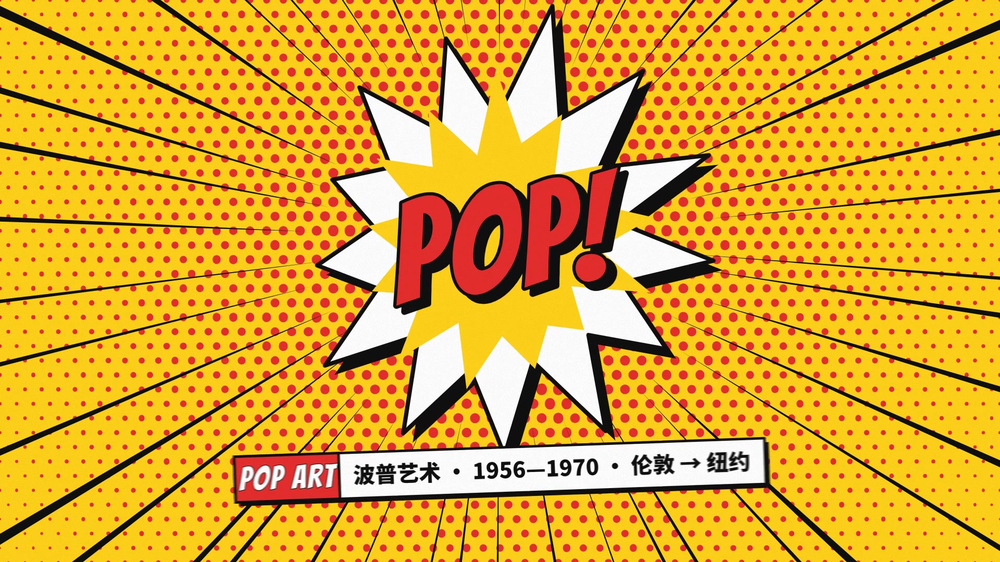
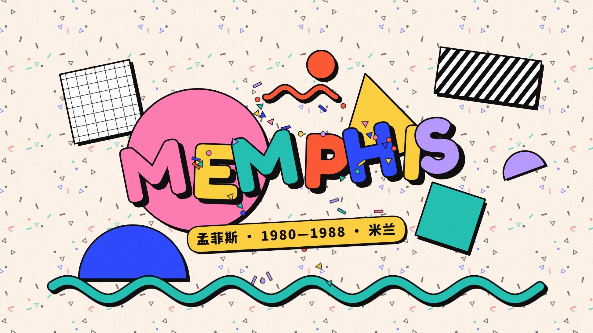
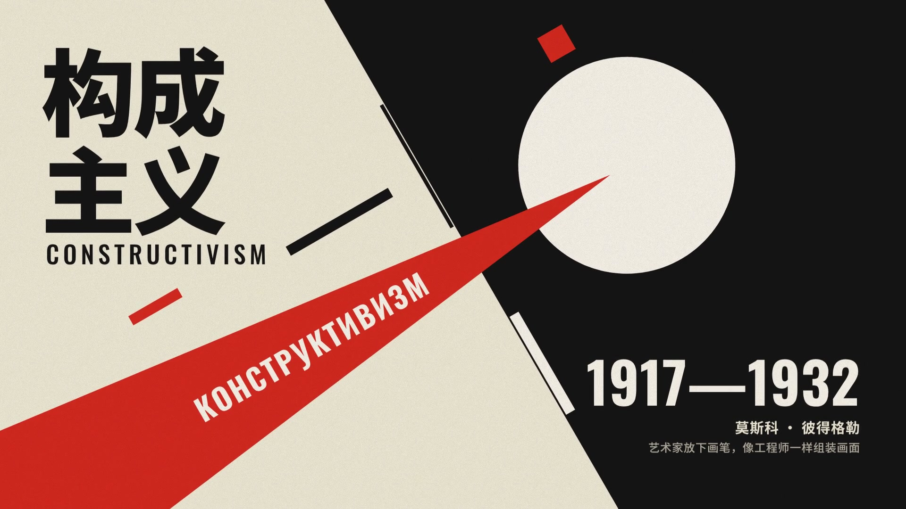
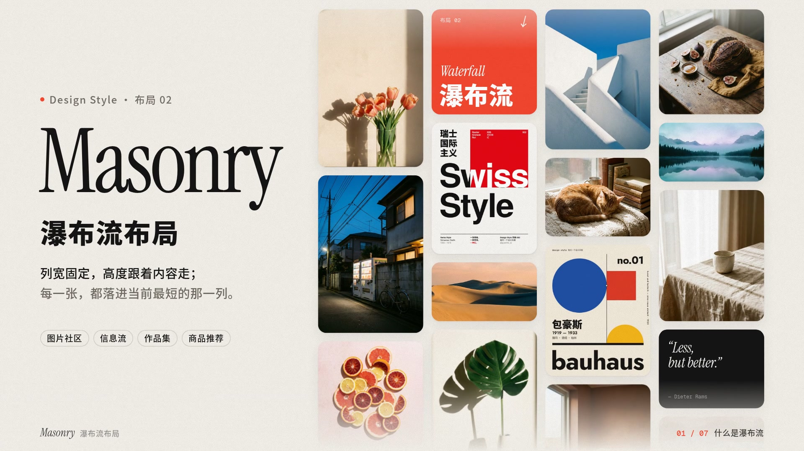
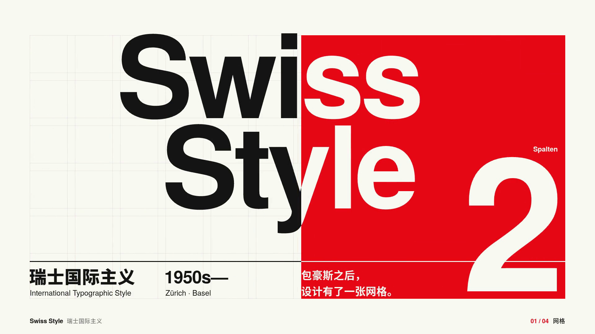
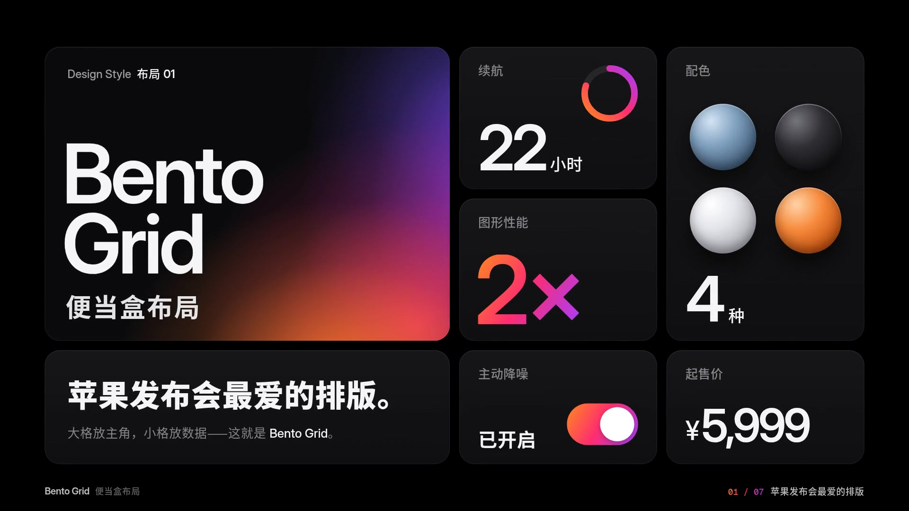
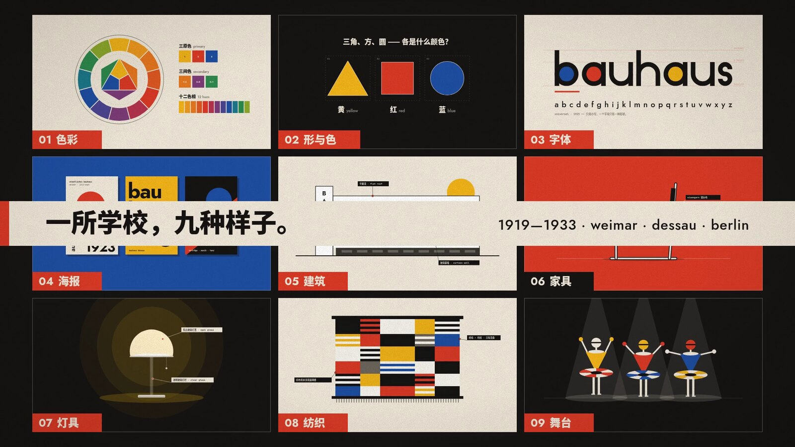

<div align="center">

[中文](README.md) · **English**

# Design Style

**Design references for humans and AI.**

Explore visual styles and layout systems through short motion films, editable diagrams, practical rules, design tokens, AI prompts, and source code.

Two series share the same gallery: **Design styles** and **Layouts**. A style defines a visual language; a layout organizes information.

By Guanmo [@guanmo_ai](https://x.com/guanmo_ai)

[**Explore the English gallery →**](https://guanmo-ai.github.io/design-style/?lang=en)

<!-- BEGIN WORK PREVIEWS -->
<!-- Generated by npm run gallery:readme from gallery/data/works.json. Do not edit this block. -->
<table>
  <tr>
    <td align="center" valign="top" width="33%">
      <a href="https://guanmo-ai.github.io/design-style/?lang=en#work-005-pop-art"></a><br />
      <a href="https://guanmo-ai.github.io/design-style/?lang=en#work-005-pop-art"><b>Pop Art</b></a><br />
      <sub>18 seconds</sub>
    </td>
    <td align="center" valign="top" width="33%">
      <a href="https://guanmo-ai.github.io/design-style/?lang=en#work-004-memphis"></a><br />
      <a href="https://guanmo-ai.github.io/design-style/?lang=en#work-004-memphis"><b>Memphis</b></a><br />
      <sub>15 seconds</sub>
    </td>
    <td align="center" valign="top" width="33%">
      <a href="https://guanmo-ai.github.io/design-style/?lang=en#work-003-constructivism"></a><br />
      <a href="https://guanmo-ai.github.io/design-style/?lang=en#work-003-constructivism"><b>Constructivism</b></a><br />
      <sub>15 seconds</sub>
    </td>
  </tr>
  <tr>
    <td align="center" valign="top" width="33%">
      <a href="https://guanmo-ai.github.io/design-style/?lang=en#work-02-masonry"></a><br />
      <a href="https://guanmo-ai.github.io/design-style/?lang=en#work-02-masonry"><b>Masonry</b></a><br />
      <sub>15 seconds</sub>
    </td>
    <td align="center" valign="top" width="33%">
      <a href="https://guanmo-ai.github.io/design-style/?lang=en#work-002-swiss-style"></a><br />
      <a href="https://guanmo-ai.github.io/design-style/?lang=en#work-002-swiss-style"><b>Swiss Style</b></a><br />
      <sub>15 seconds</sub>
    </td>
    <td align="center" valign="top" width="33%">
      <a href="https://guanmo-ai.github.io/design-style/?lang=en#work-01-bento-grid"></a><br />
      <a href="https://guanmo-ai.github.io/design-style/?lang=en#work-01-bento-grid"><b>Bento Grid</b></a><br />
      <sub>15 seconds</sub>
    </td>
  </tr>
  <tr>
    <td align="center" valign="top" width="33%">
      <a href="https://guanmo-ai.github.io/design-style/?lang=en#work-001-bauhaus"></a><br />
      <a href="https://guanmo-ai.github.io/design-style/?lang=en#work-001-bauhaus"><b>Bauhaus</b></a><br />
      <sub>15 seconds</sub>
    </td>
  </tr>
</table>
<!-- END WORK PREVIEWS -->

</div>

## What each episode includes

| Resource | What you get |
|---|---|
| Motion film | A 15–18 second film at 1920 × 1080, 60 fps, built with Remotion. Music and sound effects are synthesized in Python. Download finished films from [Releases](https://github.com/guanmo-ai/design-style/releases). |
| Four visual references | Editable 1080 × 1350 SVGs: poster, quick reference, applications, and a pattern, comparison, or tutorial. Preview SVGs embed font subsets. |
| Design guide | Practical rules, project palette, typography, pitfalls, and an AI prompt. Each episode has an English quick guide and a detailed Chinese guide. |
| Making of | An English production overview, plus the detailed Chinese production log with revisions, contact sheets, and timing charts. |
| Design tokens | Shared colors, type, geometry, and motion values in `tokens.ts`, `tokens.css`, and `tokens.json`. |
| Source code | Animation, music synthesis, diagrams, and build scripts. |

The gallery interface, descriptions, search, and reading pages support **Chinese and English**. Use the `中文 / EN` control; explicit `?lang=en` or `?lang=zh` links take precedence over saved preferences and browser language. **Existing videos and artwork retain their original Chinese labels.**

## Episodes

### Design styles

| No. | English guide | Making of | Period |
|---|---|---|---|
| 001 | [Bauhaus](styles/001-bauhaus/README.en.md) | [Production overview](styles/001-bauhaus/PROCESS.en.md) | 1919–1933 |
| 002 | [Swiss Style](styles/002-swiss-style/README.en.md) | [Production overview](styles/002-swiss-style/PROCESS.en.md) | 1950–1970 |
| 003 | [Constructivism](styles/003-constructivism/README.en.md) | [Production overview](styles/003-constructivism/PROCESS.en.md) | 1917–1932 |
| 004 | [Memphis](styles/004-memphis/README.en.md) | [Production overview](styles/004-memphis/PROCESS.en.md) | 1980–1988 |
| 005 | [Pop Art](styles/005-pop-art/README.en.md) | [Production overview](styles/005-pop-art/PROCESS.en.md) | 1956–1970 |

### Layouts

| No. | English guide | Making of | Period |
|---|---|---|---|
| 01 | [Bento Grid](layouts/01-bento-grid/README.en.md) | [Production overview](layouts/01-bento-grid/PROCESS.en.md) | 2020s– |
| 02 | [Masonry](layouts/02-masonry/README.en.md) | [Production overview](layouts/02-masonry/PROCESS.en.md) | 2009– |

## Run the gallery locally

Requirements: **Node.js 22.12+** and an authenticated [GitHub CLI](https://cli.github.com/) for downloading this repository's release videos. Gallery browsing does not require Remotion rendering dependencies.

```bash
git clone https://github.com/guanmo-ai/design-style.git
cd design-style
npm run gallery:setup
npm run gallery:sync
npm run gallery:build
npm run gallery:serve
```

Open [http://127.0.0.1:4186/?lang=en](http://127.0.0.1:4186/?lang=en). The gallery supports bilingual search, series filters, video playback, previous/next navigation, SVG previews, and on-site reading pages.

```bash
npm run gallery:test
npm run gallery:check
npm run gallery:readme
```

`gallery:sync` downloads and verifies the release videos. `gallery:readme` updates the preview tables in both project READMEs. The maintenance guide is currently [in Chinese](docs/GALLERY.md).

## Edit and render an episode

Rendering also requires **Python 3.10+**, **ffmpeg**, and Git.

```bash
npm ci
npm run fonts
pip install numpy fonttools
npm run studio

# Example: render Bauhaus and rebuild its images
npm run render:001
npx playwright install chromium
npm run images:001
```

Episode suffixes are `001`–`005`, `L01`, and `L02`; for example, `npm run render:L02` renders Masonry. Output goes into `out/`. The root `npm ci` applies the browser ZIP extraction security patch. If installation uses `--ignore-scripts`, run `npm run postinstall` before rendering or running the security tests.

```bash
npm test
npx tsc --noEmit
```

## Repository structure

```text
src/                      Remotion entry and shared animation helpers
styles/NNN-name/          Design styles
layouts/NN-name/          Layout systems
  README.en.md            English quick guide
  PROCESS.en.md           English production overview
  README.md / PROCESS.md  Detailed Chinese guide and production log
  tokens.*                Shared design tokens
  video/                  Animation source and cover
  audio/                  Music synthesis
  images/                 Editable SVGs and shareable previews
  process/                Storyboards and timing data
gallery/                  Static gallery, bilingual UI, and catalog
scripts/                  Build, rendering, image, and validation tools
public/                   Fonts and generated audio
```

## Sharing and attribution

Code is shared for learning and adaptation. When sharing videos or artwork, credit **Guanmo / @guanmo_ai**.

Fonts retain their own licenses. Jost, JetBrains Mono, Inter, Geist Mono, Selawik, Instrument Serif, Noto Sans SC, Oswald, Fredoka, and Bangers use the SIL Open Font License; TeX Gyre Heros uses the GUST Font License. The gallery's adapted visual foundations have separate [license](gallery/LICENSE) and [attribution](gallery/NOTICE.md) files.
