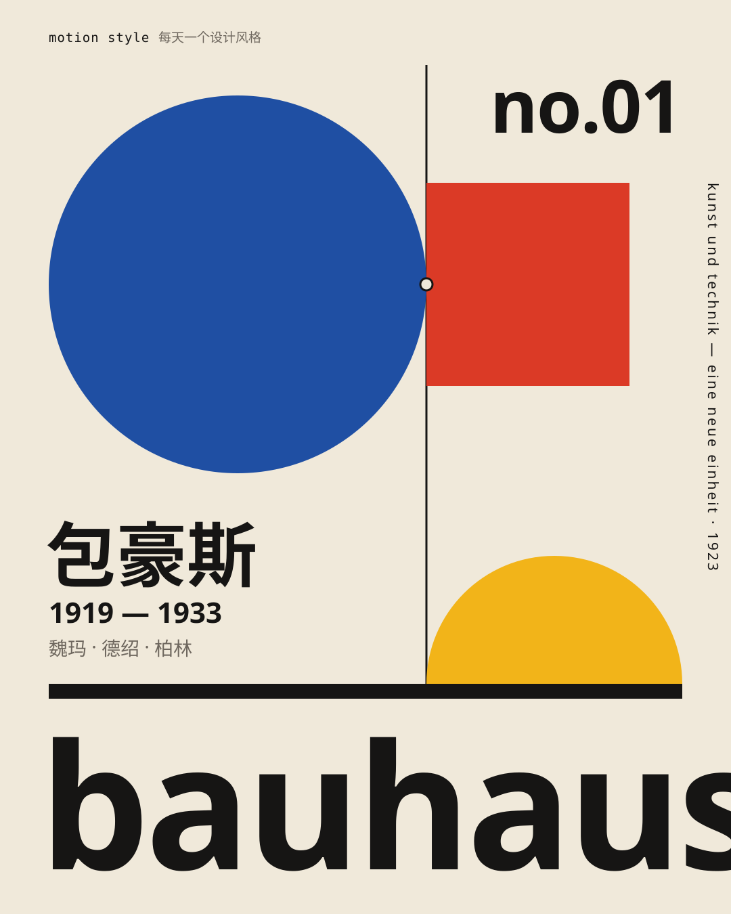

<div align="center">



# 每天一个设计风格 · Motion Style

**每天拆解一个设计风格：一支 15 秒动效短片 + 一组风格图 + 全部源码。**
设计师拿去就能用，普通人看完就能认出来。

by 观默 [@guanmo_ai](https://x.com/guanmo_ai)

</div>

---

## 每一期都有什么

| | 内容 | 规格 | 源码 |
|---|---|---|---|
| 🎬 | **15 秒动效短片** | 1920×1080 · 60fps · 配乐与音效全部由代码合成 | `video/*.tsx`（[Remotion](https://www.remotion.dev)）· `audio/make_music.py` |
| 🖼 | **4 张风格图** | 1080×1350（X / 小红书竖图比例） | `images/*.svg`，手写 SVG，可直接改 |
| 📐 | **风格指南** | 历史 · 规则 · 色板 · 字体 · 版式 · 常见误区 · AI 提示词 | `README.md` |
| 🎨 | **设计令牌** | 同一份颜色 / 字体 / 线宽，视频、图片、网页共用 | `tokens.ts` · `tokens.css` · `tokens.json` |

> `images/preview/` 里的 SVG 已内嵌字体子集，在 GitHub 上点开就是最终效果。

## 目录

| 期 | 风格 | 年代 | 一句话 | |
|:-:|---|---|---|---|
| **001** | [**包豪斯 Bauhaus**](styles/001-bauhaus) | 1919—1933 | 圆、方、三角 + 红黄蓝，把“好看”变成可以教的规则 | ✅ |
| 002 | 瑞士国际主义 Swiss Style | 1950s— | 网格、无衬线、客观 | 明天见 → |

计划中（顺序可能调整）：构成主义 · 装饰艺术 Art Deco · 孟菲斯 Memphis · 新粗野主义网页 Neo-Brutalism · Y2K · 日式极简 …… 想看哪个，来 X 上告诉我。

## 本地运行

需要 Node 18+、Python 3.10+、ffmpeg。

```bash
git clone https://github.com/guanmo-ai/motion-style.git && cd motion-style
npm install
npm run fonts                  # 下载开源字体到 public/fonts（Jost / JetBrains Mono / Noto Sans SC）
pip install numpy fonttools

npm run studio                 # 在浏览器里逐帧预览、改参数
npm run render:001             # 生成配乐 → 渲染 out/001-bauhaus.mp4
npx playwright install chromium
npm run images:001             # 生成图案 → 内嵌字体的 preview SVG + 2x PNG
```

## 目录结构

```
motion-style/
├─ src/                    # Remotion 入口，每期注册一个 Composition：S001-Bauhaus …
│  └─ lib/                 # 通用动画工具（缓动 / 弹簧 / 关键帧轨道）与胶片颗粒
├─ styles/
│  └─ 001-bauhaus/
│     ├─ README.md         # 风格指南
│     ├─ tokens.{ts,css,json}
│     ├─ video/Bauhaus.tsx # 15 秒短片（6 个段落，全部参数化）
│     ├─ audio/make_music.py
│     └─ images/           # poster / cheatsheet / app-ui / pattern(.py)
│        └─ preview/       # 内嵌字体、可直接分享的 SVG
├─ scripts/                # 字体下载、SVG → PNG
└─ public/                 # 字体与生成的音频（不入库）
```

## 统一规格

- **时长** 15 秒 = 900 帧 @ 60fps；配乐 120 BPM，1 拍 = 30 帧，所有转场都落在拍点上
- **结构** 钩子（0–1.5s）→ 认识它 → 拆解规则 → 现场搭一张作品 → 它在今天的哪里 → 片尾
- **风格图** 海报 · 速查卡 · 今天的应用 · 图案/纹理，四张一组
- **字体** 只用可免费商用的开源字体（SIL OFL）

## 授权

代码欢迎学习和改造；转发视频和图片请注明出处 **观默 @guanmo_ai**。
字体 Jost、JetBrains Mono、Noto Sans SC 均为 SIL Open Font License 1.1。
