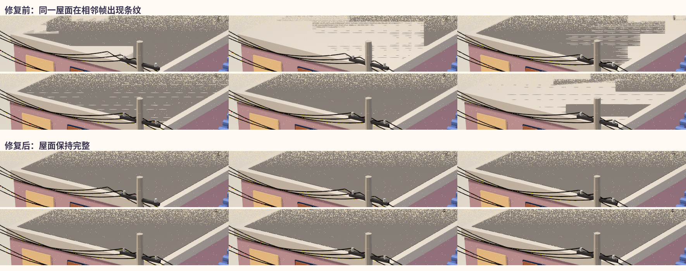

# 018 线上屋顶闪烁修复与发布前审查 · 2026-10-30

用户指出线上影片咖啡店屋面持续闪烁，并明确要求对抗式审查通过后直接发布。上一轮只验证了发布字节与入口，未识别、修复该视觉缺陷。本轮从线上文件复现并修复来源几何。

## 定位证据

- 线上 MP4 下载后 SHA-256 为 `1ab674051cf56ad2c7f85780da2a131daa829b3e142278c0a819287f44b93c29`，与 `day-18` 成片一致；缺陷已经存在于影片像素中。
- `scenes/street.js`：奶油色屋顶从 6.5 到 7.0，灰色屋面从 6.9 到 7.0。两个顶面完全共面，随镜头发生深度争夺（z-fighting）。修复将灰色层上移 0.02，保持形状、色板和时间轴。
- 同一段电线的高度列表重复了 `[8.7, 0]` 与 `[8.7, -0.0]`，形成 1,152 个重合三角面。去掉重复项，保留上下两排原有独立电线。
- 在相同 Metal 后端、相同 81—86 帧进行修复前后渲染。固定屋面区域 `x=860..1009,y=165..199` 的相邻帧 RGB 平均绝对变化由 42.60 降至 0.92；大于 20 灰阶的像素比例由 47.39% 降至 1.30%。这是该局部样本的验证，不是全片质量分数。

## Standards · 规范轴

基准为 `56003335760e4145adcb14569be2c16ec9c5ebf6`；检查 `git diff 56003335760e4145adcb14569be2c16ec9c5ebf6`。适用规则为当前用户 AGENTS 指令与本次修复目标。

结论：未发现阻塞项。可见几何只涉及屋面间距和重复电线；既有动画、光照、后期与音乐创作代码未改。渲染器增加 `ANGLE_BACKEND=metal` 的可选入口，默认仍为 SwiftShader；新入口只是 Chromium 参数，不执行 shell。Three.js 固定在原有 0.170.0，锁文件的完整性值与 npm 官方 registry 一致。回归测试读取实际生成几何，分别在旧代码失败、新代码通过。

画廊视频 URL 以已有 SHA-256 添加版本查询，文件路径不变。经测试，同名文件换哈希会请求不同 URL，原有风格与布局导航、下载、阅读、路径校验测试通过。未发现本次差异引入的无关抽象或文档规范违例。

## Spec · 需求轴

结论：发布前实现与成片没有未解决阻塞项。修复直接消除了线上已复现的屋面条纹；没有以关掉深度测试、遮住场景或降低画幅代替修复。保持 1920×1080、30fps、600 帧、20 秒，原 AAC 音轨直接复用，前后解码 PCM 的 SHA-256 完全相同：`27e09ebfa7a26458740bee449d4c2850b935712b548bf3af76ba73273f10d02c`。

完整 600 帧使用四个 Metal 渲染进程输出，事件表一致，日志无页面异常；编码后全片解码通过，未检出整帧黑屏，按秒联系表已检查。006 等其他未完成作品和 019 的待确认状态不属于本次发布。

## 验证与交付边界

- 屋面间距、电线重复面两项几何测试：旧版两项失败，修复后两项通过。
- 同名视频缓存回归：旧版失败，带哈希 URL 后通过；24 项画廊测试通过。
- 根目录 42 项现有及缓存回归测试通过；另有 2 项几何测试通过。TypeScript 检查、脚本语法检查与差异检查通过。
- 新成片 SHA-256：`e424c9cef2b86d90b53d1669f4f73cc0dd03308bc66075af60339f6bed1bca18`，44,602,322 字节。
- 发布采用 `day-18-flicker-v2`，原 `day-18` 保留回退；修复完成不等于发布完成，Release、目录与 Pages 需在发布后分别核验。

## Release 发布记录

[day-18-flicker-v2](https://github.com/guanmo-ai/design-style/releases/tag/day-18-flicker-v2) 于 `2026-10-30T08:29:40Z` 发布，[发布工作流](https://github.com/guanmo-ai/design-style/actions/runs/41026696048) 成功。源码提交为 `7f862dc35405b4f08253aa4cbaced1395e89b651`，完整 ZIP 含 799 个文件，清单与提交一致、CRC 完整。

GitHub API 返回的成片 digest 为 `e424c9cef2b86d90b53d1669f4f73cc0dd03308bc66075af60339f6bed1bca18`，源码 ZIP digest 为 `b9293149327224dca5b8d5dced28d44c10bf772e2ac7c070c030b644defd71de`，与本地一致。目录切换为该 Release 和真实发布时间，保持作品 ID 与上架号；原 `day-18` 未改动。

Pages 部署与线上实际加载视频需以本次目录更新提交对应的工作流及浏览器核验为准。019 仍须等待主人确认。
