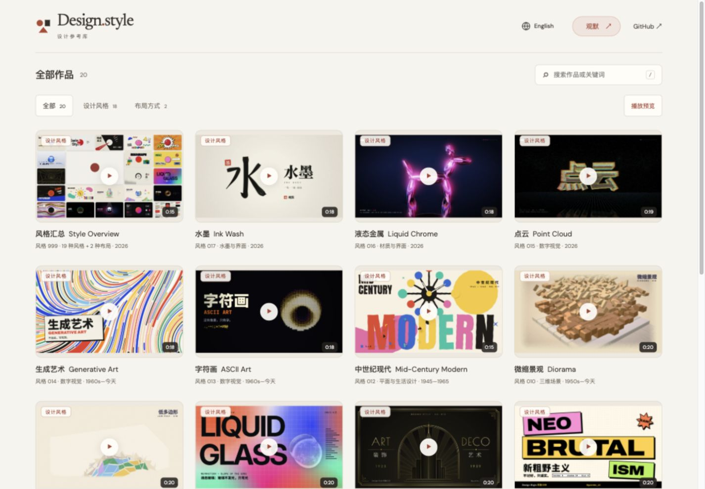

# 风格 999：风格汇总

按用户要求移除首页顶部独立宣传片区，把原片作为普通「风格 999」卡片加入设计风格列表。标题为「风格汇总」，标注「19 种风格 + 2 种布局」，详情列出全部名称。原有卡片尺寸、预览、搜索、筛选和前后导航适用于这条汇总。

视频、封面和源码继续使用 `promo/`，无需新增 Release；999 为汇总保留编号，常规风格仍连续编号。中英文 README 的生成预览同步加入该卡片。

验证结果：

- `npm run gallery:test`：26 项通过。
- `npm run gallery:build`：20 个视频构建通过。
- `npm run gallery:check`：245 个文件、2570 个站内引用和媒体哈希校验通过。
- 内置独立浏览器确认首页没有顶部独立展示区，桌面首行四张卡片宽度均为 302px；窄屏下使用同一单列卡片布局。
- 点击汇总播放，读取到时长 15 秒、播放进度 8.38 秒、`paused: false`、`readyState: 4`，无媒体错误。英文详情列出全部内容，切换至下一部水墨后恢复普通作品的指南、过程和四张图解。

桌面预览：

## 上线前对抗式审查

基线：`db5aea21678a577ed6526554f746e8aaefb917d2`，审查本次工作区中汇总卡片相关差异；需求来自本次对话：按普通风格卡片展示、编号 999、明确汇总范围、移除顶部独立区域，并在审查后上线。

### 规范

发现并修正 1 处文档矛盾：原「添加下一期」仍声称所有目录条目都必须来自 Release、所有期号都必须连续，与新增的仓库视频及 999 保留编号不符。现明确区分常规作品与汇总 999。未发现其他阻塞交付的规范问题。

### 需求与实际行为

发现并修复 1 个上线阻塞问题：新 `gallery.mjs` 引入 `isOverview`，旧缓存 `model.mjs` 不导出该符号；混用时模块链接阶段抛出 `SyntaxError`，整个画廊无法加载。已用旧模块与新入口组合复现。

修复：构建按所有脚本、样式的内容计算统一 SHA-256 版本，并同时更新页面引用与模块内部依赖。发布检查验证这些链接的版本一致；故意移除模块依赖的版本号时，检查按预期拒绝发布，恢复后完整发布包通过。其余需求已由目录测试及浏览器检查确认。

两轴分别发现 1 处问题，均已修复；当前无已知上线阻塞项。用户已明确授权审查后上线。
