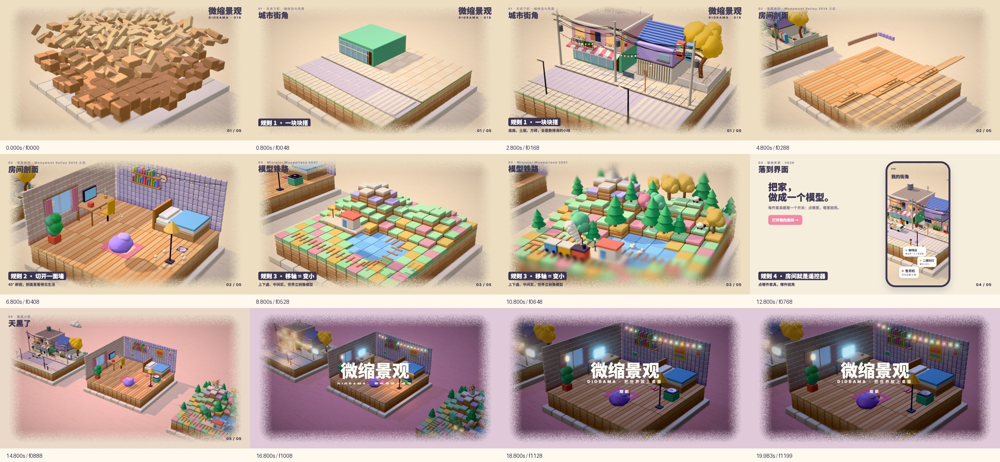
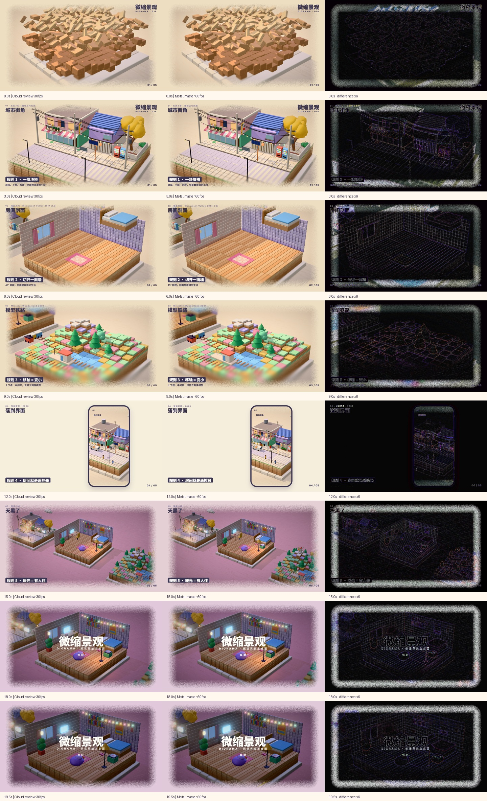

# 018 微缩景观第三版 · 60fps 渲染与发布记录 · 2026-11-02

## 当前状态

用户明确要求按 `docs/HANDOFF.md` 渲染 60fps 正片并发布 `day-18-v3`。渲染、合成、本地验证与云端第三版审片文件同秒对照已完成。`day-18-v3` 已发布，三项附件 digest / 大小已核验，画廊已切换到 60fps 第三版，Pages 部署与线上播放核验完成。

## 设计与渲染来源

- 设计来源为 `1606f5c9d10a1f46e67cba1daea1b5aff9f51e46`（`claude/diorama-audio-style-polish-cppqt4`）。本次不修改设计、动画、渲染器或配乐代码。
- 使用独立工作区，保留主工作区既有未提交修改与创作文件。
- 通过锁文件安装 Three.js 0.170.0，复用本机 Playwright；字体使用项目声明的 Noto Sans SC 与 Inter。冒烟发现本机缺少 `Inter.ttf`，从项目字体脚本声明的 Google Fonts 来源补齐后重新渲染。新字体仅位于独立工作区。
- Chromium 实测后端：`ANGLE (Apple, ANGLE Metal Renderer: Apple M5, Unspecified Version)`。
- `PR=1`、1920×1080、60fps，四个进程分段生成 0—1199 帧；四份 `events.json` 完全一致，日志无页面异常。
- 使用原 `audio/make_music.py` 和原事件表生成配乐，WAV 为 48kHz 立体声、20 秒，脚本报告 −15.00 LUFS。
- 按交接参数合成 H.264 / CRF 16 / yuv420p + AAC 256k；无插帧、无调速。

## 成片与检查

- `018-diorama.mp4`：59,232,690 字节，1920×1080、60fps、1200 帧、20 秒，H.264 + AAC、48kHz 立体声。
- SHA-256：`7cf8d42d075c04f7a4f4d397bcb17126d61b240d34fe2f75ab7b29e710a6af73`。
- FFmpeg 完整解码 1200 帧通过，未检出黑屏段；AAC 解码响度 −15.3 LUFS、真峰值 −1.1 dBTP。
- 已查看全片 12 张静帧联系表与第 0 帧原尺寸图，封面来自新版第 0 帧；`video/cover.jpg` 与 `video3d/cover.jpg` 字节一致。
- 内置独立浏览器实际播放至 20 秒结束，1920×1080、20 秒，无媒体错误；英文切换保留影片，英文指南显示 60fps / 1200 帧 / 风格 010。
- 两项屋面深度与重复电线几何回归通过。根目录 42 项 Node 测试通过（画廊 24、安全 8、动效 10）。
- 新媒体本地画廊构建与发布检查通过：13 期、183 个文件、1988 个站内引用、441.6 MiB。初次使用符号链接缓存被发布检查拒绝，换成普通文件后通过，未修改发布检查规则。

## 30fps 对照与边界

先在本机下载目录定位到 `018-diorama-v3-review.mp4`，随后按用户补充信息从 `review-renders` 提交 `430b92a` 直接核对新增的 `018/018-diorama-v3-30fps-review.mp4`，两者字节哈希相同。规格 1920×1080 / 30fps / 600 帧 / 20 秒，53,628,520 字节，SHA-256 `f0538e2a501a28a4a9c9c74d6b2144af13ba6fb0e05d012554c893fca6ff6c20`。首版 `018-diorama-master.mp4` 保留，未用作第三版参考。

抽取云端审片文件的 0、3、6、9、12、15、18、19.5 秒，与 Metal 60fps 对应帧比较，未见场景、镜头、字幕或结尾时序偏移。8 帧 RGB 平均绝对差为 1.9995—12.4719 / 255，可见差异主要集中在纸屑边缘、颗粒和阴影，不是像素一致。另以同一设计代码在本机生成 SwiftShader 30fps 样帧，确认同类差异会出现在 Metal / SwiftShader 后端对照中；原事件表完全一致。这是 8 个时间点的视觉抽样，不是逐帧视觉接受证明，未据此修改设计代码。

云端 `018-diorama-v3-music.wav` 与本机原脚本生成的 WAV 的 SHA-256 完全相同：`28559bb34798a6a6c7d906d9631aafe9fb6894ee6368f469d136360cd7ec1ae5`；117 条零件事件表也字节相同：`bc0593703f077d1ae495a181b09648e0255f6c014128ffb3b0fa83500357a016`。

两版 AAC 解码后均为 1,920,000 个 int16 样本（48kHz × 20 秒 × 双声道），相关度 0.99989944；均方根差 −54.84 dBFS，整体 RMS 分别 −17.871 与 −17.872 dBFS。说明音轨没有重排或调速；AAC 重新编码后并非字节相同。

原始帧、事件表、渲染与编码日志、FFprobe、完整解码日志、后端差异指标和联系表保存在本工作区 `out/day-18-v3/`，不进入公开源码包。

## 发布准备

- tokens 的 motion / video 同步为 60fps / 1200 帧，时间轴分段与文字帧号换算为 60fps，章节秒数保持 0、4.2、7.8、11.2、14.2、16.4。
- 目录切到 `day-18-v3` 与新成片 SHA-256，保留「风格 010」，说明改为第三版缓推房间的结尾；实际发布时间使用 Release API 的真实时间。
- 中英文根目录、本期指南与制作过程使用新 Release 链接，渲染复现命令对齐 60fps；旧 `day-18-flicker-v2` 保留回退。
- 完整源码 ZIP 已核验：804 个文件与源码提交清单完全一致，ZIP CRC 完整；发布分片还原后的 SHA-256 与完整包一致。
- Release 与附件校验完成，交接中的 018 渲染发布项已关闭；015 待审项保留。

## Release 发布记录

- [day-18-v3](https://github.com/guanmo-ai/design-style/releases/tag/day-18-v3) 于 `2026-11-02T11:27:28Z` 发布（洛杉矶 `2026-11-02 03:27:28 PST`）。
- [发布分支提交](https://github.com/guanmo-ai/design-style/commit/636cde7f1a02cd9d2715928a125c0f0456b269a1)，[发布工作流](https://github.com/guanmo-ai/design-style/actions/runs/41436829752) 成功。
- Release tag 指向完整源码提交 `2f0624afd5beaef72657a6125b5cae526863493e`。源码包由 `git archive` 导出，共 804 个文件；不含生成帧、WAV、下载字体、依赖目录或主工作区未提交创作。

| 附件 | 字节数 | SHA-256 |
|---|---:|---|
| `018-diorama-source.zip` | 146794703 | `94199ab35647446a344f5f865babb4d6e1f025f74b6c9591bb027ef54d894a56` |
| `018-diorama.mp4` | 59232690 | `7cf8d42d075c04f7a4f4d397bcb17126d61b240d34fe2f75ab7b29e710a6af73` |
| `SHA256SUMS` | 171 | `6b3e4194e937f2d5e4513e4554219fb77d81dffe47ed21150a198fd8b53aa1b5` |

三项 GitHub Release API digest 与大小均与本地交付文件一致；旧 `day-18-flicker-v2` 保留回退。

## 画廊上线核验

- 画廊提交 `8b9f149841776e49b91841ec13dfdbe1a4e8e577` 的 [Pages 工作流](https://github.com/guanmo-ai/design-style/actions/runs/41437222410) 与 [安全检查](https://github.com/guanmo-ai/design-style/actions/runs/41437222336) 均成功。
- 线上 `data/works.json` 返回 `day-18-v3`、风格 010、60fps、20 秒，发布时间为 `2026-11-02T11:27:28Z`，视频哈希与 Release 一致；中英文指南、制作过程四个页面均 HTTP 200 并包含新版入口。
- 内置独立浏览器打开线上详情，显示「风格 010」且位于 13 部作品的第一条；实际加载带新版 SHA-256 的视频 URL，1920×1080、20 秒，播放推进到 1.54 秒，无媒体错误。英文切换仍为同一影片。此为播放与入口验证，不代表新的人工艺术接受。
- 主工作区未提交创作保留，其 `git status --porcelain=v1` 与本次执行前逐字节一致；工作在独立工作区和 `codex/release-diorama-v3` 分支完成，未切换原主工作区。
