# 待做风格（草稿）

选题时做过、本期没选上的风格。三张风格图（海报 / 速查卡 / App 概念）已经做完，可以直接接着做成一期。

正式开做时：

1. 取下一个空期号，把目录移到 `styles/NNN-name/`（例如 `git mv drafts/op-art styles/014-op-art`）
2. 把图里的 `NO. 009` / `风格 009` 改成新期号，重跑 `python3 styles/NNN-name/images/make_svgs.py && python3 scripts/build_images.py styles/NNN-name/images`
3. 补第四张图、tokens、视频、配乐与文档（流程同 [MAKING_TEMPLATE](../docs/MAKING_TEMPLATE.md)）

字体已在 `scripts/build_images.py` 登记；Poiret One、Noto Serif SC 已随 013 装饰艺术加进 `scripts/fetch_fonts.sh`，Limelight、Monoton 开做时再加。

> 装饰艺术已做成 [013 · 装饰艺术](../styles/013-art-deco)；同批候选液态玻璃已做成 [014 · 液态玻璃](../styles/014-liquid-glass)。
>
> 未来主义已做成 [015 · 未来主义](../styles/015-futurism)。
>
> 抖动像素的图里写的是 `NO. 014`，开做时按上面第 2 步改成新期号。

---

## 排期（主人 2026-10-29 定）

| 风格 | 状态 |
|---|---|
| 字符画 ASCII Art · `ascii/` | **主人已审片通过（2026-11-04）**：正式目录 [020 · 字符画](../styles/020-ascii-art)，保留本目录作为原片来源。 |
| 生成艺术 Generative Art · `generative/` | **主人已审片通过（2026-11-04）**：正式目录 [021 · 生成艺术](../styles/021-generative-art)，保留本目录作为原片来源。 |
| 动态字体 Kinetic Type · `kinetic-type/` | 第五轮没选上，图留着 |
| 中世纪现代 Mid-Century Modern · `mid-century/` | **下周做** |
| 液态金属 Liquid Chrome · `liquid-chrome/` | **第三版已出（2026-11-06），等主人审片**：[`liquid-chrome/film/liquid-chrome-film.mp4`](liquid-chrome/film/liquid-chrome-film.mp4)（18 秒 · 1080p60 · 18 MB）。第一版主人：“画面可以但枯燥”→ 第二版照标杆骨架重做，每章一件镜面雕塑 → 第三版（“少了音效”“地板不好看，往影视大片的方向搞”）：棋盘格换成黑色湿石材舞台 + 顶光光柱和灰尘，每次出字都解码 + 配“嗒”声、规则卡砸字 |
| 点云 Point Cloud · `point-cloud/` | **第四版已出（2026-11-06），等主人审片**：[`point-cloud/film/point-cloud-film.mp4`](point-cloud/film/point-cloud-film.mp4)（19.5 秒 · 1080p60 · 41 MB）。第一版“枯燥、BGM 一般”→ 第二版照标杆骨架重做（主人：“好一些了”）→ 第三版标题做成立体扫描线招牌、人头换成斯坦福兔子 → 第四版（“文字少了音效”“扫描面前后变化太突然”）：每次出字都解码 + 配“嗒”声、规则卡砸字，规则卡一张 45 帧、镜头滑过去 |
| 热成像 Thermal · `thermal/` | **下一期就做**（主人 2026-11-06：“热成像记一下，下次就把它做下来”），图和温度场代码都在，直接复用 |
| 第七轮候选：治愈系手绘 / 卡通渲染 / 潮玩 · `hand-painted/` `toon-shading/` `designer-toy/` | **第二版图已出（2026-11-08），等主人看**，见下 |
| 第四轮候选：低多边形 / 体素 / 等距微缩（从参考视频提取） | 等主人选，见下 |
| 第三轮候选：赛博朋克 / 城市流行 / 膨胀风 | 等主人选（与第四轮一起看） |
| 第二轮候选：风格派 / 图形统计 / 无限画布 | 主人觉得一般（太像设计史教科书），图留着 |
| 欧普艺术、抖动像素 | 之前没选上，实在没得选再考虑 |
| 迷幻海报 Psychedelic · `psychedelic/` | **放到最后做** |
| ~~拟物 Skeuomorphism~~ | **不做**（图已删） |

主人偏好（选题参考）：**要年轻人喜欢、正在被追捧的风格**，别太像设计史教科书。最喜欢的是 005 波普、004 孟菲斯、003 构成主义、布局 02 瀑布流、布局 01 便当盒、001 包豪斯——**平涂、几何、大色块、有真实代表作的 20 世纪运动**，以及**对做界面直接有用的布局**。

## 第七轮候选：年轻人喜欢的三种“像”（2026-11-07，三个都做，未占期号）

主人：要“大家喜欢的、在推特上能出爆款的”，真的对设计师有帮助，动效顶尖；先列 10 个文字再挑。第一批 10 个（镭射全息 / 赛璐璐作画 / 黏土定格 / 焦散 / 示波器 / 流体 / 剪纸立体书 / 贴纸 / 故障 / LED 点阵）主人觉得“被局限了”，要动画风格、年轻人喜欢的；第二批 10 个里定下 **吉卜力那一路 + 三渲二 + 潮玩盲盒**，三个都做，每个两张。

**名字（主人 2026-11-07 定）**：风格名叫画法，代表作写在片子里——和“波普艺术 / 沃霍尔”一个道理。

- **治愈系手绘 Hand-Painted Anime**：副标题、推文可以直说“吉卜力式的天空、草浪和光”。
- **卡通渲染 Toon Shading**：行业正式叫法（三渲二），设计师能直接搜到教程和插件。
- **潮玩 Designer Toy**：盲盒不进名字，做成片子里最上头的那个动作（撕开 → 弹出 → 定一拍）。

**关于“吉卜力”（主人问开源会不会惹祸）**：画风本身不受版权保护，受保护的是角色、具体画面和商标。守几条就行——
不画他们的角色、不复刻名场面、不用 logo / 截图 / 字体，配乐不用久石让的旋律；**AI 提示词不写 “in the style of Studio Ghibli”**，只写具体画法；画面里写一行“致敬吉卜力工作室的手绘背景传统 · 非官方，与吉卜力工作室无关”；不商用。潮玩同理：角色和包装全部原创，不出现泡泡玛特 / Labubu。卡通渲染的年代线里提到的游戏名只作历史出处。

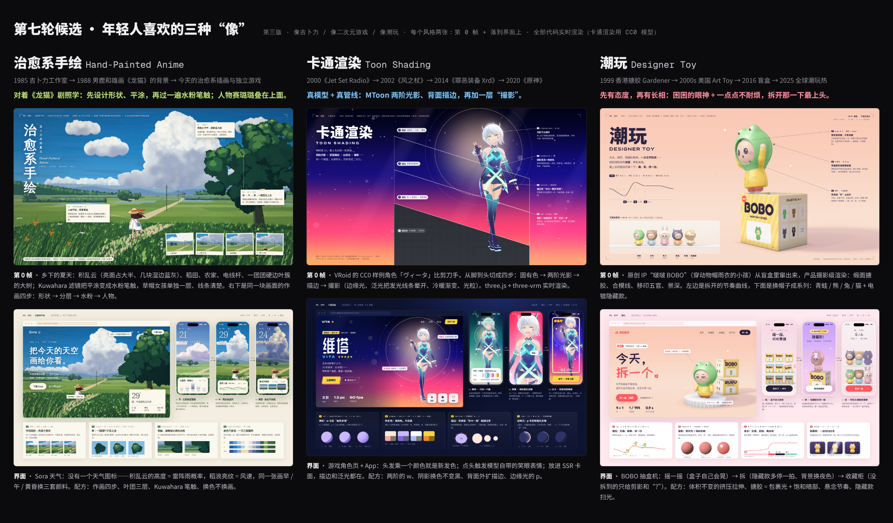

| | 治愈系手绘 Hand-Painted Anime · `hand-painted/` | 卡通渲染 Toon Shading · `toon-shading/` | 潮玩 Designer Toy · `designer-toy/` |
|---|---|---|---|
| 年代 | 1985 吉卜力工作室 → 1988 男鹿和雄画《龙猫》的背景 → 今天的治愈系插画与独立游戏 | 2000《Jet Set Radio》→ 2002《风之杖》→ 2014《罪恶装备 Xrd》→ 2020《原神》 | 1999 香港搪胶 Gardener → 2000s 美国 Art Toy → 2016 盲盒 → 2025 全球潮玩热 |
| 一句话 | 天空一笔一笔刷，云一团一团鼓，风吹过草坡翻出亮面 | 明明是 3D，看上去却是手画的：两阶光影 + 一圈描边 + 画上去的五官 | 大头、小身子、哑光软胶——最上头的是拆开那一下 |
| 第 0 帧 · 独有动作 | 夏天的山坡：积云 = 一堆圆的高度场、按法线分三四个色阶；草坡上一道道风的亮带；树影里的光斑全是椭圆（太阳的小孔成像）；戴草帽的女孩按着帽子 | 原创 Q 版角色“星野”被斜条切成五步，从脚到头：灰模 → 法线 → 两阶光影 → + 描边 → + 边缘光 / 天使环 / 脸部阴影；左边 3D 视口，右边动画天空 | 原创角色“小菇”从盲盒里跳出来，洋葱皮残影标 −8 帧压扁 / −4 帧拉长 / 现在定一拍；盒子侧面印全系列 + 隐藏款剪影；左下同一只四种材质（搪胶 / 植绒 / 果冻 / 电镀） |
| 网页 / App | Sora 天气：把预报画成会动的画——云高 = 降雨概率，亮带速度 = 风速；同一张画早 / 午 / 黄昏 / 夜四套颜料 | 游戏角色页 + App：只改两色换发色；点头换表情（换贴图，模型不动）；SSR 卡面 | MOGU 抽盒机：摇一摇（盒子会晃）→ 拆（隐藏款多停一拍）→ 收藏柜（缺的只给剪影） |
| 对设计师有用 | 积云 = 圆的并集 + 色阶、风 = sin(x·k − ωt)、光斑扁度 = 1/sin(太阳高度)、换色不换画 | lit = smoothstep(t ± w)、阴影换色不变黑（H −15° / S +20% / V −25%）、背面外扩描边、脸部阈值图、天使环 | squash & stretch（sx = 1/√sy）、搪胶 = wrap 0.4 + 暗部 base²、悬念节奏（0.6 s → 0.18 s → 停 0.25 s）、隐藏款扫光 |
| 技术路线 | CPU 用圆堆高度场 + 山脊线，GPU 按法线分色阶 + 笔触噪声 + 风带 + 光斑；前景草叶 / 花瓣 / 女孩用 Canvas 2D（`hand-painted/paint.js`） | WebGL2 光线步进写 4 张缓冲（成片 / 法线+深度 / 灰模 / 两阶），第二遍按斜条拼阶段、从深度和法线跳变里找描边（`toon-shading/toon.js`） | WebGL2 光线步进：SDF 角色 + 盲盒（印刷面 Canvas 现画成纹理），摄影棚柔光箱环境，洋葱皮第二次步进叠上去（`designer-toy/toy.js`） |

**第一版 → 第二版（主人 2026-11-08：“吉卜力跟吉卜力风格有差距”“另外两个能用但称不上顶尖”“有点廉价，要当成全球最顶尖的设计师做的”）：**

- **治愈系手绘**：先查了男鹿和雄的画法——Nicker 广告色（水粉）、纸先打湿再上天空、先大块后细节、最后点“色点”暗示叶子，“不描绘，只暗示”；人物是平涂赛璐璐，叠在厚涂背景上。第一版是“圆 + 色阶”的矢量感，所以渲染器整个重写（`paint.js`）：① 底色着色器铺大色块（积乱云湿边、稻田透视、水渠、远山空气透视）② 实例化笔触，每一笔是一个笔刷印子，方向跟着形体走、颜色取自底色再抖一点 ③ 四层笔从大到小 ④ 色点。树荫按树冠一团团真实投影，光斑因此是横的椭圆。构图换成乡下的夏天：积乱云 + 稻田 + 土路 + 电线杆 + 大树 + 戴草帽的女孩（`scene.js`、`girl.js`）。封面左下放同一张画的“作画四步”。
- **卡通渲染**：角色重做（渐变长双马尾、星星眼 + 虎牙、夹克 + 百褶裙 + 过膝袜 + 厚底鞋），头发用“大形”法线算明暗，不再一簇一块脏影；加上动画成片“贵”的那一步——**撮影**（扩散光、渐变叠色、轻微色差、光粒）；背景换成游戏立绘式的黄昏光环。封面从脚到头四条斜带：灰模 → 两阶 → 描边 → 撮影。
- **潮玩**：IP 重做成“啵啵 BOBO”——穿动物帽雨衣的小孩，困困的半睁眼 + 一颗小牙（先有态度，再有长相）；同一个身体换帽子成系列（青蛙 / 熊 / 兔 / 猫 + 电镀隐藏款）。渲染做到产品摄影：缎面搪胶（糊的反射 + 小高光）、帽子侧面的合模线、移印五官、景深。封面放拆开的节奏曲线和系列货架，去掉了洋葱皮残影。

生成方式：`node drafts/_lib/shot-gl.cjs drafts/<风格>/cover.html /tmp/x.png 1920 1080 2`（`ui.html` 同理），4K 截完缩到 1080p 存进 `png/`；对比图 `node drafts/_lib/shot.cjs drafts/candidates-7.html drafts/candidates-7.png 1960 1138`。新用到的字体（站酷快乐体、马善政毛笔楷书、Fraunces）已加进 `scripts/fetch_fonts.sh`。

## 第六轮：液态金属 + 点云全片（2026-11-06）

主人看了三张对比图：“这一次效果都不错”“是不是以前被仓库限制住了”。定下来：**液态金属和点云同时做，热成像下一期做**；代码要复用；第一目标动效顶尖，第二目标对设计师有用，仓库的规则只作参考。

两部都是 18 秒、1080p60、一整首歌，直接做全片（不再先出开头小样）。都沿用了标杆的骨架（第 0 帧重击、签名物理、元素接力、固定外框、首尾呼应、画面上标参数），但画面全部是实时 GPU 渲染：

- **液态金属** `liquid-chrome/film/`：同一滩水银接力到底——字从水银里站起来（带拉丝）→ 化成四颗珠两两合上（smin 的“颈”）→ 形状不动、世界在转 → 拉成柱断成五颗（瑞利–普拉托）→ 倒进手机变成会长刺的语音助手 → 落回水银、字再站起来。
- **点云** `point-cloud/film/`：从头到尾同一批 100 万个点——一个点炸开拼成立体标题 → 扎进去散成星（近大远小）→ 倒进楼梯井，扫描面往下走、镜头螺旋下潜 → 卷成龙卷聚成盆景 → 鼠标拨开 → 倒进扫描 App → 拼回标题。

成片：[液态金属](liquid-chrome/film/liquid-chrome-film.mp4) · [点云](point-cloud/film/point-cloud-film.mp4)。点云几十万个点每帧都在动，H.264 很难压：用两遍编码 17 Mbps 压到 36 MB，最密的几段细点会软一点；要更清楚的版本就重跑 `make.sh` 改成 crf 22（约 190 MB，不入库）。

**第一版 → 第二版（主人 2026-11-06：“点云 BGM 一般、有点枯燥”“液态金属也一样，画面可以但枯燥”）：** 第一版每章 3—5 秒、主角是抽象的珠子和点，没有作品、没有“搭”的过程。第二版照 [标杆](../docs/BENCHMARKS.md) 的骨架重做：每章 3 拍一件真实代表作、按十六分音符搭起来、五条规则一拍一张、首尾呼应，两首配乐重写。分镜见各自的 `film/STORYBOARD.md`。

工具：`_lib/film-gl.cjs`（WebGL 页面逐帧截图，断了能接着渲）、`_lib/contact.py`（抽帧联系表）。GPU 做片子的经验见 [`docs/GPU_MOTION.md`](../docs/GPU_MOTION.md)。

## 第六轮候选：三种“光”（2026-11-06，动效优先、视觉拉满，三选一，未占期号）

主人：别被仓库影响，自己发挥；**动效顶尖第一，视觉拉满第二，然后才是风格**，要对专业设计师有启发；先出图，每个两张。这一轮不再从 20 世纪运动里挑，而是挑三种“光”的视觉语言——**反射的光、扫描的光、看不见的光**。三个都是“动起来才成立”的材质 / 媒介风格，图全部用 WebGL 实时渲染（光线步进、几百万个点、温度场模拟），没有一张贴图或素材照片。每个两张：第 0 帧 + 落到网页和手机 App（手机三屏 = 一个交互的三拍，底部四张动效配方卡）。

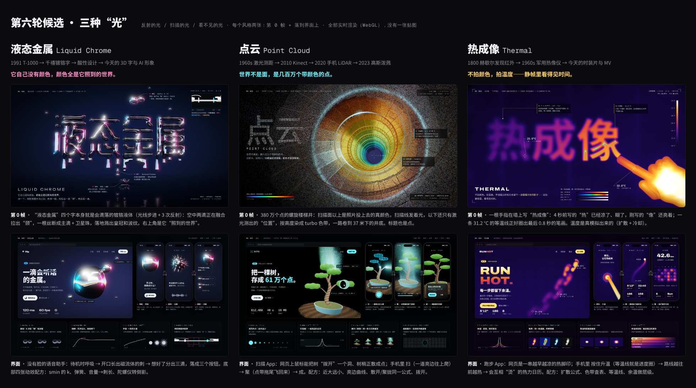

| | 液态金属 Liquid Chrome · `liquid-chrome/` | 点云 Point Cloud · `point-cloud/` | 热成像 Thermal · `thermal/` |
|---|---|---|---|
| 年代 | 1991《终结者 2》T-1000 → 千禧镀铬字 → 酸性设计 → 今天的 3D 字与 AI 形象 | 1960s 激光测距 → 2010 Kinect → 2020 手机 LiDAR → 2023 高斯泼溅 | 1800 赫歇尔发现红外 → 1960s 军用热像仪 → 今天的时装片与 MV |
| 一句话 | 它自己没有颜色，颜色全是它照到的世界 | 世界不是面，是几百万个带颜色的点 | 不拍颜色，拍温度——静帧里看得见时间 |
| 第 0 帧 · 独有动作 | “液态金属”四个字是会滴落的镀铬液体：空中两滴正融合出“颈”，一根丝断成主滴 + 卫星珠，落地溅出皇冠和波纹；右上角是它照到的环境图 | 380 万个点的螺旋楼梯井：扫描面以上是真颜色，扫描线发光，以下只剩激光测出的位置、按高度染成 turbo 色带，卷到 37 米井底；标题也由点组成 | 手指在墙上写“热成像”：4 秒前的“热”已凉、已糊，刚写的“像”还亮着；31.2 °C 等温线正好圈出最后 0.8 秒的笔画（扩散 + 冷却是真算的） |
| 网页 / App | 没有脸的语音助手：呼吸 → 开口长出磁流体的刺 → 分出三滴，落成三个按钮 | 扫描 App：网页上鼠标能把树拨开一个洞；手机里 扫 → 聚（点带拖尾飞回来）→ 成 | 跑步 App：越早越凉的热脚印；按住升温（等温线就是进度圈）→ 越往前越热的路线 → 会互相“烫”的日历 |
| 对设计师有用 | smin 的 k 决定颈多粗、弹簧落位、音量 → 刺长、陀螺仪转环境图 | size = w·f/z、扫描亮边曲线、散开 / 聚拢同一公式、视线平面里的“拨开” | 扩散 + 冷却公式、色带查表（同一温度四种情绪）、等温线当进度、余温做层级 |
| 技术路线 | WebGL2 光线步进：文字距离场挤出成“鼓起来”的字 + smin 液滴，3 次镜面反射，手写摄影棚环境（`liquid-chrome/chrome.js`） | WebGL2 `gl.POINTS`：不透明点走深度测试 + 加法发光层，按距离算点径和景深（`point-cloud/pc.js`） | CPU 上模拟温度场（写字 = 加热，之后扩散 + 牛顿冷却），GPU 双三次放大 + 色带查表 + 等温线（`thermal/thermal.js`） |

生成方式：`node drafts/_lib/shot-gl.cjs drafts/<风格>/cover.html drafts/<风格>/png/cover.png 1920 1080 2`（`ui.html` 同理；脚本会等页面渲染完再截，4K 出图后缩到 1080p 入库）。共用的小工具在 `_lib/glkit.js`（着色器、浮点缓冲、分块绘制、泛光 + ACES）。新用到的字体（站酷庆科黄油体、Geist / Geist Mono 可变字重）已加进 `scripts/fetch_fonts.sh`。

## 第五轮：全片 18 秒（2026-11-04）

主人看第三版开头：“勉强过关”“继续做完”，动效还不算顶尖，所以要把手机 / 网页上怎么用讲清楚。两期都在开头 10 秒后面接上：06 五条规则（一拍一张卡，每张自己演示自己）→ 07 用在手机上（一部手机五个界面 = 五个可以直接用的动效配方）→ 片尾回到开场的构图 + 署名“观默”。配乐是同一首歌接着走到 18 秒，收在主和弦。每期一个签名动作：字符画“先乱码，再落定”，生成艺术“从一个点长出来”。分镜见各自的 `film/STORYBOARD.md`；出片 `bash film/make.sh`（1080 帧，云端约 3 分钟）。

## 第五轮：开头小样第三版——一整首歌 + 拍点上的接力 + 固定外框（2026-11-04）

主人看第二版：“BGM 都不连贯，这是最大的问题”；“分镜之间突然就硬切过去”；“比我以前的那些有差距”。对照 `docs/BENCHMARKS.md` 改：配乐用 `_lib/song.py` 写成一整首歌（换章只换和弦和一句旋律）；换章的速度峰值落在拍点上；加上标杆都有的左上章节外框和右上进度；每章换成一件真实代表作（字符画：donut.c → 《黑客帝国》数字雨 → FIGlet → 手机 → PSX DOOM 火焰；生成艺术：Fidenza → Schotter → Truchet → 网页 / 手机 → L 系统）。分镜见各自的 `film/STORYBOARD.md`。

## 第五轮：开头小样第二版——每 1.5 秒换一个主角（2026-11-04）

主人看第一版：“动来动去都是这些东西，没有新东西进来，也没有旧的东西出去”；生成艺术“好像都是一些带子”。要创新、要有网页和手机、要有带子以外的东西，目标是推特爆款。

第二版两期都改成 10 秒、五段，每段换一种主角和动作，换场用接力（上一个散开 / 收回 / 缩小，变成下一个），网页和手机直接放进开头：

- **字符画**：转动的甜甜圈（donut.c）→ 炸开成字雨拼出网页 → 点按钮、进度条 → 每个字飞去手机 → 心形封面跳动的播放器 → 心脏放大着火（DOOM 火焰）→ 火烧进 ASCII 大字 → 风吹散 → 片尾。
- **生成艺术**：流场色带 → 圆堆积 → 缩成点吸到网格 → 特鲁谢瓷砖一波波翻 → 缩进手机钱包的卡片 + 网页生成器拖滑块 → 界面掉落时树长出来、开花 → 片尾。
- 配乐修了一个 bug：段落起点不在拍点上时，鼓和贝斯会整段不响（第一版手机段的心跳就没有响）。现在所有段落都吸到全片的节拍网格上。

## 第五轮：字符画 + 生成艺术，开头 8 秒动效小样（2026-11-04，已被第二版替换）

主人：生成艺术和字符画都做；**动效顶尖优先**，一定要对设计师有帮助，BGM 和音效要做好。按“先验开头，再做全片”，两期各先出开头 8 秒（1080p · 60fps · 120 BPM，带配乐和音效），分镜和全片计划见各自的 `film/STORYBOARD.md`。

- **字符画** `ascii/film/ascii-sample.mp4`：扫描线解码 → 灯灭 → 光绕回来、探针在字符阶梯上一格格爬（每换一个字一个音）→ 字号按拍变细 → 锁定一个 `@` 钻进去，笔画撑满屏幕，里面是一颗新的星球 → 标题解码。
- **生成艺术** `generative/film/generative-sample.mp4`：色带一起长（每条出生一个木琴音，音高 = 画面高度）→ 方向场箭头翻出来、红点顺着风走 → 推近看一条色带撞停 → 按粗细分三批长回来 → 换种子倒带、新的一张炸开 → 标题卡。
- 工具：`_lib/film.cjs`（逐帧截图，3 页并行）、`_lib/events.cjs`（导出动作时间给配乐）、`_lib/stills.cjs` / `_lib/still.cjs`（联系表 / 单帧）。每期 `film/make.sh` 一条命令出片；云端 480 帧约 1—2 分钟。

## 第五轮候选（2026-11-04，动效优先、冲爆款，三选一，未占期号）

主人：视觉顶尖、对设计师有用、**动效最顶尖是最关键的**，要做爆款。这一轮专挑“动起来才成立”的风格：三个风格的本体都是运动（字在翻、字在撑、线在长），静帧只是其中一帧。每个两张图：第 0 帧 + 落到网页和手机 App。

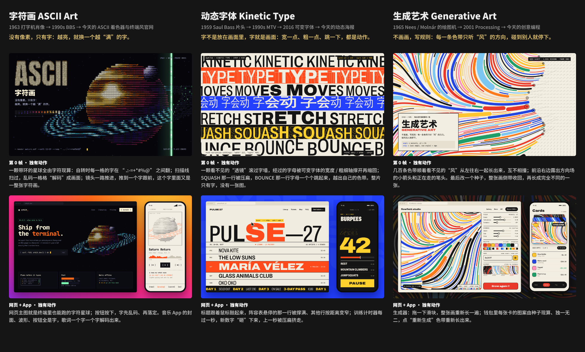

| | 字符画 ASCII Art · `ascii/` | 动态字体 Kinetic Type · `kinetic-type/` | 生成艺术 Generative Art · `generative/` |
|---|---|---|---|
| 年代 | 1963 打字机肖像 → 1990s BBS → 今天的 ASCII 着色器 | 1959 Saul Bass 片头 → MTV → 2016 可变字体 → 今天 | 1965 Nees / Molnár 绘图机 → 2001 Processing → 今天 |
| 一句话 | 没有像素，只有字：越亮，就换一个越“满”的字 | 字就是画面：宽一点、粗一点、跳一下，都是动作 | 不画画，写规则：色带只听“风”的方向，碰到别人就停 |
| 第 0 帧 · 独有动作 | 带环星球全由字符现算，自转时每格的字跟着翻；扫描线把乱码一格格“解码”成画面；推到一个字跟前，字里又是一整张字符画 | 看不见的“透镜”滚过字墙，经过的字母被 wdth / wght 轴撑开再缩回；SQUASH 被压扁、BOUNCE 一个个跳出色带 | 几百条色带从左往右一起长出来、互不相撞，前沿露出方向场和笔头；改一个种子，整张画倒带再长成另一张 |
| 网页 / App | 终端 AI 助手官网 + 纸白音乐播放器（封面、波形、按钮全是字） | 音乐节官网（标题跟鼠标鼓起、阵容悬停撑满）+ 训练计时器（数字每秒砸下来） | 流场生成器（滑块 + 种子 + 历史）+ 钱包（每张卡的图案由种子现算） |
| 对设计师有用 | 字符阶梯、亮度 → 字的映射、解码动效 | 可变字体轴的取值、`font-variation-settings`、距离衰减公式 | 流场公式、防碰撞、加权色板、种子 = 可复现 |
| 为什么会火 | X 上这两年最火的视觉之一；“全是字”本身就让人停下来放大看 | 设计师最爱收藏的动效类型，参数直接能抄 | 颜色最炸、截图就好看；“每次运行都不一样”可以让观众自己换种子 |
| 技术路线 | Canvas 2D 解析求交（`ascii/ascii.js`），纯 CPU，云端可渲 | HTML + 可变字体 Archivo（wdth 62—125 / wght 100—900） | Canvas 2D 流场 + 占用网格（`generative/gen.js`），纯 CPU |

生成方式：`node drafts/_lib/shot.cjs drafts/<风格>/cover.html drafts/<风格>/png/cover.png`（`ui.html` 同理）；对比图 `python3 drafts/_lib/compare5.py && node drafts/_lib/shot.cjs drafts/candidates-5.html drafts/candidates-5.png 1960 1180`。用到的字体（Archivo、JetBrains Mono、Anton、Space Grotesk、Noto Sans SC）都已在 `scripts/fetch_fonts.sh` 里。

## 街角小样：地面拆开、一块块铺（2026-10-29）

主人：两个方向都要；街角的地面不要“僵在那”，要拆成很多元素，一块块组成现在的样子。
- 新增 `_3d/base_build.js`（由 `gen_anim.py` 换进场景）：底板落下 → 四层土各切四块从左推进来 → 切面上的小石子“啵”出来 → 后面 72 块 2×2 方砖从左后角波浪落下 → 人行道 144 块方砖翻着一排排落下 → 柏油 12 条从左往右刷开、路缘石拉出 → 中线一段段弹出、斑马线一条条翻下来。约 1.3 秒拼完，房子等零件整体往后挪 1.3 秒，全片 6.5 秒（195 帧）。
- 镜头起始拉远一点（看得到整块模型），全程推近。
- 底座拼装时关掉 GTAO（大平板在掠射角下会出方形空洞），房子长出来时再淡入。
- 声音：土块推到位、方砖翻落、斑马线一条一个音往上走，都跟着动作。

## 小样换色（2026-10-29）

主人：动效可以，但颜色不好看，要温馨一点，参考 @EianLu 的“成都平原 / 玉林路”小动画和 004 孟菲斯。提取的配色做法：
- **奶油纸底**（`#F6EEDD`）+ 一层很淡的纸纹；画面边缘不是硬边，而是**碎成纸屑点**（圆角矩形距离 + 噪声阈值）。
- **粉彩田块**：芥末黄 `#F4C54F`、绿 `#4DAF72`、薄荷 `#A9DDB4`、樱花粉 `#F49DB6`、薰衣草 `#C9A6EC`、天蓝 `#7DB8E8`；一块田整块同色，上面叠一层细条纹当田垄。山用长春花蓝，不再用宝蓝。
- **暗面往暖紫里混**（`#7A5C86`），不往黑里压，所以不发灰。
- 街角：粉、薰衣草、薄荷的房子，银杏黄的树；黄昏到入夜改成薰衣草到蜜桃粉的暮色，不再用深蓝夜。

## 5 秒动效小样（2026-10-29）

主人：静帧“不好不坏、不惊艳”，要顶尖的动效。改成先定动作、再出 5 秒小样。主人选了两个方向：

- **低多边形 · 折纸搭建**（`samples/origami/`）：纯 2D 平涂（奶油纸 + 红黄蓝绿），用 `_lib/poly3d.py` 逐帧算。纸面上的三角形一块块“翻牌”（原地跳起转一圈，前半圈是纸、转回来是颜色，过冲约 5%）拼成山、田、湖；树在拍点上一簇簇冒出来；枕木在火车前方一根根落下；蒸汽团最后铺满画面，回到第 0 帧的纸，循环。`python3 frames.py <目录>` → `node ../render_svgs.cjs <目录>` → `python3 audio.py x.wav`，150 帧约 40 秒。
- **微缩景观 · 街角**（`samples/diorama/`，场景 `_3d/diorama_anim.html` 由 `_3d/gen_anim.py` 从静帧场景生成，时间轴在 `_3d/anim_timeline.js`）：店面和民居从地里升起，二层、屋顶从天上落下压一下，电线杆长出来、电线拉过去，售货机落下、樱花冒出来，小卡车落到路上；然后白天 → 黄昏 → 入夜，窗户一盏盏亮、路灯亮、卡车亮着灯开走。three.js 软件渲染约 8 秒一帧，150 帧约 20 分钟（`node _3d/anim_shoot.cjs`）。

两段都是 120 BPM，一拍 15 帧，大动作落在拍点上；声音用 Python 标准库合成，每个动作一个声音，时间直接取自动画脚本。

## 第四轮改版：低多边形 + 微缩景观，做细、换成亮色（2026-10-29）

主人反馈：低多边形和微缩景观方向不错，但①不够精细；②颜色（黄昏紫、夜景蓝紫）不是他喜欢的——要像参考视频和波普 / 孟菲斯 / 包豪斯那样**明亮、干净、饱和的玩具色**。不一定非要真 3D，2D 做细也行。

| 低多边形 · 山谷小火车 | 微缩景观 · 街角模型 |
|:-:|:-:|
| 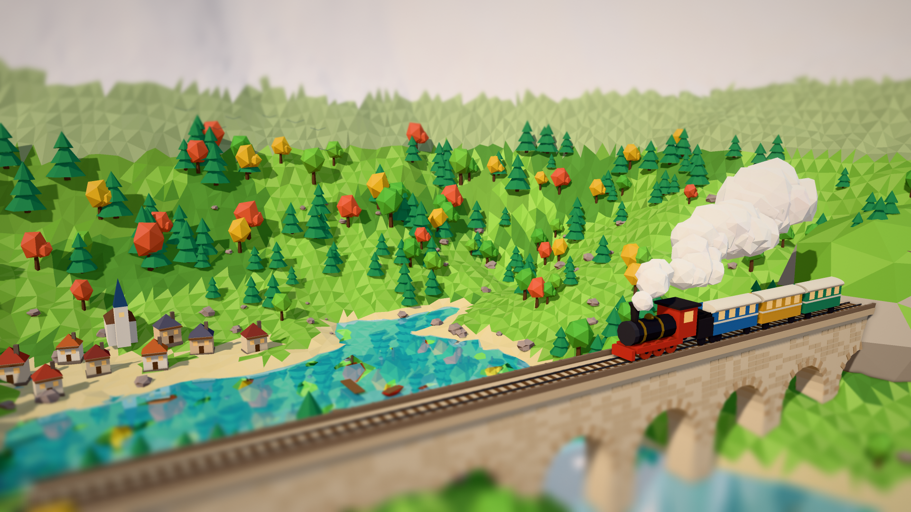 | 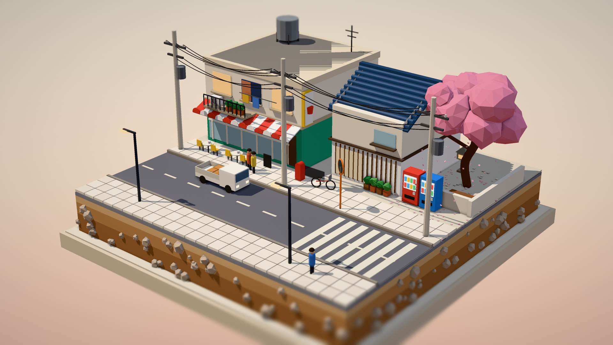 |

- 改用 three.js 渲染（`drafts/_3d/`：`valley.html`、`diorama.html`，底座 `lib.js`）：软阴影、GTAO 环境光遮蔽、移轴景深、Neutral 色调映射（不洗色）。云端软件 WebGL 一张 1920×1080（内部 2 倍）约 30 秒。
- 零件做细：石拱桥的石块和拱券石、带车轮连杆驾驶室的蒸汽机车、湖面倒影、教堂和小屋、秋色树；街角模型有切开的土层、遮阳篷、阳台晾衣、空调外机、水箱、电线杆和下垂电线、售货机、樱花和落花、小卡车、行人、猫。
- 用法：`cd drafts/_3d && npm install && node shoot.cjs valley.html out.png`（需要 `playwright` 自带的 Chromium）。
- **做成正片时：** 每帧约 30 秒，15—20 秒 × 60fps 约 1000 帧 ≈ 8—10 小时 CPU，超过一小时，按主人要求交给 Codex 用 Mac 显卡渲（`--gl=angle`），写进 `docs/HANDOFF.md`。

## 第四轮候选（2026-10-29，从主人给的参考视频提取，三选一，未占期号）

**参考视频是什么风格：** 低多边形（Low Poly）3D + 微缩景观（Diorama）——一座漂浮在云上的小岛，热气球把房子一栋栋吊上来盖成小镇，傍晚到入夜灯一盏盏亮、孔明灯升空。特征：三角面平涂、玩具般的饱和色、柔和的环境光、“小世界”的微缩感、昼夜换光。原视频是有人让 AI 从零写代码渲染的 3D 短片（不用模板、不加字），“AI 竟然能做出这个”本身就是传播点。

我们不照搬它（不做漂浮岛、热气球、小镇），只提取风格，再找两个相近的方向。三张图都用自己写的三角面渲染器 `drafts/_lib/poly3d.py` 现算：每个面算一次朝向打光、加雾，再按远近画成 SVG——纯 CPU，不用 WebGL，云端就能渲正片。

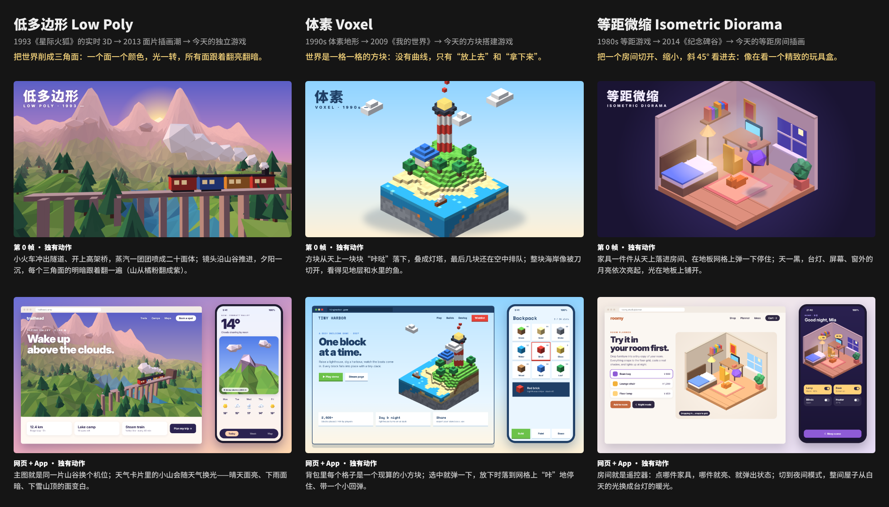

| | 低多边形 Low Poly · `low-poly/` | 体素 Voxel · `voxel/` | 等距微缩 Isometric Diorama · `iso-room/` |
|---|---|---|---|
| 一句话 | 把世界削成三角面：一个面一个颜色，光一转所有面跟着翻亮翻暗 | 世界是一格一格的方块：只有“放上去”和“拿下来” | 把一个房间切开、缩小，斜 45° 看进去，像精致的玩具盒 |
| 镜头 | 透视，沿山谷推进 | 正交等距，绕着方块转 | 正交等距，固定机位、换光 |
| 第 0 帧 · 独有动作 | 小火车冲出隧道开上高架桥，蒸汽喷成二十面体；夕阳一沉，每个三角面的明暗跟着翻一遍 | 方块从天上一块块“咔哒”落下叠成灯塔，最后几块还在空中排队；海岸被切开，看得见地层和鱼 | 家具一件件落进房间、在地板网格上弹一下停住；天一黑，台灯、屏幕、月亮依次亮起 |
| 网页 / App | 徒步预订 + 天气（小山随天气换光） | 方块游戏官网 + 背包（每格一个现算方块） | 家具店房间规划 + 智能家居（房间就是遥控器） |
| 可选代表作 | 《星际火狐》（1993）·《VR 战警》（1993）· 2013 年前后的低多边形插画潮 ·《纪念碑谷》（2014）·《Alto’s Adventure》（2015）| 体素地形《Comanche》（1992）·《我的世界》（2009）·《天天过马路》（2014）· MagicaVoxel（2014）·《Townscaper》（2021）| 《模拟城市 2000》（1993）·《哈宝酒店》（2000）·《纪念碑谷》（2014）· Dribbble / 小红书的等距房间插画 |

**推荐：低多边形。** 它就是参考视频的风格本体，画面最有电影感（透视镜头、夕阳、雾、蒸汽），“镜头本身在动”和“一个面一个颜色”都直接对上我们的检查表；渲染器已经能出这种画质。**体素**最讨年轻人喜欢（我的世界那一代），“方块咔哒落下”的动作最解压；**等距微缩**最治愈、最适合落到 App 界面，但三个里动作幅度最小。

## 第三轮候选（2026-10-29，年轻人正在追的风格，三选一，未占期号）

| | 赛博朋克 Cyberpunk · `cyberpunk/` | 城市流行 City Pop · `city-pop/` | 膨胀风 Inflated 3D · `inflated/` |
|---|---|---|---|
| 年代 | 1982《银翼杀手》→ 1995《攻壳机动队》→ 2077 | 1978—1988 · 東京 | 2021— |
| 一句话 | 高科技，低生活：黑夜、雨、霓虹，一切都在闪、都在出故障 | 把夏天装进唱片封面：喷枪蓝天、白房子、棕榈和泳池，永远是下午三点 | 一切都是充气的：圆鼓鼓、软乎乎，按下去会凹 |
| 气质 / 色彩 | 酷、电影感；夜黑 + 霓虹粉 `#FF2E97` 青 `#20F2FF` 酸黄 `#F4FF3A` | 慵懒、怀旧、晴朗；深蓝渐变天 `#0638B8` + 泳池青 + 落日粉橙 | 可爱、解压；奶紫底 + 糖果粉 `#FF6FAE` 紫 `#A98BFF` 薄荷 `#4FDDB8` 奶黄 `#FFD45C` |
| 运动方式 | 闪烁 + 撕裂：灯管点亮、故障错位、雨和倒影 | 慢速多层视差：车窗般横移、水花慢动作 | 充气 + 回弹：吹鼓、挤扁、弹回 |
| 第 0 帧 · 独有动作 | 霓虹灯管一根根“噼”地点亮（先闪两下再稳住），画面在重拍上被横向撕开、红青错位；雨一直下，湿地面的倒影跟着灯一起亮、被水波扯碎 | 镜头像车窗一样慢慢横移，前景棕榈快、白房子慢、云最慢；水花慢动作炸开再落下，水面高光一闪一闪；标题带着 80 年代速度条纹划进来 | 字母一个个被打气筒“噗”地吹鼓（体积过冲约 8% 再回弹抖两下），最后一个还瘪着、正在进气；被碰到就挤扁，松开弹回 |
| 网页 / App · 独有动作 | 切角面板像全息投影一行行扫出来，数字滚动跳变；按下时故障一闪；霓虹路线一路“描”过去 | 主图是一张会动的画，滚动时按视差错开；磁带卷盘一快一慢地转；落日渐变按钮一点像阳光扫过 | 按钮按下去会凹、松手“啵”地弹回；进度条像灌气一样一节节鼓起来，金币落进罐子弹两下 |
| 可选代表作 | 《银翼杀手》（1982）·《阿基拉》（1988）·《攻壳机动队》（1995）·《黑客帝国》（1999）·《赛博朋克 2077》（2020）· 九龙城寨 / 重庆夜景 · 机能风穿搭 | 山下达郎《FOR YOU》（1982，铃木英人）· 大泷咏一《A LONG VACATION》（1981，永井博）· 霍克尼《更大的水花》（1967）· 竹内玛莉亚《Plastic Love》（1984）在 YouTube 的翻红 · 今天的 lo-fi 直播封面 | 1967 Blow 充气椅 · 1970s 纽约泡泡字涂鸦 · Koons《气球狗》（1994—2000）· 微软 Fluent 3D 表情（2021）· MSCHF 大红靴（2023）· 小红书的膨胀字 |
| 技术路线 | SVG：发光滤镜、倒影 + 水波位移、横带错位 + 通道分离 | SVG：渐变 + 平涂零件（`city-pop/scene.py`：积云、棕榈、水面高光） | SVG 光照滤镜（`inflated/puff.py`）：模糊程度 = 鼓起程度，从 0 涨上去就是充气 |

**推荐：赛博朋克。** 第一帧最有电影感（霓虹、雨、倒影，正对 015 总结的“开头往电影感靠、主角要大要亮”），推特上最容易停住手指；代表作横跨电影、动画、游戏、城市、穿搭、界面，一章一个领域很好排。要守住一条：故障撕裂只在重拍上出现，不能一直抖。

**其次膨胀风。** 最“当下”、最轻松可爱，充气滤镜能直接给设计师拿走；但代表作偏新，历史纵深不如前两个。**城市流行**画面最好看、配乐最好做（80 年代日系 funk），但动作偏慢，要靠视差和水花撑住“惊艳”。

## 第二轮候选（2026-10-29，按上面的偏好再找，三选一，未占期号）

| | 风格派 De Stijl · `de-stijl/` | 图形统计 Isotype · `isotype/` | 无限画布 Infinite Canvas（布局）· `infinite-canvas/` |
|---|---|---|---|
| 年代 | 1917—1931 · 荷兰 | 1925—1934 · 维也纳 | 1963 Sketchpad → 2016 Figma → 今天 |
| 一句话 | 只用横线、竖线和红黄蓝：一刀刀切开画面，再往格子里灌颜色 | 一个图形永远代表同一个数：多了就多摆几个，绝不放大；不满一个就切掉一截 | 没有页面、没有边界：内容摆在一张无限大的平面上，靠缩放和平移去找 |
| 气质 / 色彩 | 严谨、有节奏；纸白 + 黑线 + 红 `#D52B1E` 黄 `#F4C51C` 蓝 `#1C4DA1` | 友好、讲道理；米纸 + 墨 + 砖红 `#C7372C` 钢蓝 `#2C5A8A`，颜色只表示类别 | 轻松、协作；点阵灰底 + 便签色 + 选中蓝 `#2F6BFF` + 带名字的彩色光标 |
| 运动方式 | 切割 + 灌色：直线运动、硬停顿 | 盖章 + 排队：一个个落下、堆高 | 镜头运动：推、拉、平移，语义缩放 |
| 第 0 帧 · 独有动作 | 黑线像刀一样横穿画面，把一格切成两格（切开那一下“咔”地顿住），再从切口把颜色灌满一格；字也是一根根矩形“搭”上去的。整张画面是一棵不断二分的树 | 数字往上涨，人形就一个接一个“盖章”落进虚线格，从底往上堆成柱子——两堆图形本身就是柱状图；最后不满一个的那个被竖着切掉一截 | 镜头本身是主角：一直在推近、拉远、平移；拉远时卡片收成色块只剩大标题，推近时细节一层层长出来；好几个带名字的光标同时在拖、拉、连线 |
| 网页 / App · 独有动作 | 整页就是一张网格，黑线就是布局。换页时线先切出新格子、颜色再灌进去；日历里每个事件是一格，拖动时整排格线跟着重切 | 图标像活字一样咔咔排队：去年一排淡、今年一排实，新的一格落下时整排往右让位；数据变了只增减个数，从不缩放 | 节点之间的连线跟着拖动实时弯曲；手机上双指一捏，四天行程收成四块大标题，一放开，每块里的卡片重新长出来 |
| 可选代表作 | Huszár《De Stijl》刊头（1917）· Rietveld 红蓝椅（1918）· 施罗德住宅（1924）· Van Doesburg 奥贝特咖啡馆（1928）· Mondrian《构成》（1930）·《百老汇爵士乐》（1943）· YSL 蒙德里安裙（1965）→ 今天的便当盒布局 | Neurath《社会与经济》图集（1930）· Arntz 图形符号 · 东京奥运象形图（1964）· Aicher 慕尼黑奥运（1972）· AIGA 交通标志（1974）→ 今天的图标、emoji、数据新闻 | Sutherland Sketchpad（1963）· Engelbart“演示之母”（1968）· Prezi（2009）· Figma（2016）· 白板与节点式 AI 工作流（今天） |
| 技术路线 | 纯 SVG 矩形（`de-stijl/blocks.py`：横竖矩形拼字） | 纯 SVG `<symbol>` + `<use>`（`isotype/picto.py`：图形库 + 切截） | HTML / SVG（`infinite-canvas/common.py`：光标、选框、便签） |

**推荐：风格派。** 和你最喜欢的包豪斯、构成主义同一路（平涂、几何、大色块），代表作横跨刊头字体、家具、建筑、室内、绘画、时装，一章一个领域很好排；“切一刀、灌一格”的动作前面没有用过；最后一章正好落到今天的便当盒布局和网格界面，对设计师最直接。风险是红黄蓝和 001 包豪斯撞色，靠“只有横竖、没有圆和三角”和切割动作拉开。

**其次图形统计。** 最实用（图标系统、数据可视化），封面那面“人墙”在推特上很抢眼；代表作从 1930 年的图集一路到奥运象形图和 emoji。**无限画布**适合排进布局系列，它的冲击力主要靠镜头运动，静帧封面在三个里最像界面截图。

## 第一轮候选（2026-10-29）

每个风格两张图：**第 0 帧** + **落到网页和手机 App**，图在各自的 `png/` 下。生成方式：`python3 drafts/<风格>/cover.py`（或 `ui.py`）→ `node drafts/_lib/shot.cjs <html> <png>`；对比图 `python3 drafts/_lib/compare.py`。新字体（Bagel Fat One、Anton、Righteous、Caveat、Inter）开做时补进 `scripts/fetch_fonts.sh`。

- **迷幻海报 Psychedelic（1966—1972）**：字被灌进一个形状里，直到撑满。动作：字像热蜡灌进会晃的模子，一滴拉出细颈后断开，背后色环往外流。工具 `psychedelic/warp.py`。
- **中世纪现代 Mid-Century Modern（1945—1965）**：剪刀代替尺子。动作：一秒 12 张的定格，纸边每跳重剪一遍，剪纸手把零件一块块放上去，提起时影子长而虚、按下时收紧。工具 `mid-century/cut.py`。代表作：Bass《金臂人》片头（1955）· Nelson 球钟（1949）· Eames Hang-It-All（1953）· Girard 织物（1952）· Rand ABC 标志（1962）· Case Study House #22（1960）。

---

## 欧普艺术 Op Art（1955—1970）· `op-art/`

| 海报 | 速查卡 | App 概念 |
|:-:|:-:|:-:|
| 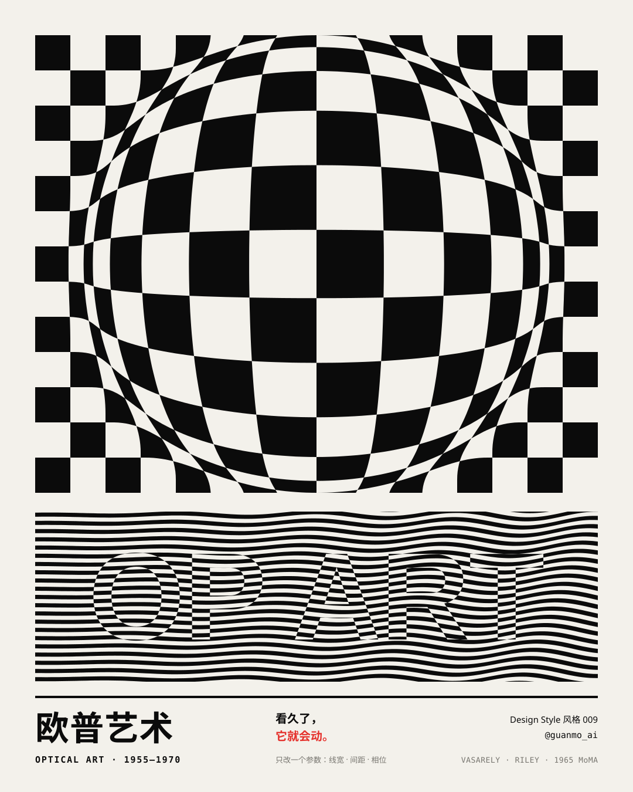 | 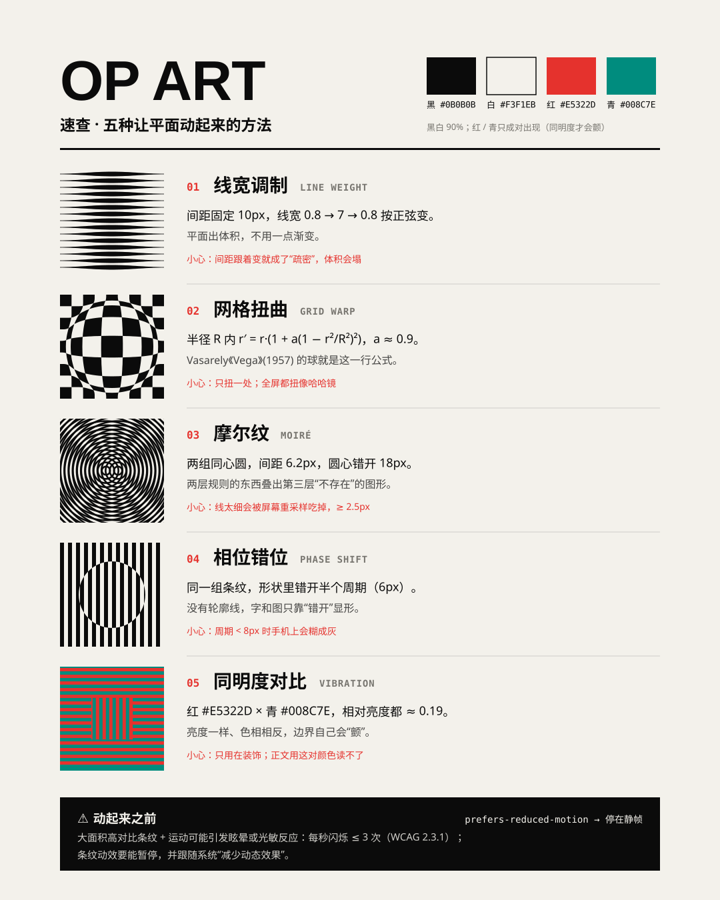 | 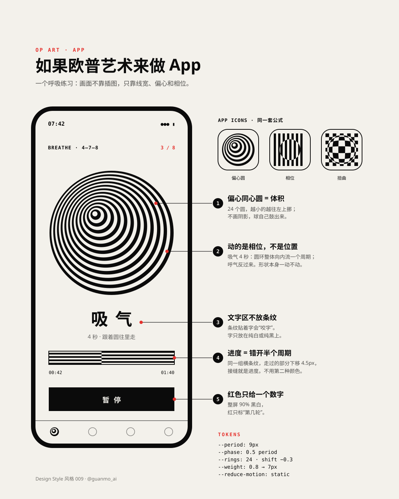 |

- **一句话：** 看久了，它就会动——只改一个参数（线宽、间距、相位），平面就鼓起来、流起来。
- **对设计师有用的地方：** 五种带参数的方法，可迁移到品牌图形、动态 logo、加载动画和图案：线宽调制 · 网格扭曲 `r′ = r·(1 + a(1 − r²/R²)²)` · 摩尔纹 · 相位错位 · 同明度对比（红 `#E5322D` × 青 `#008C7E`，相对亮度都 ≈ 0.19）。
- **色板：** 黑 `#0B0B0B` · 白 `#F3F1EB`（黑白 90%）· 红 / 青只成对出现
- **字：** Archivo 900（wdth 108—125）· Space Mono · Monoton（点缀）· Noto Sans SC
- **动效设想（15 秒）：** 白屏里条纹出现，标题靠相位错开显形 → 整片条纹像 Riley《Current》一样流动 → 平的棋盘被一个参数推成一颗球（Vega）并转动 → 两组同心圆滑过、流出摩尔纹 → 等宽线靠线宽调制转成圆柱 → 同明度红青“颤”一下收尾。全片不搬形状，只改参数。
- **安全线：** 每秒闪烁 ≤ 3 次（WCAG 2.3.1）；大面积高频条纹不要剧烈运动；提供减少动态效果的静帧版本。

---

## 1-bit 抖动像素 Dither（1984—今天）· `dither/`

| 海报 | 速查卡 | App 概念 |
|:-:|:-:|:-:|
| 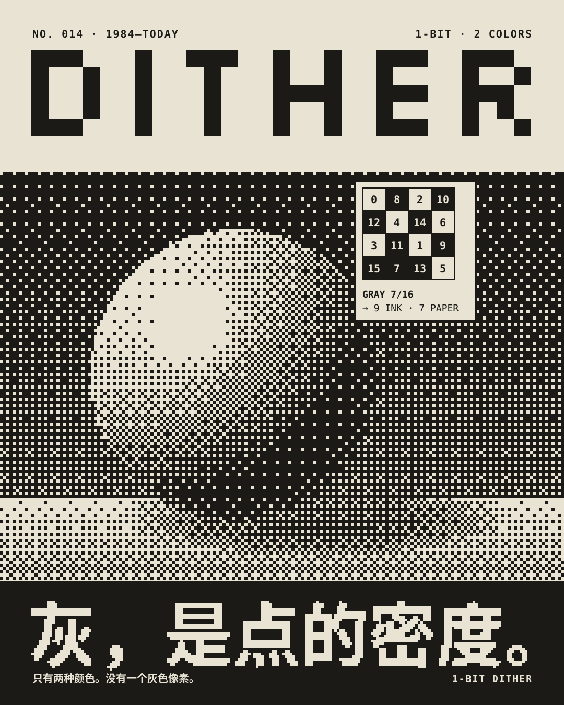 | 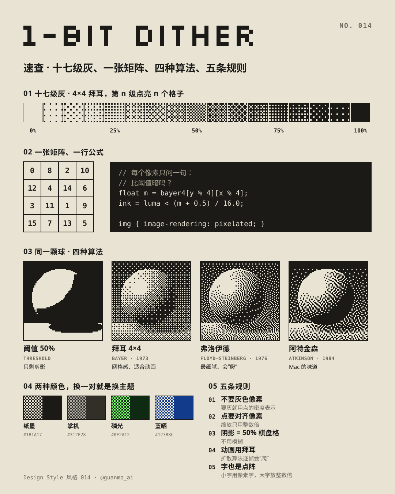 | 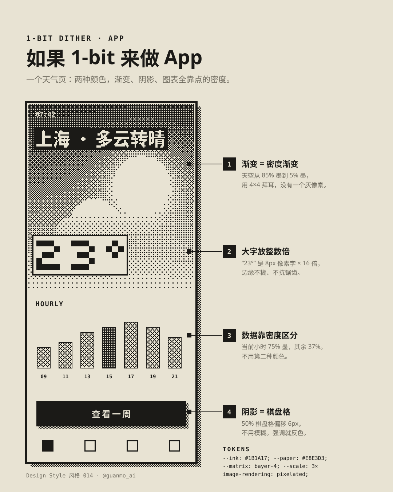 |

- **一句话：** 只有黑和白；灰，是点的密度。
- **对设计师有用的地方：** 4×4 拜耳的十七级灰（第 n 级点亮阈值 < n 的格子）、一行公式 `ink = luma < (bayer[y%4][x%4] + 0.5) / 16`、同一颗球四种算法对比（阈值 / 拜耳 1973 / Floyd–Steinberg 1976 / Atkinson 1984）、两色主题（纸墨 · 掌机 · 磷光 · 蓝晒）、阴影 = 50% 棋盘格。
- **色板：** 墨 `#1B1A17` · 纸 `#E8E3D3`（全片只有这两种）
- **字：** Silkscreen（像素标题，按 8px 原生尺寸的整数倍放大）· Space Mono · Noto Sans SC（大号中文在 `make_svgs.py` 里现场栅格化成点阵）
- **动效设想：** 一镜到底钻进一个像素：格子从 8px 长到满屏，途中亮出每格的阈值；被推近的那一格里是缩小 240 倍的整张画，推到底正好回到第 0 帧，无缝循环。光绕球转一圈，点阵一直在“爬”。所有渐显都用拜耳溶解，不用半透明。
