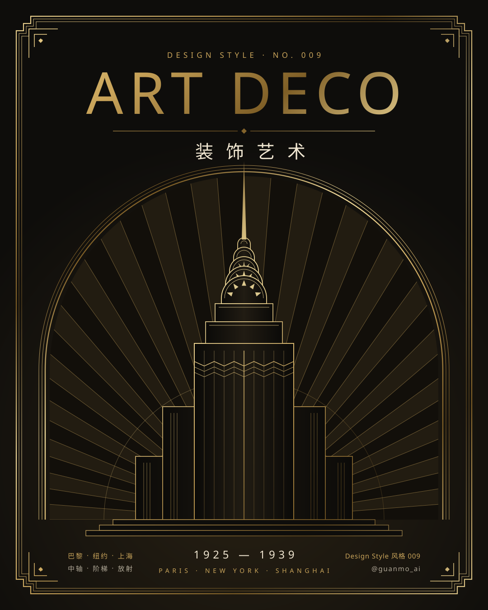
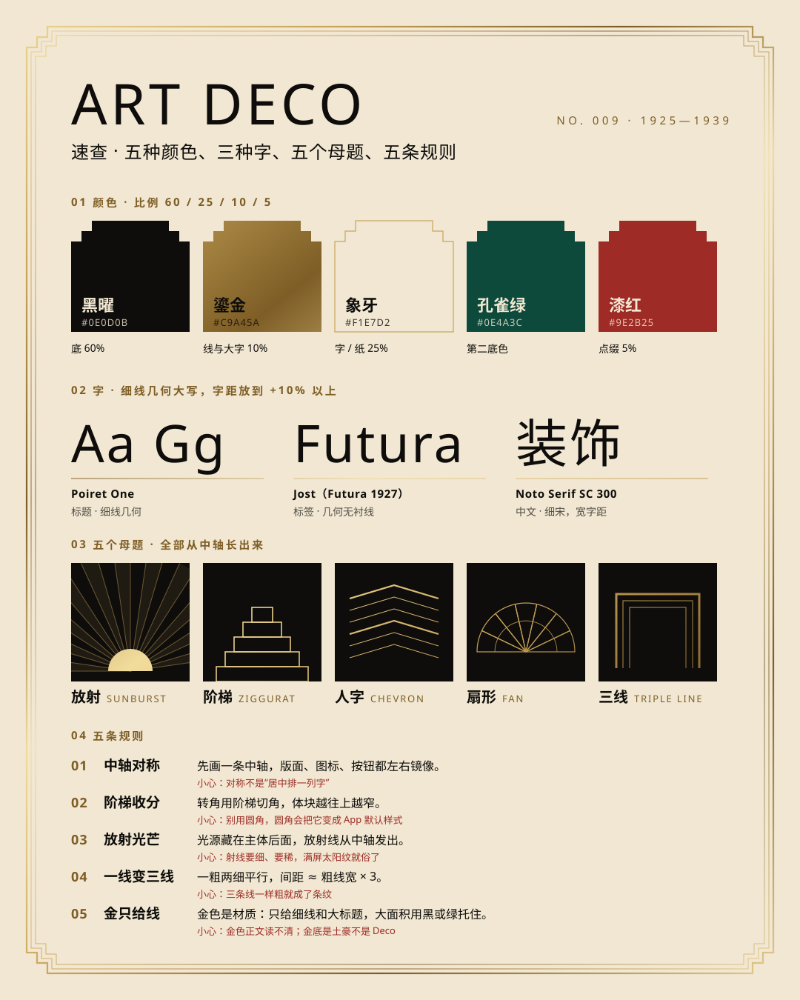
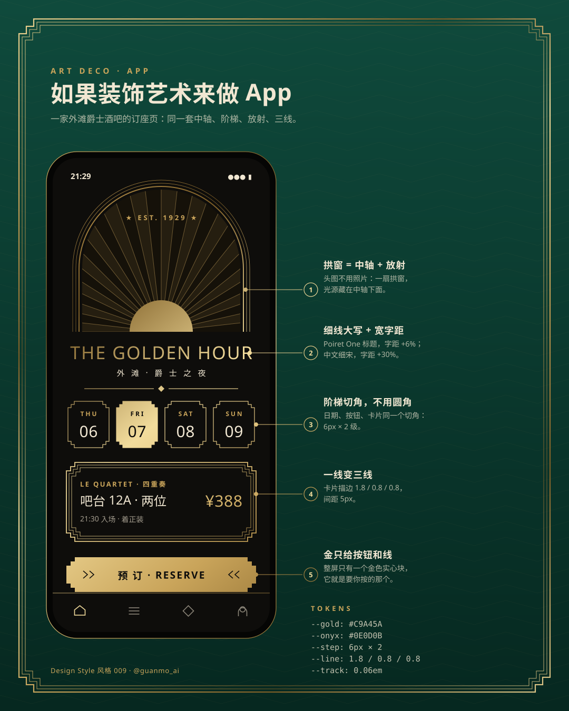
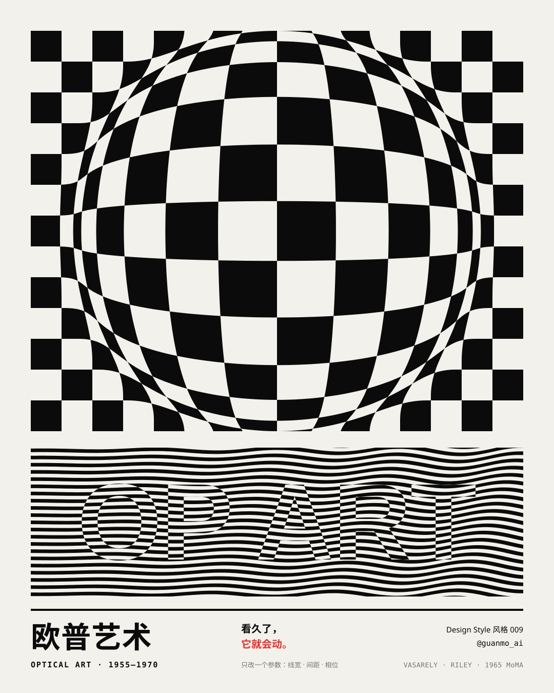
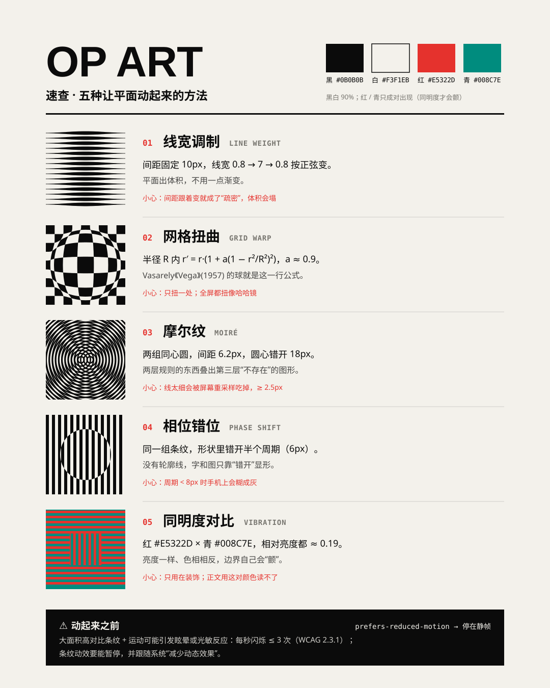
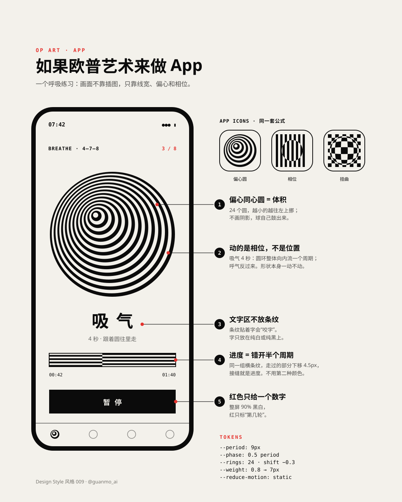

# 待做风格（草稿）

选题时做过、本期没选上的风格。三张风格图（海报 / 速查卡 / App 概念）已经做完，可以直接接着做成一期。

正式开做时：

1. 取下一个空期号，把目录移到 `styles/NNN-name/`（例如 `git mv drafts/op-art styles/013-op-art`）
2. 把图里的 `NO. 009` / `风格 009` 改成新期号，重跑 `python3 styles/NNN-name/images/make_svgs.py && python3 scripts/build_images.py styles/NNN-name/images`
3. 补第四张图、tokens、视频、配乐与文档（流程同 [MAKING_TEMPLATE](../docs/MAKING_TEMPLATE.md)）

字体已在 `scripts/build_images.py` 登记；`npm run fonts` 尚未下载这几支（Poiret One、Limelight、Noto Serif SC、Monoton），开做时加进 `scripts/fetch_fonts.sh`。

---

## 装饰艺术 Art Deco（1925—1939）· `art-deco/`

| 海报 | 速查卡 | App 概念 |
|:-:|:-:|:-:|
|  |  |  |

- **一句话：** 先立一条中轴，再让阶梯、放射和三线从中轴往外长；金色是材质，只给线。
- **对设计师有用的地方：** 品牌、包装、酒店餐饮的“高级感”。五个母题（放射 / 阶梯 / 人字 / 扇形 / 三线）可直接拿走；上海外滩是中文读者最近的 Deco 样本。
- **色板：** 黑曜 `#0E0D0B` 60% · 鎏金 `#C9A45A`（斜向多段渐变）10% · 象牙 `#F1E7D2` 25% · 孔雀绿 `#0E4A3C` · 漆红 `#9E2B25` 5%
- **字：** Poiret One（标题，细线几何）· Jost（Futura 1927 的开源替代）· Noto Serif SC 300（中文细宋，宽字距）
- **五条规则：** 中轴对称 · 阶梯收分（不用圆角）· 放射光芒（光源藏在主体后）· 一线变三线（1 粗 2 细，间距 ≈ 粗线 × 3）· 金只给线
- **动效设想（15 秒）：** 一根金线落在中轴上 → 分裂成三线、画出阶梯角框 → 放射线像折扇从中轴展开 → 摩天楼逐层收分长高，镜头上摇到拱冠、尖顶伸出 → 巴黎 / 纽约 / 上海三城对称变形 → 五个母题镜像蒙太奇 → 电梯门合上落回海报。签名动作：左右镜像同时生长 + 金属高光扫过。
- **制作提醒：** 大面积低不透明度的金色楔形在 Chromium 里会出分块色差，用 `mix()` 预先算成实色（见 `make_svgs.py`）。

## 欧普艺术 Op Art（1955—1970）· `op-art/`

| 海报 | 速查卡 | App 概念 |
|:-:|:-:|:-:|
|  |  |  |

- **一句话：** 看久了，它就会动——只改一个参数（线宽、间距、相位），平面就鼓起来、流起来。
- **对设计师有用的地方：** 五种带参数的方法，可迁移到品牌图形、动态 logo、加载动画和图案：线宽调制 · 网格扭曲 `r′ = r·(1 + a(1 − r²/R²)²)` · 摩尔纹 · 相位错位 · 同明度对比（红 `#E5322D` × 青 `#008C7E`，相对亮度都 ≈ 0.19）。
- **色板：** 黑 `#0B0B0B` · 白 `#F3F1EB`（黑白 90%）· 红 / 青只成对出现
- **字：** Archivo 900（wdth 108—125）· Space Mono · Monoton（点缀）· Noto Sans SC
- **动效设想（15 秒）：** 白屏里条纹出现，标题靠相位错开显形 → 整片条纹像 Riley《Current》一样流动 → 平的棋盘被一个参数推成一颗球（Vega）并转动 → 两组同心圆滑过、流出摩尔纹 → 等宽线靠线宽调制转成圆柱 → 同明度红青“颤”一下收尾。全片不搬形状，只改参数。
- **安全线：** 每秒闪烁 ≤ 3 次（WCAG 2.3.1）；大面积高频条纹不要剧烈运动；提供减少动态效果的静帧版本。
