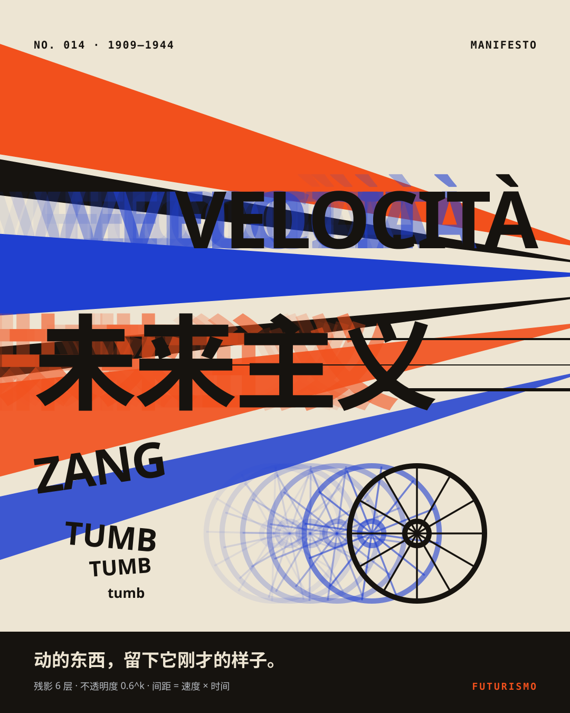
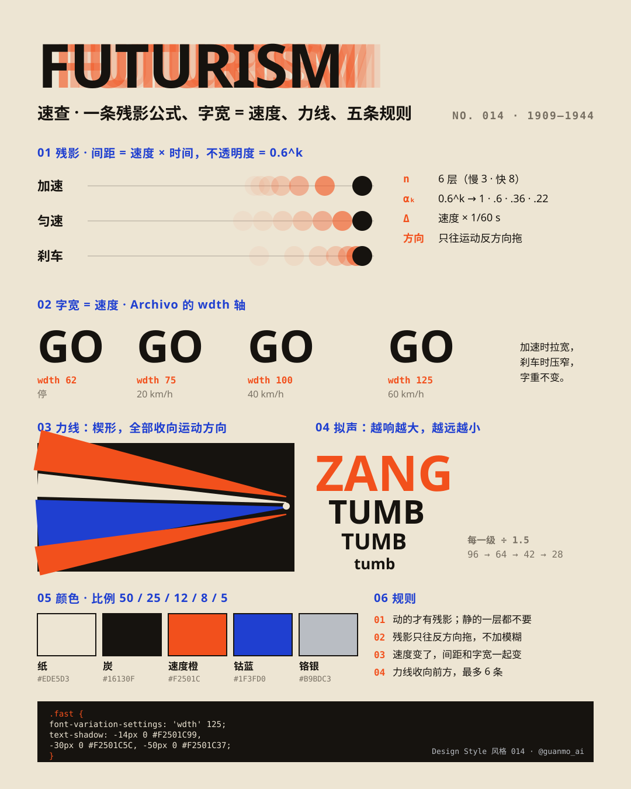
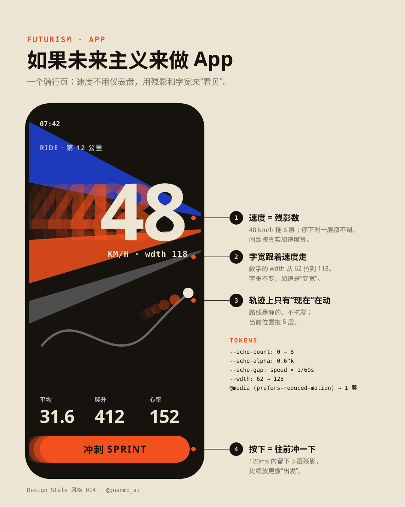

# 待做风格（草稿）

选题时做过、本期没选上的风格。三张风格图（海报 / 速查卡 / App 概念）已经做完，可以直接接着做成一期。

正式开做时：

1. 取下一个空期号，把目录移到 `styles/NNN-name/`（例如 `git mv drafts/op-art styles/014-op-art`）
2. 把图里的 `NO. 009` / `风格 009` 改成新期号，重跑 `python3 styles/NNN-name/images/make_svgs.py && python3 scripts/build_images.py styles/NNN-name/images`
3. 补第四张图、tokens、视频、配乐与文档（流程同 [MAKING_TEMPLATE](../docs/MAKING_TEMPLATE.md)）

字体已在 `scripts/build_images.py` 登记；Poiret One、Noto Serif SC 已随 013 装饰艺术加进 `scripts/fetch_fonts.sh`，Limelight、Monoton 开做时再加。

> 装饰艺术已做成 [013 · 装饰艺术](../styles/013-art-deco)；同批候选液态玻璃已做成 [014 · 液态玻璃](../styles/014-liquid-glass)。
>
> 抖动像素、未来主义两套图里写的是 `NO. 014`，开做时按上面第 2 步改成新期号。

---

## 欧普艺术 Op Art（1955—1970）· `op-art/`

| 海报 | 速查卡 | App 概念 |
|:-:|:-:|:-:|
|  |  |  |

- **一句话：** 看久了，它就会动——只改一个参数（线宽、间距、相位），平面就鼓起来、流起来。
- **对设计师有用的地方：** 五种带参数的方法，可迁移到品牌图形、动态 logo、加载动画和图案：线宽调制 · 网格扭曲 `r′ = r·(1 + a(1 − r²/R²)²)` · 摩尔纹 · 相位错位 · 同明度对比（红 `#E5322D` × 青 `#008C7E`，相对亮度都 ≈ 0.19）。
- **色板：** 黑 `#0B0B0B` · 白 `#F3F1EB`（黑白 90%）· 红 / 青只成对出现
- **字：** Archivo 900（wdth 108—125）· Space Mono · Monoton（点缀）· Noto Sans SC
- **动效设想（15 秒）：** 白屏里条纹出现，标题靠相位错开显形 → 整片条纹像 Riley《Current》一样流动 → 平的棋盘被一个参数推成一颗球（Vega）并转动 → 两组同心圆滑过、流出摩尔纹 → 等宽线靠线宽调制转成圆柱 → 同明度红青“颤”一下收尾。全片不搬形状，只改参数。
- **安全线：** 每秒闪烁 ≤ 3 次（WCAG 2.3.1）；大面积高频条纹不要剧烈运动；提供减少动态效果的静帧版本。

---

## 1-bit 抖动像素 Dither（1984—今天）· `dither/`

| 海报 | 速查卡 | App 概念 |
|:-:|:-:|:-:|
|  |  |  |

- **一句话：** 只有黑和白；灰，是点的密度。
- **对设计师有用的地方：** 4×4 拜耳的十七级灰（第 n 级点亮阈值 < n 的格子）、一行公式 `ink = luma < (bayer[y%4][x%4] + 0.5) / 16`、同一颗球四种算法对比（阈值 / 拜耳 1973 / Floyd–Steinberg 1976 / Atkinson 1984）、两色主题（纸墨 · 掌机 · 磷光 · 蓝晒）、阴影 = 50% 棋盘格。
- **色板：** 墨 `#1B1A17` · 纸 `#E8E3D3`（全片只有这两种）
- **字：** Silkscreen（像素标题，按 8px 原生尺寸的整数倍放大）· Space Mono · Noto Sans SC（大号中文在 `make_svgs.py` 里现场栅格化成点阵）
- **动效设想：** 一镜到底钻进一个像素：格子从 8px 长到满屏，途中亮出每格的阈值；被推近的那一格里是缩小 240 倍的整张画，推到底正好回到第 0 帧，无缝循环。光绕球转一圈，点阵一直在“爬”。所有渐显都用拜耳溶解，不用半透明。

---

## 未来主义 Futurism（1909—1944）· `futurism/`

| 海报 | 速查卡 | App 概念 |
|:-:|:-:|:-:|
|  |  |  |

- **一句话：** 动的东西，留下它刚才的样子。
- **对设计师有用的地方：** 残影公式（第 k 层 = k × Δt 前的位置，不透明度 0.6^k，加速拉开、刹车挤拢）、字宽 = 速度（Archivo `wdth` 62 → 125）、力线（楔形全部收向前方）、拟声排版（每级 ÷ 1.5）、`text-shadow` 残影 CSS。
- **色板：** 纸 `#EDE5D3` · 炭 `#16130F` · 速度橙 `#F2501C` · 钴蓝 `#1F3FD0` · 铬银 `#B9BDC3`
- **字：** Archivo（可变字宽 / 字重）· Space Mono · Noto Sans SC Black
- **动效设想：** 全片一条物理规则——残影由真实轨迹生成，所以刹车时残影会自己收拢进本体、加速时自己拉开；字宽跟速度实时变。镜头跟拍时力线从背景扫过；某一刻“未来主义”迎面冲向镜头撑满画面。
