# 待做风格（草稿）

选题时做过、本期没选上的风格。三张风格图（海报 / 速查卡 / App 概念）已经做完，可以直接接着做成一期。

正式开做时：

1. 取下一个空期号，把目录移到 `styles/NNN-name/`（例如 `git mv drafts/op-art styles/014-op-art`）
2. 把图里的 `NO. 009` / `风格 009` 改成新期号，重跑 `python3 styles/NNN-name/images/make_svgs.py && python3 scripts/build_images.py styles/NNN-name/images`
3. 补第四张图、tokens、视频、配乐与文档（流程同 [MAKING_TEMPLATE](../docs/MAKING_TEMPLATE.md)）

字体已在 `scripts/build_images.py` 登记；Poiret One、Noto Serif SC 已随 013 装饰艺术加进 `scripts/fetch_fonts.sh`，Limelight、Monoton 开做时再加。

> 装饰艺术已做成 [013 · 装饰艺术](../styles/013-art-deco)；同批候选液态玻璃已做成 [014 · 液态玻璃](../styles/014-liquid-glass)。
>
> 未来主义已做成 [015 · 未来主义](../styles/015-futurism)。
>
> 抖动像素的图里写的是 `NO. 014`，开做时按上面第 2 步改成新期号。

---

## 马克笔发布记录（2026-11-15）

- 马克笔第四版完整视频已上线。见[正式目录 027 · 马克笔手绘](../styles/027-marker/README.md)，网站期号为「风格 020」。

## 作品资料索引

| 风格 | 状态 |
|---|---|
| 水墨 Ink Wash · `ink-wash/` | **用户已审片通过并要求上架（2026-11-09）**：正式目录 [024 · 水墨](../styles/024-ink-wash)，沿用 `04f0aed` 的 18.75 秒完整原片。 |
| 本轮其余候选 | 用户不通过，不收录；不再发送本轮视频审核。 |
| 字符画 ASCII Art · `ascii/` | **主人已审片通过（2026-11-04）**：正式目录 [020 · 字符画](../styles/020-ascii-art)，保留本目录作为原片来源。 |
| 生成艺术 Generative Art · `generative/` | **主人已审片通过（2026-11-04）**：正式目录 [021 · 生成艺术](../styles/021-generative-art)，保留本目录作为原片来源。 |
| 动态字体 Kinetic Type · `kinetic-type/` | 第五轮没选上，图留着 |
| 中世纪现代 Mid-Century Modern · `mid-century/` | **下周做** |
| 液态金属 Liquid Chrome · `liquid-chrome/` | 正式目录 [023 · 液态金属 Liquid Chrome](../styles/023-liquid-chrome)；保留本草稿目录作为原片及渲染源码来源。 |
| 点云 Point Cloud · `point-cloud/` | 正式目录 [022 · 点云 Point Cloud](../styles/022-point-cloud)；保留本草稿目录作为原片及渲染源码来源。 |
| 毛绒 Plush · `plush/` | **已授权正式收录（2026-11-11）**：风格 018，见 [`025-plush`](../styles/025-plush/README.md) |
| 新艺术运动 Art Nouveau · `art-nouveau/` | 正式目录 [026 · 新艺术运动](../styles/026-art-nouveau/README.md)，画廊风格 019。 |
| 热成像 Thermal · `thermal/` | 候选图和温度场源码 |
| 第四轮候选：低多边形 / 体素 / 等距微缩（从参考视频提取） | 等主人选，见下 |
| 第三轮候选：赛博朋克 / 城市流行 / 膨胀风 | 等主人选（与第四轮一起看） |
| 第二轮候选：风格派 / 图形统计 / 无限画布 | 主人觉得一般（太像设计史教科书），图留着 |
| 欧普艺术、抖动像素 | 之前没选上，实在没得选再考虑 |
| 迷幻海报 Psychedelic · `psychedelic/` | **放到最后做** |
| ~~拟物 Skeuomorphism~~ | **不做**（图已删） |

## 超级平面第二版 · 第一步：参考 + 三个构图小样（2026-11-18）

主人看完第十二轮后同意“只做一个、先磨一帧”的做法：先给参考板和 3 个构图小样，挑一个再精修。方向写在 [`supergraphics/DIRECTION.md`](supergraphics/DIRECTION.md)：拿第一版和 Georges Rousse、Felice Varini、Sea Ranch 的真实作品并排看，差在空间是假的（干净 CG 白盒）、东西太多、光是平的、构图是摆的。

- 换成 **Blender Cycles 路径追踪**（`pip install bpy`，5.3）+ ambientCG / Poly Haven 的 CC0 实拍材质和天空（`supergraphics/blender/fetch_assets.sh`，素材不入库）。
- 漆用镜头的画面坐标算遮罩：从这个机位看是完美的形状，同时保留墙面的凹凸，被光照、被遮挡。
- **实测**：960×540、32 采样 + 降噪约 30—40 秒一帧，64 采样约 58 秒；1080p 估计 2—4 分钟一帧。出静帧够；做片子要把光烘焙进场景再动镜头，或者交给有显卡的机器。
- 三个小样（`supergraphics/png/v2/comps.jpg`）：A 厂房纵深 + 一个红色正圆（门洞是圆心，人站在里面）；B 混凝土中庭仰视 + 四色同心环；C 厂房 + 四个黄字。

---

## 第十二轮候选：超级平面 / 超扁平 / 功能主义 / Frutiger Aero，各两张图（2026-11-18，未占期号）

每个候选制作首帧和应用图。改版尝试大比例主角、层次分明的布光与更简洁的封面文字。

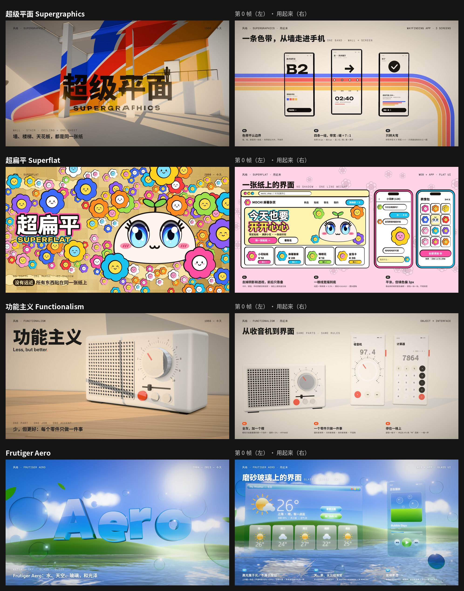

| | 超级平面 Supergraphics · `supergraphics/` | 超扁平 Superflat · `superflat/` | 功能主义 Functionalism · `functional/` | Frutiger Aero · `frutiger-aero/` |
|---|---|---|---|---|
| 第 0 帧 | 两层高的白房子：四条色带从地面爬上墙、翻过柱子和天花板；“超级平面”四个字刷在墙、楼梯、柱子上，只有从这个机位看才拼得上（字的投影机比镜头偏 0.4 米，所以在柱子边上能看到错开）；低太阳的窗影压在地上 | 金箔底（日本屏风）+ 琳派的云 + 满屏带脸的小花 + 一只大眼睛的麻薯 + 贴纸字；全平涂、粗黑线，填色比线偏 3px（丝网印刷的套色偏移） | 一台原创收音机放在橡木桌上：暖白喷涂机身、真打孔的喇叭网、滚花铝旋钮停在一格上、全机唯一一个橙色键；左边窗子的低角度光 | 镜头贴着水面：“Aero”玻璃字浮在水上（正面上半截一块 Aero 光泽），彩虹泡泡往上冒，亮绿山坡、深蓝到浅青的天，太阳在右上角 |
| 用起来 | 导视 App 的三屏：同一组四色带从墙上横穿三部手机，在第二屏里变成路线，右边转大弯翻到地面 | 贴纸杂货网站 + 聊天 / 表情包两部手机，连浏览器和手机壳都画成平的 | 同一台收音机 + 两部同样暖白的手机：旋钮 → 圆形刻度盘，喇叭孔 → 点阵数字，橙色键 → 唯一的主按钮 | 同一片天当壁纸，前面两块磨砂玻璃（真透射 + 粗糙度）：天气网站 + 音乐 App，3D 光泽球按钮 |
| 它自己怎么动（给视频） | 色带不认墙角；镜头走到“对点”的位置，散在三面墙上的碎块拼成字 | 透视镜头的视角一路收到 0（正交），立体的世界“啪”地压成一张纸 | 档位：旋钮、推子、数字停下来一定停在一格上，冲过头约 4% 再“咔”回来，一格一声 | 浮力 + 高光属于光：东西往上漂、阻尼大，球怎么转，高光都停在顶上 |
| 技术 · 实测 | three.js；`_3d/project.js` 把 2D 画布从一台“投影机”投到所有表面上；云端 1080p 一帧约 0.3 秒，出图约 12 秒（2 倍超采样） | Canvas 2D（`superflat/sf.js`），一张 0.5 秒 | three.js：打孔板是挤出时挖了 300 多个孔，旋钮侧面按角度做齿；出图约 12 秒 | three.js：Water 反射 + 透射玻璃 + 彩虹干涉泡泡，反射环境用场景自己的天和草地生成；出图约 10 秒 |

角色、花、机器全部是原创的，不画任何一件真实作品里的形象，也没有出现任何品牌名。出图：`cd drafts/_3d && npm install && node shoot.cjs ../<风格>/cover.html ../<风格>/png/cover.png`（`ui.html` 同理）；加 `?pr=1` 出快速预览。字体都在 `scripts/fetch_fonts.sh` 里，没有新加。

---

## 第十轮：新浪潮 New Wave 全片（2026-11-17，网站风格 021）

- 20 秒、60 fps、八个场景。第二版用《Minimalist Design Pulse》，画面沿 130.07 BPM 的拍点重新编排。
- [第二版原片](new-wave/film/new-wave-film.mp4) · [原始制作记录](new-wave/PROCESS.md) · [正式作品资料](../styles/028-new-wave/README.md)

---

## 第八轮：新艺术运动 Art Nouveau 全片（2026-11-12，网站风格 019）

新艺术运动的候选图见 `art-nouveau/png/`，短片以连续生长的鞭线组织画面。

- **画面** `art-nouveau/film/`：**整支片子只有一根线。** 它从标题拱的左脚出发，顺时针绕一圈——鞭线（曲率梳）→ 穆夏的光环 → 吉马德的地铁口（黄昏，灯亮）→ 蒂芙尼的台灯（夜里，玻璃一块块嵌进去，灯亮）→ 手机机身和界面（三条规则 + 色板）——再回到标题脚下卷进去；片尾拉远，整支片子就是一根鞭线。分镜见 [`art-nouveau/film/STORYBOARD.md`](art-nouveau/film/STORYBOARD.md)，过程见 [`art-nouveau/PROCESS.md`](art-nouveau/PROCESS.md)。
- **签名物理**：梢头像蕨菜一样卷着，一边长一边松开；卷曲量 = 生长速度过一根弹簧。
- **技术**：Canvas 2D，0.07 秒 / 帧，4 子帧运动模糊；`smooth.py` 跳变 0、死区 0、最大 10.9。
- **配乐**：一支 3/4 拍圆舞曲（竖琴、拨弦、钢片琴、弦乐），台灯亮和收束落在小节线上。

成片：[新艺术运动](art-nouveau/film/art-nouveau-film.mp4)。四张风格图、tokens、时间轴和中英文指南见 [正式目录](../styles/026-art-nouveau/README.md)。

## 第七轮：毛绒 Plush 全片（2026-11-10，未占期号）

全片为 20 秒、1080p60，使用一首连续的配乐。

- **画面** `plush/film/`：从头到尾同一批 409,600 根毛——毛球砸下来 → 炸开拼成「毛绒」→ 缩回去只剩一根，再 ×8、×8…… 长回四十万根 → 奥本海姆《皮毛早餐》（1936）→ Steiff 泰迪熊（1902，九个零件“啵”出来）→ Kangol 毛毛渔夫帽（抛起来翻一圈）→ 五条规则（同一颗球自己演示：根深尖浅 / 乱一点 / 逆光镶边 / 慢半拍 / 一按就倒）→ 倒进手机（点赞、开关、加载）→ 拼回「毛绒」。分镜见 [`plush/film/STORYBOARD.md`](plush/film/STORYBOARD.md)。
- **签名物理**：每根毛是一根弹簧，毛尖 = 身体的运动 ⊗ 弹簧的冲激响应。零件只管自己动，毛的“晚半拍、冲过头、抖回来”是算出来的，不是一根根 K 的。
- **渲染器** `_lib/fur/fur.js` + `_lib/kit/shapes.js`（2026-11-11 起，通用的部分拆进了 [`_lib/kit/`](_lib/kit/README.md)）：真的一根根画（每根一条带锥度的细带，Kajiya–Kay 光照，成撮，逆光镶边），云端软件渲染 3.8 秒 / 帧。踩的坑写进了 [`docs/GPU_MOTION.md`](../docs/GPU_MOTION.md)。
- **可以摸的 demo** `plush/demo.html`：有显卡的电脑直接打开，鼠标拨毛、拖着甩，四个滑块对应四条规则。
- 和前几期不一样的地方：布景没有用“黑场 + 聚光灯”，换成了糖果色无缝背景（毛绒要的是软和亮）；色彩接力是粉 / 蓝 → 驼 / 绿 → 金 / 紫 → 荧光绿 / 洋红 → 奶油白。

成片：[毛绒](plush/film/plush-film.mp4)。四张风格图、tokens、时间轴与中英文阅读页见 [正式目录](../styles/025-plush/README.md)，网站期号为「风格 018」。

## 第六轮：液态金属 + 点云全片（2026-11-06）

两部都是 18 秒、1080p60、一整首歌，直接做全片（不再先出开头小样）。都沿用了标杆的骨架（第 0 帧重击、签名物理、元素接力、固定外框、首尾呼应、画面上标参数），但画面全部是实时 GPU 渲染：

- **液态金属** `liquid-chrome/film/`：同一滩水银接力到底——字从水银里站起来（带拉丝）→ 化成四颗珠两两合上（smin 的“颈”）→ 形状不动、世界在转 → 拉成柱断成五颗（瑞利–普拉托）→ 倒进手机变成会长刺的语音助手 → 落回水银、字再站起来。
- **点云** `point-cloud/film/`：从头到尾同一批 100 万个点——一个点炸开拼成立体标题 → 扎进去散成星（近大远小）→ 倒进楼梯井，扫描面往下走、镜头螺旋下潜 → 卷成龙卷聚成盆景 → 鼠标拨开 → 倒进扫描 App → 拼回标题。

成片：[液态金属](liquid-chrome/film/liquid-chrome-film.mp4) · [点云](point-cloud/film/point-cloud-film.mp4)。点云几十万个点每帧都在动，H.264 很难压：用两遍编码 17 Mbps 压到 36 MB，最密的几段细点会软一点；要更清楚的版本就重跑 `make.sh` 改成 crf 22（约 190 MB，不入库）。

**第一版 → 第二版：** 第一版每章 3—5 秒、主角是抽象的珠子和点，没有作品、没有“搭”的过程。第二版照 [标杆](../docs/BENCHMARKS.md) 的骨架重做：每章 3 拍一件真实代表作、按十六分音符搭起来、五条规则一拍一张、首尾呼应，两首配乐重写。分镜见各自的 `film/STORYBOARD.md`。

工具：`_lib/film-gl.cjs`（WebGL 页面逐帧截图，断了能接着渲）、`_lib/contact.py`（抽帧联系表）。GPU 做片子的经验见 [`docs/GPU_MOTION.md`](../docs/GPU_MOTION.md)。

## 第六轮候选：三种光（2026-11-06）

这三套候选探索三种“光”的视觉语言——**反射的光、扫描的光、看不见的光**。三个都是“动起来才成立”的材质 / 媒介风格，图全部用 WebGL 实时渲染（光线步进、几百万个点、温度场模拟），没有一张贴图或素材照片。每个两张：第 0 帧 + 落到网页和手机 App（手机三屏 = 一个交互的三拍，底部四张动效配方卡）。

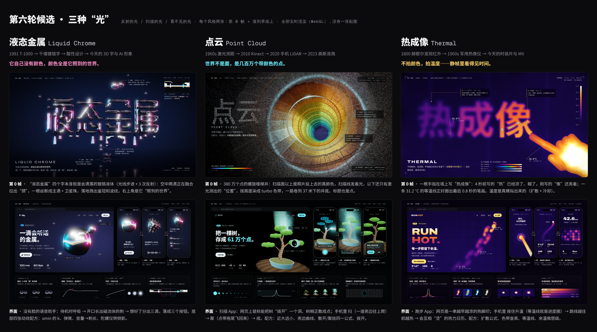

| | 液态金属 Liquid Chrome · `liquid-chrome/` | 点云 Point Cloud · `point-cloud/` | 热成像 Thermal · `thermal/` |
|---|---|---|---|
| 年代 | 1991《终结者 2》T-1000 → 千禧镀铬字 → 酸性设计 → 今天的 3D 字与 AI 形象 | 1960s 激光测距 → 2010 Kinect → 2020 手机 LiDAR → 2023 高斯泼溅 | 1800 赫歇尔发现红外 → 1960s 军用热像仪 → 今天的时装片与 MV |
| 一句话 | 它自己没有颜色，颜色全是它照到的世界 | 世界不是面，是几百万个带颜色的点 | 不拍颜色，拍温度——静帧里看得见时间 |
| 第 0 帧 · 独有动作 | “液态金属”四个字是会滴落的镀铬液体：空中两滴正融合出“颈”，一根丝断成主滴 + 卫星珠，落地溅出皇冠和波纹；右上角是它照到的环境图 | 380 万个点的螺旋楼梯井：扫描面以上是真颜色，扫描线发光，以下只剩激光测出的位置、按高度染成 turbo 色带，卷到 37 米井底；标题也由点组成 | 手指在墙上写“热成像”：4 秒前的“热”已凉、已糊，刚写的“像”还亮着；31.2 °C 等温线正好圈出最后 0.8 秒的笔画（扩散 + 冷却是真算的） |
| 网页 / App | 没有脸的语音助手：呼吸 → 开口长出磁流体的刺 → 分出三滴，落成三个按钮 | 扫描 App：网页上鼠标能把树拨开一个洞；手机里 扫 → 聚（点带拖尾飞回来）→ 成 | 跑步 App：越早越凉的热脚印；按住升温（等温线就是进度圈）→ 越往前越热的路线 → 会互相“烫”的日历 |
| 对设计师有用 | smin 的 k 决定颈多粗、弹簧落位、音量 → 刺长、陀螺仪转环境图 | size = w·f/z、扫描亮边曲线、散开 / 聚拢同一公式、视线平面里的“拨开” | 扩散 + 冷却公式、色带查表（同一温度四种情绪）、等温线当进度、余温做层级 |
| 技术路线 | WebGL2 光线步进：文字距离场挤出成“鼓起来”的字 + smin 液滴，3 次镜面反射，手写摄影棚环境（`liquid-chrome/chrome.js`） | WebGL2 `gl.POINTS`：不透明点走深度测试 + 加法发光层，按距离算点径和景深（`point-cloud/pc.js`） | CPU 上模拟温度场（写字 = 加热，之后扩散 + 牛顿冷却），GPU 双三次放大 + 色带查表 + 等温线（`thermal/thermal.js`） |

生成方式：`node drafts/_lib/shot-gl.cjs drafts/<风格>/cover.html drafts/<风格>/png/cover.png 1920 1080 2`（`ui.html` 同理；脚本会等页面渲染完再截，4K 出图后缩到 1080p 入库）。共用的小工具在 `_lib/glkit.js`（着色器、浮点缓冲、分块绘制、泛光 + ACES）。新用到的字体（站酷庆科黄油体、Geist / Geist Mono 可变字重）已加进 `scripts/fetch_fonts.sh`。

## 第五轮：全片 18 秒（2026-11-04）

两期都在开头 10 秒后面接上：06 五条规则（一拍一张卡，每张自己演示自己）→ 07 用在手机上（一部手机五个界面 = 五个可以直接用的动效配方）→ 片尾回到开场的构图 + 署名“观默”。配乐是同一首歌接着走到 18 秒，收在主和弦。每期一个签名动作：字符画“先乱码，再落定”，生成艺术“从一个点长出来”。分镜见各自的 `film/STORYBOARD.md`；出片 `bash film/make.sh`（1080 帧，云端约 3 分钟）。

## 第五轮：开头小样第三版——一整首歌 + 拍点上的接力 + 固定外框（2026-11-04）

第三版的配乐用 `_lib/song.py` 写成一整首歌（换章只换和弦和一句旋律）；换章的速度峰值落在拍点上；加上标杆都有的左上章节外框和右上进度；每章换成一件真实代表作（字符画：donut.c → 《黑客帝国》数字雨 → FIGlet → 手机 → PSX DOOM 火焰；生成艺术：Fidenza → Schotter → Truchet → 网页 / 手机 → L 系统）。分镜见各自的 `film/STORYBOARD.md`。

## 第五轮：开头小样第二版——每 1.5 秒换一个主角（2026-11-04）

第二版两期都改成 10 秒、五段，每段换一种主角和动作，换场用接力（上一个散开 / 收回 / 缩小，变成下一个），网页和手机直接放进开头：

- **字符画**：转动的甜甜圈（donut.c）→ 炸开成字雨拼出网页 → 点按钮、进度条 → 每个字飞去手机 → 心形封面跳动的播放器 → 心脏放大着火（DOOM 火焰）→ 火烧进 ASCII 大字 → 风吹散 → 片尾。
- **生成艺术**：流场色带 → 圆堆积 → 缩成点吸到网格 → 特鲁谢瓷砖一波波翻 → 缩进手机钱包的卡片 + 网页生成器拖滑块 → 界面掉落时树长出来、开花 → 片尾。
- 配乐修了一个 bug：段落起点不在拍点上时，鼓和贝斯会整段不响（第一版手机段的心跳就没有响）。现在所有段落都吸到全片的节拍网格上。

## 第五轮：字符画 + 生成艺术，开头 8 秒动效小样（2026-11-04，已被第二版替换）

两期各制作了 8 秒开头小样（1080p、60fps、120 BPM），包含配乐和音效。分镜见各自的 `film/STORYBOARD.md`。

- **字符画** `ascii/film/ascii-sample.mp4`：扫描线解码 → 灯灭 → 光绕回来、探针在字符阶梯上一格格爬（每换一个字一个音）→ 字号按拍变细 → 锁定一个 `@` 钻进去，笔画撑满屏幕，里面是一颗新的星球 → 标题解码。
- **生成艺术** `generative/film/generative-sample.mp4`：色带一起长（每条出生一个木琴音，音高 = 画面高度）→ 方向场箭头翻出来、红点顺着风走 → 推近看一条色带撞停 → 按粗细分三批长回来 → 换种子倒带、新的一张炸开 → 标题卡。
- 工具：`_lib/film.cjs`（逐帧截图，3 页并行）、`_lib/events.cjs`（导出动作时间给配乐）、`_lib/stills.cjs` / `_lib/still.cjs`（联系表 / 单帧）。每期 `film/make.sh` 一条命令出片；云端 480 帧约 1—2 分钟。

## 第五轮候选（2026-11-04）

三个风格的本体都是运动（字在翻、字在撑、线在长），静帧只是其中一帧。每个两张图：第 0 帧 + 落到网页和手机 App。

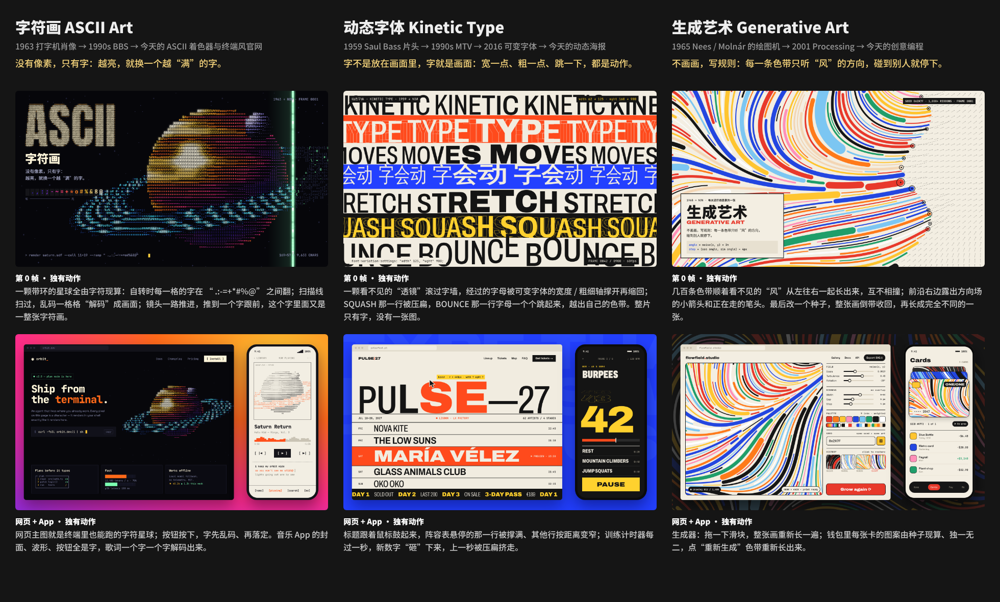

| | 字符画 ASCII Art · `ascii/` | 动态字体 Kinetic Type · `kinetic-type/` | 生成艺术 Generative Art · `generative/` |
|---|---|---|---|
| 年代 | 1963 打字机肖像 → 1990s BBS → 今天的 ASCII 着色器 | 1959 Saul Bass 片头 → MTV → 2016 可变字体 → 今天 | 1965 Nees / Molnár 绘图机 → 2001 Processing → 今天 |
| 一句话 | 没有像素，只有字：越亮，就换一个越“满”的字 | 字就是画面：宽一点、粗一点、跳一下，都是动作 | 不画画，写规则：色带只听“风”的方向，碰到别人就停 |
| 第 0 帧 · 独有动作 | 带环星球全由字符现算，自转时每格的字跟着翻；扫描线把乱码一格格“解码”成画面；推到一个字跟前，字里又是一整张字符画 | 看不见的“透镜”滚过字墙，经过的字母被 wdth / wght 轴撑开再缩回；SQUASH 被压扁、BOUNCE 一个个跳出色带 | 几百条色带从左往右一起长出来、互不相撞，前沿露出方向场和笔头；改一个种子，整张画倒带再长成另一张 |
| 网页 / App | 终端 AI 助手官网 + 纸白音乐播放器（封面、波形、按钮全是字） | 音乐节官网（标题跟鼠标鼓起、阵容悬停撑满）+ 训练计时器（数字每秒砸下来） | 流场生成器（滑块 + 种子 + 历史）+ 钱包（每张卡的图案由种子现算） |
| 对设计师有用 | 字符阶梯、亮度 → 字的映射、解码动效 | 可变字体轴的取值、`font-variation-settings`、距离衰减公式 | 流场公式、防碰撞、加权色板、种子 = 可复现 |
| 为什么会火 | X 上这两年最火的视觉之一；“全是字”本身就让人停下来放大看 | 设计师最爱收藏的动效类型，参数直接能抄 | 颜色最炸、截图就好看；“每次运行都不一样”可以让观众自己换种子 |
| 技术路线 | Canvas 2D 解析求交（`ascii/ascii.js`），纯 CPU，云端可渲 | HTML + 可变字体 Archivo（wdth 62—125 / wght 100—900） | Canvas 2D 流场 + 占用网格（`generative/gen.js`），纯 CPU |

生成方式：`node drafts/_lib/shot.cjs drafts/<风格>/cover.html drafts/<风格>/png/cover.png`（`ui.html` 同理）；对比图 `python3 drafts/_lib/compare5.py && node drafts/_lib/shot.cjs drafts/candidates-5.html drafts/candidates-5.png 1960 1180`。用到的字体（Archivo、JetBrains Mono、Anton、Space Grotesk、Noto Sans SC）都已在 `scripts/fetch_fonts.sh` 里。

## 街角小样：地面拆开、一块块铺（2026-10-29）

- 新增 `_3d/base_build.js`（由 `gen_anim.py` 换进场景）：底板落下 → 四层土各切四块从左推进来 → 切面上的小石子“啵”出来 → 后面 72 块 2×2 方砖从左后角波浪落下 → 人行道 144 块方砖翻着一排排落下 → 柏油 12 条从左往右刷开、路缘石拉出 → 中线一段段弹出、斑马线一条条翻下来。约 1.3 秒拼完，房子等零件整体往后挪 1.3 秒，全片 6.5 秒（195 帧）。
- 镜头起始拉远一点（看得到整块模型），全程推近。
- 底座拼装时关掉 GTAO（大平板在掠射角下会出方形空洞），房子长出来时再淡入。
- 声音：土块推到位、方砖翻落、斑马线一条一个音往上走，都跟着动作。

## 小样换色（2026-10-29）

换色时参考了 @EianLu 的短动画和 004 孟菲斯，采用奶油色背景和偏暖的粉彩。
- **奶油纸底**（`#F6EEDD`）+ 一层很淡的纸纹；画面边缘不是硬边，而是**碎成纸屑点**（圆角矩形距离 + 噪声阈值）。
- **粉彩田块**：芥末黄 `#F4C54F`、绿 `#4DAF72`、薄荷 `#A9DDB4`、樱花粉 `#F49DB6`、薰衣草 `#C9A6EC`、天蓝 `#7DB8E8`；一块田整块同色，上面叠一层细条纹当田垄。山用长春花蓝，不再用宝蓝。
- **暗面往暖紫里混**（`#7A5C86`），不往黑里压，所以不发灰。
- 街角：粉、薰衣草、薄荷的房子，银杏黄的树；黄昏到入夜改成薰衣草到蜜桃粉的暮色，不再用深蓝夜。

## 5 秒动效小样（2026-10-29）

先确定独特动作，再各制作一段 5 秒动效小样。

- **低多边形 · 折纸搭建**（`samples/origami/`）：纯 2D 平涂（奶油纸 + 红黄蓝绿），用 `_lib/poly3d.py` 逐帧算。纸面上的三角形一块块“翻牌”（原地跳起转一圈，前半圈是纸、转回来是颜色，过冲约 5%）拼成山、田、湖；树在拍点上一簇簇冒出来；枕木在火车前方一根根落下；蒸汽团最后铺满画面，回到第 0 帧的纸，循环。`python3 frames.py <目录>` → `node ../render_svgs.cjs <目录>` → `python3 audio.py x.wav`，150 帧约 40 秒。
- **微缩景观 · 街角**（`samples/diorama/`，场景 `_3d/diorama_anim.html` 由 `_3d/gen_anim.py` 从静帧场景生成，时间轴在 `_3d/anim_timeline.js`）：店面和民居从地里升起，二层、屋顶从天上落下压一下，电线杆长出来、电线拉过去，售货机落下、樱花冒出来，小卡车落到路上；然后白天 → 黄昏 → 入夜，窗户一盏盏亮、路灯亮、卡车亮着灯开走。three.js 软件渲染约 8 秒一帧，150 帧约 20 分钟（`node _3d/anim_shoot.cjs`）。

两段都是 120 BPM，一拍 15 帧，大动作落在拍点上；声音用 Python 标准库合成，每个动作一个声音，时间直接取自动画脚本。

## 第四轮改版：低多边形 + 微缩景观，做细、换成亮色（2026-10-29）

这一轮增加了形体和建筑细节，改为明亮、饱和的玩具色。

| 低多边形 · 山谷小火车 | 微缩景观 · 街角模型 |
|:-:|:-:|
| 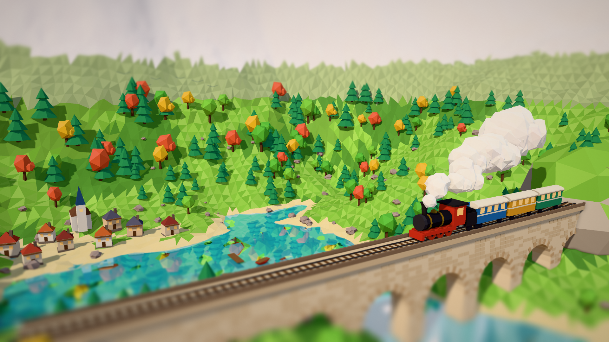 | 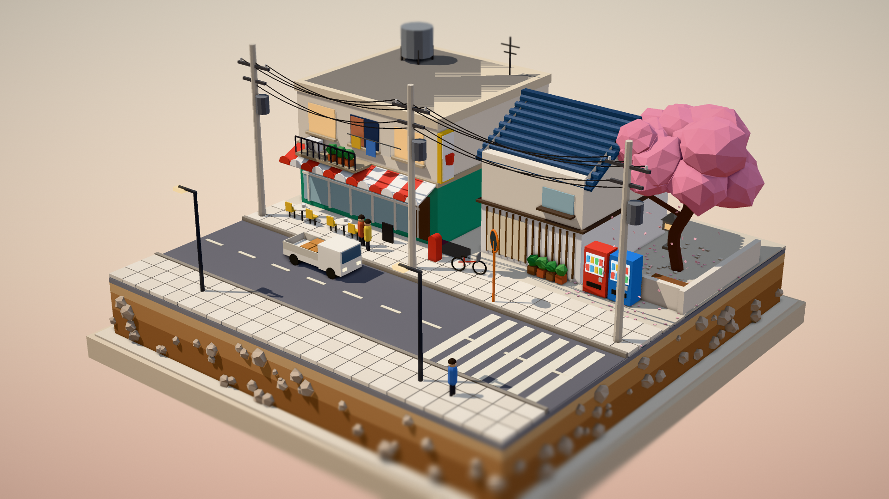 |

- 改用 three.js 渲染（`drafts/_3d/`：`valley.html`、`diorama.html`，底座 `lib.js`）：软阴影、GTAO 环境光遮蔽、移轴景深、Neutral 色调映射（不洗色）。云端软件 WebGL 一张 1920×1080（内部 2 倍）约 30 秒。
- 零件做细：石拱桥的石块和拱券石、带车轮连杆驾驶室的蒸汽机车、湖面倒影、教堂和小屋、秋色树；街角模型有切开的土层、遮阳篷、阳台晾衣、空调外机、水箱、电线杆和下垂电线、售货机、樱花和落花、小卡车、行人、猫。
- 用法：`cd drafts/_3d && npm install && node shoot.cjs valley.html out.png`（需要 `playwright` 自带的 Chromium）。
- **做成正片时：** 每帧约 30 秒，15—20 秒 × 60fps 约 1000 帧 ≈ 8—10 小时 CPU，可在有 GPU 的机器上用 `--gl=angle` 加速。

## 第四轮候选（2026-10-29，由参考视频拆解）

**参考视频是什么风格：** 低多边形（Low Poly）3D + 微缩景观（Diorama）——一座漂浮在云上的小岛，热气球把房子一栋栋吊上来盖成小镇，傍晚到入夜灯一盏盏亮、孔明灯升空。特征：三角面平涂、玩具般的饱和色、柔和的环境光、“小世界”的微缩感、昼夜换光。原视频是有人让 AI 从零写代码渲染的 3D 短片（不用模板、不加字），“AI 竟然能做出这个”本身就是传播点。

我们不照搬它（不做漂浮岛、热气球、小镇），只提取风格，再找两个相近的方向。三张图都用自己写的三角面渲染器 `drafts/_lib/poly3d.py` 现算：每个面算一次朝向打光、加雾，再按远近画成 SVG——纯 CPU，不用 WebGL，云端就能渲正片。

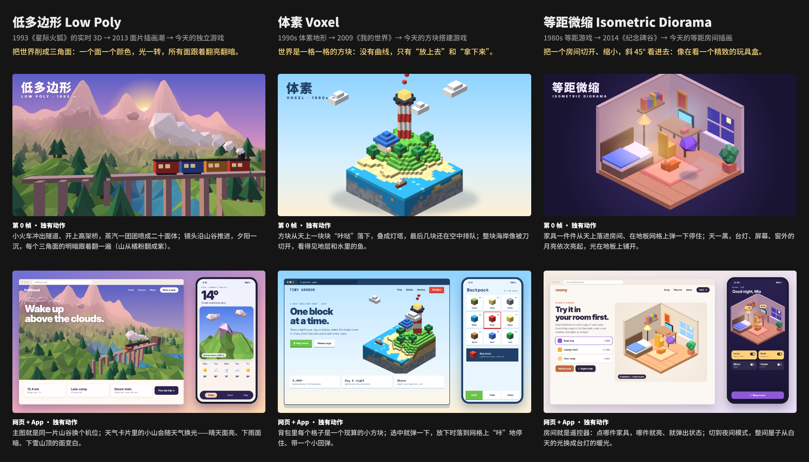

| | 低多边形 Low Poly · `low-poly/` | 体素 Voxel · `voxel/` | 等距微缩 Isometric Diorama · `iso-room/` |
|---|---|---|---|
| 一句话 | 把世界削成三角面：一个面一个颜色，光一转所有面跟着翻亮翻暗 | 世界是一格一格的方块：只有“放上去”和“拿下来” | 把一个房间切开、缩小，斜 45° 看进去，像精致的玩具盒 |
| 镜头 | 透视，沿山谷推进 | 正交等距，绕着方块转 | 正交等距，固定机位、换光 |
| 第 0 帧 · 独有动作 | 小火车冲出隧道开上高架桥，蒸汽喷成二十面体；夕阳一沉，每个三角面的明暗跟着翻一遍 | 方块从天上一块块“咔哒”落下叠成灯塔，最后几块还在空中排队；海岸被切开，看得见地层和鱼 | 家具一件件落进房间、在地板网格上弹一下停住；天一黑，台灯、屏幕、月亮依次亮起 |
| 网页 / App | 徒步预订 + 天气（小山随天气换光） | 方块游戏官网 + 背包（每格一个现算方块） | 家具店房间规划 + 智能家居（房间就是遥控器） |
| 可选代表作 | 《星际火狐》（1993）·《VR 战警》（1993）· 2013 年前后的低多边形插画潮 ·《纪念碑谷》（2014）·《Alto’s Adventure》（2015）| 体素地形《Comanche》（1992）·《我的世界》（2009）·《天天过马路》（2014）· MagicaVoxel（2014）·《Townscaper》（2021）| 《模拟城市 2000》（1993）·《哈宝酒店》（2000）·《纪念碑谷》（2014）· Dribbble / 小红书的等距房间插画 |

**推荐：低多边形。** 它就是参考视频的风格本体，画面最有电影感（透视镜头、夕阳、雾、蒸汽），“镜头本身在动”和“一个面一个颜色”都直接对上我们的检查表；渲染器已经能出这种画质。**体素**最讨年轻人喜欢（我的世界那一代），“方块咔哒落下”的动作最解压；**等距微缩**最治愈、最适合落到 App 界面，但三个里动作幅度最小。

## 第三轮候选（2026-10-29，年轻人正在追的风格，三选一，未占期号）

| | 赛博朋克 Cyberpunk · `cyberpunk/` | 城市流行 City Pop · `city-pop/` | 膨胀风 Inflated 3D · `inflated/` |
|---|---|---|---|
| 年代 | 1982《银翼杀手》→ 1995《攻壳机动队》→ 2077 | 1978—1988 · 東京 | 2021— |
| 一句话 | 高科技，低生活：黑夜、雨、霓虹，一切都在闪、都在出故障 | 把夏天装进唱片封面：喷枪蓝天、白房子、棕榈和泳池，永远是下午三点 | 一切都是充气的：圆鼓鼓、软乎乎，按下去会凹 |
| 气质 / 色彩 | 酷、电影感；夜黑 + 霓虹粉 `#FF2E97` 青 `#20F2FF` 酸黄 `#F4FF3A` | 慵懒、怀旧、晴朗；深蓝渐变天 `#0638B8` + 泳池青 + 落日粉橙 | 可爱、解压；奶紫底 + 糖果粉 `#FF6FAE` 紫 `#A98BFF` 薄荷 `#4FDDB8` 奶黄 `#FFD45C` |
| 运动方式 | 闪烁 + 撕裂：灯管点亮、故障错位、雨和倒影 | 慢速多层视差：车窗般横移、水花慢动作 | 充气 + 回弹：吹鼓、挤扁、弹回 |
| 第 0 帧 · 独有动作 | 霓虹灯管一根根“噼”地点亮（先闪两下再稳住），画面在重拍上被横向撕开、红青错位；雨一直下，湿地面的倒影跟着灯一起亮、被水波扯碎 | 镜头像车窗一样慢慢横移，前景棕榈快、白房子慢、云最慢；水花慢动作炸开再落下，水面高光一闪一闪；标题带着 80 年代速度条纹划进来 | 字母一个个被打气筒“噗”地吹鼓（体积过冲约 8% 再回弹抖两下），最后一个还瘪着、正在进气；被碰到就挤扁，松开弹回 |
| 网页 / App · 独有动作 | 切角面板像全息投影一行行扫出来，数字滚动跳变；按下时故障一闪；霓虹路线一路“描”过去 | 主图是一张会动的画，滚动时按视差错开；磁带卷盘一快一慢地转；落日渐变按钮一点像阳光扫过 | 按钮按下去会凹、松手“啵”地弹回；进度条像灌气一样一节节鼓起来，金币落进罐子弹两下 |
| 可选代表作 | 《银翼杀手》（1982）·《阿基拉》（1988）·《攻壳机动队》（1995）·《黑客帝国》（1999）·《赛博朋克 2077》（2020）· 九龙城寨 / 重庆夜景 · 机能风穿搭 | 山下达郎《FOR YOU》（1982，铃木英人）· 大泷咏一《A LONG VACATION》（1981，永井博）· 霍克尼《更大的水花》（1967）· 竹内玛莉亚《Plastic Love》（1984）在 YouTube 的翻红 · 今天的 lo-fi 直播封面 | 1967 Blow 充气椅 · 1970s 纽约泡泡字涂鸦 · Koons《气球狗》（1994—2000）· 微软 Fluent 3D 表情（2021）· MSCHF 大红靴（2023）· 小红书的膨胀字 |
| 技术路线 | SVG：发光滤镜、倒影 + 水波位移、横带错位 + 通道分离 | SVG：渐变 + 平涂零件（`city-pop/scene.py`：积云、棕榈、水面高光） | SVG 光照滤镜（`inflated/puff.py`）：模糊程度 = 鼓起程度，从 0 涨上去就是充气 |

**推荐：赛博朋克。** 第一帧最有电影感（霓虹、雨、倒影，正对 015 总结的“开头往电影感靠、主角要大要亮”），推特上最容易停住手指；代表作横跨电影、动画、游戏、城市、穿搭、界面，一章一个领域很好排。要守住一条：故障撕裂只在重拍上出现，不能一直抖。

**其次膨胀风。** 最“当下”、最轻松可爱，充气滤镜能直接给设计师拿走；但代表作偏新，历史纵深不如前两个。**城市流行**画面最好看、配乐最好做（80 年代日系 funk），但动作偏慢，要靠视差和水花撑住“惊艳”。

## 第二轮候选（2026-10-29）

| | 风格派 De Stijl · `de-stijl/` | 图形统计 Isotype · `isotype/` | 无限画布 Infinite Canvas（布局）· `infinite-canvas/` |
|---|---|---|---|
| 年代 | 1917—1931 · 荷兰 | 1925—1934 · 维也纳 | 1963 Sketchpad → 2016 Figma → 今天 |
| 一句话 | 只用横线、竖线和红黄蓝：一刀刀切开画面，再往格子里灌颜色 | 一个图形永远代表同一个数：多了就多摆几个，绝不放大；不满一个就切掉一截 | 没有页面、没有边界：内容摆在一张无限大的平面上，靠缩放和平移去找 |
| 气质 / 色彩 | 严谨、有节奏；纸白 + 黑线 + 红 `#D52B1E` 黄 `#F4C51C` 蓝 `#1C4DA1` | 友好、讲道理；米纸 + 墨 + 砖红 `#C7372C` 钢蓝 `#2C5A8A`，颜色只表示类别 | 轻松、协作；点阵灰底 + 便签色 + 选中蓝 `#2F6BFF` + 带名字的彩色光标 |
| 运动方式 | 切割 + 灌色：直线运动、硬停顿 | 盖章 + 排队：一个个落下、堆高 | 镜头运动：推、拉、平移，语义缩放 |
| 第 0 帧 · 独有动作 | 黑线像刀一样横穿画面，把一格切成两格（切开那一下“咔”地顿住），再从切口把颜色灌满一格；字也是一根根矩形“搭”上去的。整张画面是一棵不断二分的树 | 数字往上涨，人形就一个接一个“盖章”落进虚线格，从底往上堆成柱子——两堆图形本身就是柱状图；最后不满一个的那个被竖着切掉一截 | 镜头本身是主角：一直在推近、拉远、平移；拉远时卡片收成色块只剩大标题，推近时细节一层层长出来；好几个带名字的光标同时在拖、拉、连线 |
| 网页 / App · 独有动作 | 整页就是一张网格，黑线就是布局。换页时线先切出新格子、颜色再灌进去；日历里每个事件是一格，拖动时整排格线跟着重切 | 图标像活字一样咔咔排队：去年一排淡、今年一排实，新的一格落下时整排往右让位；数据变了只增减个数，从不缩放 | 节点之间的连线跟着拖动实时弯曲；手机上双指一捏，四天行程收成四块大标题，一放开，每块里的卡片重新长出来 |
| 可选代表作 | Huszár《De Stijl》刊头（1917）· Rietveld 红蓝椅（1918）· 施罗德住宅（1924）· Van Doesburg 奥贝特咖啡馆（1928）· Mondrian《构成》（1930）·《百老汇爵士乐》（1943）· YSL 蒙德里安裙（1965）→ 今天的便当盒布局 | Neurath《社会与经济》图集（1930）· Arntz 图形符号 · 东京奥运象形图（1964）· Aicher 慕尼黑奥运（1972）· AIGA 交通标志（1974）→ 今天的图标、emoji、数据新闻 | Sutherland Sketchpad（1963）· Engelbart“演示之母”（1968）· Prezi（2009）· Figma（2016）· 白板与节点式 AI 工作流（今天） |
| 技术路线 | 纯 SVG 矩形（`de-stijl/blocks.py`：横竖矩形拼字） | 纯 SVG `<symbol>` + `<use>`（`isotype/picto.py`：图形库 + 切截） | HTML / SVG（`infinite-canvas/common.py`：光标、选框、便签） |

**推荐：风格派。** 和你最喜欢的包豪斯、构成主义同一路（平涂、几何、大色块），代表作横跨刊头字体、家具、建筑、室内、绘画、时装，一章一个领域很好排；“切一刀、灌一格”的动作前面没有用过；最后一章正好落到今天的便当盒布局和网格界面，对设计师最直接。风险是红黄蓝和 001 包豪斯撞色，靠“只有横竖、没有圆和三角”和切割动作拉开。

**其次图形统计。** 最实用（图标系统、数据可视化），封面那面“人墙”在推特上很抢眼；代表作从 1930 年的图集一路到奥运象形图和 emoji。**无限画布**适合排进布局系列，它的冲击力主要靠镜头运动，静帧封面在三个里最像界面截图。

## 第一轮候选（2026-10-29）

每个风格两张图：**第 0 帧** + **落到网页和手机 App**，图在各自的 `png/` 下。生成方式：`python3 drafts/<风格>/cover.py`（或 `ui.py`）→ `node drafts/_lib/shot.cjs <html> <png>`；对比图 `python3 drafts/_lib/compare.py`。新字体（Bagel Fat One、Anton、Righteous、Caveat、Inter）开做时补进 `scripts/fetch_fonts.sh`。

- **迷幻海报 Psychedelic（1966—1972）**：字被灌进一个形状里，直到撑满。动作：字像热蜡灌进会晃的模子，一滴拉出细颈后断开，背后色环往外流。工具 `psychedelic/warp.py`。
- **中世纪现代 Mid-Century Modern（1945—1965）**：剪刀代替尺子。动作：一秒 12 张的定格，纸边每跳重剪一遍，剪纸手把零件一块块放上去，提起时影子长而虚、按下时收紧。工具 `mid-century/cut.py`。代表作：Bass《金臂人》片头（1955）· Nelson 球钟（1949）· Eames Hang-It-All（1953）· Girard 织物（1952）· Rand ABC 标志（1962）· Case Study House #22（1960）。

---

## 欧普艺术 Op Art（1955—1970）· `op-art/`

| 海报 | 速查卡 | App 概念 |
|:-:|:-:|:-:|
| 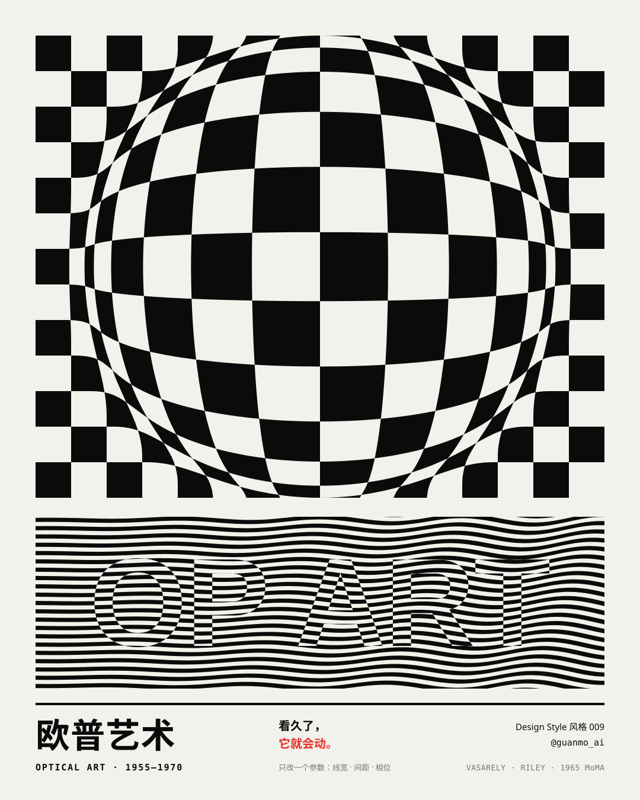 | 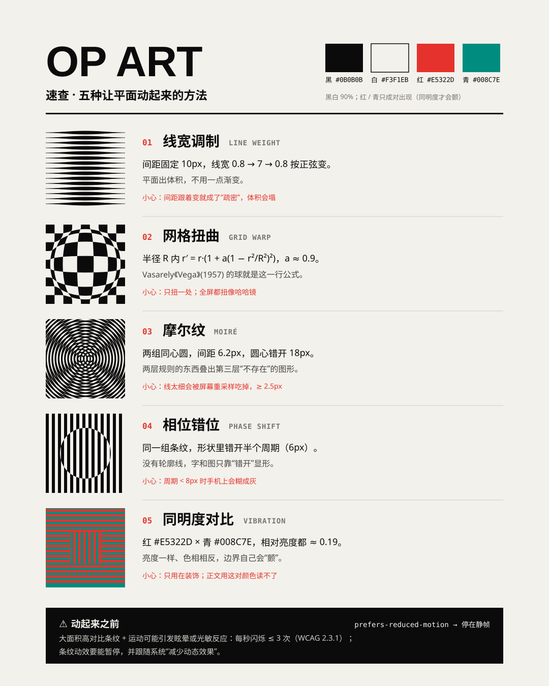 | 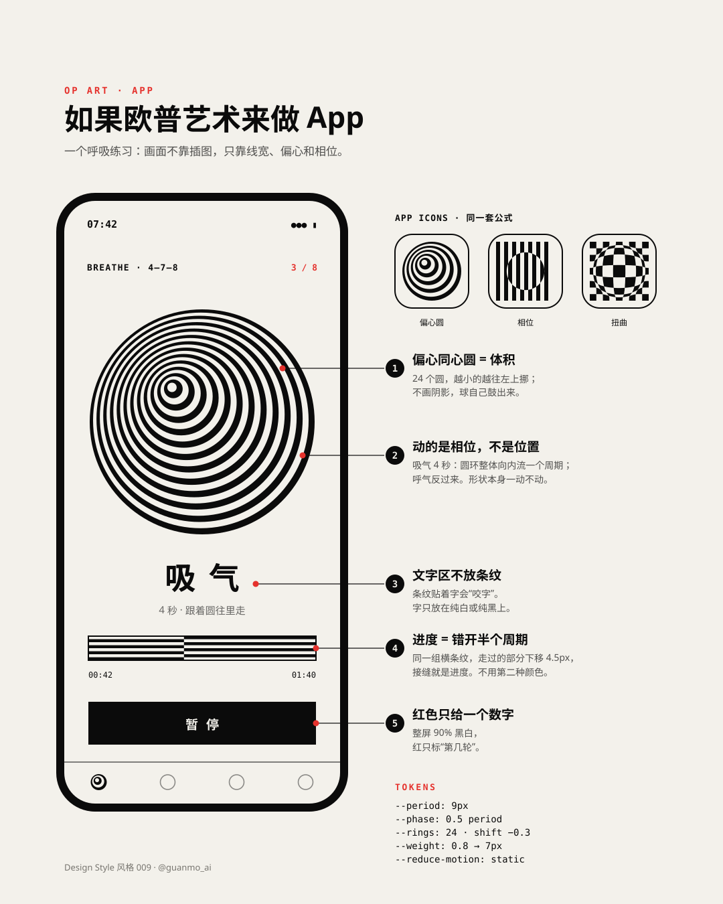 |

- **一句话：** 看久了，它就会动——只改一个参数（线宽、间距、相位），平面就鼓起来、流起来。
- **对设计师有用的地方：** 五种带参数的方法，可迁移到品牌图形、动态 logo、加载动画和图案：线宽调制 · 网格扭曲 `r′ = r·(1 + a(1 − r²/R²)²)` · 摩尔纹 · 相位错位 · 同明度对比（红 `#E5322D` × 青 `#008C7E`，相对亮度都 ≈ 0.19）。
- **色板：** 黑 `#0B0B0B` · 白 `#F3F1EB`（黑白 90%）· 红 / 青只成对出现
- **字：** Archivo 900（wdth 108—125）· Space Mono · Monoton（点缀）· Noto Sans SC
- **动效设想（15 秒）：** 白屏里条纹出现，标题靠相位错开显形 → 整片条纹像 Riley《Current》一样流动 → 平的棋盘被一个参数推成一颗球（Vega）并转动 → 两组同心圆滑过、流出摩尔纹 → 等宽线靠线宽调制转成圆柱 → 同明度红青“颤”一下收尾。全片不搬形状，只改参数。
- **安全线：** 每秒闪烁 ≤ 3 次（WCAG 2.3.1）；大面积高频条纹不要剧烈运动；提供减少动态效果的静帧版本。

---

## 1-bit 抖动像素 Dither（1984—今天）· `dither/`

| 海报 | 速查卡 | App 概念 |
|:-:|:-:|:-:|
| 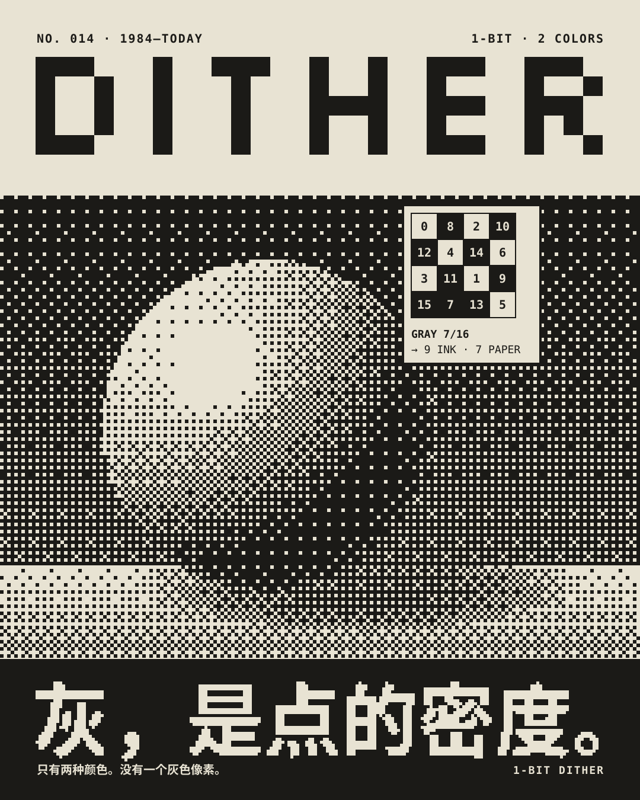 | 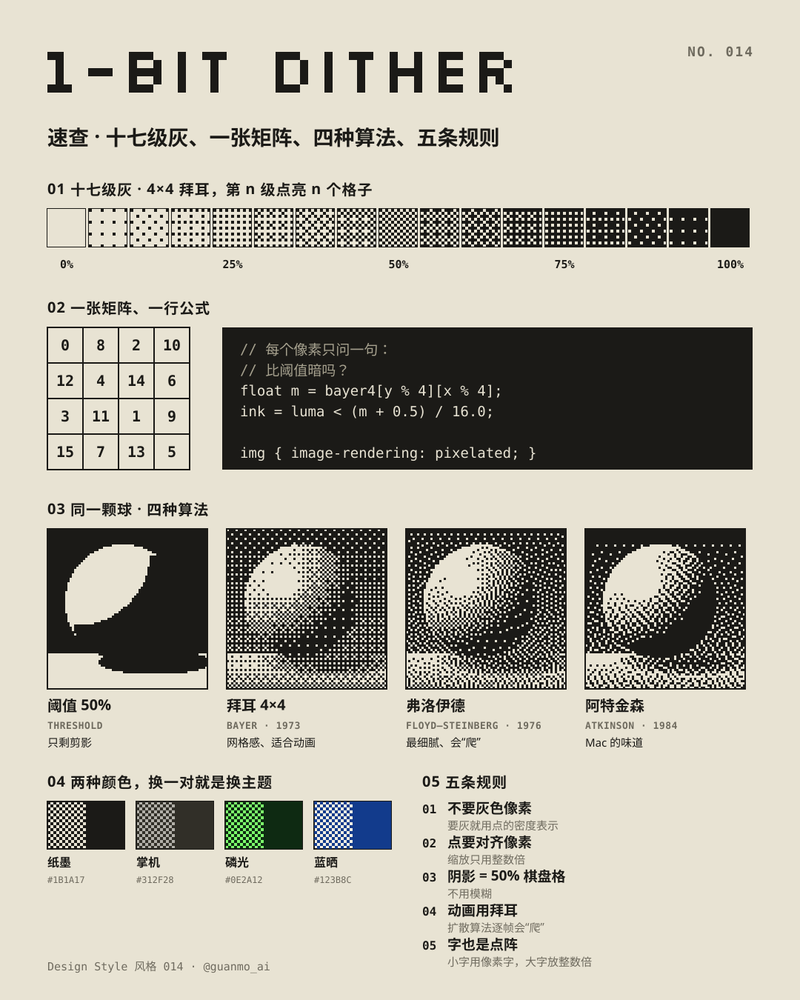 | 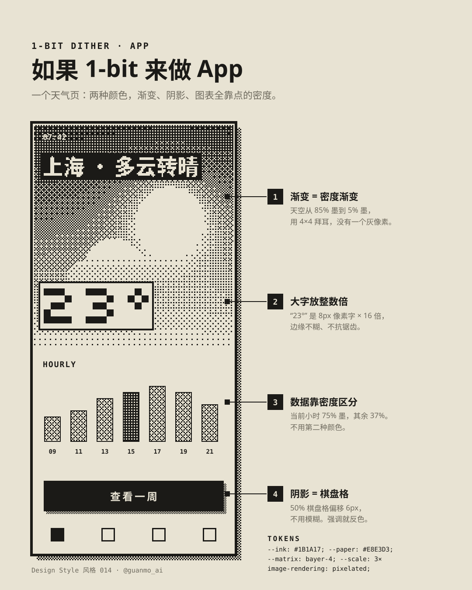 |

- **一句话：** 只有黑和白；灰，是点的密度。
- **对设计师有用的地方：** 4×4 拜耳的十七级灰（第 n 级点亮阈值 < n 的格子）、一行公式 `ink = luma < (bayer[y%4][x%4] + 0.5) / 16`、同一颗球四种算法对比（阈值 / 拜耳 1973 / Floyd–Steinberg 1976 / Atkinson 1984）、两色主题（纸墨 · 掌机 · 磷光 · 蓝晒）、阴影 = 50% 棋盘格。
- **色板：** 墨 `#1B1A17` · 纸 `#E8E3D3`（全片只有这两种）
- **字：** Silkscreen（像素标题，按 8px 原生尺寸的整数倍放大）· Space Mono · Noto Sans SC（大号中文在 `make_svgs.py` 里现场栅格化成点阵）
- **动效设想：** 一镜到底钻进一个像素：格子从 8px 长到满屏，途中亮出每格的阈值；被推近的那一格里是缩小 240 倍的整张画，推到底正好回到第 0 帧，无缝循环。光绕球转一圈，点阵一直在“爬”。所有渐显都用拜耳溶解，不用半透明。
