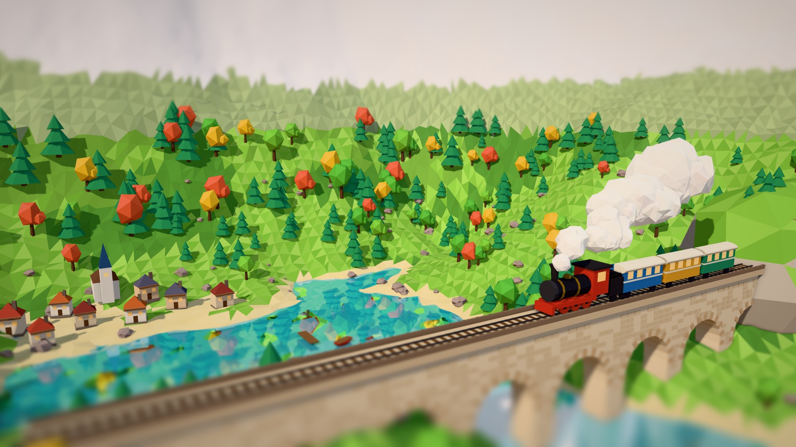
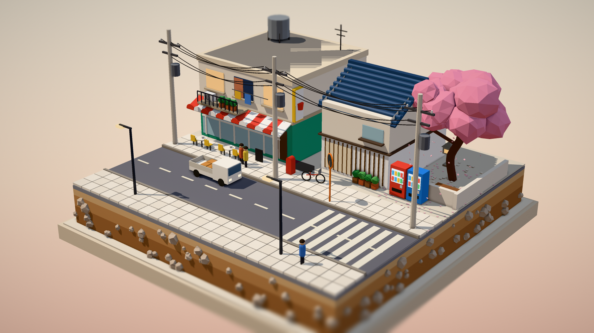
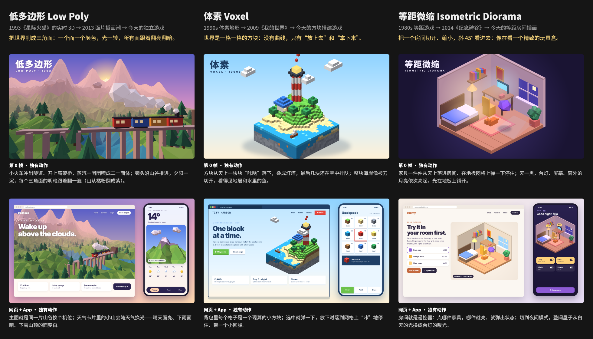
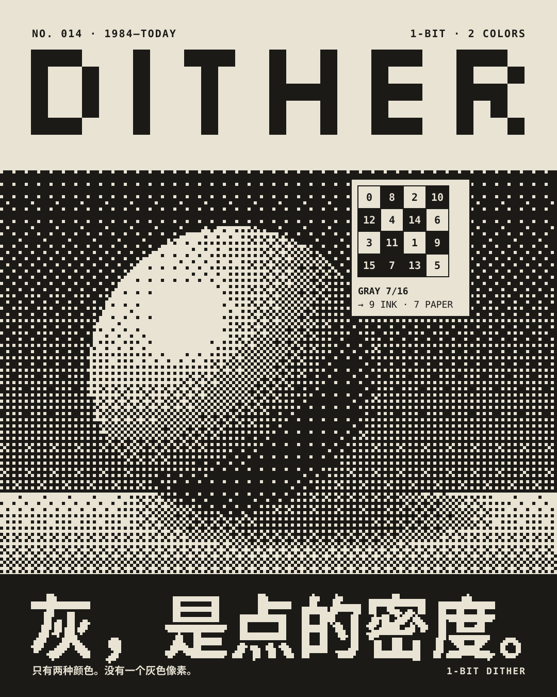
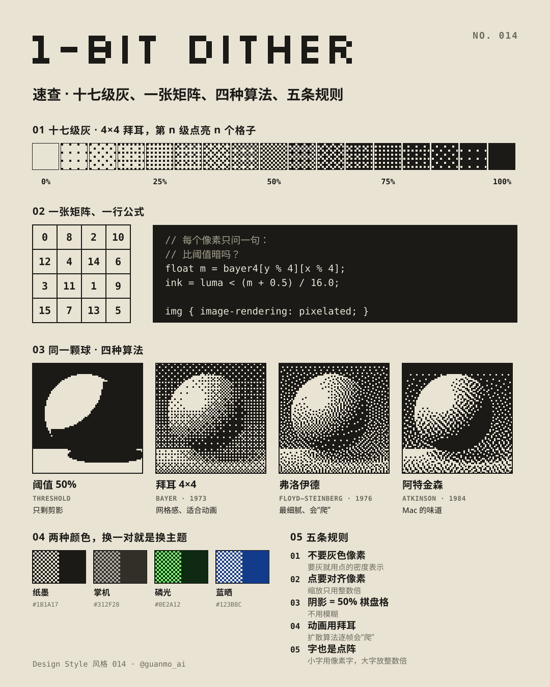
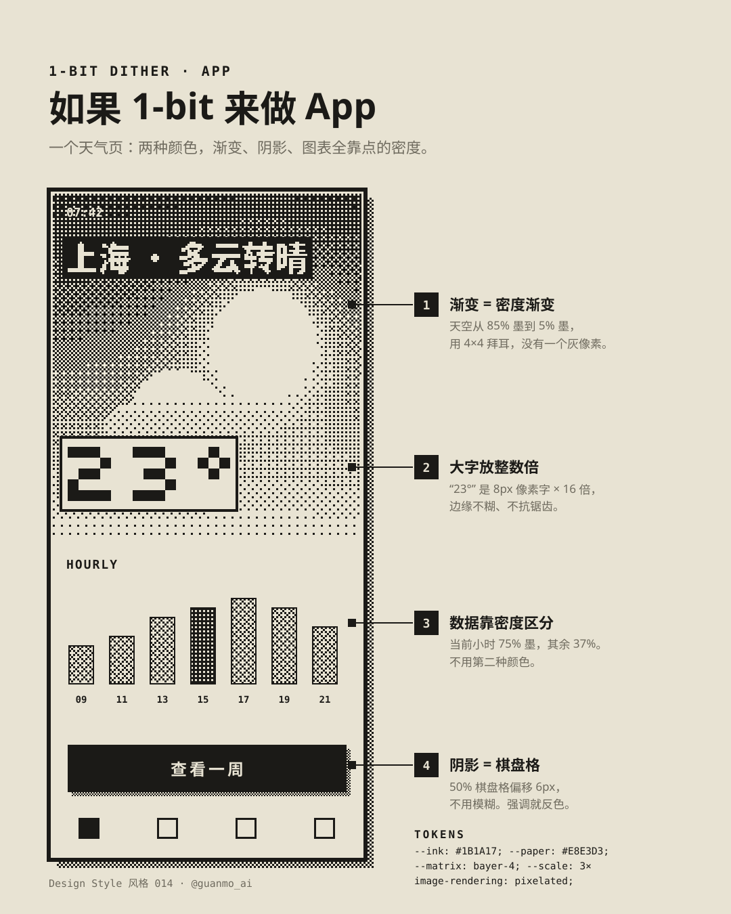

# 待做风格（草稿）

选题时做过、本期没选上的风格。三张风格图（海报 / 速查卡 / App 概念）已经做完，可以直接接着做成一期。

正式开做时：

1. 取下一个空期号，把目录移到 `styles/NNN-name/`（例如 `git mv drafts/op-art styles/014-op-art`）
2. 把图里的 `NO. 009` / `风格 009` 改成新期号，重跑 `python3 styles/NNN-name/images/make_svgs.py && python3 scripts/build_images.py styles/NNN-name/images`
3. 补第四张图、tokens、视频、配乐与文档（流程同 [MAKING_TEMPLATE](../docs/MAKING_TEMPLATE.md)）

字体已在 `scripts/build_images.py` 登记；Poiret One、Noto Serif SC 已随 013 装饰艺术加进 `scripts/fetch_fonts.sh`，Limelight、Monoton 开做时再加。

> 装饰艺术已做成 [013 · 装饰艺术](../styles/013-art-deco)；同批候选液态玻璃已做成 [014 · 液态玻璃](../styles/014-liquid-glass)。
>
> 未来主义已做成 [015 · 未来主义](../styles/015-futurism)。
>
> 抖动像素的图里写的是 `NO. 014`，开做时按上面第 2 步改成新期号。

---

## 排期（主人 2026-10-29 定）

| 风格 | 状态 |
|---|---|
| 中世纪现代 Mid-Century Modern · `mid-century/` | **下周做** |
| 第四轮候选：低多边形 / 体素 / 等距微缩（从参考视频提取） | 等主人选，见下 |
| 第三轮候选：赛博朋克 / 城市流行 / 膨胀风 | 等主人选（与第四轮一起看） |
| 第二轮候选：风格派 / 图形统计 / 无限画布 | 主人觉得一般（太像设计史教科书），图留着 |
| 欧普艺术、抖动像素 | 之前没选上，实在没得选再考虑 |
| 迷幻海报 Psychedelic · `psychedelic/` | **放到最后做** |
| ~~拟物 Skeuomorphism~~ | **不做**（图已删） |

主人偏好（选题参考）：**要年轻人喜欢、正在被追捧的风格**，别太像设计史教科书。最喜欢的是 005 波普、004 孟菲斯、003 构成主义、布局 02 瀑布流、布局 01 便当盒、001 包豪斯——**平涂、几何、大色块、有真实代表作的 20 世纪运动**，以及**对做界面直接有用的布局**。

## 5 秒动效小样（2026-10-29）

主人：静帧“不好不坏、不惊艳”，要顶尖的动效。改成先定动作、再出 5 秒小样。主人选了两个方向：

- **低多边形 · 折纸搭建**（`samples/origami/`）：纯 2D 平涂（奶油纸 + 红黄蓝绿），用 `_lib/poly3d.py` 逐帧算。纸面上的三角形一块块“翻牌”（原地跳起转一圈，前半圈是纸、转回来是颜色，过冲约 5%）拼成山、田、湖；树在拍点上一簇簇冒出来；枕木在火车前方一根根落下；蒸汽团最后铺满画面，回到第 0 帧的纸，循环。`python3 frames.py <目录>` → `node ../render_svgs.cjs <目录>` → `python3 audio.py x.wav`，150 帧约 40 秒。
- **微缩景观 · 街角**（`samples/diorama/`，场景 `_3d/diorama_anim.html` 由 `_3d/gen_anim.py` 从静帧场景生成，时间轴在 `_3d/anim_timeline.js`）：店面和民居从地里升起，二层、屋顶从天上落下压一下，电线杆长出来、电线拉过去，售货机落下、樱花冒出来，小卡车落到路上；然后白天 → 黄昏 → 入夜，窗户一盏盏亮、路灯亮、卡车亮着灯开走。three.js 软件渲染约 8 秒一帧，150 帧约 20 分钟（`node _3d/anim_shoot.cjs`）。

两段都是 120 BPM，一拍 15 帧，大动作落在拍点上；声音用 Python 标准库合成，每个动作一个声音，时间直接取自动画脚本。

## 第四轮改版：低多边形 + 微缩景观，做细、换成亮色（2026-10-29）

主人反馈：低多边形和微缩景观方向不错，但①不够精细；②颜色（黄昏紫、夜景蓝紫）不是他喜欢的——要像参考视频和波普 / 孟菲斯 / 包豪斯那样**明亮、干净、饱和的玩具色**。不一定非要真 3D，2D 做细也行。

| 低多边形 · 山谷小火车 | 微缩景观 · 街角模型 |
|:-:|:-:|
|  |  |

- 改用 three.js 渲染（`drafts/_3d/`：`valley.html`、`diorama.html`，底座 `lib.js`）：软阴影、GTAO 环境光遮蔽、移轴景深、Neutral 色调映射（不洗色）。云端软件 WebGL 一张 1920×1080（内部 2 倍）约 30 秒。
- 零件做细：石拱桥的石块和拱券石、带车轮连杆驾驶室的蒸汽机车、湖面倒影、教堂和小屋、秋色树；街角模型有切开的土层、遮阳篷、阳台晾衣、空调外机、水箱、电线杆和下垂电线、售货机、樱花和落花、小卡车、行人、猫。
- 用法：`cd drafts/_3d && npm install && node shoot.cjs valley.html out.png`（需要 `playwright` 自带的 Chromium）。
- **做成正片时：** 每帧约 30 秒，15—20 秒 × 60fps 约 1000 帧 ≈ 8—10 小时 CPU，超过一小时，按主人要求交给 Codex 用 Mac 显卡渲（`--gl=angle`），写进 `docs/HANDOFF.md`。

## 第四轮候选（2026-10-29，从主人给的参考视频提取，三选一，未占期号）

**参考视频是什么风格：** 低多边形（Low Poly）3D + 微缩景观（Diorama）——一座漂浮在云上的小岛，热气球把房子一栋栋吊上来盖成小镇，傍晚到入夜灯一盏盏亮、孔明灯升空。特征：三角面平涂、玩具般的饱和色、柔和的环境光、“小世界”的微缩感、昼夜换光。原视频是有人让 AI 从零写代码渲染的 3D 短片（不用模板、不加字），“AI 竟然能做出这个”本身就是传播点。

我们不照搬它（不做漂浮岛、热气球、小镇），只提取风格，再找两个相近的方向。三张图都用自己写的三角面渲染器 `drafts/_lib/poly3d.py` 现算：每个面算一次朝向打光、加雾，再按远近画成 SVG——纯 CPU，不用 WebGL，云端就能渲正片。

| | 低多边形 Low Poly · `low-poly/` | 体素 Voxel · `voxel/` | 等距微缩 Isometric Diorama · `iso-room/` |
|---|---|---|---|
| 一句话 | 把世界削成三角面：一个面一个颜色，光一转所有面跟着翻亮翻暗 | 世界是一格一格的方块：只有“放上去”和“拿下来” | 把一个房间切开、缩小，斜 45° 看进去，像精致的玩具盒 |
| 镜头 | 透视，沿山谷推进 | 正交等距，绕着方块转 | 正交等距，固定机位、换光 |
| 第 0 帧 · 独有动作 | 小火车冲出隧道开上高架桥，蒸汽喷成二十面体；夕阳一沉，每个三角面的明暗跟着翻一遍 | 方块从天上一块块“咔哒”落下叠成灯塔，最后几块还在空中排队；海岸被切开，看得见地层和鱼 | 家具一件件落进房间、在地板网格上弹一下停住；天一黑，台灯、屏幕、月亮依次亮起 |
| 网页 / App | 徒步预订 + 天气（小山随天气换光） | 方块游戏官网 + 背包（每格一个现算方块） | 家具店房间规划 + 智能家居（房间就是遥控器） |
| 可选代表作 | 《星际火狐》（1993）·《VR 战警》（1993）· 2013 年前后的低多边形插画潮 ·《纪念碑谷》（2014）·《Alto’s Adventure》（2015）| 体素地形《Comanche》（1992）·《我的世界》（2009）·《天天过马路》（2014）· MagicaVoxel（2014）·《Townscaper》（2021）| 《模拟城市 2000》（1993）·《哈宝酒店》（2000）·《纪念碑谷》（2014）· Dribbble / 小红书的等距房间插画 |

**推荐：低多边形。** 它就是参考视频的风格本体，画面最有电影感（透视镜头、夕阳、雾、蒸汽），“镜头本身在动”和“一个面一个颜色”都直接对上我们的检查表；渲染器已经能出这种画质。**体素**最讨年轻人喜欢（我的世界那一代），“方块咔哒落下”的动作最解压；**等距微缩**最治愈、最适合落到 App 界面，但三个里动作幅度最小。

## 第三轮候选（2026-10-29，年轻人正在追的风格，三选一，未占期号）

| | 赛博朋克 Cyberpunk · `cyberpunk/` | 城市流行 City Pop · `city-pop/` | 膨胀风 Inflated 3D · `inflated/` |
|---|---|---|---|
| 年代 | 1982《银翼杀手》→ 1995《攻壳机动队》→ 2077 | 1978—1988 · 東京 | 2021— |
| 一句话 | 高科技，低生活：黑夜、雨、霓虹，一切都在闪、都在出故障 | 把夏天装进唱片封面：喷枪蓝天、白房子、棕榈和泳池，永远是下午三点 | 一切都是充气的：圆鼓鼓、软乎乎，按下去会凹 |
| 气质 / 色彩 | 酷、电影感；夜黑 + 霓虹粉 `#FF2E97` 青 `#20F2FF` 酸黄 `#F4FF3A` | 慵懒、怀旧、晴朗；深蓝渐变天 `#0638B8` + 泳池青 + 落日粉橙 | 可爱、解压；奶紫底 + 糖果粉 `#FF6FAE` 紫 `#A98BFF` 薄荷 `#4FDDB8` 奶黄 `#FFD45C` |
| 运动方式 | 闪烁 + 撕裂：灯管点亮、故障错位、雨和倒影 | 慢速多层视差：车窗般横移、水花慢动作 | 充气 + 回弹：吹鼓、挤扁、弹回 |
| 第 0 帧 · 独有动作 | 霓虹灯管一根根“噼”地点亮（先闪两下再稳住），画面在重拍上被横向撕开、红青错位；雨一直下，湿地面的倒影跟着灯一起亮、被水波扯碎 | 镜头像车窗一样慢慢横移，前景棕榈快、白房子慢、云最慢；水花慢动作炸开再落下，水面高光一闪一闪；标题带着 80 年代速度条纹划进来 | 字母一个个被打气筒“噗”地吹鼓（体积过冲约 8% 再回弹抖两下），最后一个还瘪着、正在进气；被碰到就挤扁，松开弹回 |
| 网页 / App · 独有动作 | 切角面板像全息投影一行行扫出来，数字滚动跳变；按下时故障一闪；霓虹路线一路“描”过去 | 主图是一张会动的画，滚动时按视差错开；磁带卷盘一快一慢地转；落日渐变按钮一点像阳光扫过 | 按钮按下去会凹、松手“啵”地弹回；进度条像灌气一样一节节鼓起来，金币落进罐子弹两下 |
| 可选代表作 | 《银翼杀手》（1982）·《阿基拉》（1988）·《攻壳机动队》（1995）·《黑客帝国》（1999）·《赛博朋克 2077》（2020）· 九龙城寨 / 重庆夜景 · 机能风穿搭 | 山下达郎《FOR YOU》（1982，铃木英人）· 大泷咏一《A LONG VACATION》（1981，永井博）· 霍克尼《更大的水花》（1967）· 竹内玛莉亚《Plastic Love》（1984）在 YouTube 的翻红 · 今天的 lo-fi 直播封面 | 1967 Blow 充气椅 · 1970s 纽约泡泡字涂鸦 · Koons《气球狗》（1994—2000）· 微软 Fluent 3D 表情（2021）· MSCHF 大红靴（2023）· 小红书的膨胀字 |
| 技术路线 | SVG：发光滤镜、倒影 + 水波位移、横带错位 + 通道分离 | SVG：渐变 + 平涂零件（`city-pop/scene.py`：积云、棕榈、水面高光） | SVG 光照滤镜（`inflated/puff.py`）：模糊程度 = 鼓起程度，从 0 涨上去就是充气 |

**推荐：赛博朋克。** 第一帧最有电影感（霓虹、雨、倒影，正对 015 总结的“开头往电影感靠、主角要大要亮”），推特上最容易停住手指；代表作横跨电影、动画、游戏、城市、穿搭、界面，一章一个领域很好排。要守住一条：故障撕裂只在重拍上出现，不能一直抖。

**其次膨胀风。** 最“当下”、最轻松可爱，充气滤镜能直接给设计师拿走；但代表作偏新，历史纵深不如前两个。**城市流行**画面最好看、配乐最好做（80 年代日系 funk），但动作偏慢，要靠视差和水花撑住“惊艳”。

## 第二轮候选（2026-10-29，按上面的偏好再找，三选一，未占期号）

| | 风格派 De Stijl · `de-stijl/` | 图形统计 Isotype · `isotype/` | 无限画布 Infinite Canvas（布局）· `infinite-canvas/` |
|---|---|---|---|
| 年代 | 1917—1931 · 荷兰 | 1925—1934 · 维也纳 | 1963 Sketchpad → 2016 Figma → 今天 |
| 一句话 | 只用横线、竖线和红黄蓝：一刀刀切开画面，再往格子里灌颜色 | 一个图形永远代表同一个数：多了就多摆几个，绝不放大；不满一个就切掉一截 | 没有页面、没有边界：内容摆在一张无限大的平面上，靠缩放和平移去找 |
| 气质 / 色彩 | 严谨、有节奏；纸白 + 黑线 + 红 `#D52B1E` 黄 `#F4C51C` 蓝 `#1C4DA1` | 友好、讲道理；米纸 + 墨 + 砖红 `#C7372C` 钢蓝 `#2C5A8A`，颜色只表示类别 | 轻松、协作；点阵灰底 + 便签色 + 选中蓝 `#2F6BFF` + 带名字的彩色光标 |
| 运动方式 | 切割 + 灌色：直线运动、硬停顿 | 盖章 + 排队：一个个落下、堆高 | 镜头运动：推、拉、平移，语义缩放 |
| 第 0 帧 · 独有动作 | 黑线像刀一样横穿画面，把一格切成两格（切开那一下“咔”地顿住），再从切口把颜色灌满一格；字也是一根根矩形“搭”上去的。整张画面是一棵不断二分的树 | 数字往上涨，人形就一个接一个“盖章”落进虚线格，从底往上堆成柱子——两堆图形本身就是柱状图；最后不满一个的那个被竖着切掉一截 | 镜头本身是主角：一直在推近、拉远、平移；拉远时卡片收成色块只剩大标题，推近时细节一层层长出来；好几个带名字的光标同时在拖、拉、连线 |
| 网页 / App · 独有动作 | 整页就是一张网格，黑线就是布局。换页时线先切出新格子、颜色再灌进去；日历里每个事件是一格，拖动时整排格线跟着重切 | 图标像活字一样咔咔排队：去年一排淡、今年一排实，新的一格落下时整排往右让位；数据变了只增减个数，从不缩放 | 节点之间的连线跟着拖动实时弯曲；手机上双指一捏，四天行程收成四块大标题，一放开，每块里的卡片重新长出来 |
| 可选代表作 | Huszár《De Stijl》刊头（1917）· Rietveld 红蓝椅（1918）· 施罗德住宅（1924）· Van Doesburg 奥贝特咖啡馆（1928）· Mondrian《构成》（1930）·《百老汇爵士乐》（1943）· YSL 蒙德里安裙（1965）→ 今天的便当盒布局 | Neurath《社会与经济》图集（1930）· Arntz 图形符号 · 东京奥运象形图（1964）· Aicher 慕尼黑奥运（1972）· AIGA 交通标志（1974）→ 今天的图标、emoji、数据新闻 | Sutherland Sketchpad（1963）· Engelbart“演示之母”（1968）· Prezi（2009）· Figma（2016）· 白板与节点式 AI 工作流（今天） |
| 技术路线 | 纯 SVG 矩形（`de-stijl/blocks.py`：横竖矩形拼字） | 纯 SVG `<symbol>` + `<use>`（`isotype/picto.py`：图形库 + 切截） | HTML / SVG（`infinite-canvas/common.py`：光标、选框、便签） |

**推荐：风格派。** 和你最喜欢的包豪斯、构成主义同一路（平涂、几何、大色块），代表作横跨刊头字体、家具、建筑、室内、绘画、时装，一章一个领域很好排；“切一刀、灌一格”的动作前面没有用过；最后一章正好落到今天的便当盒布局和网格界面，对设计师最直接。风险是红黄蓝和 001 包豪斯撞色，靠“只有横竖、没有圆和三角”和切割动作拉开。

**其次图形统计。** 最实用（图标系统、数据可视化），封面那面“人墙”在推特上很抢眼；代表作从 1930 年的图集一路到奥运象形图和 emoji。**无限画布**适合排进布局系列，它的冲击力主要靠镜头运动，静帧封面在三个里最像界面截图。

## 第一轮候选（2026-10-29）

每个风格两张图：**第 0 帧** + **落到网页和手机 App**，图在各自的 `png/` 下。生成方式：`python3 drafts/<风格>/cover.py`（或 `ui.py`）→ `node drafts/_lib/shot.cjs <html> <png>`；对比图 `python3 drafts/_lib/compare.py`。新字体（Bagel Fat One、Anton、Righteous、Caveat、Inter）开做时补进 `scripts/fetch_fonts.sh`。

- **迷幻海报 Psychedelic（1966—1972）**：字被灌进一个形状里，直到撑满。动作：字像热蜡灌进会晃的模子，一滴拉出细颈后断开，背后色环往外流。工具 `psychedelic/warp.py`。
- **中世纪现代 Mid-Century Modern（1945—1965）**：剪刀代替尺子。动作：一秒 12 张的定格，纸边每跳重剪一遍，剪纸手把零件一块块放上去，提起时影子长而虚、按下时收紧。工具 `mid-century/cut.py`。代表作：Bass《金臂人》片头（1955）· Nelson 球钟（1949）· Eames Hang-It-All（1953）· Girard 织物（1952）· Rand ABC 标志（1962）· Case Study House #22（1960）。

---

## 欧普艺术 Op Art（1955—1970）· `op-art/`

| 海报 | 速查卡 | App 概念 |
|:-:|:-:|:-:|
|  |  |  |

- **一句话：** 看久了，它就会动——只改一个参数（线宽、间距、相位），平面就鼓起来、流起来。
- **对设计师有用的地方：** 五种带参数的方法，可迁移到品牌图形、动态 logo、加载动画和图案：线宽调制 · 网格扭曲 `r′ = r·(1 + a(1 − r²/R²)²)` · 摩尔纹 · 相位错位 · 同明度对比（红 `#E5322D` × 青 `#008C7E`，相对亮度都 ≈ 0.19）。
- **色板：** 黑 `#0B0B0B` · 白 `#F3F1EB`（黑白 90%）· 红 / 青只成对出现
- **字：** Archivo 900（wdth 108—125）· Space Mono · Monoton（点缀）· Noto Sans SC
- **动效设想（15 秒）：** 白屏里条纹出现，标题靠相位错开显形 → 整片条纹像 Riley《Current》一样流动 → 平的棋盘被一个参数推成一颗球（Vega）并转动 → 两组同心圆滑过、流出摩尔纹 → 等宽线靠线宽调制转成圆柱 → 同明度红青“颤”一下收尾。全片不搬形状，只改参数。
- **安全线：** 每秒闪烁 ≤ 3 次（WCAG 2.3.1）；大面积高频条纹不要剧烈运动；提供减少动态效果的静帧版本。

---

## 1-bit 抖动像素 Dither（1984—今天）· `dither/`

| 海报 | 速查卡 | App 概念 |
|:-:|:-:|:-:|
|  |  |  |

- **一句话：** 只有黑和白；灰，是点的密度。
- **对设计师有用的地方：** 4×4 拜耳的十七级灰（第 n 级点亮阈值 < n 的格子）、一行公式 `ink = luma < (bayer[y%4][x%4] + 0.5) / 16`、同一颗球四种算法对比（阈值 / 拜耳 1973 / Floyd–Steinberg 1976 / Atkinson 1984）、两色主题（纸墨 · 掌机 · 磷光 · 蓝晒）、阴影 = 50% 棋盘格。
- **色板：** 墨 `#1B1A17` · 纸 `#E8E3D3`（全片只有这两种）
- **字：** Silkscreen（像素标题，按 8px 原生尺寸的整数倍放大）· Space Mono · Noto Sans SC（大号中文在 `make_svgs.py` 里现场栅格化成点阵）
- **动效设想：** 一镜到底钻进一个像素：格子从 8px 长到满屏，途中亮出每格的阈值；被推近的那一格里是缩小 240 倍的整张画，推到底正好回到第 0 帧，无缝循环。光绕球转一圈，点阵一直在“爬”。所有渐显都用拜耳溶解，不用半透明。
