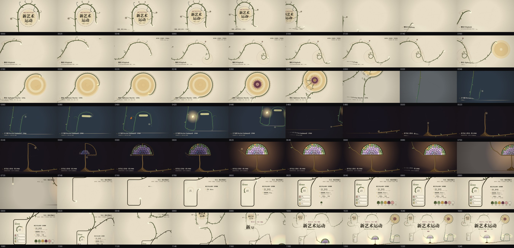

# 新艺术运动 Art Nouveau · 制作过程

> 记录，不是规则。必须守的只有 [`docs/DESIGN_NOTES.md`](../../docs/DESIGN_NOTES.md) 开头那八条。

🎬 [成片](film/art-nouveau-film.mp4) · 🧾 [分镜](film/STORYBOARD.md) · 每 20 帧一张：

## 一览

| | |
|---|---|
| 成片 | 21 秒 · 1920×1080 · 60fps · 约 23 MB，配乐由代码合成（-14 LUFS，一支圆舞曲） |
| 画面 | Canvas 2D，没有 WebGL。每帧是帧号的纯函数；4 个子帧做运动模糊 |
| 速度 | 云端 0.07 秒 / 帧（3 路并行），整片渲染 + 合成约 3 分钟 |
| 外部素材 | 没有。字体 Noto Serif SC、Cormorant、Cinzel Decorative（都是 OFL） |
| 选题 | 主人在浮世绘和新艺术运动的候选图里选了后者：“给我做一个顶尖的动效，起码媲美毛绒，一定要很丝滑” |

## 为什么是“一根线”

先问的是：这种风格自己会怎么动？新艺术运动所有东西都是从植物来的，线是**长**出来的。于是全片只有一个动作——一根鞭线往前长——其余全部是它经过之后长出来的附属物。再往前推一步：既然一切都是这根线长出来的，那就让**整支片子只有一根线**，绕世界一圈回到起点。片尾拉远的那一下是这个决定直接推出来的，也是全片最想让人“哇”的地方。

这一期**没有用默认骨架里的规则卡章和固定外框**：规则放进了手机那一章旁边（三条 + 色板），鞭线的规则在第一章用曲率梳直接演示。

## 签名动作：蕨菜一样的梢头

主线是一串点（每 2px 一个，带方向和粗细），由 `world.js` 按曲率积分出来。画的时候只取长到的那一段，最后 240px 重新积分：额外的曲率 = C·(1−d/U)²，C 跟着“生长速度过一根弹簧”走。所以梢头在加速时卷紧、停下时冲过头再松开。卷曲方向取“接下来往哪边拐”（tanh 连续取值），不会突然翻面。

枝条是同一套：从主线某一点出发的一小段鞭线，主线经过后才开始长，自己的梢头也卷着；长完之后曲率跟着风轻轻晃。

## 走过的弯路

| 问题 | 原因 | 怎么改 |
|---|---|---|
| 页面卡死 | 自己的 `function frame` 和 `window.frame` 是同一个名字，无限递归 | 改名 `draw` |
| 转场时画面空 | 主线在两章之间跑 2000—2900px，镜头跟着它，下一章的东西还没长出来 | 拉远镜头没用（看到的是更大的空白）。改成让线在转场里冲刺 + 沿途长叶子 + 镜头往前看 22 帧 |
| 跟拍时梢头总在画面边上 | 高斯平滑让镜头落后于梢头 | 镜头目标取 22 帧之后的梢头位置 |
| 台灯像彩虹 | 规则的扇形格子 + 按行配色 | 行边界改成起伏的弧、每格左右随机偏、每格自己有径向深浅，配色按“天 → 紫藤 → 叶”分族随机 |
| 规则只停留 1.7 秒 | 收尾段太挤 | 全片加一小节（20 → 21 秒），规则多停 1 秒 |
| 进度数字带重影 | 运动模糊把 58% 和 59% 叠在一起 | 数字按整帧取值 |

## 没做、没验证的

- **看过的是静帧、联系表和连续帧，不是播放。**“丝滑”只用 `smooth.py` 量过（跳变 0、死区 0、最大单帧变化 10.9）。
- **配乐没听过**：只核对了时长（21.0 秒）、响度（-14 LUFS）和每半秒的音量曲线（夜里那几小节弦乐偏轻约 5 dB，片尾全和弦最响）。
- 没做四张风格图、tokens、期号；等主人审片。
- 只有横版。

## 可以留给以后的

- `film/engine.js` 的 `shapeTip`：任何“长出来的线”（藤、闪电、墨迹、电路）都能用，梢头卷曲 + 嫩梢变细，每帧纯函数。
- `film/path.js`：按曲率积分的路径构造器（`clo / arc / to / mark`），配 `film/debug.html` 看整张世界的布局。
- 镜头“往前看 N 帧再高斯平滑”的跟拍写法。
