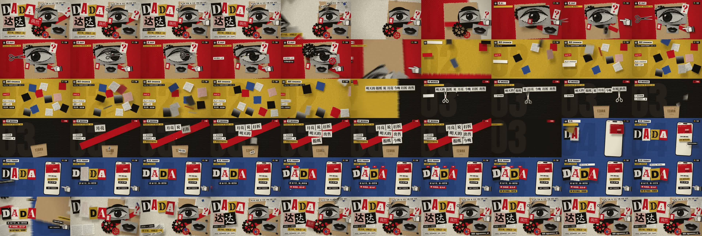

# 达达 Dada · 制作过程

> 记录，不是规则。必须守的只有 [`docs/DESIGN_NOTES.md`](../../docs/DESIGN_NOTES.md) 开头那八条。

🎬 [成片（第二版）](film/dada-film.mp4) · 🧾 [分镜](film/STORYBOARD.md) · 每 18 帧一张：

## 一览

| | |
|---|---|
| 成片 | 17.87 秒 · 1920×1080 · 60fps · 1072 帧 · 约 31 MB |
| 画面 | Node + `@napi-rs/canvas`（Skia 的 Canvas 2D），**不用浏览器**。每帧是帧号的纯函数；5 个子帧做运动模糊 |
| 速度 | 本机约 0.13—0.15 秒 / 帧，整片渲染 + 编码约 2 分 40 秒 |
| 配乐 | 生成的纯音乐《Cut and Paste》（`film/music/cut-and-paste.mp3`，实测 128.63 BPM），上面叠一层代码合成的纸声；成片 -14.1 LUFS，峰值 -2.8 dBTP |
| 外部素材 | 除配乐外没有。“照片”是亮度函数现算的网点，纸纹是噪声 |
| 字体 | Abril Fatface、Anton、Rye、Alfa Slab One、Archivo Black、Noto Sans SC、Noto Serif SC、Ma Shan Zheng（OFL）；Special Elite（Apache 2.0）。已登记进 `scripts/fetch_fonts.sh`，许可是按 Google Fonts 的 `ofl/`、`apache/` 目录推断的，没有逐个读许可证 |

## 主人怎么说的

- 2026-11-18：要新风格，“你不要自己想这些”“要真的能代表设计风格的”。从《梅格斯平面设计史》第七版目录里挑了达达和维也纳分离派，各出两张图（`png/`、`../secession/png/`），评价“还不错”。
- “先给达达吧，把它做出一个顶尖的动效出来。把它当做你毕生最重要的一件事对待。目的就是推特爆款，然后动效顶尖，对设计师有帮助。”“你可以不用被我这个仓库束缚。”
- 第一版（20 秒）：“好像还行，又好像不行的样子。我希望你的背景能够变啊，背景不要一成不变的。然后动效再顶尖一点，节奏再快一点。还有你的 BGM 不好听啊……不要老是跟以前一样的。”
- 第二版（本目录的成片）：“这个做得很好。”

## 从一个词到成片

1. **先问它自己怎么动。** 达达的东西是剪下来、撕下来、贴上去的纸，贴的时候不讲究。所以全片只有一条物理：**纸片从空中“啪”地拍下来**——抛物线落地（落地那一帧最快）、影子随高度变远变虚、落定后角度抖两下。转场、出字、标注全用这一下。
2. **同一批纸片接力到底。** 全片约 60 张纸片（`film/pool.mjs`），每一章是它们重新落成的另一张拼贴，没有硬切。第 0 帧就是封面，片尾飞回同一张拼贴。
3. **四章各演一种手法**：剪（照片蒙太奇）→ 偶然（随机落点）→ 词（把标题剪开重排）→ 今天（落进手机界面，三条规则各自演示自己）。分镜见 [`film/STORYBOARD.md`](film/STORYBOARD.md)。
4. **没按仓库的出片方式做。** 本机 Chrome 无头模式在沙箱里起不来，改用 Node 的 Canvas 库直接画帧，原始像素经管道送进 ffmpeg。附带的好处是快，画质不用妥协。
5. **审片顺序**：全片低密度联系表 → 关键帧 2×2 大图 → 成片里解码抽帧核对跳变 → `smooth.py`。

## 第一版 → 第二版

第一版的场景和配乐脚本留在 [`film/v1/`](film/v1)（成片没入库）。

| 主人说的 | 第二版怎么改 |
|---|---|
| 背景一成不变 | 每章一张不同的大底纸：米 → 红 → 赭黄 → 黑 → 蓝 → 米。换章时**整张底纸被撕走**（四个方向轮着来，撕口露白纤维、投影子），露出下一张。每张底纸有自己的网点 / 十字 / 铅字条 / 格线和一个大号章节数字 |
| BGM 不好听、老跟以前一样 | 不再用代码合成乐曲，改用音乐生成模型出一首纯音乐；画面拍点按这首曲子**实测**的拍子重排。代码只合成纸声（落地、剪刀、撕纸、摇袋子、打字），压在配乐下面约 16 dB |
| 节奏再快一点 | 20 秒 → 17.87 秒，120 → 128.63 BPM，每章都缩短；纸片飞行时长 26 → 24 帧 |
| 动效再顶尖一点 | 重的一下落地会**震到旁边的纸片**（离得越远跳得越晚、越低）并崩出纸屑；有鼓的段落镜头每拍往里顶一下，每章镜头歪一个小角度；眼珠一格格跟着剪刀看过去；方纸飘着落；剪刀加贴纸式描边 |

## 配乐怎么对上的

- 生成参数：纯音乐、24 秒，风格描述是“拼贴感放克，约 126 BPM，第一拍就进律动，干的碎拍鼓、跳跃的贝斯、切碎的铜管和钢琴短句，换段前鼓停一拍，结尾一记干净的重击”。一次返回两首，另一首结尾被硬切，没用。
- **实际出来的风格和要的不完全一样**：音频分析模型听到的是“俏皮的复古电子 / 合成器流行”，无人声，没发现失真或跑调。
- 逐拍量了整体 / 低频 / 高频能量（脚本没入库，结论写在这里）：128.63 BPM，第 0 拍在 0.038 秒；第 14 拍起鼓和贝斯陆续进来，第 30—33 拍鼓停，第 34 拍全部回来，最后一击在 23.418 秒。
- 片子第 0 帧 = 曲子 6.548 秒（第 14 拍落在第 1.2 帧）。于是：红纸在片子第 4 拍拍下，鼓停的四拍用来剪标题、装袋、摇（第三章前半），鼓回来那一下（片子第 20 拍）红带砸下、词一个个蹦出来，署名落在最后一击上。
- 核对：成片音轨和原曲做互相关，起点 6.548 秒；最后一击折算到片子第 1012.2 帧，署名落地在第 1012 帧。

## 审片里改掉的

| 看到的问题 | 改法 |
|---|---|
| 底层的大纸片飞的时候跳到所有东西上面 | 牛皮纸、黑圆、红带、报纸不参与“飞起来就置顶” |
| 剪开的照片后来又合回去了 | 错位一直保持到它飞走 |
| 开场剪刀横着盖住标题 | 斜着从右上伸进来，第三剪把第一个词剪掉 |
| 方纸太小、互相离得远，画面散 | 放大到 1.3 倍，重排落点 |
| 那首诗字太小、底下太空 | 黑圆（第一版）/ 红带（第二版）垫在诗下面，诗放大到 1.55 倍 |
| 外框跟着镜头缩放，四角被裁 | 外框和标注画在屏幕坐标里，只跟落地的震动 |
| 眼珠在子帧之间换格，出现重影 | 眼珠按整帧取值 |
| 剪刀压在照片、红纸、黑纸上看不清 | 加一圈贴纸式描边；黑纸那一章剪刀换成浅色 |
| 署名贴着画面右下角 | 往里挪 |
| 一条标注压在字母卡上 | 挪到卡片上方的空处 |
| 片尾一度对错了位置（署名落在配乐结束之后） | 按互相关重新核对，署名对回最后一击 |

## 丝滑量出来的数（`python3 drafts/_lib/smooth.py film/dada-film.mp4`）

1072 帧 · 相邻帧平均差 4.36（中位 2.69，最大 25.14 @ 第 905 帧）· 死区 0 段 · 跳变 9 处：

- 7：字母卡 A 拍下（开场第一下）
- 757、785、813、841、869：间隔正好一拍，对应镜头每拍往里顶一下
- 1012、1014、1015：署名拍下

抽帧看过的是第 5—8、755—758、903—906、1011—1014 帧；785 到 869 那四处只按间隔对上了，没有逐个抽帧。

## 图上的史实

| 片里写的 | 核对到哪 |
|---|---|
| 达达 1916—约 1924，苏黎世伏尔泰酒馆 | [MoMA 的运动年代](https://www.moma.org/momaorg/shared/flattened_pages/moma_learning/themes/dada/)与[大都会艺术博物馆的酒馆记录](https://www.metmuseum.org/research-centers/leonard-a-lauder-research-center/research-resources/modern-art-index-project/ball-and-hennings) |
| Hannah Höch · 照片蒙太奇 · 1919 | [柏林新国家美术馆藏品记录](https://id.smb.museum/object/961048)，1919 年为《用达达餐刀切开……》的创作年份 |
| Jean Arp · 按偶然的法则排列 · 1916—17 | [MoMA 藏品记录](https://www.moma.org/collection/works/37013)。纸片自然落下的做法有同代人记述，MoMA 也指出成品较规整，可能保留了有意安排 |
| Tristan Tzara · 做一首达达诗 · 1920 | [《Littérature》1920 年第 15 期第 18 页](https://sdrc.lib.uiowa.edu/dada/litterature/15/pages/18.htm) |

制作时先查了摘要，上架前补核了上述藏品和原始期刊。1920 年原页用的是袋子（*un sac*）。

**那条报纸标题（明天的报纸说月亮今晚打折出售）和抽出来的诗是自己编的**，不是查拉的作品；纸袋上印的“TZARA 1920”只是指这个方法的出处。眼睛、嘴、齿轮、指示手都是代码画的，没有照搬具体作品。

## 没做、没验证的

- **看过的是静帧、联系表和连续帧，不是播放。**
- **配乐没有亲耳听过**：听感来自音频分析模型的描述，加上自己量的拍点、响度和音画对位。
- 配乐来自美图设计室的音乐生成工具。画廊和 Release 标注 AI 生成配乐，平台使用规则见[美图设计室用户协议](https://www.designkit.cn/agreement)。
- **约 11.1—11.4 秒画面几乎是空的**：第三章的诗飞走、黑纸还没撕完，只剩黑底和“03”。
- **第四章信息偏密**：左边四张字母卡加三条规则、右边一部手机；第二版只是加快了，没有重新设计。
- 只有横版。画廊版图解、tokens、时间轴和中英文指南见[达达正式目录](../../styles/029-dada/README.md)。
- 第一版成片没入库（只留了源码）。
