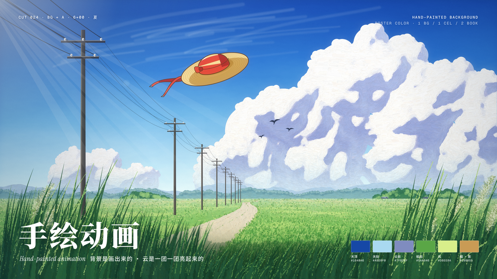
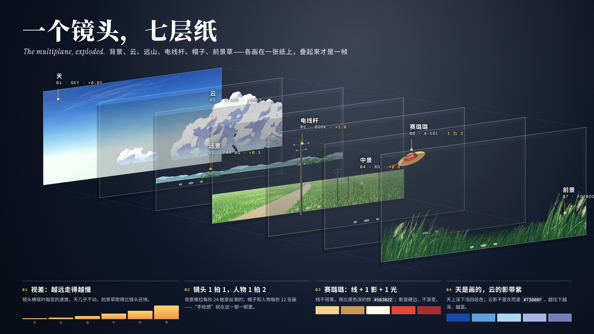
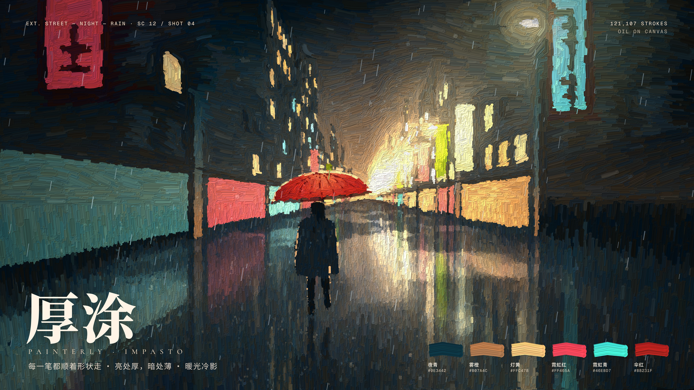
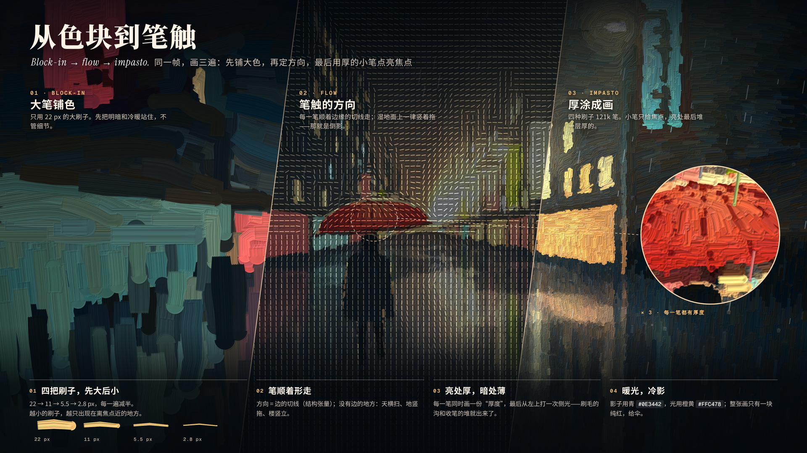
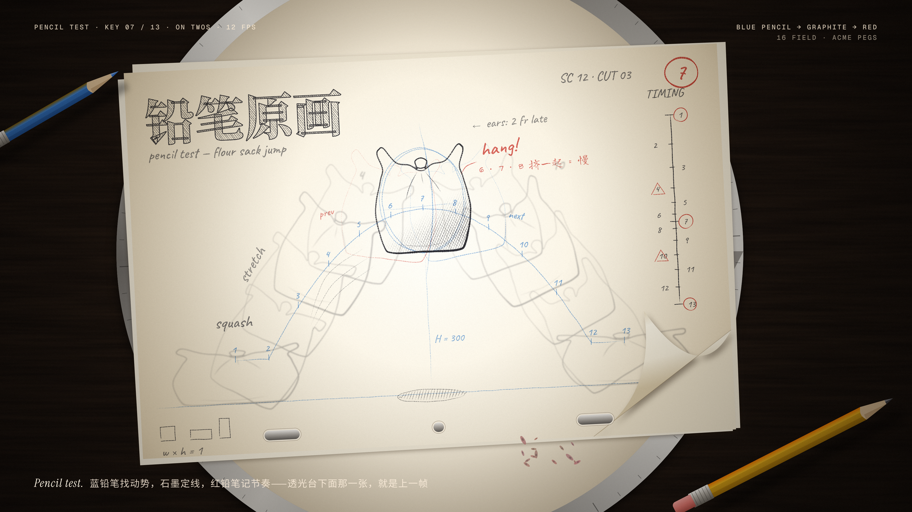
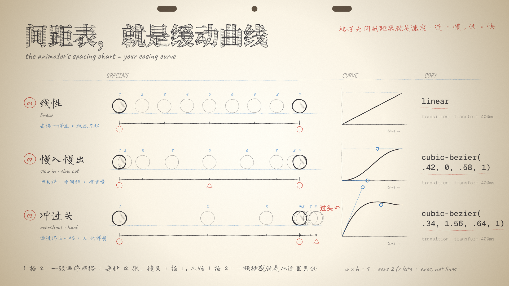

# 手绘三选一（第九轮候选，2026-11-16，未占期号）

主人：“探索手绘风格……顶尖一点的，甚至可以迁移到做电影、做动画”“推特爆款是绝对的”“自己选择 3 个风格，分别做两张图”。之后又补了一句：“你可以不用被这个项目约束……你把视觉效果做好给我看看。”

已做过的马克笔（027）、水墨（024）不再选。这一轮挑了手绘动画 / 电影里最常见的三种画法，从最柔到最“原始”：

| | 手绘动画 · 背景美术 `anime/` | 厚涂 Painterly `painterly/` | 铅笔原画 Pencil Test `pencil/` |
|---|---|---|---|
| 一句话 | 背景是画出来的，云是一团一团亮起来的 | 每一笔都顺着形状走，亮处厚、暗处薄 | 蓝铅笔找动势，石墨定线，红铅笔记节奏 |
| 第 1 张 | 夏天：积雨云、电线杆、风吹过稻田、被风吹走的草帽 | 雨夜的街：红伞、湿地面倒影、霓虹，12 万笔油画 | 透光台上的动画纸：面粉袋跳一次，13 帧透成一条轨迹，右下角翻起一页 |
| 第 2 张 | 一个镜头七层纸：多层摄影台拉开，标每层视差速度 | 从色块到笔触：大笔铺色 → 方向场 → 厚涂成画，× 3 放大镜 | 间距表就是缓动曲线：线性 / 慢入慢出 / 冲过头，配可以直接抄的 `cubic-bezier` |
| 为什么会火 | 这几年 X 上传播最广的手绘风格；分层拆解图是设计师最爱转的那一类 | 电影感 + “这是代码画的油画” | 动画师的行业内景 + 对做 UI 动效的人直接有用 |
| 设计师拿走 | 视差速度表、“镜头 1 拍 1、人物 1 拍 2”、赛璐璐 = 线 + 1 影 + 1 光、天和云影的色值 | 四把刷子 22 / 11 / 5.5 / 2.8、笔触方向规则、暖光冷影色板 | 三条缓动曲线和对应的间距表、挤压拉伸面积不变、跟随晚 2 帧 |
| 自己会怎么动（做成片时） | 镜头横摇，七层按视差各走各的；帽子和草 1 拍 2 | 笔触每两帧重画一次（“沸腾”），但贴在物体上跟着走 | 一张张翻纸：上一张透出来，线条轻微抖动（line boil） |








## 怎么画的（全部是代码，没有素材、没有生成图）

- **积雨云**（`anime/scene.js`）：几百个球——大球是骨架，中球长在大球表面、往上和往两边长。逐像素找最前面那颗球得到高度场，模糊后求法线 = 大形体的明暗（小包只决定轮廓），再切成亮 / 影两色、影里带紫。直接用每颗球的法线会变成“青蛙卵”，这一步是关键。
- **电线杆和稻田**：同一套透视（灭点、相机高 1.6、焦距 900）投出来，电线按悬链线下垂。
- **厚涂**（`painterly/paint.js`）：先程序生成一张“参考帧”（湿地面倒影是按透视逐列以墙脚线为镜子翻过去再竖着拖的），再用结构张量求每处的笔触方向；四遍笔从大到小，小笔只给焦点；每一笔同时画在颜色层和厚度层，最后用厚度层打一次左上侧光 = 油彩的起伏，加画布经纬纹。
- **铅笔**（`pencil/pencil.js`）：石墨画在透明层上，再按纸纹去掉一部分——轻的笔只落在纸纹凸起上（颗粒），重的笔把沟也填满。线自动细分，两头轻中间重；面粉袋的挤压拉伸保持面积不变，耳朵按速度晚两帧。

## 出图

```bash
bash drafts/hand-drawn/render_all.sh
```

2 倍超采样渲 3840×2160（`png/hi/*.jpg`，发 X 用），再缩一份 1920×1080（`png/*.png`）。云端 4 核约 5 分钟，厚涂最慢。单张预览：`node drafts/hand-drawn/shot.cjs <页面> <out.png> 1920 1080 1`。

字体都是仓库里已有的免费商用字体（Noto Serif SC / Noto Sans SC、Geist Mono、Instrument Serif、Cormorant、Caveat、站酷龙藏体 LongCang），`npm run fonts` 拉取。

## 第二轮（2026-11-16 · 主人：“厚涂、铅笔原画都还行……当作全球最顶尖的设计工作室，做 15—20 秒的视频；手绘动画更像手绘一点，靠近吉卜力”）

- **手绘动画改图**（`anime/ghibli.js`）：除了天、电线杆、赛璐璐帽子，每一层用水粉笔触重画一遍（`painterly/paint.js` 的同一套笔触引擎，刷毛纹和厚度压到很低），轮廓用原层的边裁齐；云的明暗改成由中等大小的云包决定，影子是一团团往下兜的圆弧，不再是迷彩斑。两张图已重出。
- **厚涂短片** [`../impasto/film/impasto-film.mp4`](../impasto/film/impasto-film.mp4)（18 秒 · 1080p60 · 雨夜钢琴）：同一张画布上 125,088 笔一笔笔“走”出来——赭色底布 + 炭笔起稿 → 22 px 大笔铺色 → 方向场亮一下 → 小笔从红伞往外画 → 推到伞上 ×3、侧光扫过（厚度在屏幕分辨率每帧重算）→ 拉回全景、雨和倒影活过来、刷出色板 → 用笔写出“厚涂”，一笔红收尾。分镜见 [`STORYBOARD.md`](../impasto/film/STORYBOARD.md)。`smooth.py`：跳变 0、死区 0、最大单帧变化 6.0。
- **铅笔原画短片** [`../pencil-test/film/pencil-test-film.mp4`](../pencil-test/film/pencil-test-film.mp4)（18 秒 · 1080p60 · 拨弦 + 钢琴）：面粉袋一秒 12 张（每 5 帧换一张，每张重画所以线在抖），镜头和转台一拍一丝滑；慢放留下洋葱皮、弧线、时间表 → 时间表的刻度飞出来排成 `cubic-bezier` 曲线、手柄一拉变成冲过头 → 量宽高 `w × h = 1`、耳朵晚 2 张 → 跳回来落地、红笔签名，封面那一页重新浮出来。`smooth.py` 报的 49 处“跳变”全部是一拍二换画（间隔 5 帧，最大单帧变化 4.7），是这个风格本身的节奏；死区 0。
- 渲染技巧：厚涂的每帧仍是帧号的纯函数（每一笔的起止帧预先算好），同一页面按帧号递增渲染时把画完的笔缓存进 3 倍母版画布，比从头画快几百倍；0.49 秒 / 帧。铅笔 0.14 秒 / 帧。
- 公共组件改动：`_lib/events.cjs` 加了可选的 `EVQ` 环境变量（给页面传查询串，不影响旧片子）。
