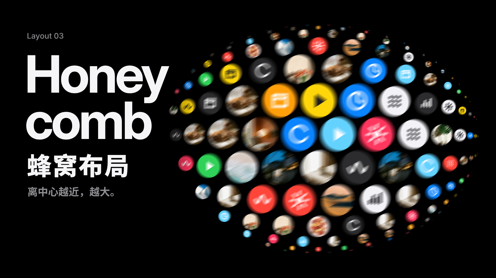

# 候选 · 布局 03 · 蜂窝 / 鱼眼布局 Honeycomb（探索稿）

> 主人 2026-11-18：粘性滚动“算布局吗”→ 分屏“有点普通”→ 从蜂窝、破格、横滑货架、卡片堆叠、看板里选了 **蜂窝**（“按你的推荐 1 试试”）。
> 这是**探索稿**：第 0 帧 + 8 秒核心动作小样。没有占期号，“Layout 03”是暂定。

> **一句话：** 六边形密铺，没有行和列；离中心越近越大，边上的缩成小点。

| 第 0 帧（封面） |
|:-:|
|  |

小样：[`film/honeycomb-sample.mp4`](film/honeycomb-sample.mp4)（8 秒 · 1080p60 · 无声）

## 它自己怎么动：一面透镜

- **中心一圈原大 1:1**（平区 r0）；往外，**位置按 tanh 往里收，大小按 sech² 缩小**。sech² 正好是 tanh 的导数——大小 = 位置变化的快慢，所以边上的图标越挤越小，但永远不会叠在一起。
- 平区、收缩区都按画面比例做成椭圆（横屏）；手表上是圆。
- 设计师能拿走：六边形密铺的中心距（本片 150px、图标 132px，缝 = 12%）；平区半径；收缩曲线 `s = 1 − tanh²((r − r0) / k)`。

## 小样里有什么（8 秒）

| 时间 | 动作 |
|---|---|
| 0—2.1 | 第 0 帧就在动：整片蜂窝带惯性流过透镜（τ = 0.5 s，和粘性滚动那版同一条惯性曲线），换个方向再甩一下；经过中心的图标鼓起来，离开时缩回去 |
| 2.1—2.9 | 吸附：临界阻尼，落在一张湖的照片上 |
| 2.9—4.4 | 像转表冠一样放大，湖从一颗图标长成一整屏（“点开”），再缩回原位 |
| 4.75—8 | 拉远到 0.42 倍：整片蜂窝是一个六边形；再轻轻甩一下，拉远后也还是透镜 |

`smooth.py`：跳变 0、死区 0，最大帧差 23.2 在第 140 帧（第二次甩、速度最快的时候）。看过第 0 帧全尺寸、每 20 帧一张的联系表、甩和点开两段的连续帧；**没看过播放**。

## 没做 / 待核对

- 配乐和音效、全片、网页 / 手机图、四张布局图、tokens 都还没做。
- 时间线待核对后再写（Apple Watch 的蜂窝主屏，2015 年前后）。
- 图标：照片是布局 02 用过的 AI 生成照片；纯色图标是程序画的原创图形，不照搬任何真实 App 的图标。

## 文件

```
honeycomb/
├─ README.md
├─ png/cover.png              # 第 0 帧
└─ film/
   ├─ honeycomb.html          # Canvas 2D；window.frame(f) 是帧号的纯函数，子帧平均出运动模糊
   └─ honeycomb-sample.mp4    # 8 秒 · 1080p60 · 12 Mbps
```

重渲（云端约 25 秒）：

```bash
node drafts/_lib/film-gl.cjs drafts/honeycomb/film/honeycomb.html /tmp/hc 0 480 3
```
