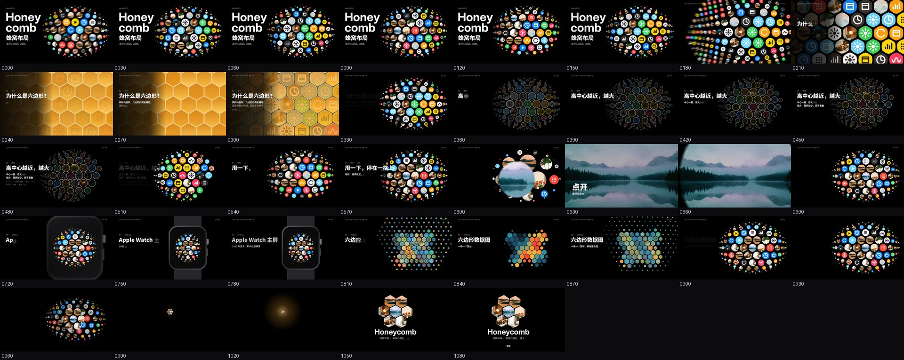

# 候选 · 布局 03 · 蜂窝 / 鱼眼布局 Honeycomb（全片草稿）

正式作品见[布局 03 · 蜂窝布局](../../layouts/03-honeycomb/README.md)。

> **一句话：** 六边形密铺，没有行和列；离中心越近越大，边上的缩成小点。

成片：[`film/honeycomb-film.mp4`](film/honeycomb-film.mp4)（18.5 秒 · 1080p60 · 带配乐和音效）· 分镜 [`film/STORYBOARD.md`](film/STORYBOARD.md) · 过程 [`PROCESS.md`](PROCESS.md)

| 第 0 帧（封面） | 全片每 30 帧一张 |
|:-:|:-:|
|  |  |

## 它自己怎么动

物理只有三样，全片都围着它们：

- **透镜：** 中心一圈（平区 r0）原大 1:1；往外，位置按 tanh 往里收，大小按 sech² 缩小。sech² 是 tanh 的导数——大小 = 位置变化的快慢，所以边上越挤越小，但永远不叠在一起。
- **惯性：** 甩一下，`v = v0 · e^(−t / 0.5s)`（约等于 iOS 默认减速）。
- **吸附：** 临界阻尼，0.17 秒落在一格上。

**同一片 169 颗格子从头到尾不换**：圆变六边形 → 变蜂蜡 → 变线框 → 一颗长成一整屏 → 缩进手表 → 摊成数据地图 → 收成七颗。

## 设计师拿得走

| 数 | 值 |
|---|---|
| 中心距 / 图标 / 缝 | 150 / 132 / 12% |
| 平区 | 中心 32% 的半径以内原大 |
| 往外的大小 | `s = 1 − tanh²((r − r0) / k)`，k = 0.58 |
| 吸附 | 临界阻尼，0.17 s |
| 点开 | 图标从原位长成一整屏（圆形遮罩半径从图标半径长到对角线），收起反过来 |
| 为什么是六边形 | 同样面积周长最短，最省料的密铺（Hales 1999 年证明） |
| 在哪见过 | Apple Watch 主屏（默认就是蜂窝）、六边形数据图 |

## 配乐

一整首歌：120 BPM（一拍 = 30 帧）· F 大调 · 马林巴 + 钢片琴主旋律、拨弦琶音、短底鼓。招牌声音是“表冠”：放大时一格一格“嗒嗒嗒”，越转越密、越转越高。甩是一阵风，吸附“咔”+ 一个调好音的“啵”，点开往上扬、收起往下落，七颗六边形在第 1020 帧（第 34 拍）弹开 = 重拍 + 镲 + 砸字。每个字落定一声“嗒”。−14 LUFS。

## 文件

```
honeycomb/
├─ README.md · PROCESS.md
├─ png/cover.png               # 第 0 帧
└─ film/
   ├─ STORYBOARD.md            # 三件事 + 分镜
   ├─ film.html                # 全片：Canvas 2D；window.frame(f) 是帧号的纯函数；window.events() 导出出字时间
   ├─ audio.py                 # 配乐（读 events.json）
   ├─ events.json
   ├─ make.sh                  # 一条命令出片（约 2 分钟）
   ├─ honeycomb-film.mp4       # 成片
   ├─ contact.jpg              # 每 30 帧一张
   └─ honeycomb.html           # 最早的 8 秒探索稿（留作对照）
```

```bash
bash drafts/honeycomb/film/make.sh
```
