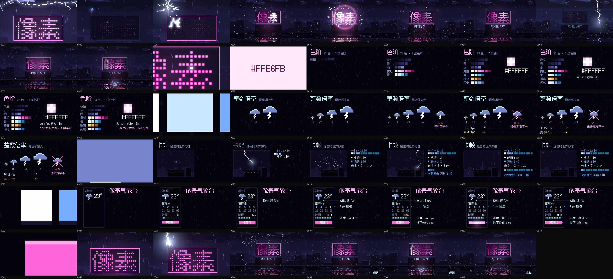

# 像素风 Pixel Art · 制作过程

> 记录，不是规则。必须守的只有 [`docs/DESIGN_NOTES.md`](../../docs/DESIGN_NOTES.md) 开头那八条。

🎬 [成片](film/pixel-film.mp4) · 🧾 [分镜与数值](film/STORYBOARD.md) · 🖼 [风格图](images/)

## 一览

| | |
|---|---|
| 成片 | 18.7 秒 · 1920 × 1080 · 30 fps · 562 帧 · 150 BPM（一拍 12 帧） |
| 画面 | Node 直接写 320 × 180 的像素缓冲，整数倍率最近邻放大，不用浏览器。粒子按世界时间逐帧模拟，所以审片时单取一帧也从第 0 帧走起 |
| 绘制层 | [pixelfx](https://github.com/patch-gg/pixelfx) 的 `src/core`（MIT，原样放在 `film/vendor/pixelfx/`）：不透明颜色缓冲 + 叠加光缓冲、粒子、闪电路径 |
| 声音 | 全部用 numpy 合成：8-bit 方波、三角波贝斯、噪声鼓、雨和雷。实测 -17 LUFS，真峰值 -1.5 dBFS |
| 字体 | 缝合像素字体 12 px 比例宽度简体中文版，官方 Release 2026.08.11（OFL-1.1），转成点阵后渲染 |
| 外部素材 | 没有 |

## 想法

像素风自己的运动是“一格一格地动、一阶一阶地变、撞上了停一下”。全片只用这三条：落格（形 15 fps、光 30 fps、镜头只跳整数倍）、色阶（颜色只在色板里跳）、卡帧（英雄帧 + 冻结 + 整像素震）。

题材选夜雨里的霓虹灯泡招牌：灯泡就是放大的像素，霓虹的冷却正好是一条色阶，闪电是最强的撞击。招牌上的字就是“像素”两个字，一个字的像素 = 一个灯泡。

换章不切，而是“钻进一格”：镜头按整数倍率钻进一个像素，再从下一块板的一个像素里退出来。这是只有像素风才成立的转场，画面里任何时候都还是整齐的方块。

## 小样 v1 → v2 → v3

- **v1**（5 秒）：开头 1.3 秒只有镜头往下摇，灯泡点亮用了 1.1 秒，副标题一个字母一个字母打出来，收尾前有空档，整体偏慢。
- **v2**（4.2 秒）：改成 150 BPM，一拍正好 12 帧，每一拍都有事件。开场直接给招牌特写和蓄电；落雷后的拉远改成 12 → 10 → 8 → 6 倍的整数跳切；加了浪涌和第二道雷的断电重启；副标题改成字母砸下来。
- **v3**：第 0 帧是封面，要在静音自动播放时一眼抓住人。v2 的第 0 帧招牌是暗的，天空和板子都是深蓝，没有主角。v3 让招牌一开始就满亮，背后一道蓝白闪电横穿天空，粉和蓝白两种最亮的颜色对冲；故事从“点亮”改成“亮着、断电、再被雷劈活”。闪电路径的随机种子挑过：只在云间，不落地，不碰招牌和避雷针，不抢后面落雷的戏。

## 小样 → 全片

小样是“一个镜头”，全片要补上设计师能拿走的东西、一个真正的收束和署名，同时不丢掉小样的速度。

- **前 3.9 秒不动。** 小样从第 0 帧到第 8 拍（雨滴落水、灯跑一遍）原样保留，只把最后的落水从“收尾”改成“换章的起点”。
- **四块板**，各 6—7 拍，都画在招牌同一张 320 × 180 网格、同一套 23 色上：
  - 色阶：7 条色阶每 3 帧砸下一条；右边一个 12 倍大的灯泡每拍烧白一次、每 2 帧降一阶，色值大字跟着跳。规则不是写在卡片上的，是这个灯泡一直在做的事。
  - 整数倍率：同一个雷云图标按 4、3、2、1 倍排开，再放一个 2.5 倍的反例打叉；下面两条轨道同样 60 px/s，一条 15 fps 一格格跳，一条 30 fps 每帧走。
  - 卡帧：小窗里落一道雷，真的卡给你看：整屏反相、冻结 3 帧（雨也停、配乐也停）、震 3 → 2 → 1 px。右边的胶片条按真实时间一格一帧往前走，世界停住了，钟没停。
  - 像素气象台：把同一套像素和颜色用到一个天气界面上，1 px 描边、1 px 投影、按下下移 1 px、进度条一格 3 px、图标 15 fps，四条标注写在旁边。
- **换章四次**，每次 1 拍：钻进去 3 级、退出来 3 级，每级 2 帧（15 fps，和“形”同一个帧率）。钻进去的格子和退出来的格子挑颜色接得上的：“闪电”色阶的浅蓝 → 图标闪电的白，按钮的粉 → 招牌灯泡的粉。
- **第一次换章最长**（2 拍）：钻进一个正烧白的灯泡，到 1536 倍时那一格占满全屏，然后按霓虹色阶每 2 帧冷一阶，色值跟着跳（`#FFFFFF` → … → `#5E1050`），冷到最暗正好是色阶板的底色。色阶这条规则在讲之前先演了一遍。
- **收尾**回到和封面同一个 12 倍构图，第三道雷、浪涌、整数倍跳出去，署名砸在积水上，最后一滴雨落水（“咚”+ 叮）。最后 0.8 秒只有水纹和雨，署名留在画面上。
- **雨一直在下**，板上也在下（压暗两阶）。卡帧板上的小窗里雨更亮一阶，冻结时能看出它停住了。

这次没按默认骨架做“代表作 / 规则卡 / 手机章”：规则直接从三条运动规律里长出来，每块板上动的东西就是那条规则本身；手机界面放在最后一块板上，当作同一套像素的应用。四张风格图换成从同一个渲染器里取的五帧 PNG。

## 字体

小样用的缝合像素字体是 npm 上第三方打包的 2022 版。全片换成官方 Release 2026.08.11（12 px 比例宽度，压缩包 SHA-256 与官方发布清单一致），`glyphs.py` 直接从压缩包里读。新版在 12 px 下整字比旧版低 2 行，点阵统一上移 2 行，让汉字仍占第 1—11 行；“像”“素”两个字的字形有细微变化，招牌上的灯泡排布也跟着变了一点。

## 声音

- 150 BPM，Am – F – C – G 两拍一个和弦。小样部分的配器不变；四块板上加一条方波主旋律。
- 出字一律“哔”一声，换一块板从五声音阶最低音重新往上走。
- 每次卡帧配乐一起停住（前后 3 ms 斜坡），冻结完原样接上。
- 方波边沿很陡，编码成 AAC 后样本之间会冲出约 3 dB。限幅前后各切掉 15 kHz 以上，按 4 倍过采样量真峰值，留 1.5 dB。

## 还没验证

- 只看过联系表、换章和卡帧的连续帧、第 0 帧和最后一帧全尺寸；没看过播放。
- 声音只核对了时长、响度和真峰值，没听过。
