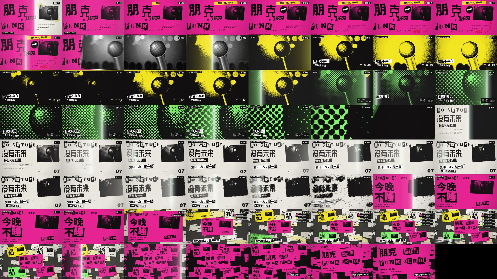

# 朋克复印机 Punk Xerox · 制作过程（第一版）

> 记录，不是规则。必须守的只有 [`docs/DESIGN_NOTES.md`](../../docs/DESIGN_NOTES.md) 开头那八条。

🎬 [成片（第一版，暂时只有代码合成的声音层，配乐待生成）](film/punk-film.mp4) · 🧾 [分镜](film/STORYBOARD.md)

## 一览

| | |
|---|---|
| 成片 | 18.75 秒 · 1920×1080 · 60fps · 1125 帧 |
| 画面 | Node + `@napi-rs/canvas`（Skia 的 Canvas 2D），不用浏览器。每帧是帧号的纯函数；3 个子帧做运动模糊；4 段并行渲染后拼接 |
| 时间轴 | 按拍写（`scene.mjs` 的 `B(拍)`），暂按 160 BPM 排。配乐生成回来后量实际拍子，只改 `BPM`、`OFF`、`MUSIC_START` |
| 外部素材 | 没有。“照片”是现算的话筒特写（球面网罩、镀铬手柄、虚焦的灯和人头），纸纹、墨点都是噪声 |
| 字体 | Noto Sans SC、站酷庆科黄油体、Long Cang、Anton、Archivo Black、Abril Fatface、Alfa Slab One、Bangers、Rye、Permanent Marker、Space Mono（OFL）；Special Elite（Apache 2.0）。都已在 `scripts/fetch_fonts.sh` 里 |

## 先问它自己怎么动

1. **复印机的灯管扫过去。** 灯管扫过的地方变成下一代：灰色没了，只剩黑和纸色；黑往外渗，细线断掉，边起毛，纸上多出墨点，整张还歪一点。全片只有这一种转场：**扫一次 = 复印一次**。
2. **跟随和滞后**：刚扫过的那一条墨先是淡的，约 5 帧后才“定”下来（`compose` 里按每一列被扫过的时间算 `1 − 0.6·e^(−age/5)`）；灯管后面拖着一段渐弱的余光。
3. **同一张纸接力到底**：新贴上去的东西（胶带、贴纸、马克笔、照片）是彩色的、带影子的；灯管一扫，它们被压平成黑。右上角的“第 N 代”一直在走。

## 复印是怎么算的（`kit.mjs` 的 `xeroxPixel`、`scene.mjs` 的 `gen`）

每个像素：原稿先按这一代的半径模糊，取亮度，加三层噪声（细、中、低频），低于阈值就上墨；墨点在中频噪声高的地方成团。第 g 代（k = log₂g，kk = k^1.6）：

| 参数 | 公式 | 第 1 代 | 第 8 代 | 第 64 代 |
|---|---|---|---|---|
| 模糊半径（px） | 0.8 + 1.05·kk | 0.8 | 6.9 | 19.3 |
| 阈值 | 0.5 + 0.012·kk | 0.50 | 0.57 | 0.71 |
| 低频噪声（墨团） | 0.03 + 0.025·kk | 0.03 | 0.18 | 0.48 |
| 歪 | 每代 ±0.45°·k，往右上漂 | 0 | 1.35° | 2.7° |

前几代几乎看不出变化，十几代以后塌得很快——这也是片子里那句“3 代以内最好看”的来源。

## 给设计师的四个数

| 旋钮 | 片里怎么演 | 拿走 |
|---|---|---|
| 阈值 | 一张灰照片扫成黄纸上的黑白；旋钮 0.50 → 0.17 → 0.84 → 0.50，黑白边界在画面里流动 | 灰色不存在。0.45—0.55 之间最好用 |
| 网点 | 45° 网点，每两拍放大复印一次（100% → 200% → 400% → 800%），最后一颗点吞掉画面 | 放大复印，点就变成了图形 |
| 代数 | 每拍复印一次：2、3、4、6、8、12、16、24、32、64 代 | 复印一次，糊一层。3 代以内最好看 |
| 纸色 | 同一张海报印在四种纸上，订在墙上 | 颜色在纸上，墨只有黑：荧光粉 #FF3E9A · 柠檬黄 #FFE21A · 复印白 #F1EEE4 · 荧光绿 #7BE86A · 墨 #121012 |

这次没用默认骨架里的规则卡和手机章：四条规则都由复印机自己演示，应用落在贴满海报的墙上，片尾整面墙被复印成一张粉纸。

## 修改记录

| 看到的问题 | 改法 |
|---|---|
| 第一版“照片”是一个莫西干剪影对着话筒喊，主人看了说太丑 | 换成话筒特写：球面网罩（网格按球面映射弯过去）、金属箍、镀铬锥形手柄、背光亮边；灯和人头全部虚焦。阈值和网点都在这颗球上最好看 |
| 代数那一章到第 64 代字还很清楚 | 模糊、阈值、墨团按 k^1.6 增长：前几代慢，后面塌得快 |
| 钻进网点时最后一颗点不够大，画面没被吞掉 | 推镜从 9 倍加到 30 倍；放大中心选在亮度约 0.72 的地方，点彼此分开 |
| 片尾整面墙复印后粉纸上全是黑雾 | 粉纸的亮度约 0.51，正好卡在阈值上。最后一遍阈值降到 0.36、墙涂深，墙变成实黑、纸变干净的粉 |
| 片名海报底下露出“今 / 不”，读成“今朋克”“不PUNK” | 片名海报放大到 1.06 倍，完全盖住下面那张 |
| 读数面板退场后还留在画面里 | 退场方向改成往最近的画边，退完不再画 |
| 灯管进场、出场时整屏的光一下亮 / 一下灭（`smooth.py` 抓到第 21、130、1013、1051 帧） | 余光和整屏提亮按灯管离画边的距离淡入淡出，灯管扫到画外 480px 才算结束 |
| 贴纸、墙上的复印件在画面中间凭空出现（第 62、958 帧） | 贴纸 4 帧淡入；复印件从画外、离中心更远的方向飞进来，落在拍上 |
| 复印件变成墙上那张海报的一瞬间（第 878 帧）亮度跳了一下 | 墙上这张是同一条管线印出来的贴图，纸纹叠了两遍；墙这张纸不再叠纸纹 |

## 丝滑量出来的数（`python3 drafts/_lib/smooth.py film/punk-film.mp4`）

1125 帧 · 相邻帧平均差 5.79（中位 4.41，最大 39.11） · 死区 0 段 · 跳变 6 处（第 957—961 帧是一张粉色复印件从画外飞进来，第 980 帧是片名海报飞进来；逐帧量过都是连续的钟形曲线，不是切）。最大单帧变化在第 536 帧：钻进网点的最后一下。

## 没做、没验证的

- **看过的是静帧、联系表和成片里解码出来的连续帧，不是播放。**
- **还没有配乐。** 现在的音轨只有代码合成的声音层（扫描、胶带、贴纸、马克笔、旋钮、标签机打字、订书枪、最后一击），没有亲耳听过，只核对了时长和响度（约 −16.7 LUFS）。配乐用 Sonilo 生成后，量实际拍子再对齐（`BPM=… OFF=… MUSIC_START=… bash make.sh`），画面会按拍子整体伸缩。
- 墙那一段的信息偏密：四张复印件 + 五个色票 + 一条规则同时在画面里。
- 只有横版。风格图、tokens、中英文指南还没做。
- 成片 CRF 17，约 56 MB（纸纹和墨点很难压）。
