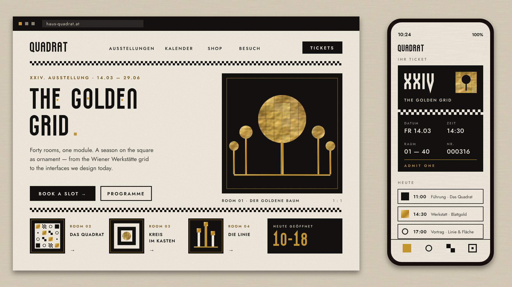

# 维也纳分离派 Vienna Secession · 制作过程

> 记录，不是规则。必须守的只有 [`docs/DESIGN_NOTES.md`](../../docs/DESIGN_NOTES.md) 开头那八条。

| 第 0 帧 | 用起来 |
|---|---|
|  |  |

## 先想的三件事

1. **它自己会怎么动：一切都是正方形，金箔也是。** 金箔本来就是一张张方形薄片，贴的时候从空中飘下来、贴上去、起一点皱，再被压平、擦亮。分离派的装饰也从方格里长出来：一个方格一分为四，四个再各自分。片子里的运动只有这两种：**金箔飘落贴合**，**方格一分为四**。
2. **从头接力到尾的东西：一块正方形的版面。** 第 0 帧是贴到一半的方板（封面），换章时方板整体推近或者一分为四，变成下一章的版面，最后拉回整块方板，贴上最后一张金箔。
3. **设计师能拿走的：** 1 : 1 的版面、8 列方格、直角按钮、两行棋盘格当分隔线、金只用在一处、四个颜色（`#121110` 黑、`#F2EDE2` 纸白、`#C99A2E` 金、`#6E2A17` 底漆红褐）、高腰的线条字母。

## 两张图

- **第 0 帧** `cover.py`：黑底，右边一块正方形方板。外圈两行棋盘格，里面一圈有节奏、左右对称的纹样；正中黑方块上一排圆冠的金树。树冠的金箔还缺五张，露出红褐色的底漆，缺的那几张正从空中飘下来；上边一格正在一分为四。左边是标题、一句话、分离派的口号和色卡。
- **用起来** `ui.py`：一家展览馆的网站和手机门票。网页的版式全部落在 8 列方格上：图都是正方形，按钮是直角，金只出现在作品图、开放时间和门票的金章上。

## 做法

- **字母是画出来的，不是字体。** `secession.py` 里每个字母是几条等粗的中心线：宽 3、高 7 个单位，弯处都是整半圆，E、A、R、S 的横画放在离顶 2.4 个单位处（高腰）。字怀里放一个金色小方点。右边开口的字母（E、C、F、L）后面字距收一点。以后做片子时，字母可以一笔一笔长出来。
- **金箔是滤镜算的。** 噪声当成起皱的表面，打一盏斜上方的灯（漫反射 + 高光），再乘回金色；每张箔片颜色和反光都略有不同，箔片之间留 1 像素的缝。没贴的格子露出底漆红褐 `#6E2A17`。
- **第一版方板像二维码。** 用四分法随机细分，太密、没有主次。改成对称结构：外圈纹样按“方中方 · 点 · 圈 · 金点 · 金点 · 圈 · 点 · 方中方”的节奏排，往里留一圈白，再放黑方块。
- **树一开始像地球仪。** 树冠外面那圈金线和贴着树冠的小树让它读成“架子上的球”。去掉外圈，三棵树站在同一条地平线上，小树往外挪。
- 截图用 `drafts/_lib/shot.cjs`。云端会话里项目锁定的 Playwright 找不到浏览器时，它会退回预装的 Chromium。

## 全片（19.5 秒 · 1920×1080 · 60fps）

成片 [`film/secession-film.mp4`](film/secession-film.mp4)，分镜 [`film/STORYBOARD.md`](film/STORYBOARD.md)。

### 先量配乐，再排画面

配乐是生成的纯音乐《Gilded Precision》（`film/music/gilded-precision.m4a`，21 秒）。同时生成的《Vienna Clockwork》（同目录）开头更满，但没有回落和重新进入，所以选了前一首。实测 122.3 BPM，第 k 拍在第 `4 + 29.44·k` 帧：

| 时刻 | 音乐 | 画面 |
|---|---|---|
| 0.07 s | 第一下 | 第一张金箔落定 |
| 1.5—5.9 s | 18 个八分音符“滴答” | 每一下贴一张金箔 |
| 5.93 s | 低音进来 | 猛拉出：1 → 4 |
| 6.4 / 6.9 s | 下两拍 | 16、64 |
| 7.92 s | 到顶 | 64 格铺满，斜着滑过，格子一格格翻出金箔背面 |
| 9.87 s | 回落 | 甩镜到字母 |
| 10.86 s | 回落里的一下 | 字怀里的金方点弹出来 |
| 11.34 s | 重新砸进 | 方形光圈打开海报 |
| 11.84 / 12.82 / 13.80 / 14.78 s | 重音 | 翻卡 → 网页；希区柯克变焦 → 按钮；移焦 → 门票；棋盘格翻牌 → 封面 |
| 15.77—16.75 s | 三拍 | 64 → 16 → 4 → 1 逐层合回 |
| 17.72 s | 最后一击 | 最后一张金箔拍下；擦亮的光扫过；署名 |

### 运动只有两种

- **金箔飘落**：每张金箔按帧号算出位置（左右摆、前段慢后段快）、平面内的转角和绕两轴的翻转。翻到正好对着灯的那一刻闪一下，背对灯时变暗；飞得越高越大、越虚（景深），影子越远越淡；落定时弹一下（过冲约 6%），闪光在 8 帧内退掉，崩起几粒金屑。
- **一分为四**：64 格里每一格都从和上一层方块相接的那个角弹出来（弹簧，过冲约 5%）；合回时倒过来，缩回那个角。

### 转场十种，不重复

连续推进、猛拉出（逐拍一层）、侧滑（带翻牌波浪）、甩镜、方形光圈、翻卡（竖条切片做透视）、希区柯克变焦（按钮大小不变，背后的网页后退）、移焦（预模糊贴图交叉淡入）、棋盘格翻牌（120 像素一格，斜向波浪）、逐层推回。只有两处让镜头往下“咚”一下：重新砸进的那一拍、最后一击。

### 技术

- Canvas 2D，浏览器里逐帧截图（`../_lib/film-gl.cjs`），每帧是帧号的纯函数，可断点续渲。
- 静态的大块（方板底子、标题、64 格纹样、海报、网页、门票、杂志封面）由 `film/assets.py` 用风格图同一套 SVG 代码生成，2 倍分辨率；树冠的金箔、飘落、字母、镜头实时画。
- 金箔贴图在页面加载时现算：值噪声做起皱的高度场，几道浅褶，打一盏斜上方的灯（漫反射 + 高光），12 张各不相同；景深用的模糊版本预先算好。
- 运动模糊：每帧 4 个子帧（快门 180°），甩镜和逐层拉出那几帧加到 10—12 个子帧，避免出现台阶。
- 字母和风格图里是同一套线条字，`getTotalLength` 量出每一笔的长度，用虚线偏移一笔一笔画出来：先是一道金光，画完慢慢变成纸白。
- 声音：配乐原样不动；`film/audio.py` 按页面导出的 123 个动作时刻合成音效（金箔落定的“叮”、出字的“嗒”、分格的“咔”、甩镜、翻卡、最后一击、署名的钟声），整体压在配乐下面约 16 dB（按全片 RMS），逐 0.1 秒比，最响的一刻也比配乐低 4.3 dB；成片响度 -14 LUFS。

## 没做、没验证的

- 字体：Jost、Noto Serif SC、站酷庆科黄油体（都是 OFL）。英文标题和数字是 `secession.py` 画的线条字，不用字体。
- 网页和门票里的展览、时间、地址都是虚构的。
