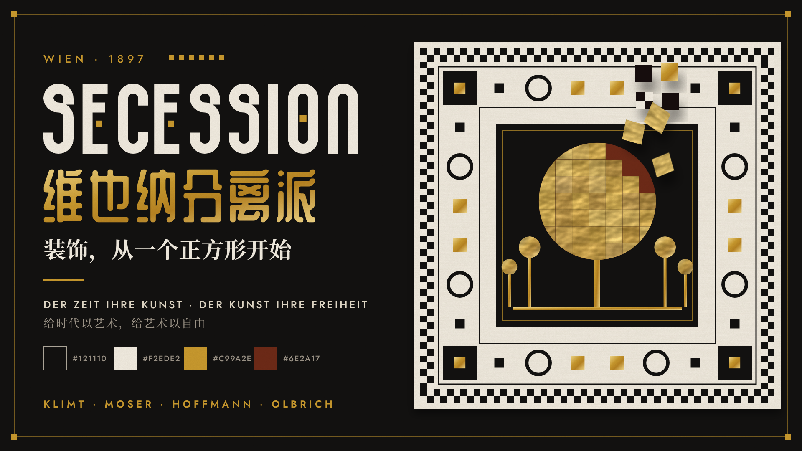

# 维也纳分离派 Vienna Secession · 制作过程（风格图阶段）

> 记录，不是规则。必须守的只有 [`docs/DESIGN_NOTES.md`](../../docs/DESIGN_NOTES.md) 开头那八条。

| 第 0 帧 | 用起来 |
|---|---|
|  |  |

## 先想的三件事

1. **它自己会怎么动：一切都是正方形，金箔也是。** 金箔本来就是一张张方形薄片，贴的时候从空中飘下来、贴上去、起一点皱，再被压平、擦亮。分离派的装饰也从方格里长出来：一个方格一分为四，四个再各自分。片子里的运动只有这两种：**金箔飘落贴合**，**方格一分为四**。
2. **从头接力到尾的东西：一块正方形的版面。** 第 0 帧是贴到一半的方板（封面），换章时方板整体推近或者一分为四，变成下一章的版面，最后拉回整块方板，贴上最后一张金箔。
3. **设计师能拿走的：** 1 : 1 的版面、8 列方格、直角按钮、两行棋盘格当分隔线、金只用在一处、四个颜色（`#121110` 黑、`#F2EDE2` 纸白、`#C99A2E` 金、`#6E2A17` 底漆红褐）、高腰的线条字母。

## 两张图

- **第 0 帧** `cover.py`：黑底，右边一块正方形方板。外圈两行棋盘格，里面一圈有节奏、左右对称的纹样；正中黑方块上一排圆冠的金树。树冠的金箔还缺五张，露出红褐色的底漆，缺的那几张正从空中飘下来；上边一格正在一分为四。左边是标题、一句话、分离派的口号和色卡。
- **用起来** `ui.py`：一家展览馆的网站和手机门票。网页的版式全部落在 8 列方格上：图都是正方形，按钮是直角，金只出现在作品图、开放时间和门票的金章上。

## 做法

- **字母是画出来的，不是字体。** `secession.py` 里每个字母是几条等粗的中心线：宽 3、高 7 个单位，弯处都是整半圆，E、A、R、S 的横画放在离顶 2.4 个单位处（高腰）。字怀里放一个金色小方点。右边开口的字母（E、C、F、L）后面字距收一点。以后做片子时，字母可以一笔一笔长出来。
- **金箔是滤镜算的。** 噪声当成起皱的表面，打一盏斜上方的灯（漫反射 + 高光），再乘回金色；每张箔片颜色和反光都略有不同，箔片之间留 1 像素的缝。没贴的格子露出底漆红褐 `#6E2A17`。
- **第一版方板像二维码。** 用四分法随机细分，太密、没有主次。改成对称结构：外圈纹样按“方中方 · 点 · 圈 · 金点 · 金点 · 圈 · 点 · 方中方”的节奏排，往里留一圈白，再放黑方块。
- **树一开始像地球仪。** 树冠外面那圈金线和贴着树冠的小树让它读成“架子上的球”。去掉外圈，三棵树站在同一条地平线上，小树往外挪。
- 截图用 `drafts/_lib/shot.cjs`。云端会话里项目锁定的 Playwright 找不到浏览器时，它会退回预装的 Chromium。

## 没做、没验证的

- 只有两张风格图，没有分镜和片子。
- 字体：Jost、Noto Serif SC、站酷庆科黄油体（都是 OFL）。英文标题和数字是 `secession.py` 画的线条字，不用字体。
- 网页和门票里的展览、时间、地址都是虚构的。
