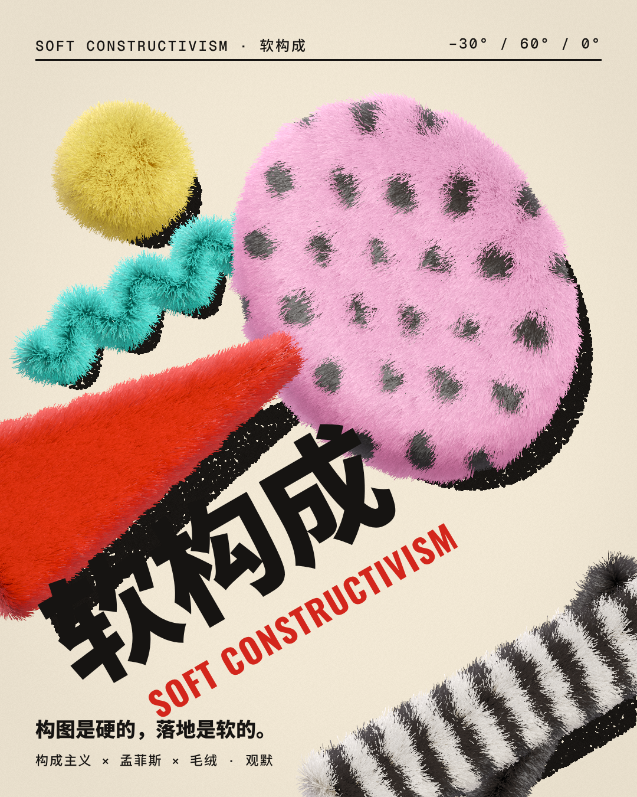
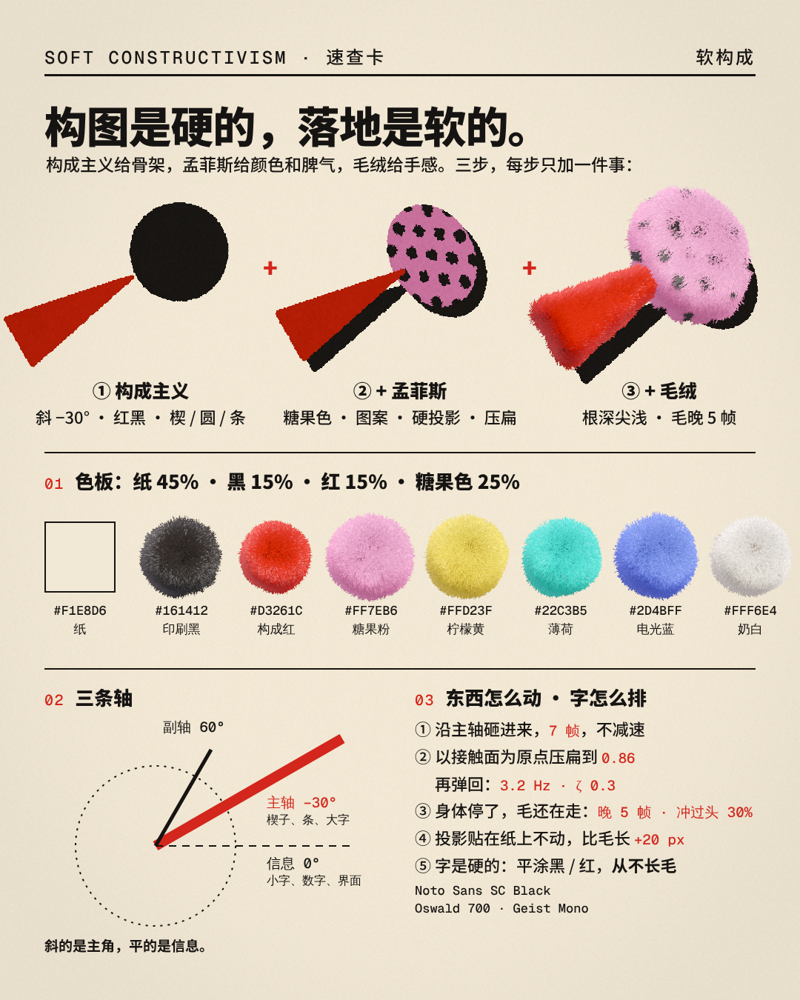
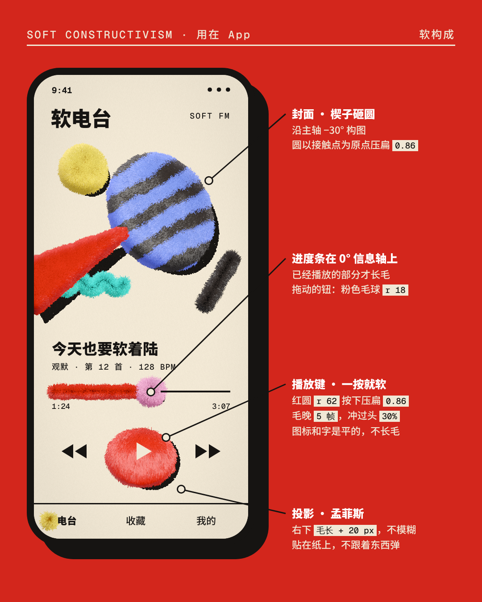

# 软构成 Soft Constructivism · 草稿（等主人看图）

构成主义 × 孟菲斯 × 毛绒。**构图是硬的，落地是软的。**

| 海报 | 速查卡 | 用在 App |
|:-:|:-:|:-:|
|  |  |  |

三张图都是用片子要用的同一个毛绒渲染器（`drafts/_lib/fur/fur.js`，409,600 根毛）渲的，图上的质感就是片子里的质感。单张约 8 秒（云端、软件渲染）。

## 三个来源各拿什么

| 来源 | 拿什么 | 不拿什么 |
|---|---|---|
| 构成主义（003） | 主轴 −30° / 副轴 60° / 信息 0°；红黑纸；只用楔、圆、条；大字沿主轴排 | 具体某张海报的构图 |
| 孟菲斯（004） | 糖果色；图案（圆点、斑马纹、波浪线）**染在毛里**；平的黑色硬投影；落地以接触面为原点压扁 | 黑描边（毛没法描边，用硬投影代替） |
| 毛绒（plush） | 每根毛是一根弹簧：身体停了毛还在走；根深尖浅 | 圆滚滚的玩偶造型——这里只有几何体 |

**字是硬的**：平涂黑 / 红，从不长毛（Noto Sans SC Black · Oswald 700 · Geist Mono）。东西是软的，字是硬的，两者一眼分得开。

## 色板

纸 `#F1E8D6` 45% · 印刷黑 `#161412` 15% · 构成红 `#D3261C` 15% · 糖果色 25%：粉 `#FF7EB6`、黄 `#FFD23F`、薄荷 `#22C3B5`、电光蓝 `#2D4BFF`、奶白 `#FFF6E4`。毛的根色压暗、尖色就是这个颜色（`softc.js` 里的 `TONES`）。

## 动效设想（还没做，等图通过）

- **签名物理：斜着砸，软着落。** 每个零件沿主轴 −30° 砸进来（7 帧，不减速）→ 以接触面为原点压扁到 0.86 → 弹回（3.2 Hz · ζ 0.3）→ 毛晚 5 帧、冲过头 30% 再抖回来。投影贴在纸上不动：东西离纸越高，影子离得越远。
- **接力：同一批 409,600 根毛。** 楔子 → 圆 → 条 → 字的形状之间飞，换章不切。图案换的时候像染料一样从一边扫过去。
- **第 0 帧**是全片能量最高的那一刻：红楔子正砸中粉圆，圆被压扁，毛往前甩（就是海报那一帧在动）。
- **一招三步**：平的构成主义画面 → 糖果色和图案扫过去、投影落下、开始压扁 → 毛从根上长出来（速查卡的三格在动）。
- **用在 App**：播放键被按下去，毛晚半拍；进度条往前走，走过的地方长出毛。
- **结尾**：所有零件重新沿主轴砸回海报构图，最后一下“咚”+ 署名观默。
- 约 18 秒 · 60fps · 1920×1080。按毛绒那一期的实测（约 3.8 秒 / 帧）估，正片渲染约 70 分钟，可以在云端后台断点续渲。

## 文件

- `softc.js`：色板、轴、平面图形（楔 / 圆 / 条 / 波浪线）、图案染色、把海报像素坐标里的平面图形变成毛绒零件。图和片子共用。
- `images/poster.html` · `cheatsheet.html` · `app.html` + `still.js` + `sheet.css`：三张图。重渲：

```bash
cd drafts/soft-construct/images && for n in poster cheatsheet app; do node ../../_lib/shot-gl.cjs $n.html png/$n.png 1080 1350 1; done
```
