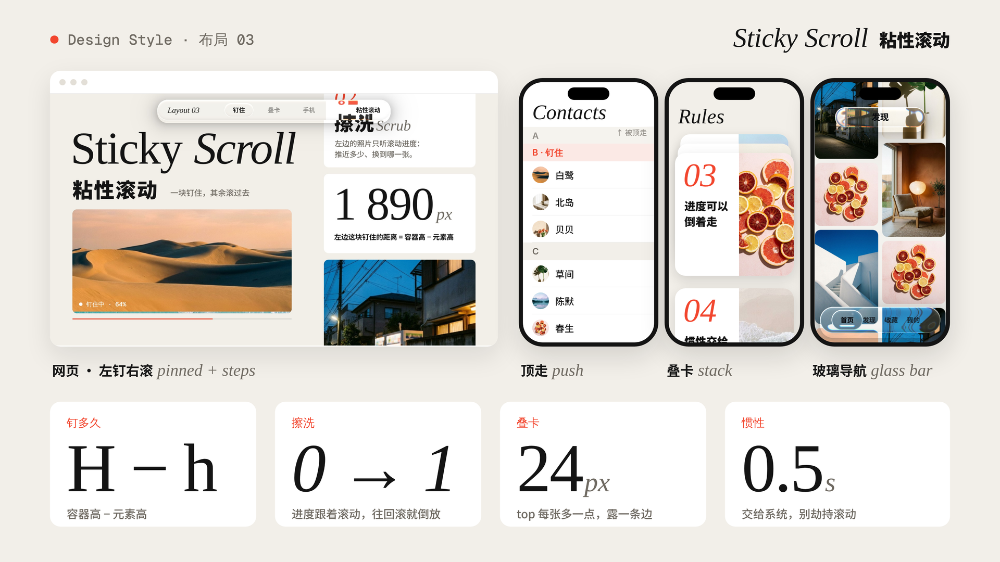

# 候选 · 布局 03 · 粘性滚动 Sticky Scroll（2012—）

> 这是**探索稿**：选题理由、研究、第 0 帧、网页 / 手机图、9.6 秒开头小样。没有占期号，图上的“布局 03”只是暂定。

> **一句话：** 页面在走，它不走。一块内容在父容器里钉住，别的内容从旁边滑过去；容器走完，它被下一个顶走。

| 第 0 帧（封面） | 网页和手机里的样子 |
|:-:|:-:|
|  |  |

开头小样：[`film/sticky-sample.mp4`](film/sticky-sample.mp4)（9.6 秒 · 1080p60 · 无声）

## 改了四版（都在 2026-11-18）

| 版 | 主人看完怎么说 | 那一版是什么样 |
|---|---|---|
| 一 | “没以前的做得好，尽量靠近苹果风格，甚至靠近前面两个布局风格” | 黄色强调 + 虚线、等宽读数、速度表，像调试界面 |
| 二 | “动效不够顶尖啊，紫色也是 AI 味；参考前两期布局的内容，也可以复用液态玻璃、孟菲斯、包豪斯” | 纯黑 + 深灰卡 + 蓝紫粉渐变 + 照片；动作只有“滚”和一次“顶走” |
| 三 | “算了，不要包豪斯、孟菲斯，还是要像前面两个布局那样现代化的” | 一张长网页，包豪斯一节 + 孟菲斯一节，液态玻璃导航；加了拉远和叠卡 |
| **四（现在）** | — | 见下 |

**第四版 = 第三版的动作 + 布局 02 瀑布流的视觉。**

- **视觉和瀑布流同一套：** 暖白纸 `#F2EFE9`、白卡片、真照片（布局 02 用过的 AI 生成照片）、Instrument Serif 大标题（正体 + 斜体）、思源黑体、Geist Mono；强调色只有一点红 `#F2462E`（编号和进度线）。没有紫色渐变，没有往期的风格。
- **液态玻璃导航从头钉到尾：** 真折射（WebGL：折射量 = 边缘的坡度，R / G / B 各弯一次），滚过它下面的卡片和照片被弯过来；选中的标签是一滴玻璃，从“钉住”滑到“叠卡”时被拉长。玻璃本身没有颜色。
- **第一节 = 左钉右滚：** 左边的标题和一张照片钉住，照片只听滚动进度——慢慢推近，到了步骤的分界就从下往上换成下一张（湖 → 沙丘 → 海），照片下面一根红线是进度。右栏的白色步骤卡和照片照常滚、按速度糊掉。
- **镜头拉远（最“惊艳”的一下）：** 滚到两节交界时整张页面缩到 0.3 倍：看得见整张长网页、白框（视口）在上面往下走、左边那块在自己的容器里钉着，到容器底被顶出视口；下面的五张规则卡还躺在原位。再推回来，正好落在第一张规则卡钉住的那一帧。
- **第二节 = 叠卡：** 五条规则 = 五张白底照片卡（左边斜体红编号 + 规则，右边一张照片），每张 sticky、top 每张多 24px；滚到顶就钉住，压在下面的往后缩 4.5%、暗一点。规则卡自己演示了规则。
---

## 为什么选它

便当盒讲**编排**（面积 = 重要程度），瀑布流讲**流**（最短的一列优先）。粘性滚动讲第三件事：**布局不只排在平面上，也排在滚动的时间轴上。** 同一块屏幕，滚到第几像素该显示什么、什么钉住、什么让位。

- **顶尖、常见：** 苹果每一个产品页、《纽约时报》和 The Pudding 的数据新闻、Linear / Stripe 的官网、Awwwards 年度站，几乎都靠它。手机上更日常：通讯录的 A / B / C 标题互相顶走、卡包里一张张叠上去的卡、App 顶上收起来的大标题。
- **有真实代表作：** 2012 年《纽约时报》Snow Fall，是公认把“滚动叙事”带红的那一篇。
- **它本身就是运动：** 布局 01、02 的片子要给卡片“编”一个动作；这一期不用编，**滚动就是它的动作**。整支片子可以就是在滚一张网页。
- **设计师拿得走：** 钉多久 = 容器高 − 元素高、进度 p 的公式、叠卡每张多 24px、惯性交给系统。都是能直接写进 CSS 的数。

**也考虑过、没选的：** 分屏 Split Screen（动作只有“中线滑动”一种，撑不起 18 秒）、看板 Kanban（实用但不出片）、全屏竖滑信息流（抖音式，动作就是一下“吸附”，和瀑布流的“流”太近）、无限画布（第二轮已经做过候选图，见 [`../infinite-canvas/`](../infinite-canvas/)）。主人想要其中哪个，可以换。

## 它从哪来（已核对）

| 年份 | 事件 |
|---|---|
| **2012.12.20** | 《纽约时报》发表 John Branch 的 *Snow Fall: The Avalanche at Tunnel Creek*：读者往下滚，全屏的画面、视频和地图跟着变。普遍认为是它把“滚动叙事 Scrollytelling”带红（同月 6 日 The Verge 已经用过视差滚动，它不是第一个）。来源：[Wikipedia](https://en.wikipedia.org/wiki/Snow_Fall)、[Nightingale](https://nightingaledvs.com/the-past-present-and-future-of-scrollytelling/) |
| **2013** | Safari 6.1 起支持 `position: -webkit-sticky`（前缀加在值上）。来源：[SitePoint](https://www.sitepoint.com/css-position-sticky-introduction-polyfills) |
| **2017.01** | Chrome 56 重新加回 `position: sticky`（之前在 Chrome 37 移除），主流浏览器都能用了。来源：[Chrome 博客](https://developer.chrome.com/blog/position-sticky) |
| **2017.11** | The Pudding 发布 Scrollama：用 IntersectionObserver 判断“哪一步进了视口”，配合 sticky 做“左钉右滚”。来源：[The Pudding](https://pudding.cool/process/introducing-scrollama/) |
| **2019—2020 前后** | 苹果产品页的“滚动擦洗”（滚多少，产品就转多少帧）被大量仿做，成了“高级官网”的代名词。来源：[CSS-Tricks 教程](https://css-tricks.com/?p=308477)（只能确认被仿做，苹果自己的实现没有公开） |
| **2023.07** | Chrome 115 支持 CSS 滚动驱动动画（`animation-timeline: scroll() / view()`），擦洗不再需要 JS。 |
| **2025** | Chrome 133 支持 `@container scroll-state(stuck: top)`：CSS 终于能知道“我现在钉住了没有”（[Chrome 博客](https://developer.chrome.com/blog/css-scroll-state-queries)）；9 月 Safari 26.0 支持滚动驱动动画（[WebKit](https://webkit.org/blog/17333/webkit-features-in-safari-26-0/)）。 |

## 它自己怎么动

1. **页面在走，它不走。** 钉住的那块在容器里纹丝不动，其余内容照常滚。画面上的对比就是签名：**在走的按速度糊掉，钉住的那块最清楚。**
2. **滚动有惯性。** 手指甩一下，页面按指数衰减慢下来：v(t) = v₀·e^(−t/τ)，τ ≈ 0.5 秒（约等于 iOS 默认减速率 0.998 / 毫秒）。小样里每一次“甩”都是这条曲线，没有手调的缓动。
3. **到底就被顶走。** 容器走完，钉住的那块跟着容器一起被推出去，下一块接着钉——不是淡出、不是盖住，是推走。
4. **擦洗。** 钉住期间，里面的东西只听滚动进度 p：滚多少，照片就推近多少、换到哪一张；手指停下，它也停。
5. **玻璃只弯光。** 钉在最上面的玻璃导航不挡内容，只把滚过它下面的东西弯过来：滚得越快，玻璃里的内容越糊、越弯。

## 五条规则（草稿）

| # | 规则 | 怎么做 | 小心 |
|:-:|---|---|---|
| 01 | **钉在容器里** | sticky 只在父元素范围内生效；钉多久 = 容器高 − 元素高 | 父元素 `overflow: hidden` 或者高度刚好等于元素，sticky 就失效 |
| 02 | **一次只钉一样** | 同一屏只有一个主角钉住，其余照常滚 | 钉住的东西一多，屏幕被吃掉，手机上尤其明显 |
| 03 | **进度可以倒着走** | 擦洗动画是 p 的纯函数，往回滚就倒放 | 别用“滚到某处触发一次”的动画冒充擦洗：回滚时不会复原 |
| 04 | **惯性交给系统** | 只改“滚到哪显示什么”，不改滚多快 | 劫持滚动（scroll-jacking）是这种布局最大的差评来源 |
| 05 | **手机上换排法** | 桌面“左钉右滚”→ 手机“图钉在上、字从下面盖过去”或者叠卡 | 别把左右两栏等比缩小；钉住的部分别超过屏幕高的 40% |

## 全片分镜设想（18 秒，等主人点头再做）

**整支片子就是在滚一张长网页**，液态玻璃导航从头钉到尾，选中的那滴玻璃跟着滑到当前这一节。没有切镜头，只有滚动和一次拉远。

| 时间 | 章节 | 画面 |
|---|---|---|
| 0—2 | 左钉右滚 | 第 0 帧：页面正被甩上去，右栏全糊了，只有标题和照片钉在左边、清清楚楚；照片推近、换张（小样已做） |
| 2—5.5 | 拉远 | 整张长网页缩小：视口在上面走，左边那块在容器里钉着、到底被顶走，下面的规则卡还在原位；推回来（小样已做） |
| 5.5—9.5 | 叠卡 | 五条规则一张张钉住叠上去（小样已做到这里） |
| 9.5—12.5 | 回到前两期 | 布局 01 的便当盒格子钉住，格子里的内容随滚动换一套；布局 02 的瀑布流从下面流上来、从玻璃导航下面穿过去（玻璃把照片弯过来） |
| 12.5—16 | 手机 | 页面“倒进”手机：通讯录 A 被 B 顶走 → 玻璃标签栏 → 叠卡（网页 / 手机图里的三屏） |
| 16—18 | 收束 | 一直滚到页面最底，**橡皮筋回弹**（iOS 的 overscroll）：页面被拉过头再弹回来，一声“嗒”，最下面露出署名“观默” |

声音的想法：甩的那一下是“嘶”的一声（音高跟着速度走），每次钉住“咔”一声，被顶走是低一点的“咚”，回弹是收尾的那一声。

## 现在有什么、没有什么

- **有：** 第 0 帧、网页 / 手机图、9.6 秒开头小样（`smooth.py`：跳变 0、死区 0，最大帧差 17.3 在第 132 帧，是第二次甩、照片卡整张掠过的时候）。
- **看过的：** 第 0 帧和网页图的全尺寸静帧，小样每 24 帧一张的联系表，照片换张那一段每 4 帧一张。拉远 / 推回 / 叠卡的动作和第三版相同（第三版看过连续帧）。**没看过播放**，丝滑要主人自己看。
- **没有：** 配乐和音效（小样是无声的）、全片、四张布局图、tokens。
- 照片是布局 02 用过的 AI 生成照片；通讯录里的名字是虚构的。没有用 Snow Fall 和苹果的任何素材和版式。

## 文件

```
sticky-scroll/
├─ README.md
├─ ui.html                 # 网页和手机图：node ../_lib/shot.cjs ui.html png/ui.png 1920 1080 2（再缩到 1080p）
├─ glass-phone.html        # 液态玻璃那一屏（真折射）：FRAME_EXT=.png node ../_lib/film-gl.cjs glass-phone.html <目录> 0 1 1，裁 552×1040 存成 png/glass-phone.png
├─ glass-assets.js         # 上面用的照片（内嵌 data URI：本地图片进 WebGL 会被当成跨域）
├─ png/cover.png           # 第 0 帧 = 小样的第 0 帧
├─ png/ui.png
├─ png/web-frame.jpg       # 小样第 100 帧，网页图里用
├─ png/glass-phone.png
└─ film/
   ├─ sticky.html          # 小样：Canvas 2D 画页面（子帧平均出运动模糊）+ WebGL 画液态玻璃；window.frame(f) 是帧号的纯函数
   ├─ assets.js            # 照片（内嵌 data URI）
   └─ sticky-sample.mp4    # 9.6 秒 · 1080p60 · 12 Mbps
```

重渲小样（云端约 100 秒，0.18 秒 / 帧）：

```bash
node drafts/_lib/film-gl.cjs drafts/sticky-scroll/film/sticky.html /tmp/sticky 0 576 3
```

```bash
ffmpeg -y -framerate 60 -i /tmp/sticky/%04d.jpg -c:v libx264 -pix_fmt yuv420p -b:v 12M drafts/sticky-scroll/film/sticky-sample.mp4
```
