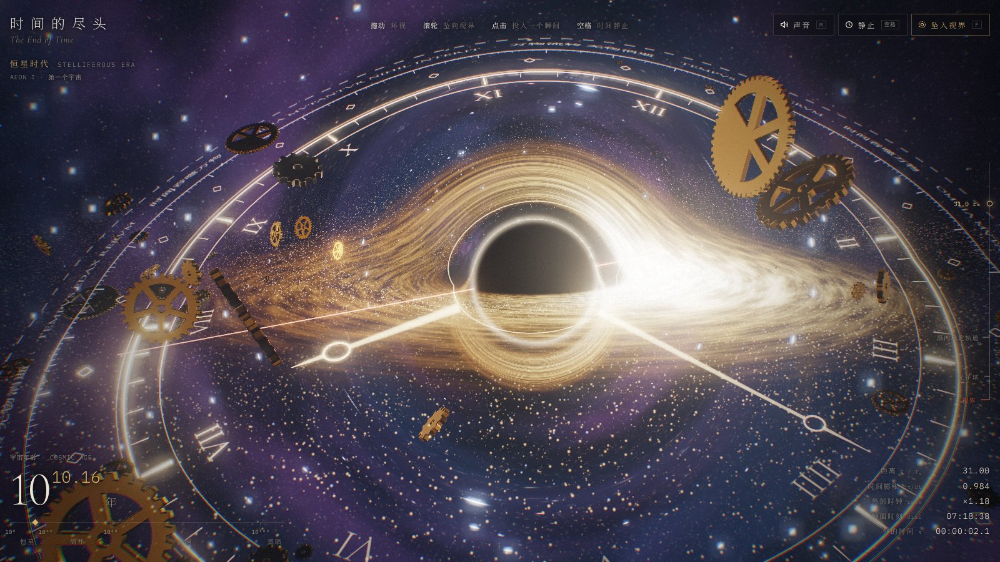
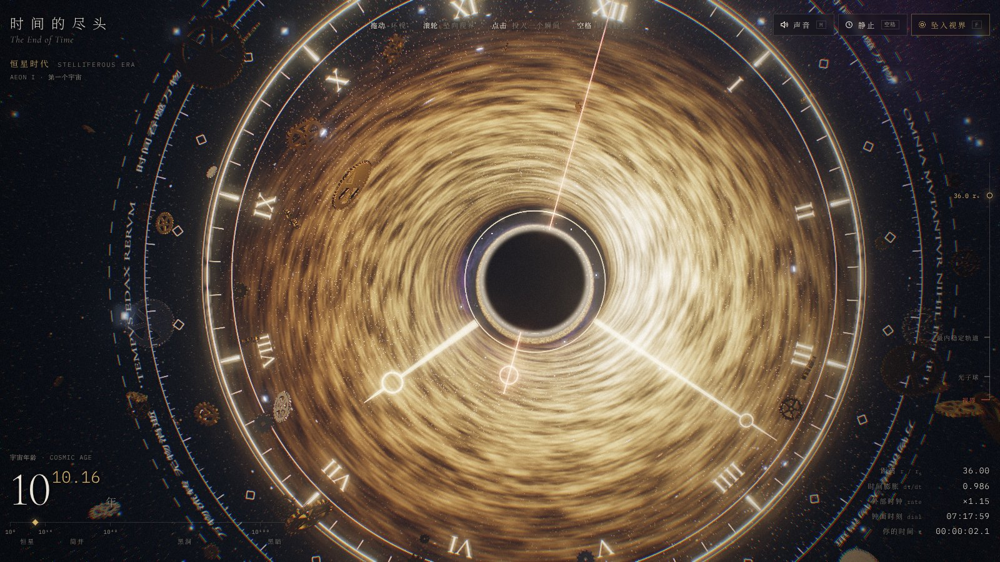
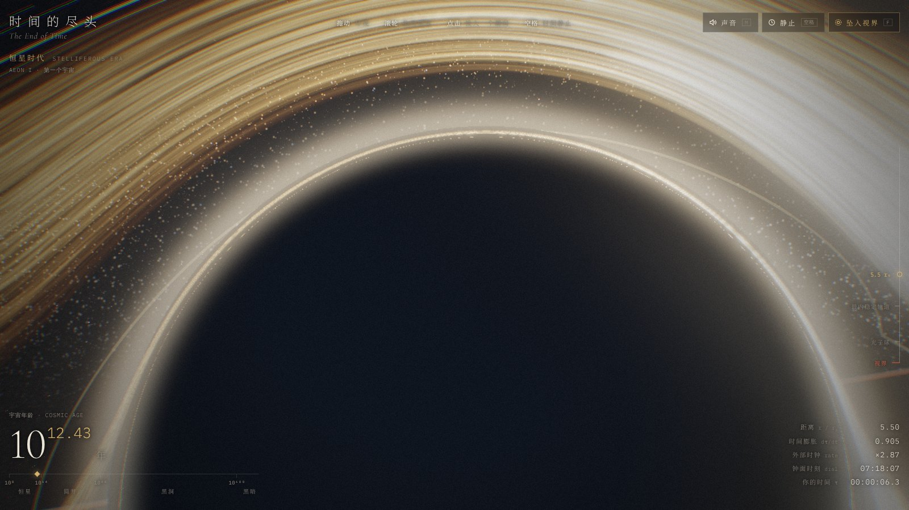

# 时间的尽头 · The End of Time

一个可以坠入的黑洞。黑洞是一座宇宙时钟的轴心，表盘、指针和散落的黄铜齿轮都绕着它转。你离视界越近，自己的一秒就越长，外面的宇宙也老得越快：恒星熄灭，质子衰变，齿轮化成灰，最后只剩黑洞，和仍在走动的时钟。越过视界，时间走到尽头，一个新的宇宙从白光里重新开始。



| 俯视：黑洞是表盘的轴心 | 深处：阴影占满半个天空 |
|---|---|
|  |  |

## 打开

单个 HTML 文件，Three.js 从 jsDelivr 载入，不需要构建。直接双击 `index.html`，或在仓库根目录起一个静态服务器：

```bash
npx serve .
```

然后打开 `http://localhost:3000/labs/end-of-time/`。需要支持 WebGL 2 的浏览器，有独立显卡更流畅；画质会按帧率自动升降。

## 怎么玩

| 操作 | 作用 |
|---|---|
| 拖动 / 单指滑动 | 环绕黑洞 |
| 滚轮 / 双指张合 / `W` `S` | 靠近或远离视界。越近，外部时钟越快，宇宙年龄增长越快 |
| 点击 / 轻点 / `C` | 投入一个“瞬间”。它边坠落边变慢、变红，最后停在视界上 |
| 空格 / 「静止」 | 时间静止：吸积盘的湍流、尘埃和指针都停在原处，视角仍可以转 |
| `F` / 「坠入视界」 | 自动下坠。到最内侧后再往里滚，会越过视界 |
| `M` / 「声音」 | 开关声音。所有声音都是 Web Audio 实时合成的 |

## 画面里哪些是真的

单位取史瓦西半径 r<sub>s</sub> = 1。

- **黑洞与吸积盘**：每个像素都沿史瓦西度规积分一条光线（`x'' = −1.5 h² x / r⁵`），所以能看到吸积盘背面被弯到黑洞上方、下方的次级像和光子环。吸积盘从最内稳定轨道 3 r<sub>s</sub> 开始，温度按 Novikov–Thorne 曲线分布，颜色同时受多普勒集束（迎面一侧更亮更蓝）和引力红移影响。
- **其他三维物体的透镜效应**：表盘、指针、尘埃和“瞬间”都在顶点着色器里按弱场点透镜公式 `θ = (β + √(β² + 4θ_E²)) / 2` 移到它们的像所在的位置，所以从黑洞背后经过的刻度会弯成弧。会被拉成爱因斯坦弧的实心齿轮则直接隐去。
- **时间膨胀**：读数里的 `dτ/dt = √(1 − r_s/r)` 是静止观察者的真实值。外部时钟倍率和宇宙年龄的增长速度由它放大而来，这部分是为了好玩做了夸张。
- **深处的视野**：阴影的角半径按 `sin ψ = (3√3/2)·√(1 − 1/r)/r` 计算。镜头会随之抬起，始终把阴影边缘留在画面里；越过光子球后阴影超过半个天空，到视界附近，整个外部宇宙缩成头顶一圈蓝移的光。
- **宇宙的结局**：时间轴按 Adams & Laughlin 的五个纪元划分。蓝色大质量恒星最先熄灭（有的会先闪一下超新星），红矮星最后熄灭；10³⁰–10⁴⁰ 年质子衰变，尘埃和齿轮随之溶解；10¹⁰⁰ 年以后进入黑暗时代，只剩一圈微弱的霍金辐射。
- **从外面看，下落的东西永远到不了视界**：投入的“瞬间”越靠近视界走得越慢，光被拉长变红，最后冻结在视界上。

## 文件

```
labs/end-of-time/
├── index.html   作品本体（HTML + CSS + GLSL + JS，约 1800 行）
├── preview/     三张截图
└── README.md
```

调试参数：`?q=0`…`?q=6` 锁定画质档位；`?manual` 停掉动画循环，改由 `window.__eot.advance(秒)` 和 `__eot.draw()` 逐帧推进，便于无头浏览器截图。
