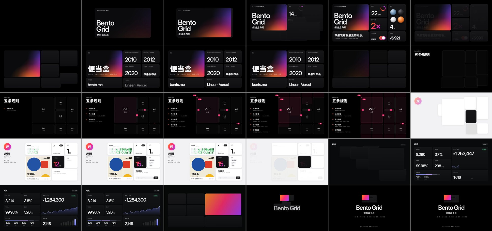
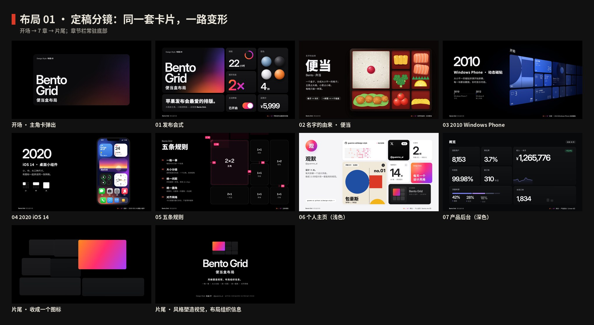
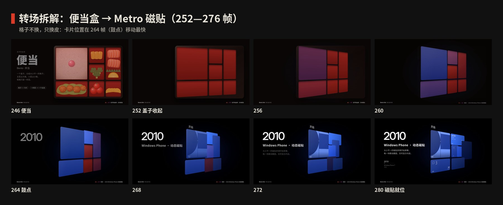
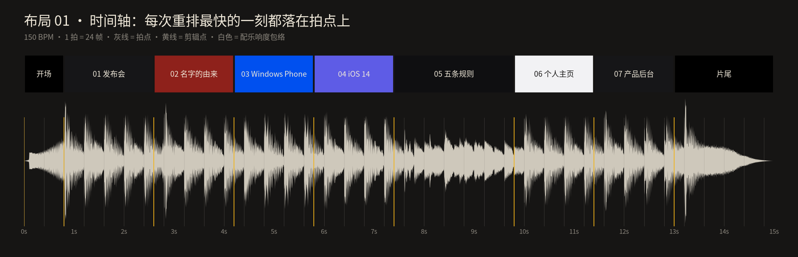

# 布局 01 · 便当盒布局 · 制作过程

> 这一期是怎么从一个想法变成 15 秒短片和 4 张图的：怎么想的、怎么做的、哪里推翻重来、下次怎么做得更好。
> 过程图都在 [`process/`](process)，可以复现的代码在 `video/` `audio/` `images/` 和根目录的 `scripts/`。

🎬 [看成片（Releases · layout-01）](https://github.com/guanmo-ai/design-style/releases/tag/layout-01) · 📐 [布局指南](README.md)

---

> 这一期最初按风格系列的第 2 期（No.02）制作；定稿前确认 Bento 是“布局”而不是“风格”，改为**布局 01**。下文 v1 联系表保留了当时的编号。

## 0 · 一览

| # | 步骤 | 产出 | 工具 / 文件 |
|:-:|---|---|---|
| 1 | 选题与定调 | 一句话定义 + 受众 | — |
| 2 | 研究 | 名字由来、前身时间线、五条规则、用法清单、常见误区 | [`README.md`](README.md) §1—§7 |
| 3 | 设计令牌 | 发布会配色、3 款开源字体、4 列网格、150 BPM 节拍 | `tokens.ts / .css / .json` |
| 4 | 视频 v1 | 发布会式卡片重排，讲五条规则 | `Remotion` · React |
| 5 | 反馈 | “感觉撑不起一个风格，不知道是不是内容少了” | — |
| 6 | 视频 v2 | 7 章：同一套卡片从便当盒、Metro、iOS 一路变到个人主页和后台 | `video/*.tsx` · `video/layout.ts` |
| 7 | 定性 | Bento 不是风格，是布局 → 新增“布局”系列，改为布局 01 | 根目录 `README.md` · 画廊 |
| 8 | 配乐与音效 | 150 BPM，F 大调，每次重排的最快一刻落在鼓点上，−14 LUFS | `audio/make_music.py`（numpy 合成） |
| 9 | 布局图 ×4 | 布局海报 · 布局速查 · 换六种风格 · 三套排法 | `images/make_svgs.py` · `scripts/build_images.py` |
| 10 | 质检 | 关键帧截图、联系表、节拍时间轴、成片抽帧 | `scripts/stills.mjs` · `contact_sheet.py` · `timeline_chart.py` |
| 11 | 发布 | 母版 + 分享版 MP4、封面、仓库、画廊 | ffmpeg · GitHub Releases · GitHub Pages |

---

## 1 · 选题与定调

**为什么做它：** 便当盒是这几年产品官网、个人主页、发布会里最常见的排法，设计师天天在用，普通人也天天在看。

**定调（写在动手之前）：**

- 一句话：*把一页内容装进大小不一的圆角格子里，一格只讲一件事，用面积告诉观众谁最重要。*
- 受众：设计师拿去就能用（网格参数、圆角公式、CSS、提示词），普通人看完就能认出“原来这叫便当盒”。
- 质感：苹果发布会式的纯黑底、深灰卡片、超大数字，干净、紧，有推进感。

## 2 · 研究：先列清单，再动手

1. **名字：** 弁当（bentō），分格的日本便当盒：主菜占大格，小菜占小格，每格只装一样菜。
2. **前身时间线：** 1950—60 年代瑞士网格 → 2010 Windows Phone 动态磁贴 → 2012 Windows 8 → 2020 iOS 14 小组件 → 2020 年代初苹果发布会的卖点总结页 → 2022—2023 “Bento Grid”这个叫法流行。
3. **规则：** 一格一事 / 大小分级 / 统一间距 / 统一圆角 / 对齐网格，每条都写了“怎么做”和“小心”。
4. **广度清单**（v2 的 7 个章节从这里来）：

   | 领域 | 代表 | 在视频里 |
   |---|---|---|
   | 发布会 | 苹果的卖点总结页 | 01 发布会 |
   | 生活 | 日本便当盒 | 02 名字的由来 |
   | 手机系统 · 2010 | Windows Phone 动态磁贴 | 03 前身 |
   | 手机系统 · 2020 | iOS 14 桌面小组件 | 04 前身 |
   | 设计规范 | 间距、圆角、网格 | 05 五条规则 |
   | 个人主页 | bento.me | 06 个人主页 |
   | 产品后台 | Linear · Vercel | 07 产品后台 |

5. **误区：** 它不是苹果发明的；它不是瀑布流；手机上要重排而不是等比缩小。

## 3 · 设计令牌

- **颜色：** 底 `#000000`，卡片 `#161618 → #0F0F11`，文字 `#F5F5F7` / `#86868B`；强调渐变 `#FF8A1F → #FF2D6F → #A63DFF` 只给主角。
- **字体：** Inter Display 600（大数字，字距 -0.045em）+ Inter + Noto Sans SC，编号用 Geist Mono；Metro 段用微软开源的 Selawik 代替 Segoe UI。全部 OFL，`scripts/fetch_fonts.sh` 下载，视频里按需加载。
- **网格：** 4 列，边距 96 / 100，间距 20，圆角 32，内边距 40；嵌套圆角 = 32 − 12 = 20。
- **节拍：** 150 BPM，1 拍 = 24 帧。
- **缓动：** 卡片重排 `Easing.bezier(0.6, 0, 0.12, 1)`：起步稍慢、前段最快、长长地落定。

## 4 · 视频 v1



v1 的结构：一张大卡片裂成发布会排版 → 一页“便当盒 · 2010 · 2012 · 2020 · 苹果发布会”的来历卡片 → 五条规则 → 个人主页 → 产品后台 → 片尾。

## 5 · 反馈与诊断

> “还不错，但就是感觉撑不起一个风格，不知道是不是内容少了。”

**诊断：**

- **讲来历的部分只有年份文字。** 观众没看到它从哪来，看不出便当盒、磁贴、小组件长什么样。
- **卡片里基本只有数字和字。** 从头到尾一个样子，看着单调。
- **只有一种配色。** 撑不起一整期。

## 6 · 视频 v2：同一套卡片，一路变形



**v2 的规则：**

1. **全片只有 7 张卡片。** 它们在 9 种排法（`video/layout.ts` 里每种排法 = 7 个矩形）之间重排。卡片编号在所有排法里一一对应，所以每次转场都是“同一批格子换位置”，而不是切镜头。
2. **来历要拍出来，不能只写年份。** 便当盒真的画出一格格菜，Metro 真的是磁贴开始屏幕，iOS 真的是手机桌面。
3. **保留卡片，切换视觉风格。** 7 章呈现了多种视觉风格：发布会黑、漆盒红、Metro 钴蓝、iOS 毛玻璃、浅色主页 / 深色后台。这些变化说明，同一套卡片可以呈现不同的视觉风格。
4. **常驻章节栏。** 底部始终显示“03 / 07 · 前身 · 2010 Windows Phone 动态磁贴”这样的进度，观众知道自己看到哪了。

**每一章怎么做：**

| 章 | 主角 | 动作 | 实现要点 |
|---|---|---|---|
| 01 发布会 | 主角卡 + 6 张数据卡 | 主角卡裂成 7 格，数字滚动 | `content.tsx` · `KeyContent`；数字用 `tween` 滚动 |
| 02 名字的由来 | 红漆便当盒 | 卡片缩进漆盒，每格落下一样菜 | `history.tsx` · `BentoBox` / `BentoFood`；菜全部用 CSS 渐变和圆画成 |
| 03 Windows Phone | 开始屏幕 | 左边年份和说明，右边磁贴墙斜着退进黑暗；日历磁贴翻起，照片慢推，远处的磁贴一块块翻进来，墙像门一样慢慢打开（36° → 28°） | `MetroCaption` / `MetroContent` / `MetroChrome` / `metroTilt`；墙以左边为轴转，`perspective(1400px)`；一个主题色（钴蓝）分几档深浅，圆角 24、缝 24；Selawik 细体大数字；整面墙共用一套光，越远越暗 |
| 04 iOS 14 | 手机桌面 | 磁贴飞进手机变成小组件，旁边是小 / 中 / 大三种尺寸 | `PhoneBack` / `PhoneFront` 夹住卡片，卡片在手机屏幕“里面” |
| 05 五条规则 | 线框网格 | 卡片变线框，规则逐条出现，同时打上间距、圆角标注 | `overlays.tsx` · `RulesPanel` / `Annotations` / `ColumnFills`；`RULES_AT` 每 18 帧一条 |
| 06 个人主页 | bento.me 式主页 | 浅色，头像栏滑入；一张卡片只放一样东西：GitHub / X / 已发布 / 最新作品 / 每期短片 / 每天一个设计风格 / 正在播放 | `HomeContent` · `Profile`；统一排版：小标题 20 灰、大数字 150、说明 20 灰、内边距 32；最新作品卡整张铺满包豪斯那期的海报；“正在播放”就是本片配乐，进度和时间跟着真实帧数走 |
| 07 产品后台 | Linear 式看板 | 主角挪到右上变收入曲线，指标滚动 | `DashContent` · `DashHeader` |
| 片尾 | 小图标 | 7 张卡缩回一个便当盒图标 →「风格塑造视觉，布局组织信息。」 | `EndTitle`；`END = KEY.map(shrink)` |

**转场拆解：**



每次重排 34—46 帧，卡片按 `order` 依次出发（每张错开 2—3 帧）。颜色在前 11 帧（`COLOR_DUR`）过渡完，位置用 `REFLOW` 缓动；移动最快的一刻在转场开始后第 12 帧（`HIT = 12`），正好压在鼓点上。

## 7 · 定性：它是布局，不是风格

v2 之后讨论了“Bento 算不算一种风格”，结论是不算：

- 它只规定格子怎么分、怎么对齐，不规定颜色、字体和质感；v2 里同一套格子已经呈现了多种视觉风格。
- Metro 和 iOS 小组件是被追认的“前身”，“Bento Grid”这个叫法 2022—2023 年才流行，真正的祖先是瑞士网格。

**于是：**

- 新增 **类型** 维度：风格 Style / 布局 Layout。风格放在 `styles/NNN-name/`，布局放在 `layouts/NN-name/`，编号各自从 1 开始。
- 视频里的“No.02”全部改成“布局 01”，片尾改为「风格塑造视觉，布局组织信息。」，合成 id 改为 `L01-BentoGrid`。
- 画廊加上“全部 / 风格 / 布局”筛选，布局作品的封面带“布局”角标。
- 第三张图从“风格应用”改为 **同一布局，六种风格**，专门讲布局和风格的区别。

## 8 · 分镜与节拍

先写时间轴（[`process/timeline.json`](process/timeline.json)），再写代码。开场 2 拍，发布会 4.5 拍，三段来历各 4 拍，五条规则 6 拍，两段用法各 4 拍，片尾 5 拍。逐帧分镜表见 [布局指南 §9](README.md#9--15-秒分镜)。



上图由 `scripts/timeline_chart.py` 直接读取最终配乐生成。剪辑点（黄线）是转场的起点；每次转场再过 12 帧（半拍）就是卡片移动最快的一刻，落在下一个拍点上：168 / 264 / 360 / 456 / 600 / 696 / 792 帧。

## 9 · 声音

`audio/make_music.py` 用 numpy 从零合成，没有任何外部音源：

- **编排：** 150 BPM，F 大调。和弦在每次重排的重音拍上换（Fmaj9 → Am9 → Dm9 → B♭maj9 → …）。四踩底鼓、反拍踩镲、八分贝斯、十六分拨弦琶音。
- **每章自己的声音：** 便当段用五声音阶拨弦，漆盒落下一声木质的“咚”；Metro 段有磁贴翻面的“咔嗒”；数字滚动时有细碎的嘀嗒；产品后台换成十六分踩镲。
- **五条规则那段：** 鼓停下，整条音乐被低通“闷住”（截止频率 16 kHz → 700 Hz），每条规则一声“叮”；规则讲完，滤波器打开，律动回到个人主页。
- **对齐：** 每次重排的 whoosh 峰值和重音都落在 `at + 12`；时间点直接写帧号，和 `layout.ts` 共用同一套数字。
- **响度：** ffmpeg `loudnorm` 标准化到 −14 LUFS。
- **局限：** 只做了响度和时间对齐检查，发布前由观默试听把关。

## 10 · 布局图

四张 1080×1350 的图都由 `images/make_svgs.py` 生成，再用 `scripts/build_images.py` 子集化字体、内嵌成自包含 SVG 并导出 PNG。

| 图 | 目的 | 检查了什么 |
|---|---|---|
| 布局海报 | 海报本身也按便当盒排：4 列、间距 20、圆角 32，一张 2×2 主角 | 每张卡只讲一件事；小卡里的图形不出界 |
| 布局速查 | 网格与尺寸、间距与圆角、色板、五条规则、字体、常见误区 | 数值与 `tokens.*` 一致（嵌套圆角 32 − 12 = 20） |
| 换六种风格 | 同一套 7 格，套上便当漆盒、Metro、iOS、包豪斯、浅色主页、深色后台 | 6 张的格子坐标完全相同，只换颜色、圆角和内容 |
| 三套排法 | 产品卖点 / 个人主页 / 数据看板，标出主角和尺寸 | 列线可见；手机端怎么重排写在页脚 |

## 11 · 质检

1. **关键帧截图：** `npx remotion bundle` 打包一次，用 `node scripts/stills.mjs` 只导出受影响的帧。
2. **联系表：** `python3 scripts/contact_sheet.py` 从成片里精确抽帧（本页 01—03 图）。
3. **时间轴：** `python3 scripts/timeline_chart.py` 检查剪辑点与拍点是否对齐。
4. **成片检查：** `ffprobe` 核对 1920×1080 · 60fps · 15.06s · H.264 + AAC，再从成片抽帧复查。

## 12 · 渲染与发布

```bash
npm run music:L01                                     # 生成配乐 → public/01-bento-grid/music.wav
npx remotion render src/index.ts L01-BentoGrid out/01-bento-grid-master.mp4 --crf=16       # 母版
ffmpeg -i out/01-bento-grid-master.mp4 -vf "scale=in_range=full:out_range=tv,format=yuv420p" \
  -c:v libx264 -preset slow -crf 18 -profile:v high -c:a aac -b:a 192k -movflags +faststart \
  out/01-bento-grid.mp4                               # 分享版（Releases 附件）
```

- 母版约 7MB，分享版约 5MB：纯色和大面积暗部压缩率很高。
- 视频不进 git 仓库，放在 [Releases · layout-01](https://github.com/guanmo-ai/design-style/releases/tag/layout-01)。
- 封面：发布会排版第 2.3 秒的帧 → `video/cover.jpg`。

## 13 · 改版记录

| 版本 | 反馈 | 诊断 | 改了什么 |
|---|---|---|---|
| v1 → v2 | “感觉撑不起一个风格，不知道是不是内容少了” | 来历只有年份文字；卡片里只有数字和字；只有一种配色 | 7 章，同一套卡片一路变形：便当盒 / Metro / iOS 三段前身 + 两种用法；常驻章节栏；重新对齐配乐 |
| v2 → 定稿 | “似乎还可以”，并讨论 Bento 算不算风格 | 它规定信息的排列方式，视觉风格可以另选 | 新增“布局”系列，改为布局 01；片尾改为「风格塑造视觉，布局组织信息。」；布局图第三张改为“换六种风格”；画廊加类型筛选 |
| 定稿前微调 ① | “没有圆角，感觉有点普通，而且没有间隙，感觉没有大片感” | Metro 段照搬原版的直角、窄缝，画面挤，镜头也不动 | 磁贴圆角 24、缝 24；Metro 段镜头慢慢推近 |
| 定稿前微调 ② | “这两个地方没有很高级……是一个顶尖的设计布局” | Metro：七种颜色的磁贴 + 高光 + 彩色发光 + 剪贴画式图标，太吵也太挤；个人主页：模板味，每张白卡片都是“小标题 + 一个数字”，还有一个假的订阅输入框 | **Metro**：改用 Windows Phone 本来的做法——整面墙只用一个主题色（钴蓝），分几档深浅；去掉发光，只留上沿一根细高光和一道很淡的扫光；字改成细体大数字 + 左下角小名字；人脉头像换成第 001 期海报压成的双色调“照片”；镜头斜着推进来再摆正。**个人主页**：#F5F5F7 底、几乎看不见的阴影，字号拉开层级；海报整张铺满；X 和“正在播放”用黑卡片，“每天一个设计风格”用品牌渐变；订阅框和工具标签换成“已发布 风格 001 / 布局 01”和本片配乐的“正在播放” |
| 定稿前微调 ③ | “按发布会的标准去做呢，或者顶尖大厂的设计水平” | Metro：铺满全屏的磁贴像一张界面截图，不像发布会里的“产品镜头”，也和 02、04 两章的版式对不上；个人主页：字号、内边距各卡片不统一，小字太多 | **Metro**：改成和 02、04 同一种章节版式——左边“2010 / Windows Phone · 动态磁贴 / 一句话 / 2010 → 2012 小时间线”，右边整面磁贴墙以左边为轴转向右后方，近大远小、越远越暗，一直排到画外；墙像门一样从 36° 慢慢开到 28°，进 iOS 前摆正；去掉头像和用户名。**个人主页**：每张卡片同一套排版（左上 20 号灰色小标题、150 号大数字、20 号灰色说明、内边距 32）；“已发布”改成一个大数字 2 期；GitHub 贡献格子沿品牌渐变着色；“每天一个设计风格”卡片上飘两团光；头像做成有高光的球；简介用苹果式的黑 + 灰两段；网址做成白色胶囊按钮 |

本次网页改版统一了「设计风格／布局方式」标签与说明文案，配套海报、图解、分镜联系表和短片片尾同步更新。当前分镜图使用新版成片抽帧；相同文案的分享版同步更新至 `layout-01` Release，画廊 SHA-256 随成片更新，构建从 Release 下载并校验后发布。

## 14 · 踩坑记录

| 问题 | 解决 |
|---|---|
| Windows Phone 的 Segoe UI 不能随项目分发 | 用微软开源的 Selawik（OFL），字形和字重都很接近 |
| 合并远端更新时，两边都改了字体加载方式 | 统一成首帧按需加载（`React.useState(loadFonts)`），中文字体也按需加载 |
| 低通滤波的截止频率用 `np.where` 分段计算，区间外的指数会溢出报警 | `np.where` 两边都会先算出来，所以先把进度 `np.clip` 到 0—1 |
| 布局图导出 PNG 时 Playwright 找不到自带的 Chromium | `svg_to_png.mjs` 支持 `CHROMIUM_PATH`，指向系统 Chromium |
| 速查卡里的 ✕ 在子集化后的字体里没有字形，显示成方块 | 改用 ×（U+00D7） |
| 小卡片里的示意图出界、Metro 头像压住“人脉”标签 | 每次导出后看 PNG，按 2× 截图逐张检查 |
| 每块磁贴各画各的渐变，整面墙的光是断开的 | 渐变画在屏幕坐标里：`background-size` 固定成一整面墙，`background-position` 取磁贴坐标的负值，每块磁贴只裁出自己那一块 |
| Metro 段镜头一斜，右边露出空的黑底 | 屏幕外多排三列磁贴（第 8—10 列），离得远、颜色也压暗 |
| 远处压暗的光叠在磁贴内容下面，照片、唱片这种整块不透明的内容把光挡住了，远处那块反而最亮 | 光层改成盖在内容上面（`pointer-events: none`），远处的字和图一起暗下去 |
| 左边的标题和斜过来的磁贴墙挤在一起 | 墙整体右移到 x = 920，并以左边为轴转，墙的近端不会往左探出来；标题晚 4 帧出现，等飞行中的磁贴先让开 |
| 海报放进 602×580 的卡片，按“铺满”裁切会切掉海报上的字 | 按宽度放满、底边贴住卡片底，上面多出的一截用海报自己的米色 `#F0E9DA` 接上 |

## 15 · 下期沿用的清单

- [ ] 先判断它是**风格**还是**布局**：风格放 `styles/`，布局放 `layouts/`，编号分开
- [ ] 来历要“拍出来”：画出它当年的样子，不能只写年份
- [ ] 广度清单至少 6 项，视频章节从这里来
- [ ] 先写 `timeline.json`，再写分镜，最后写代码；剪辑点和重音都落在拍子上
- [ ] 联系表 + 时间轴做质检；`PROCESS.md` 边做边写
