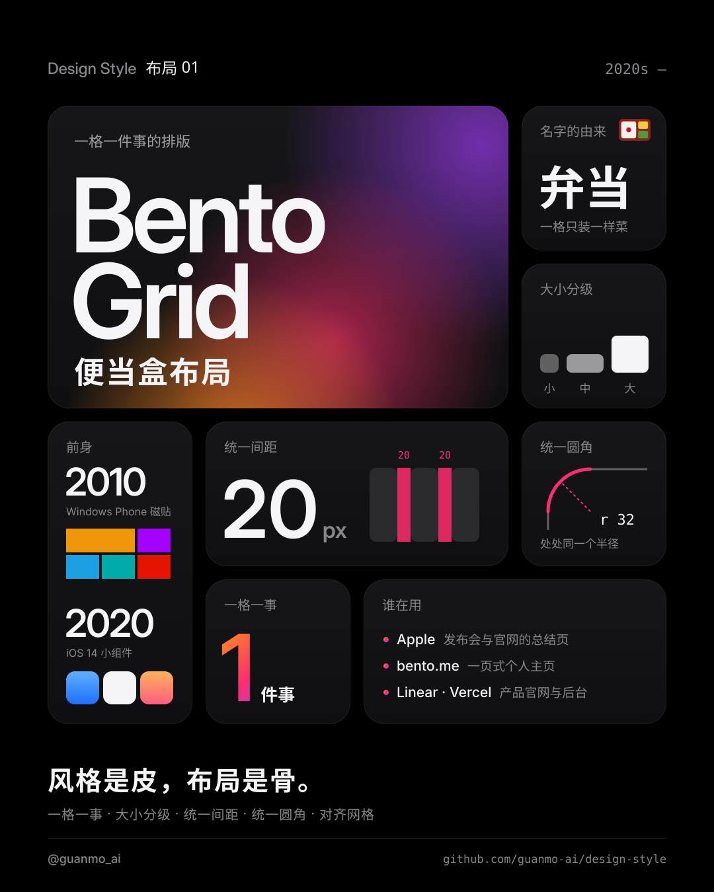
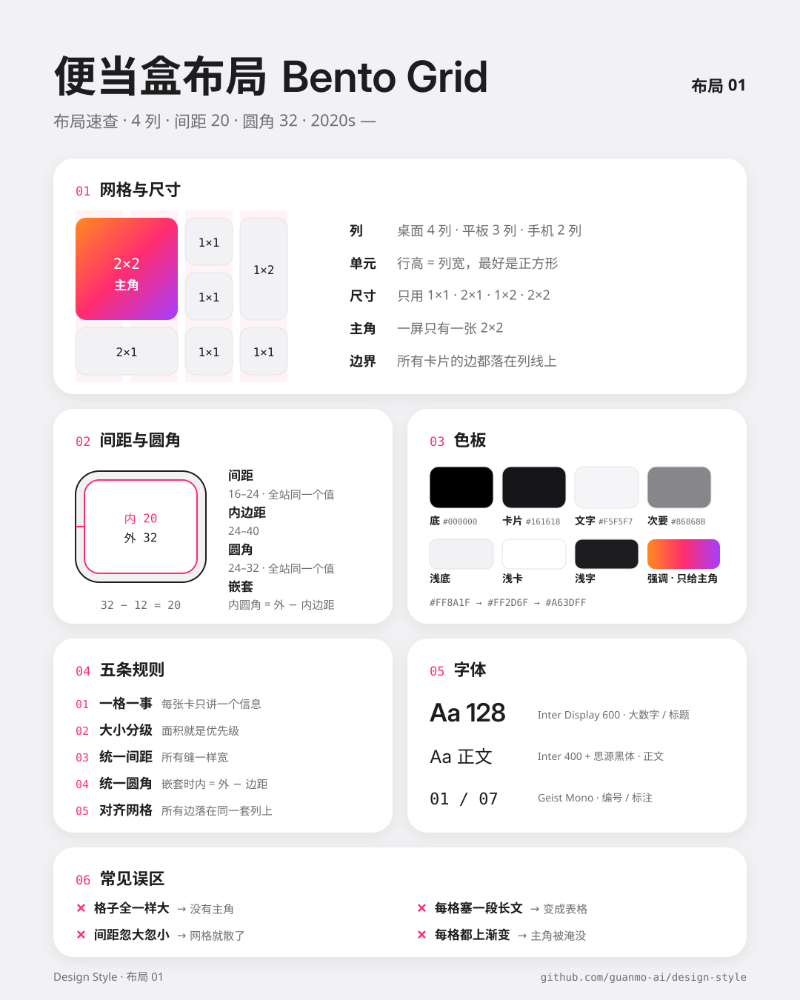
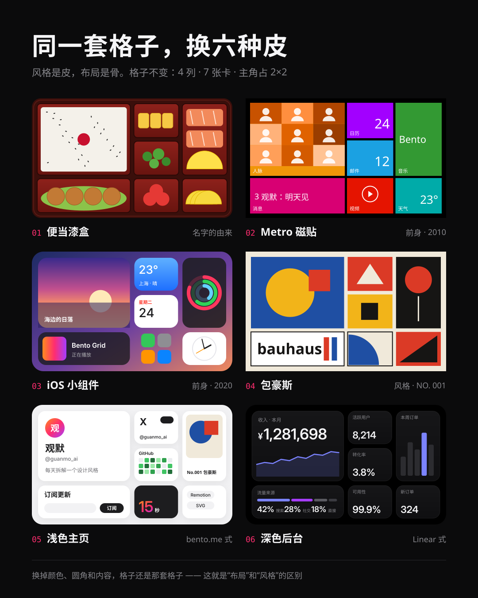
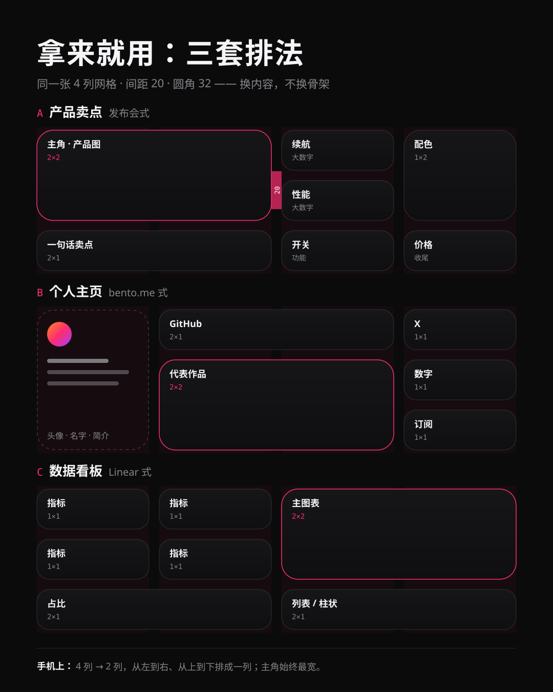

# 01 · Bento Grid

[中文](README.md) · **English** · [Watch the film](https://github.com/guanmo-ai/design-style/releases/tag/layout-01) · [Making of](PROCESS.en.md)

> English quick guide to this episode. Videos and SVG artwork retain their original Chinese labels. The [detailed Chinese guide](README.md) includes the longer history and frame-by-frame storyboard.

## Overview

One set of cards, many ways to organize information. From lunch boxes and live tiles to personal websites, learn grids, proportions, and hierarchy in 15 seconds.

Series: **Layouts**. Period shown in this episode: **2020s—**.

## Five practical rules

| Rule | How to apply it |
|---|---|
| **One idea per card** | Each card contains one number, image, or short message. |
| **Size is hierarchy** | Give one hero a 2×2 area and use 1×1, 2×1, or 1×2 supporting cards. |
| **Consistent gaps** | Choose a single gap value. This episode uses 20px in the main grid. |
| **Consistent corners** | Use one corner system; subtract inset padding from the outer radius for nested cards. |
| **Aligned grid** | Align both rows and columns. Reflow cards for smaller screens rather than shrinking the whole page. |

## Project palette and typography

This is the palette used by this project, not a universal specification for every example of Bento Grid.

- Colors: `#000000`, `#161618`, `#0F0F11`, `#F5F5F7`, `#86868B`, `#F2F2F4`, `#FFFFFF`, `#1D1D1F`, `#FF8A1F`, `#FF2D6F`, `#A63DFF`.
- Typefaces: Inter / Inter Display, Noto Sans SC, Geist Mono, Selawik.
- Editable values: [JSON tokens](tokens.json), [CSS tokens](tokens.css), and [TypeScript tokens](tokens.ts).

## Visual references

The four editable diagrams explain the same rules from different angles. Their embedded labels are in Chinese.

### Bento Grid at a glance



### Grid, gaps, corners, and five rules



### One layout, six visual styles



### Three ready-to-use arrangements



## Common pitfalls

Bento is a layout rather than a visual style: the same arrangement can use very different colors and typography. It aligns both rows and columns; masonry only aligns columns.

## AI image prompt

The original episode includes this English prompt:

```text
Bento grid layout: a 4-column grid of rounded cards with equal 20px gaps and 32px corner radius,
one hero card spanning 2x2, the others 1x1, 2x1 and 1x2, each card shows exactly one thing
(a huge number, an icon, or a short headline). Apple keynote look: pure black background,
dark gray cards #161618, white text, one orange-pink-purple gradient only on the hero card,
Inter Display typography, generous padding, clean, no clutter --ar 4:5
```

## Explore the source

- [Making of: English overview](PROCESS.en.md)
- [Detailed guide in Chinese](README.md)
- [Animation source](video)
- [Music synthesis](audio/make_music.py)
- [Original SVG files](images)
