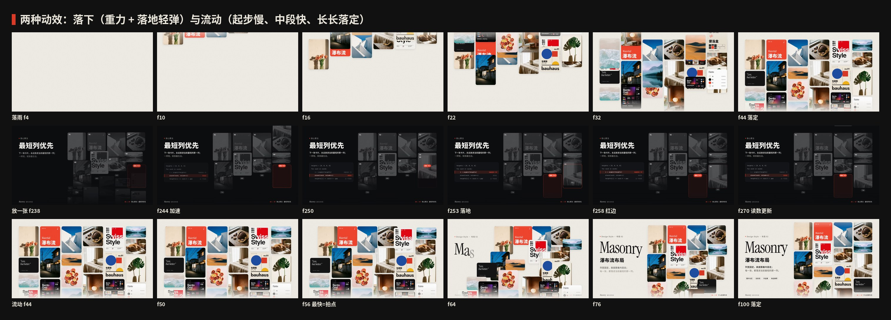
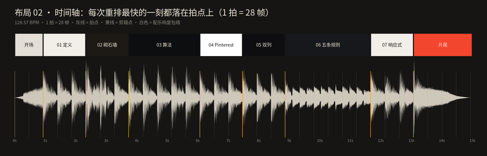
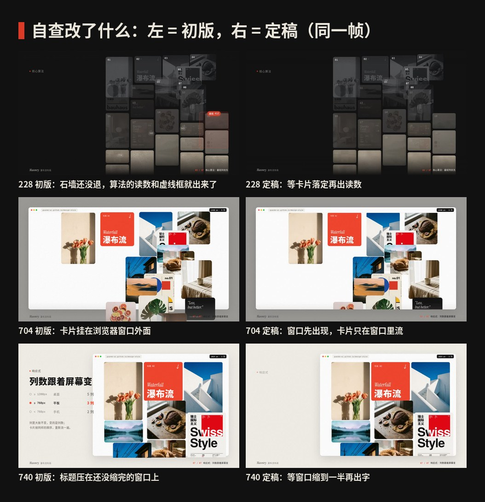

# 布局 02 · 瀑布流布局 · 制作过程

> 这一期是怎么从“瀑布流”三个字变成 15 秒短片和 4 张图的：怎么想的、怎么做的、哪里改过、下次怎么做得更好。
> 过程图都在 [`process/`](process)，可以复现的代码在 `video/` `audio/` `images/` 和根目录的 `scripts/`。

🎬 [看成片（Releases · layout-02）](https://github.com/guanmo-ai/design-style/releases/tag/layout-02) · 📐 [布局指南](README.md)

---

## 0 · 一览

| # | 步骤 | 产出 | 工具 / 文件 |
|:-:|---|---|---|
| 1 | 选题与定调 | 一句话定义 + 受众 + 和布局 01 的区别 | — |
| 2 | 研究 | 名字由来、时间线、五条规则、用法清单、常见误区、CSS 现状 | [`README.md`](README.md) §1—§7 |
| 3 | 设计令牌 | 纸色 + 一点红、Instrument Serif、列宽固定、28 帧一拍 | `tokens.ts / .css / .json` |
| 4 | 动效设计 | 两种动作：**落下**和**流动**；一套卡片从头流到尾 | `video/layout.ts` |
| 5 | 分镜与节拍 | 9 段，所有剪辑点都在拍点上 | [`process/timeline.json`](process/timeline.json) |
| 6 | 配乐与音效 | D 大调，每张卡片落地一声水滴，规则段音乐被“闷住” | `audio/make_music.py`（numpy 合成） |
| 7 | 布局图 ×4 | 布局海报 · 布局速查 · 四种排法对比 · 三套模板 | `images/make_svgs.py` · `scripts/build_images.py` |
| 8 | 质检 | 关键帧、联系表、节拍时间轴、成片抽帧 | `scripts/stills.mjs` · `contact_sheet.py` · `timeline_chart.py` |
| 9 | 自查与修改 | 3 处动效问题 + 6 处细节 | 本页 §9 |
| 10 | 发布 | 母版 + 分享版 MP4、封面、仓库 | ffmpeg · GitHub Releases |

---

## 1 · 选题与定调

**为什么做它：** 布局 01 讲的是“格子大小由内容的重要程度决定”（便当盒）；瀑布流正好相反——**格子大小由内容自己的长宽比决定**，谁也不比谁重要，按顺序往最短的一列里放。这两期放在一起看，正好是“编排”和“流”两种排法。它也是普通人每天刷得最多的布局：Pinterest、小红书、淘宝“猜你喜欢”、相册、作品集。

**定调（写在动手之前）：**

- 一句话：*列宽固定、高度跟着内容走，每一张都放进当前最短的那一列。*
- 受众：设计师拿去就能用（列数、间距、比例、算法、CSS、提示词），普通人看完能说出“原来小红书首页叫瀑布流，它是这样排的”。
- 质感：像一本摄影杂志——暖白纸色、真实照片、衬线大标题、只用一点红；动起来像水，不像机器。

## 2 · 研究：先列清单，再动手

1. **名字：** Masonry = 砌石、砖石工程：大小不一的石块一层层砌上去，缝是统一的。中文叫“瀑布流”，说的是它往下一直流、刷不到底。
2. **时间线：** 2009 David DeSandro 的 jQuery Masonry 插件 → 2010 Pinterest 上线，图钉墙让它出圈 → 2011 前后“瀑布流”叫法在国内流行 → 2010 年代中手机端双列信息流（小红书、淘宝、Pinterest App）→ 2020 Mozilla 提议 `grid-template-rows: masonry` → 2025 定名 Grid Lanes，Safari 先行 → 2026 写进 CSS Grid Level 3 草案，其余浏览器仍在开关后面（来源见指南 §1）。
3. **规则：** 列宽固定 / 先来后到（最短的一列优先）/ 统一间距 / 高度跟着比例 / 先占位再加载。每条写了“怎么做”和“小心”。
4. **广度清单**（视频的 7 个章节从这里来）：

   | 领域 | 代表 | 在视频里 |
   |---|---|---|
   | 定义 | 一面不齐的墙 | 01 定义 |
   | 名字 | 砌石墙 | 02 名字 |
   | 算法 | 最短列优先 | 03 算法 |
   | 网站 · 2010 | Pinterest 图钉墙 | 04 2010 |
   | 手机 | 双列信息流 | 05 双列 |
   | 设计规范 | 列宽、顺序、间距、比例、占位 | 06 五条规则 |
   | 前端 | 5 → 3 → 2 列 | 07 响应式 |

5. **误区：** 它不是便当盒（大小不分主次）；CSS `columns` 不是瀑布流（顺序是竖着读的）；不能把图片裁成一样高；手机上要减列，不是等比缩小；没有占位就会边加载边跳。

## 3 · 设计令牌

- **颜色：** 纸 `#F2EFE9`，卡片 `#FFFFFF`，墨 `#141414` / `#6F6A62`，夜 `#0D0E10` / `#17181B`，砂岩 `#E9E2D3`；红 `#F2462E` 只给“最短的一列”和“下一张”。
- **字体：** Instrument Serif 400 / Italic（大标题，杂志感）+ Noto Sans SC + Inter，数字和代码用 Geist Mono。全部 OFL，`scripts/fetch_fonts.sh` 下载。
- **网格：** 列宽固定，高 = 列宽 × 比例；桌面 5 列 / 平板 3 列 / 手机 2 列；间距 20、圆角 20；手机间距 8、圆角 10、边距 8。比例只用 7 档：2:3 · 3:4 · 4:5 · 1:1 · 4:3 · 3:2 · 16:9。
- **节拍：** 约 128.6 BPM，1 拍 = 28 帧（60fps）。
- **缓动：** 流动 `Easing.bezier(0.62, 0, 0.1, 1)`；落下是自己写的 `dropEase`：前 70% 按 t² 加速，落地后轻轻弹 4.5%。

## 4 · 动效设计

**核心想法：全片只有 26 张卡片，从第一帧到最后一帧都是同一批。** 它们在 13 种排法之间流动（雨、定义、石墙、算法 ×9、图钉墙、手机、线框、3 种窗口、片尾），观众看到的是“同一批内容换了一种排法”，这正是瀑布流的本质。



1. **两种动作，各讲一件事。**
   - **落下**（开场的雨、算法一章）：重力加速，落地一弹，讲“一张一张放进去”。落地那一帧就是水滴声。
   - **流动**（其余转场）：起步慢、中段最快、长长落定，讲“整面墙重新排一遍”。每张卡片按目标位置排出发顺序（按 x、按 y 或按原顺序），错开 0.5—0.8 帧，像水从一头流到另一头。
2. **最快的一刻落在鼓点上。** 每次转场从拍点前 12 帧开始，卡片移动最快的一刻正好是下一个拍点（56 / 140 / 224 / 364 / 448 / 532 / 700 / 728 / 756 / 784）。
3. **被打断也不跳。** `stateAt()` 是递归的：新转场开始时，从卡片“此刻真实所在的位置”接着走，而不是从上一种排法的终点。所以算法一章 5 张连放（每 7 帧一张）互相打断，也没有一帧跳变。
4. **先有容器，再倒进去。** 进手机、进浏览器窗口时，裁切框比卡片先到位（`clip` 进度 = `p × 1.6`；窗口那次 6 帧就到位），卡片像倒进屏幕里，而不是先飞到外面再被切掉。
5. **算法要能看懂。** 只留 8 张卡片，每列底部一颗高度读数，最短的一列变红，虚线框标出下一张要去的位置；前 3 张每拍一张慢放，后 5 张每 7 帧一张连放——先教会，再加速。
6. **镜头和质感。** 画面整体有很慢的推近和上流（图钉墙每秒往上流），全片叠 4% 的胶片颗粒，背景按章节换色（纸 → 石 → 夜 → 白 → 夜 → 纸 → 红）。

## 5 · 分镜与节拍

先写时间轴（[`process/timeline.json`](process/timeline.json)），再写代码。开场 2 拍，定义、名字各 3 拍，算法 5 拍，图钉墙、双列各 3 拍，五条规则 6 拍，响应式 3 拍，片尾约 4 拍。逐帧分镜表见 [布局指南 §9](README.md#9--15-秒分镜)。




上图由 `scripts/timeline_chart.py` 直接读取最终配乐生成：每个剪辑点都落在拍点上。

## 6 · 声音

`audio/make_music.py` 用 numpy 从零合成，没有任何外部音源：

- **编排：** D 大调，温暖、透明。Dmaj9 → Bm9 → Em9 → Asus → … 在每次重排的拍点上换和弦；底鼓、拍手、沙锤、电钢琴、贝斯、Pad。
- **每张卡片都有声音：** 开场 26 张卡片落地，每张一声 D 大调五声音阶的水滴，声像按所在的列从左到右摆开——听得出“雨”是从哪一列落下来的。
- **每章自己的声音：** 石墙段是石块的“咚”；算法段每张卡片落地一声，音高和声像由它落进的列决定（列号由 `layout.ts` 的 `masonry()` 算出，两边共用）；图钉墙的“保存”有一声点击；手机段手指上划有一声 swipe；片尾一阵 shimmer，最后一滴水。
- **五条规则那段：** 鼓停下，整条音乐被低通“闷住”（截止频率 16 kHz → 650 Hz），每条规则一声钟；规则讲完，滤波器打开，律动回到响应式。
- **对齐：** 所有时间点直接写帧号，和 `layout.ts` 共用同一套数字（`HITS`、`ALG_LAND`、`RULES_AT`）。
- **响度：** ffmpeg `loudnorm` 标准化到 −14 LUFS，时长 15.0 秒。
- **局限：** 只做了响度和时间对齐检查，发布前由观默试听把关。

## 7 · 布局图

四张 1080×1350 的图都由 `images/make_svgs.py` 生成，再用 `scripts/build_images.py` 子集化字体、内嵌照片，导出自包含 SVG 和 PNG。

| 图 | 目的 | 检查了什么 |
|---|---|---|
| 布局海报 | 海报本身就是一面 3 列瀑布流，留一个虚线框：“下一张 → 最短的一列” | 9 张的高度都按 7 档比例；虚线框确实在最短的一列 |
| 布局速查 | 算法、五条规则、断点、比例、CSS、色板 | 数值与 `tokens.*` 一致；CSS 写法注明还在开关后面 |
| 四种排法对比 | 同一组卡片用 Grid / Masonry / CSS columns / Bento 排，标出阅读顺序 | 一眼看出 `columns` 是竖着读、Masonry 是横着读 |
| 三套模板 | 作品集网页 · 双列种草 · 商品流，标出列数、间距、圆角 | 手机端 8px 间距；文字不出卡片 |

## 8 · 质检

1. **关键帧截图：** `npx remotion bundle` 打包一次，用 `node scripts/stills.mjs` 只导出受影响的帧，改一处看一处。
2. **联系表：** `python3 scripts/contact_sheet.py` 从成片里精确抽帧（本页的分镜、动效分解、修改前后）。
3. **时间轴：** `python3 scripts/timeline_chart.py` 检查剪辑点与拍点是否对齐。
4. **成片检查：** `ffprobe` 核对 1920×1080 · 60fps · 15.06s · H.264 + AAC，再从成片抽帧复查。

## 9 · 自查与修改



| 帧 | 问题 | 改了什么 |
|---|---|---|
| 228 | 算法的读数和伪代码在卡片还没让开时就出现，叠在一起 | 叠加层晚 6 帧淡入；“下一张”虚线框等卡片落定 8 帧后再出现 |
| 704 | 进浏览器窗口时，卡片先飞到窗口外面再被裁掉，像漏出来 | 这次转场单独设 `clipIn: 6`：窗口 6 帧内先到位，卡片在窗口里流 |
| 740 | “1440 → 1024 → 390px”说明文字和正在变窄的窗口重叠 | 说明改到第一次变窄（5 → 3 列）开始后 22 帧再出现，等窗口缩到一半以下让出位置 |

另外 6 处细节：

- 算法一章的文字卡片在夜色背景里变成一块空白 → 文字压到 26% 不透明度，照片去色，只留结构。
- 规则段的“顺序 1→8”圆点压在比例标签上 → 圆点下移 44 像素。
- 进手机的转场里，有一帧卡片从手机圆角外漏出来 → 手机信息流的裁切框改成直角（`r: 0`），圆角交给手机外壳。
- 海报上“下一张”的虚线框藏在画面外，看不出来 → 海报只放 9 张，让最短的一列在画面里露出空位，虚线框上加一句“下一张 → 最短的一列”。
- 速查卡的 CSS 注释太长，超出卡片 → 改成一句：“还在开关后面 → 先退回普通 Grid 或 JS。”
- 速查卡“断点”的说明压在最后一条分隔线上 → 行距 56 → 50，最后一行不画分隔线。

## 10 · 渲染与发布

```bash
npm run music:L02                                     # 生成配乐 → public/02-masonry/music.wav
npm run render:L02                                    # 母版 → out/02-masonry-master.mp4
ffmpeg -i out/02-masonry-master.mp4 -vf "scale=in_range=full:out_range=tv,format=yuv420p" \
  -c:v libx264 -preset slow -crf 18 -profile:v high -c:a aac -b:a 192k -movflags +faststart \
  out/02-masonry.mp4                                  # 分享版（Releases 附件）
npm run images:L02                                    # 布局图 → images/preview/*.svg + images/png/*.png
```

- 母版约 63.5MB，分享版约 39.8MB：照片和胶片颗粒每帧都在变，压缩率比布局 01 的纯色画面低得多。
- 视频不进 git 仓库，放在 [Releases · layout-02](https://github.com/guanmo-ai/design-style/releases/tag/layout-02)。
- 封面：第 112 帧（定义一章，墙流到右半边）→ `video/cover.jpg`。

## 11 · 踩坑记录

| 问题 | 解决 |
|---|---|
| 沙盒只有 2 核，Remotion 默认并发渲染会卡住 | 渲染时限制并发；截图只导出受影响的帧 |
| 卡片“被打断”时会从上一种排法的终点跳回去 | `stateAt()` 递归求出转场开始那一帧的真实位置，从那里接着走 |
| 布局图里的照片是相对路径，导出 SVG 后在别处打开就丢了 | `build_images.py` 新增 `inline_images()`：把 jpg / png 缩到 900px 内嵌成 data URI |
| Instrument Serif 的斜体在 SVG 里显示成正体 | `@font-face` 要写 `font-style: italic`；`FACES` 增加可选的第 4 个字段 |
| 手机信息流的裁切框带圆角，转场时和手机外壳的圆角对不上 | 裁切框用直角，圆角只交给外壳 |
| 根目录 README 的画廊和 `works.json` 由发布流程生成 | 这一期没有手动改，发布 Release 后由流程更新 |

## 12 · 下期沿用的清单

- [ ] 先判断它是**风格**还是**布局**；布局要讲清楚“它和上一期布局有什么不同”
- [ ] 全片尽量用**同一批元素**变形，让观众看到“同一内容，不同排法”
- [ ] 每种动作只讲一件事（落下 = 放进去，流动 = 重排），不要混用
- [ ] 动作最快的一刻落在拍点上；声音的时间点和画面共用同一套帧号
- [ ] 进容器的转场：容器先到位，内容再进来
- [ ] 讲算法时先慢放 3 次，再加速
- [ ] 先写 `timeline.json`，再写分镜，最后写代码；联系表 + 时间轴做质检；`PROCESS.md` 边做边写
