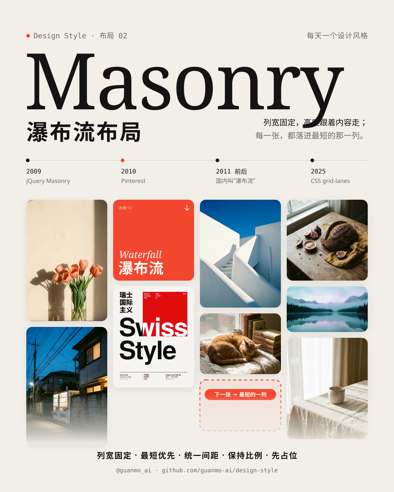
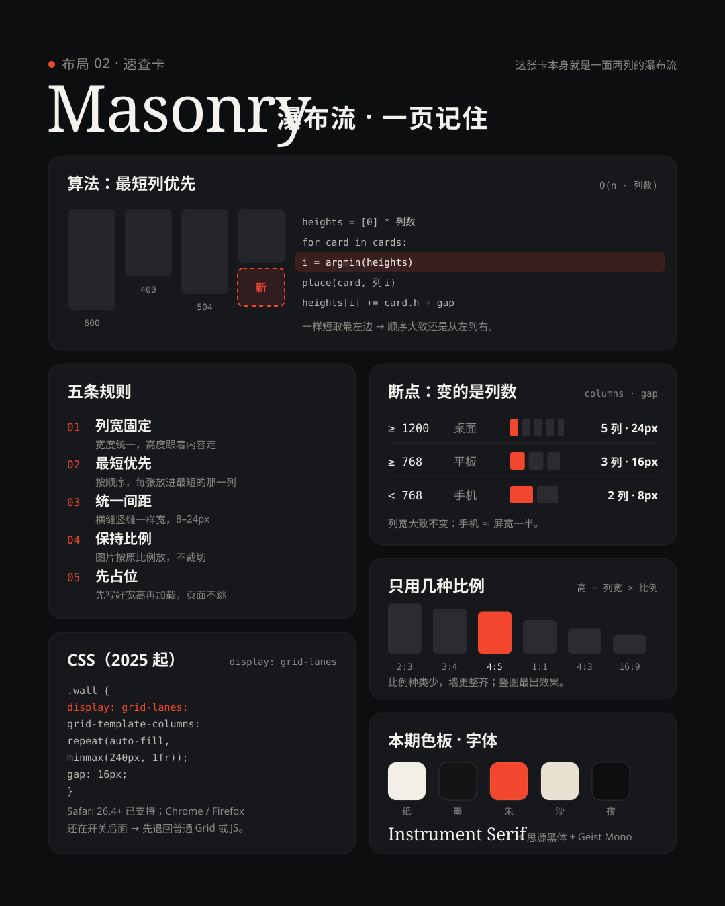
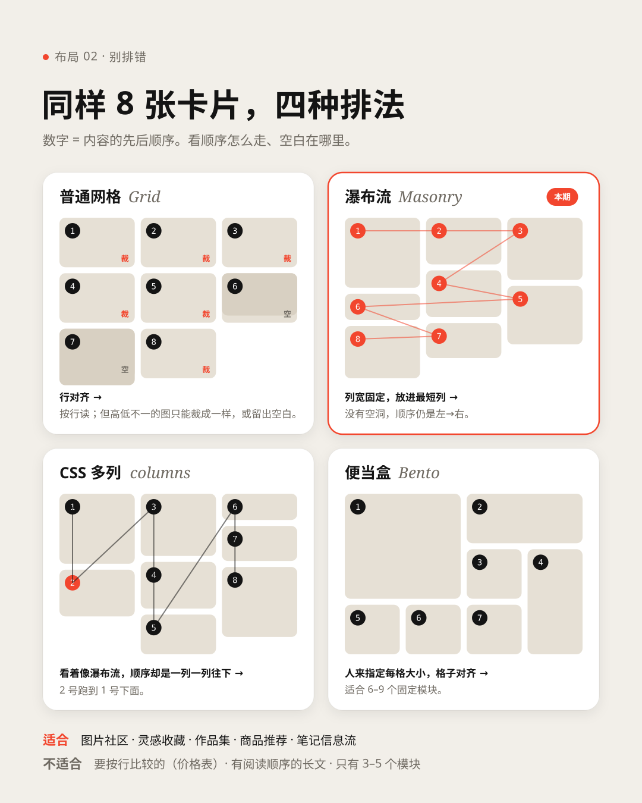

# 布局 02 · 瀑布流布局 Masonry（2009—）

> **一句话：** 列宽固定，高度跟着内容走；每一张卡片，都落进当前最短的那一列。

> **风格塑造视觉，布局组织信息。** 瀑布流不规定颜色、字体和质感，只规定“东西按什么顺序、放到哪一列”。同一面墙，可以是 Pinterest 的白底照片墙，也可以是小红书的双列笔记流、淘宝的“猜你喜欢”。

🎬 [看视频](https://github.com/guanmo-ai/design-style/releases/tag/layout-02) · 🛠 [制作过程](PROCESS.md) · 🖼 [图片源文件](images)

| 布局海报 | 布局速查 |
|:-:|:-:|
|  |  |
| **同样 8 张卡片，四种排法** | **拿来就用：三套排法** |
|  |  |

## 1 · 它从哪来

**名字：** 英文 *Masonry* 是“砌石、砖石工程”：大小不一的石块一块挨一块码紧，灰缝一样宽。中文叫**瀑布流**：内容从上往下一直流，永远看不到底。

| 年份 | 事件 |
|---|---|
| **2009** | 设计师 David DeSandro 发布 jQuery 插件 [Masonry](https://masonry.desandro.com/)：把宽度相同、高度不同的方块“像砌墙一样”往上码，算法就是**放进最短的那一列**。名字从这里来 |
| **2010** | Pinterest 上线：一整面看不到底的图钉墙，悬停出现“保存”。瀑布流从此和“图片灵感”绑在一起 |
| **2011 前后** | 国内图片社区、电商纷纷跟进，“瀑布流”这个叫法流行起来 |
| **2010 年代中** | 移动端变成**双列信息流**：封面 + 标题 + 头像 + 点赞，小红书发现页、淘宝“猜你喜欢”、Pinterest App |
| **2020** | Mozilla 提议用 CSS 原生实现（`grid-template-rows: masonry`），Firefox 放在开关后面试验 |
| **2025** | CSS 工作组定名 **Grid Lanes**（`display: grid-lanes`）；12 月 WebKit 发文介绍，Safari 先行支持（[WebKit 博客](https://webkit.org/blog/17660/introducing-css-grid-lanes/)） |
| **2026** | W3C《CSS Grid Layout Level 3》工作草案把它写作 “grid lanes layout, sometimes called masonry or waterfall”（[规范](https://www.w3.org/TR/css-grid-3/)）；Chrome / Edge / Firefox 仍在开关后面（[Can I use](https://caniuse.com/css-grid-lanes)） |

**它为什么是布局：** 瀑布流只规定排列的算法和几个参数（列宽、间距、比例），换什么颜色、字体都成立。所以和便当盒一样放进“布局”系列：**布局 02**。

## 2 · 五条规则

| # | 规则 | 怎么做 | 小心 |
|:-:|---|---|---|
| 01 | **列宽固定** | 所有卡片同一个宽度，高度跟着内容走 | 混进一张跨两列的大卡，下面会留出空洞 |
| 02 | **最短优先** | 按内容顺序，每一张放进当前最短的那一列；一样短就放最左边 | 按“一列排满再排下一列”放，顺序就乱了（见 §7） |
| 03 | **统一间距** | 横缝和竖缝一样宽：桌面 16—24px，手机 6—8px | 横缝比竖缝宽，墙就变成了一行一行 |
| 04 | **保持比例** | 图片按原始宽高比放，不裁切；高 = 列宽 × 比例 | 全裁成正方形，就退化成普通网格 |
| 05 | **先占位** | 在加载前就知道每张图的宽高，先占好位置再加载 | 图片到了才知道多高，整面墙会跳 |

## 3 · 色板

瀑布流是布局，**没有“正宗配色”**。规则只有一条：**墙本身要安静，让内容说话**——底色和卡片退后，颜色留给照片。下面是视频与布局图用的“画廊墙”配色：

| 名称 | HEX | 用途 |
|---|---|---|
| 纸 | `#F2EFE9` | 暖白画布，像画廊的墙 |
| 卡片 | `#FFFFFF` | 浅色卡片、手机与浏览器窗口 |
| 墨 | `#141414` | 标题、深色文字卡 |
| 暖灰 | `#6F6A62` | 次要文字 |
| 朱 | `#F2462E` | **唯一的强调色**：最短的那一列、规则编号、测量标注、手机里的“+” |
| 沙 | `#E9E2D3` | 便签卡 |
| 夜 | `#0D0E10` / `#17181B` | 深色章节（算法、规则）的画布与卡片 |

## 4 · 字体

| 用途 | 本项目 | 商用原版 / 其他选择 |
|---|---|---|
| 大标题（Masonry、2010） | **Instrument Serif** 400，正体 + 斜体（免费，OFL） | GT Super · Canela · Editorial New |
| 中文标题 / 正文 | **思源黑体 / Noto Sans SC** 400—900（免费，OFL） | 苹方 · HarmonyOS Sans |
| 英文界面字 | **Inter** / **Inter Display**（免费，OFL） | SF Pro · Söhne |
| 代码 / 标注 | **Geist Mono** 400 / 500（免费，OFL） | SF Mono · JetBrains Mono |

衬线大标题配照片墙，是图片社区、杂志、作品集最常见的组合：照片已经很“满”，标题要细、要有书卷气。

## 5 · 版式参数

| 场景 | 列数 | 列宽 | 间距 | 圆角 |
|---|:-:|---|---|---|
| 桌面 ≥ 1200px | 4—6 | 220—280 | 16—24 | 12—20 |
| 平板 ≥ 768px | 3 | 220—260 | 16 | 12 |
| 手机 < 768px | 2 | ≈ 屏宽一半 | 6—8（外边距同宽） | 8—10 |

- **列宽大致不变，变的是列数**：`repeat(auto-fill, minmax(240px, 1fr))` 一行搞定。
- **比例只用几种**：2:3 · 3:4 · 4:5 · 1:1 · 4:3 · 16:9。竖图（4:5、2:3）最出效果；种类越少，墙越整齐。
- **手机卡片 = 封面 + 标题栏**：标题最多 2 行（13—14px），头像 + 名字 + 点赞一行（11—12px），标题栏高度固定。
- 视频里：4 列、列宽 251、间距 20；高 = 251 × 1.5 = 377（2:3）。竖图 1080×1350：外边距 72，4 列、每列 222，间距 16。

## 6 · 这样做 / 别这样

**✅ 这样做：** 图片按原比例放 · 一面墙一套间距 · 标题栏统一高度 · 首屏就露出“下一张” · 加载前先占位（`width` / `height` 或 `aspect-ratio`） · 手机上两列、窄缝

**❌ 别这样：** 把所有图裁成一样高 · 卡片上叠很重的阴影和描边 · 横缝竖缝不一样宽 · 混进跨列的大卡 · 每张卡都塞一段长文 · 图片加载完才排版（墙会跳）

## 7 · 其他误区

- **瀑布流不是便当盒。** 便当盒的行和列都对齐，每张卡多大是**人定的**，适合 6—9 个固定模块；瀑布流只对齐列，高度跟着内容走，数量可以无限多。
- **CSS 多列（`columns`）不等于瀑布流。** 看起来很像，但它是**一列填满再填下一列**：第 2 张会跑到第 1 张下面，而不是旁边。静态图集还行，信息流、商品流、按时间排序的内容都不能用。
- **“最短优先”会让顺序轻微打乱。** 读者大致是从左到右看的，但第 5 张可能比第 4 张还靠上。重要的东西放前面；键盘 Tab 顺序和读屏顺序仍然是 HTML 里的顺序。`grid-lanes` 的 `flow-tolerance` 可以让“差不多一样短”的几列按原顺序放，顺序更稳。
- **到了手机上不是等比缩小，而是减列。** 5 列 → 3 列 → 2 列，同样的顺序重新流一遍。
- **原生 CSS 还没全面可用（截至 2026 年初）。** 先写 `display: grid-lanes`，再用 `@supports not` 退回普通 Grid（行会对齐、有空白，但顺序正确），或者用 JS（Masonry 库、或自己写 20 行“放进最短列”）。可直接用的代码见 [`tokens.css`](tokens.css)。

```css
.masonry {
  display: grid-lanes;                                         /* 原生瀑布流 */
  grid-template-columns: repeat(auto-fill, minmax(240px, 1fr)); /* 列宽固定，列数自动 */
  gap: 20px;                                                    /* 横缝 = 竖缝 */
  flow-tolerance: 16px;                                         /* 高度差 < 16px 时按原顺序放 */
}
@supports not (display: grid-lanes) {
  .masonry { display: grid; align-items: start; }               /* 退路：普通 Grid */
}
.masonry img { display: block; width: 100%; height: auto; }    /* 配合  先占位 */
```

## 8 · AI 提示词（直接复制）

**图片（Midjourney / 即梦 / ChatGPT 图像）**

```
Masonry layout (Pinterest-style waterfall grid): 4 equal-width columns of rounded cards with
equal 20px gaps, each card keeps its own aspect ratio (2:3, 4:5, 1:1, 16:9), so card heights vary
and the columns end at different heights; warm off-white background #F2EFE9, white cards, almost
no shadow, editorial photography (still life, architecture, nature), one vermilion accent #F2462E,
a large thin serif headline, calm, airy, gallery wall --ar 4:5
```

**风格 + 布局（把任意一期风格套进瀑布流）**

```
[Bauhaus / Swiss International / Bento …] style, laid out as a masonry (waterfall) layout:
equal-width columns, every card keeps its original aspect ratio, each new card goes into the
shortest column, equal horizontal and vertical gaps, no card spans two columns.
Use the colors, typography and textures of the style; keep the masonry structure.
```

**视频（Runway / 可灵 / Sora）**

```
Motion graphics: photo cards fall like raindrops into equal-width columns and settle into a
masonry wall; each new card drops into the shortest column with a tiny bounce, then the whole wall
flows smoothly as one body into new arrangements on the beat (5 columns, 3 columns, 2 columns on a
phone). Warm off-white gallery look, editorial photos, thin serif titles, 128 bpm, no 3D, no shake.
```

**代码（让 AI 写网页 / 组件）**

```
用瀑布流布局（Masonry）做这个图片墙：display: grid-lanes，grid-template-columns:
repeat(auto-fill, minmax(240px, 1fr))，gap 20px，flow-tolerance 16px；不支持时用 @supports not
退回 display: grid + align-items: start。图片 width:100%、height:auto，并在  上写出原始
width / height 先占位；卡片圆角 16px，不加重阴影；≤640px 改成 2 列、gap 8px。
不要用 CSS columns（顺序会变成一列一列往下）。颜色和字体沿用【你的风格】，设计令牌见 tokens.css。
```

## 9 · 15 秒分镜

全片 **26 张卡片**，从头到尾不换，在 13 种排法之间流动。两种动效贯穿全片：**落下**（重力加速，落地轻轻一弹）讲“一张一张放进去”，**流动**（起步慢、中段快、长长落定）讲“整面墙重排”。约 128.6 BPM，1 拍 = 28 帧：每次重排移动最快的一刻都是鼓点。

| 时间 | 帧 | 章节 | 画面 | 致敬 |
|---|---|---|---|---|
| 0:00—0.9 | 0—56 | 开场 | 26 张卡片像雨点一样落进 6 列，每一滴一声水滴 | — |
| 0.9—2.3 | 56—140 | 01 定义 | 整面墙流到右半边（4 列）：「Masonry 瀑布流布局」+ 一句话定义，墙慢慢往上流 | — |
| 2.3—3.7 | 140—224 | 02 名字 | 卡片变成砂岩石块，砌成一面石墙：Masonry = 砌石；石块 → 卡片，灰缝 → 间距 | 砖石工程 |
| 3.7—6.1 | 224—364 | 03 算法 | 只留 8 张，每列底下一颗高度读数，“最短”变红、虚线框标出下一张的位置；3 张慢放、5 张连放，右边伪代码逐行高亮 | Masonry · 2009 |
| 6.1—7.5 | 364—448 | 04 2010 | 白底图钉墙，鼠标悬停 → 点“保存” → 已保存；2009 → 2010 → 2011 前后的小时间线 | Pinterest · 2010 |
| 7.5—8.9 | 448—532 | 05 双列 | 卡片倒进手机，变成双列信息流（封面 + 标题 + 头像 + 点赞），手指往上一划 | 小红书 · 淘宝 · Pinterest App |
| 8.9—11.7 | 532—700 | 06 五条规则 | 卡片变成线框，五条规则逐条出现，同时打上测量：列宽 251、顺序 1→8、间距 20、h = 251 × 1.5 = 377、骨架屏占位；鼓停、音乐变闷 | — |
| 11.7—13.1 | 700—784 | 07 响应式 | 浏览器窗口 1440 → 1024 → 390px，5 → 3 → 2 列，同样的顺序重新流一遍 | — |
| 13.1—15.0 | 784—900 | 片尾 | 9 张卡片收成一个 3 列的小图标 →「风格塑造视觉，布局组织信息。」 | — |

<a href="https://github.com/guanmo-ai/design-style/releases/tag/layout-02"></a>

> 画面里的图钉墙、手机信息流和浏览器窗口都是重绘的示意，不是截图；笔记标题、作者、点赞数与商品价格均为虚构。照片为 AI 生成；海报与封面来自本项目往期。

## 10 · 文件

```
02-masonry/
├─ PROCESS.md                             # 制作过程
├─ process/                               # 过程图：成片分镜 · 两种动效拆解 · 自查前后对比 · 节拍时间轴
├─ tokens.ts / tokens.css / tokens.json   # 同一份设计令牌（tokens.css 附一个可直接用的 .masonry：grid-lanes + 退路）
├─ video/Masonry.tsx                      # 短片主合成：背景、镜头、图层顺序、字体、配乐
├─ video/layout.ts                        # 26 张卡片、masonry() 算法、13 种排法、转场时间表、两种缓动、打断续接
├─ video/tiles.tsx                        # 卡片：每章一套外观（照片 / 石块 / 去色 / 手机标题栏 / 线框 / 骨架屏）
├─ video/scenes.tsx                       # 卡片之外：各章标题、算法读数、图钉悬停、手机、规则栏、标注、浏览器窗口、片尾
├─ video/ui.tsx                           # 排版工具与小部件
├─ video/cover.jpg                        # 视频封面
├─ audio/make_music.py                    # 配乐：numpy 合成，D 大调 ≈128.6 BPM，-14 LUFS
└─ images/
   ├─ make_svgs.py    # 生成下面四张图：python3 make_svgs.py（照片引用 public/02-masonry/photos）
   ├─ poster.svg      # 布局海报（下半张本身就是一面瀑布流，露出“下一张”的位置）
   ├─ cheatsheet.svg  # 布局速查：算法 · 五条规则 · 断点 · 比例 · CSS · 色板
   ├─ compare.svg     # 同样 8 张卡片：普通网格 / 瀑布流 / CSS 多列 / 便当盒
   ├─ templates.svg   # 三套排法：作品集 / 双列种草 / 商品流
   └─ preview/        # 内嵌字体和照片的自包含 SVG
```

**延伸阅读：** [Masonry（David DeSandro）](https://masonry.desandro.com/) · [WebKit：Introducing CSS Grid Lanes](https://webkit.org/blog/17660/introducing-css-grid-lanes/) · [WebKit：When will CSS Grid Lanes arrive?](https://webkit.org/blog/17758/when-will-css-grid-lanes-arrive-how-long-until-we-can-use-it) · [W3C CSS Grid Layout Level 3](https://www.w3.org/TR/css-grid-3/) · [Can I use：CSS Grid Lanes](https://caniuse.com/css-grid-lanes)
