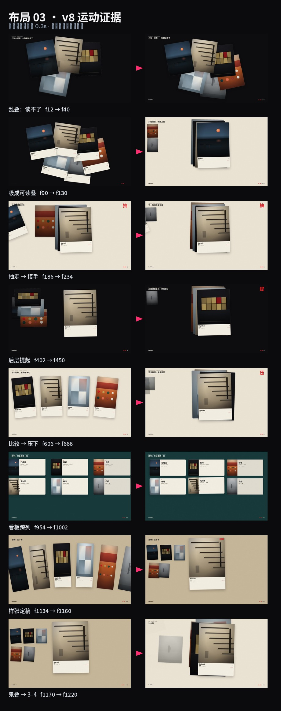
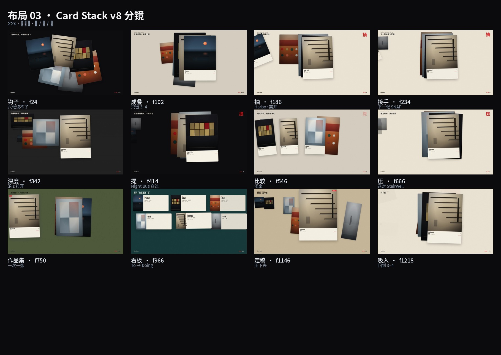
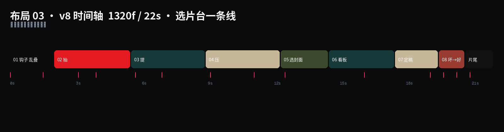

# 布局 03 · 卡片层叠 · 制作过程

**中文** · [English](PROCESS.en.md)

> 这一期是怎么从“卡片层叠”四个字变成 22 秒短片和 4 张图的：怎么想的、怎么做的、哪里被否决、怎么整片重来。
> 过程图在 [`process/`](process)，可复现的代码在 `video/` `audio/` `images/`。

📐 [布局指南](README.md)

---

## 0 · 一览

| # | 步骤 | 产出 | 工具 / 文件 |
|:-:|---|---|---|
| 1 | 选题与定调 | 一句话 + 和布局 01 / 02 的差别 | — |
| 2 | 研究 | 时间线、五条规则、何时用、常见坑 | [`README.md`](README.md) §1—§7 |
| 3 | 设计令牌 | 奶油纸 + 朱红 + Heros、18px 抬起、−1.4° | `tokens.ts / .css / .json` |
| 4 | 视频 v1–v5 | Wallet / 白 UI / 手机壳（已全部扔掉） | — |
| 5 | 否决 v5 | 「被束缚了。全部重做，所有元素都不要了。」 | — |
| 6 | 视频 v6（已否决） | 四张竖版海报循环抽/提/压 | — |
| 6b | 视频 v7（已否决） | 16 卡风暴，意义不清 | — |
| 6c | 视频 v8 | 22s，选片台 · 抽/提/压 | `video/layout.ts` `faces.tsx` `stage.tsx` |
| 7 | 配乐 | A 小调 120 BPM，numpy，−14 LUFS，22s | `audio/make_music.py` |
| 8 | 布局图 ×4 | 海报 · 速查 · 四种排法 · 三套模板 | `images/make_svgs.py` |
| 9 | 质检 | 关键帧、联系表、时间轴、成片 | `scripts/stills.mjs` |
| 10 | 发布 | 母版 MP4、封面、仓库（draft PR） | remotion · ffmpeg |

---

## 1 · 选题与定调

**为什么做它：** 布局 01 用面积排主次，布局 02 用最短列往下淌。卡片层叠是第三种：用**前后**说“现在只处理这一张”。它也是普通人每天会碰到的：iOS 底部弹层、支付详情、待办队列。

**定调：**

- 一句话：*3–4 张叠在一起，同一时刻只有最前面那张在被读。成片用 16 张卡走八种方案把规则教出来。*
- 气质：刊印色块，不是手机里的白卡片。开场密度对齐 Swiss 波，方案种类对齐 Bento。
- 受众：设计师拿去就能用（张数、换层方式、深度排序）；普通人看完能复述抽 / 提 / 压 / 扇 / 洗。

## 2 · 研究

1. **名字：** card stack = 一叠卡片。中文“层叠”说的是前后，不是左右。
2. **时间线：** 扑克/名片 → 2012 Tinder → 2013 iOS 7 的层 → Wallet → 2020s 的 sheet / 抽屉 / 队列。
3. **规则：** 3–4 张 / 一张焦点 / 轻抬 / 微旋 / 后层压暗。
4. **对标：** `layouts/01-bento-grid`——同一套卡，每一幕是不同世界；卡内有真实内容；有历史/产品 B-roll；HUD / 标注 / 交棒运镜。

## 3 · 设计令牌

- **颜色：** 纸 `#EDE6D6`，奶油 `#F6F0E4`，墨 `#111`，朱红 `#E31C23`，青绿 `#163A3A`。
- **字体：** TeX Gyre Heros + Noto Sans SC + Geist Mono。
- **层叠：** 520×740，圆角 8，抬起 18，旋转 −1.4°，每层向左上露出 40 / 30px，暗 12%。
- **节拍：** 120 BPM，1 拍 = 30 帧，全片 22 秒 = 1320 帧。
- **缓动：** 卡位 SNAP 过冲，进场 POP，运镜 SMOOTH。`TRANS.at` 比拍点早 12 帧，最快一刻落在拍上。相邻 `to` 必须是不同姿态，否则 lerp 是空操作。

## 4 · 视频 v1（已否决）

v1 用同一叠 4 张仪表盘卡走完全片：弹进、抬起、两次弧线换页、换一张皮（iOS grabber / Stripe 顶条）、线框规则、误区。画布几乎一直是冷灰，卡内是同一套数字块。

主人否决要点：

- BGM 还行，画面枯燥，看不下去
- 学不到东西：只是「一个东西在那随便变变变」
- 没有 A-roll / B-roll
- 对比仓库前面那些片子，元素密度差太远

这和 Bento 的 v1→v2 是同一类病：内容太薄，只有一种世界。

## 5 · 视频 v2（对标 Bento）

从 Bento 学到的、必须对齐的：

| Bento 做法 | Card Stack v2 |
|---|---|
| 同一套 7 卡贯穿，每幕不同世界 | 同一套 4 卡贯穿，每幕不同世界 |
| 卡内真实内容（图标、数字、图表、文案） | Wallet 登机牌、Stripe 支付、Linear 详情、地图选点、扑克/名片/档案 |
| 历史/产品 B-roll（漆盒、磁贴、手机、主页、后台） | 手机机身、Stripe 浏览器、毡面、深度轴 |
| HUD / 章节条 / 测量标注 | 底部 07 章 HUD、五条中英规则、Figma 式测量 |
| REFLOW + stagger 交棒 | 同一套缓动，世界之间变形而不是硬切 |

八章（约 22s）：钩子 → iOS A-roll → 后台 B-roll → 隐喻 B-roll → 爆炸拆解 → 规则面板 → 坏→好 → 片尾。

v2 构图被认可，但 iOS 幕「停在那不动」。v3 用呼吸 / 微振 / 镜头漂移冒充丝滑，主人第三次否决：成绩不过关，动效普通，一点丝滑都没有。

## 5b · 视频 v4（对标 Bento + Swiss，推倒运动）

从成片源码里抄来的招，不再「加呼吸」：

| 学谁 | 招 | Card Stack v4 |
|---|---|---|
| Bento `cardState` | 同一批卡 REFLOW + stagger，颜色比位置更快 | 4 卡 SNAP 过冲插值；`COLOR_DUR` 用 SMOOTH |
| Bento `HIT` | 重排最快一刻落在拍点 | `TRANS.at = 拍点 − 14`，过冲落在拍上 |
| Bento 内容 spring | `Pop` = POP 缩放进场 | 柱、行、按钮、规则 pill 全部 POP |
| Bento 镜头交棒 | 开场退、Metro 转、飞进手机 | `camAt` 用 `track` + SMOOTH，每段盯一个兴趣点 |
| Swiss 红色接力 | 同一元素变形接下一幕 | 4 卡共享元素变形，章与章重叠 12–24 帧 |
| Swiss zoom/pan | 扎进 a、摇到画面中 | iOS 推 Gate → 通知 → Sheet → 条码 → 抽卡 |
| Swiss 拍点脉冲 | 一次弹，指数衰减 | `shake` + 规则卡一次 POP，禁止循环微振 |
| Swiss Rise / Swap | 遮罩升起、旧词上走新词上来 | 标题 Rise、iOS 文案 / 误区标题 Swap |

禁止：构图停住、只做位移、PPT 切章、匀速线性、无效微振。

每幕丝滑证据（对照母版可 scrub）：

| 幕 | 不是呼吸，而是 |
|---|---|
| 钩子 | 四张卡 POP 过冲落进层叠；柱/数字/ inbox 行按拍弹出 |
| iOS | 点 Gate → 通知 SNAP 压下 → Sheet 上推 → 收起扫码、镜头扎条码 → 抽出 Apple Card；字幕 Swap |
| 后台 | 4 卡变形进 Stripe 抽屉；金额计数；438 Linear 弹到顶；地图针一次落下 |
| 隐喻 | 抽屉扇成扑克/名片；黑桃 A 一次翻开；标签 POP |
| 拆解 | SNAP 炸开后沿深度轴单向拉开；z 胶囊按拍弹出 |
| 规则 | 线框 restack；五条规则 Rise；对应卡一次 POP 强调 |
| 坑 | 鬼卡 SNAP 弹入 → 铺平 → 弹簧叠回 |
| 片尾 | 缩成图标 + 标题 Rise |



## 6 · 分镜与节拍

先写 [`process/timeline.json`](process/timeline.json)，再写代码。逐帧表见 [布局指南 §9](README.md#9--22-秒分镜)。





## 7 · 声音

`audio/make_music.py` 用 numpy 从零合成，**没有外部采样**：

- **编排：** A 小调 / C 大调，和弦换在八个方案切点上。
- **对位：** 16 张卡错峰砸进；每个方案切点 whoosh + 招式音色（抽 swipe / 提铃 / 扇 whoosh / 洗牌 / 炸开 / 吸入）；坏例低通变薄；片尾收束。
- **响度：** ffmpeg `loudnorm` → −14 LUFS，时长 22.0 秒。

## 8 · 布局图

四张 1080×1350，由 `images/make_svgs.py` 生成，再经 `scripts/build_images.py` 子集化字体。参考图与封面都是代码渲染，没有 AI 生图。

## 9 · 质检与渲染

```bash
npm run music:L03
npm run render:L03          # → out/03-card-stack-master.mp4
npm run images:L03
```

封面：开场 16 卡风暴一帧 → `video/cover.jpg`。成片不进 git。v7 母版 22s · 1920×1080 · 60fps · H.264+AAC · −14 LUFS。

## 5c · 视频 v5（零死区，推倒重做）

主人否决 v4：「还是很差劲……有的时候居然会停下来。全部推倒重做。」

**题材没问题。** Apple Wallet / Stripe drawer / Linear inbox 本身就是丝滑标杆。v4 失败是因为：

1. 同布局 `TRANS`（KEY→KEY、IOS→IOS）在 `lerpPose` 里是空操作，弹簧看起来在动、姿态没变。
2. SNAP 落定之后到下一拍有 30–60 帧空窗，画面「摆完 pose 干晾」。
3. 八段里 DECK / WIRE 是停着讲的章节。

v5 六幕、21 秒，硬保证「任意 0.3s 窗口镜头或主体至少有一个在动」：

| 保证 | 做法 |
|---|---|
| 每拍姿态不同 | KEY→KEY_UP→IOS→IOS2→NOTE→NOTE2… 禁止同布局空插值 |
| 弹簧未停就接下一下 | `dur` 22–28，拍距约 30 帧 |
| 场景内单向推进 | `drive()` 抬焦点 / 拉开 z / 收束，不振荡 |
| 镜头不走平 | `camAt` 每 18–24 帧换目标，数值从不重复平台 |
| 字幕钉死 | HUD / 文案在镜头层外，不跟运镜飞 |
| 删掉干晾章 | 不要 DECK / WIRE 休息段；拆解放进炸开里 |

设计师能带走的三句（拆解幕 + 片尾重复）：

1. **层叠 = 深度排序 + 同一交互面**
2. **3–4 张，第五张是噪声**
3. **换层用抽 / 压 / 推，不要瞬切**

## 5d · 视频 v6（GREENFIELD，全部重做）

主人否决 v5：「Card Stack 总感觉被束缚了。全部重做，所有元素都不要了。现在感觉被束缚住了，没有我现在这些视频做得好。」

**扔掉：** 登机牌 / Apple Card / 通知 / Sheet / 条码；Stripe / Linear / 地图；白 UI + 冷灰 + 产品蓝；手机壳 / 浏览器 / 毡面 / 鬼卡；旧 KEY/IOS/NOTE 姿态表。

**新叙事：** 四张竖版海报贯穿。顶尖设计师的层叠 = 深度排序 + 同一交互面 + 用身体换层。

| 幕 | 隐喻 | 动词 | 因果 |
|---|---|---|---|
| 刊·抽 | 杂志封面 | 抽 | 抽走正在看的，下一本接手 |
| 层·提 | 图层板 | 提 | 后层穿过深度，提到最前才可编辑 |
| 样·压 | 印刷样张 | 压 | 选定一张，其余压回后面 |
| 拆解 | 规则落在运动上 | — | 3–4 / 一张 / 抽提压 |
| 坏→好 | 杂刊在动 | — | 不是静图对照 |

允许保留的只有 Remotion 工程、`anim.ts` 的 SNAP/POP/SMOOTH，以及 Bento / Swiss 的运动语法。

## 5e · 视频 v7（GREENFIELD，密度重写）

主人否决 v6：「肯定不行。这么久的视频居然就这几个元素一直翻来覆去，动效很差。跟我以前那几个视频比差太远了。」

**诊断：** 不是叙事换了就行，而是同屏元素密度和动效种类远低于标杆。四张竖版海报抽/提/压翻来覆去 = 变体太少。

源码逐帧对照（单位不同，数字必须能写出来）：

| | 开场密度 | 方案种类 | 动效种类 |
|---|---|---|---|
| **Swiss** | 12×6 = **72 格**同时闪 | 波 / 标题 / 机器 5 式 / 字体 / 海报 / 地铁 / 五词 | 闪 · 升 · 重排 · 甩 · 套印 · 扎镜头 |
| **Bento** | 1 张裂成 **7 卡** | **8** 种布局（HOOK/KEY/BENTO/METRO/IOS/WIRE/HOME/DASH） | reflow · stagger · 换皮 · 镜头交棒 · POP |
| **v7** | **16** 张异形卡同时在动（0–3s） | **8** 种应用（刊 / 层 / 样 / 看板 / 相册 / 通知 / 支付 / 作品集）+ 风暴 + 坏例 | **14** 招：抽 · 提 · 压 · 扇 · 洗牌 · restack · z 炸开 · 弹簧叠回 · 镜头 snap · 内容 POP · 错峰落拍 · 挤乱吸入 · slam/散射 · 跨列 |

**扔掉：** 四张竖版慢翻、抽/提/压占大半片、大字干晾。旧四色海报系统可重画。

**硬保证：**

| 保证 | 做法 |
|---|---|
| 开场 0–3s ≥12–16 | 16 张不同尺寸/颜色/角度错峰砸进，再落 4×4、压成乱叠 |
| 8 种方案 ≤2s | MAG/LAYER/PROOF/BOARD/ALBUM/NOTE/PAY/FOLIO 各 120 帧，章重叠 24 帧变形接力 |
| ≥10 种动效 | 14 招，禁止同一抽/提循环占大半片 |
| 零干晾 | `qa-motion.ts`：任意 18 帧窗口镜头或主体在动；相邻 TRANS.to 必须不同 |
| 规则用画面教 | 作品集炸开看见每叠 3–4；坏例 24 张挤乱再吸入 4 张；HUD 只写「n on screen」 |

## 5f · 视频 v8（意义优先）

主人否决 v7：「一大堆东西在那动来动去，不知道有啥意义……动效没有很顶尖，BGM 也正常。」

**诊断：** v6 元素少；v7 矫枉过正。密度 ≠ 好片。要对标 Swiss / Bento：每一动有因果 + 教一条真规则 + 丝滑 + 配乐有记忆点。

**不是 v7 减卡。** 全片只讲一件事，6 张真作品贯穿选片台：

> 层叠界面 = 深度排序 + 同时只读一张 + 用身体换层（抽 / 提 / 压）

| 段 | 学到什么 | 为什么动不是噪音 |
|---|---|---|
| 钩子 | 六张一样亮，读不了 | 先认出坏的审片台 |
| 抽 | 抽走已经看过的，下一张接手 | 换层，不是瞬切 |
| 提 | 后层提到最前才可读 | 深度排序在工作 |
| 压 | 选定封面，其余压回 | 同时只读一张 |
| 作品集 / 看板 / 样张 | 同一原则，各一个决策 | 不是换皮刷屏 |
| 坏→好 | 叠太多 → 3–4 张 | 反面证明第一句 |

片尾三句都必须在片中用画面证明过。配乐有主题句 A–C–E–D–G，按抽/提/压变奏。

专业意义分镜（先于成片）：[`process/00-meaning.jpg`](process/00-meaning.jpg)。成片联系表：[`process/01-storyboard.jpg`](process/01-storyboard.jpg)。

## 10 · 下期沿用

- [ ] 先判断是风格还是布局；布局要写出和上一期的差别
- [ ] 全片只讲清一件事；每一动能说出观众学到什么，禁止为动而动
- [ ] 卡内要有真实内容；要有 A-roll 和 B-roll，不能只换皮
- [ ] 最快的一刻落在拍点上；声音和画面共用帧号
- [ ] 相邻 TRANS 的 `to` 必须是不同姿态；同布局 lerp 等于停
- [ ] 任意 0.3s 窗口里镜头或主体至少有一个在动
- [ ] numpy 配乐，不引入外部采样
