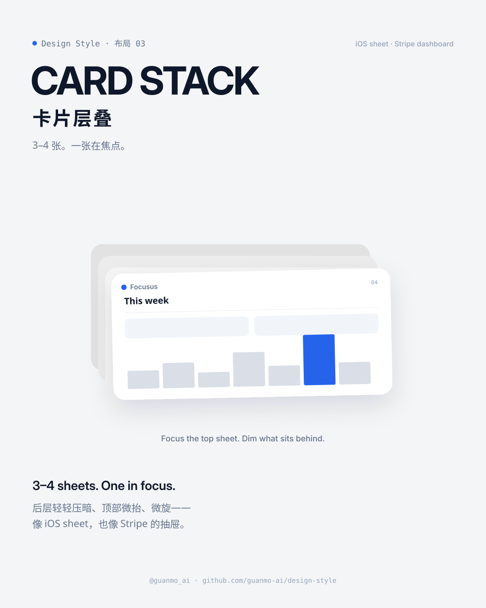
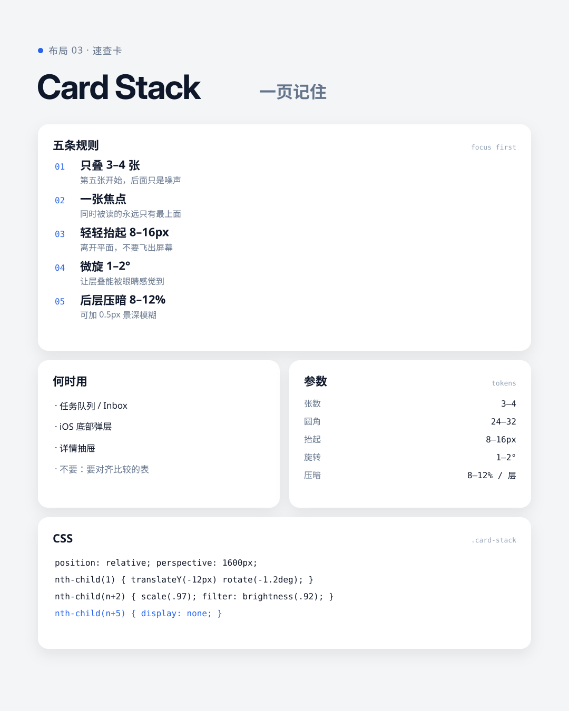
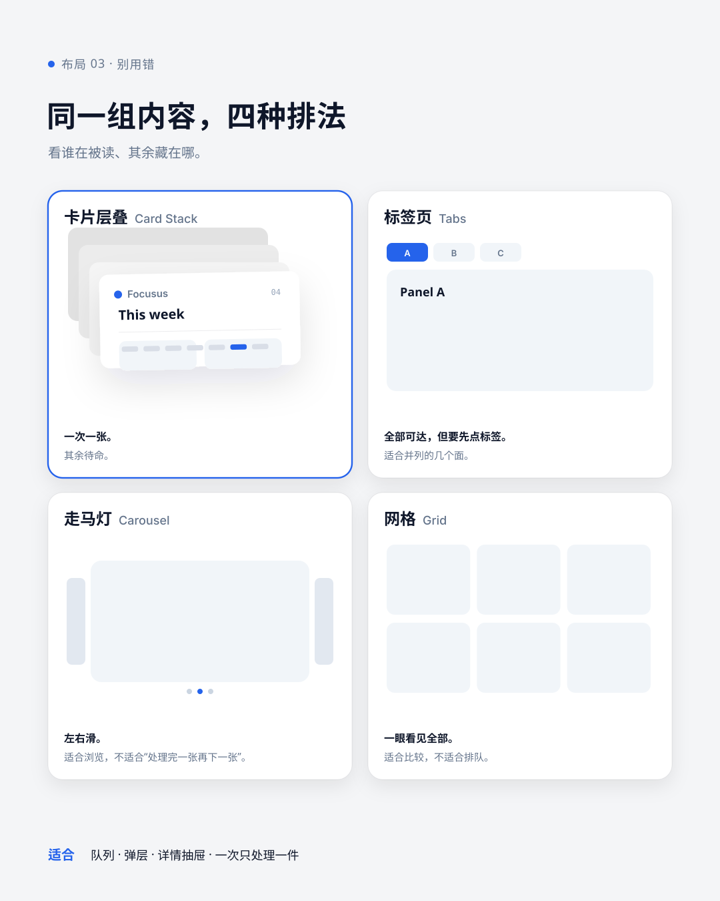
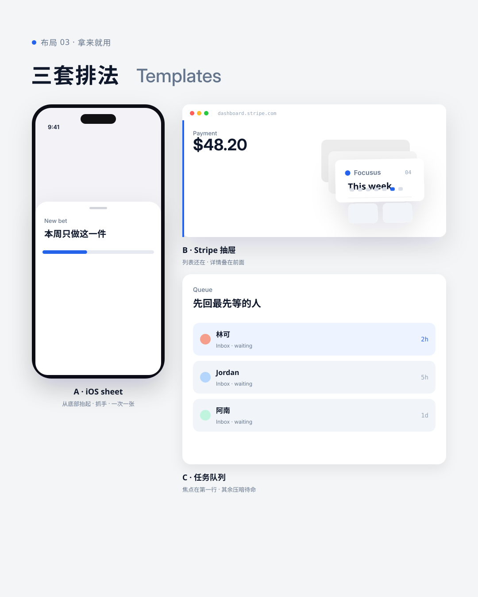

# 03 · Card Stack

[中文](README.md) · **English** · [Making of](PROCESS.en.md)

> English quick guide to this episode. Videos and SVG artwork retain their original Chinese labels. The [detailed Chinese guide](README.md) includes the longer history and frame-by-frame storyboard.

## Overview

3–4 rounded cards in a stack; only the top sheet is in focus. The same four cards travel through an iOS Wallet chain, Stripe / Linear / map, an exploded z-axis with takeaway rules, and a bad→good pit — 21 seconds, no dead frames.

Series: **Layouts**. Period shown in this episode: **2013—**.

## Five practical rules

| Rule | How to apply it |
|---|---|
| **3–4 sheets only** | Stop at four visible layers. Hide anything deeper. |
| **One in focus** | Only the top card can be read or clicked at a time. |
| **Light lift** | Raise the focus card 8–16px. Do not launch it off the plane. |
| **Micro-rotation** | 1–2° is enough to read as a layer. |
| **Dim the back** | About 8–12% darker per layer; optional 0.5px depth blur. |

## Project palette and typography

This is the palette used by this project, not a universal specification for every card stack.

- Colors: `#F4F5F7`, `#FFFFFF`, `#0F172A`, `#64748B`, `#F1F5F9`, `#2563EB`.
- Typefaces: Inter / Inter Display, Noto Sans SC, Geist Mono.
- Editable values: [JSON tokens](tokens.json), [CSS tokens](tokens.css), and [TypeScript tokens](tokens.ts).

## Visual references

The four editable diagrams explain the same rules from different angles. Their embedded labels are in Chinese.

### Card stack at a glance



### Five rules, when to use, and CSS



### The same content in four layouts



### iOS sheet, Stripe drawer, and a queue



## Common pitfalls

A stack is not tabs, a carousel, or a bento grid. Tabs treat several faces as equals. A carousel browses sideways. A bento grid shows everything at once. A stack means: handle the top sheet, keep the rest waiting.

Do not pile seven cards, keep every sheet equally bright, or hold a title card like a slide.

## AI image prompt

```text
Card stack layout, 4 rounded white dashboard cards stacked with soft depth,
top card slightly lifted and rotated -1.2 degrees, back cards gently dimmed,
iOS sheet / Stripe dashboard aesthetic, cool gray canvas #F4F5F7, one blue
accent #2563EB, Inter-like sans, clean premium product UI, no glitter, no 3D
explosion --ar 4:5
```

## Explore the source

- [Making of: English overview](PROCESS.en.md)
- [Detailed guide in Chinese](README.md)
- [Animation source](video)
- [Music synthesis](audio/make_music.py)
- [Original SVG files](images)
