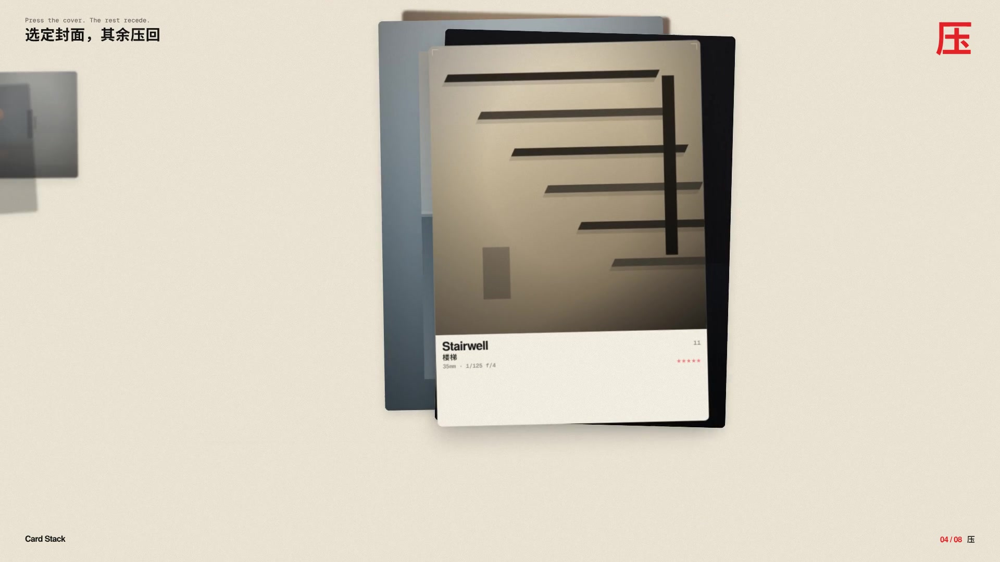

# 布局 03 · 卡片层叠 Card Stack（2013—）

**中文** · [English](README.en.md)

> **一句话：** 3–4 张圆角卡片叠在一起，同一时刻只有最上面那张在被读。

> **风格塑造视觉，布局组织信息。** 卡片层叠不规定颜色和字体，只规定“一次看几张、谁在前面”。同一叠可以是 iOS 的底部弹层，也可以是 Stripe 的详情抽屉、收件箱里等你处理的下一封。

🎬 视频随本期源码渲染 · 🛠 [制作过程](PROCESS.md) · 🖼 [图片源文件](images)

| 布局海报 | 布局速查 |
|:-:|:-:|
|  |  |
| **同一组内容，四种排法** | **拿来就用：三套排法** |
|  |  |

## 1 · 它从哪来

**名字：** 英文 *card stack* 就是“一叠卡片”。中文叫**卡片层叠**：东西还在，但被压在焦点后面。

| 年份 | 事件 |
|---|---|
| **实体** | 扑克、名片、档案袋：人本来就会“抽最上面一张” |
| **2012** | Tinder 把“一叠照片、滑走再看下一张”做成了交互 |
| **2013** | iOS 7 把界面收成半透明的层：后面还在，只是退到景深里 |
| **2014** | Material Design 把卡片写成 elevating surface，层 = 注意力 |
| **2015—** | Apple Wallet、Passbook：票卡叠在一起，点开最上面 |
| **2020s** | iOS sheet、Stripe 详情抽屉、Linear 任务队列：层叠变成后台产品的默认语言 |

**它为什么是布局：** 层叠只规定张数、焦点、抬起、旋转和后层怎么退。换什么配色、字体都成立。所以放进“布局”系列：**布局 03**。

和前两期的差别：便当盒用**面积**说谁重要；瀑布流用**最短列**安排下一张；层叠用**前后**说谁正在被处理。

## 2 · 五条规则

| # | 规则 | 怎么做 | 小心 |
|:-:|---|---|---|
| 01 | **只叠 3–4 张** | 能被感觉到的层，到第四张为止；第五张藏起来 | 叠 7、8 张，后面只是噪声 |
| 02 | **一张焦点** | 同时只有最上面那张能被读、被点 | 每张一样亮，就没有“正在看” |
| 03 | **轻轻抬起** | 焦点卡上移 8–16px，阴影比后层长一档 | 飞出 40px，像要离开屏幕，不像层叠 |
| 04 | **微旋 1–2°** | 顶卡 −1.2° 左右，后层交替微旋 | 转 8° 就成了扇面，不是产品 |
| 05 | **后层压暗** | 每往后一层暗 8–12%，可加 0.4–0.6px 模糊 | 后层比前层还抢眼，焦点就反了 |

## 3 · 色板

层叠是布局，**没有“正宗配色”**。规则只有一条：**墙要安静，让最上面那张说话**。下面是视频与布局图用的产品冷灰：

| 名称 | HEX | 用途 |
|---|---|---|
| 纸 | `#F4F5F7` | 冷灰画布，iOS / Stripe 的底 |
| 卡片 | `#FFFFFF` | 每一层的表面 |
| 墨 | `#0F172A` | 标题 |
| 次要 | `#64748B` | 说明、标签 |
| 芯片 | `#F1F5F9` | 卡片里的小格子 |
| 蓝 | `#2563EB` | **唯一强调色**：焦点柱、规则编号、抬起标注 |

## 4 · 字体

| 用途 | 本项目 | 商用原版 / 其他选择 |
|---|---|---|
| 英文标题 | **Inter Display** 500—700（免费，OFL） | SF Pro Display · Söhne |
| 中文标题 / 正文 | **思源黑体 / Noto Sans SC** 400—900（免费，OFL） | 苹方 · HarmonyOS Sans |
| 界面字 | **Inter** 400 / 500 / 600 | SF Pro Text |
| 标注 | **Geist Mono** 400 / 500 | SF Mono · JetBrains Mono |

无衬线、紧字距、少装饰：层叠自己已经有深度，标题不要再“厚”。

## 5 · 版式参数

| 场景 | 张数 | 圆角 | 抬起 | 旋转 | 后层步进 |
|---|:-:|---|---|---|---|
| 桌面详情抽屉 | 3–4 | 24–32 | 10–16px | 1–1.5° | Y 14–18 / 暗 8% |
| iOS sheet | 1 张主层 + 1–2 张暗示 | 20–28（顶角） | 从底部滑入 | 0–1° | 露出顶边 12–20px |
| 手机任务队列 | 3 | 20–24 | 8–12px | 1° | Y 10–14 |

- **焦点卡的阴影更长**，后层只留很浅的一层，避免“每张都在漂”。
- **换页用弧线离开 + 弹簧递补**，不要溶解、不要闪切。
- 视频里：卡片 760×428、圆角 28、抬起 14、旋转 −1.2°、每层向左上露出 24 / 38px、暗 11%。

## 6 · 这样做 / 别这样

**✅ 这样做：** 3–4 张 · 只有一张亮 · 轻抬 + 微旋 · 后层压暗 · 换页像真的 sheet · 第五张不出现

**❌ 别这样：** 叠一打 · 每张一样清楚 · 不抬不旋（一沓打印纸） · 焦点卡停很久像 PPT · 用溶解切换 · 后层比前层对比更强

## 7 · 其他误区

- **层叠不是标签页。** 标签页是“几个面同样重要，你选一个”；层叠是“现在只处理最上面，后面排队”。
- **层叠不是走马灯。** 走马灯在左右浏览；层叠在前后处理。Inbox、审批、底部弹层用层叠，相册用走马灯。
- **层叠不是便当盒。** 便当盒让你同时看见 6–9 个模块；层叠故意不让你同时读完。
- **景深是辅助，不是特效。** 0.5px 的后层模糊够了。再大，就像玻璃花了。
- **动效要连续。** 顶卡离开时，后面的卡从“它们当时所在的位置”弹到新槽位，不要瞬移。

```css
.card-stack {
  position: relative;
  width: min(760px, 100%);
  aspect-ratio: 760 / 428;
  perspective: 1600px;
}
.card-stack > *:nth-child(1) {
  transform: translateY(-12px) rotate(-1.15deg);
  z-index: 4;
}
.card-stack > *:nth-child(n + 2) {
  transform: translateY(17px) scale(0.974);
  filter: brightness(0.915);
}
.card-stack > *:nth-child(n + 5) { display: none; }
```

可直接用的完整写法见 [`tokens.css`](tokens.css)。

## 8 · AI 提示词（直接复制）

**图片（Midjourney / 即梦 / ChatGPT 图像）**

```
Card stack layout, 4 rounded white dashboard cards stacked with soft depth,
top card slightly lifted and rotated -1.2 degrees, back cards gently dimmed,
iOS sheet / Stripe dashboard aesthetic, cool gray canvas #F4F5F7, one blue
accent #2563EB, Inter-like sans, clean premium product UI, no glitter, no 3D
explosion --ar 4:5
```

**风格 + 布局**

```
[Bauhaus / Swiss / Bento …] style, laid out as a card stack: 3–4 rounded
cards, only the top one in focus, 8–16px lift, 1–2° micro-rotation, each
deeper layer 8–12% dimmer. Use the colors and type of the style; keep the
stack structure.
```

**视频（Runway / 可灵 / Sora）**

```
Product motion: four rounded dashboard cards assemble into a stack, the top
sheet lifts 12px and rotates -1.2°, then the front card arcs away like an
iOS sheet and the next springs into focus. Cool gray, white cards, soft
shadows, 120 bpm, no text cards holding, no shake.
```

**代码**

```
用卡片层叠做这个队列：最多 4 张圆角卡片，perspective 1600px，焦点卡
translateY(-12px) rotate(-1.15deg)，后层每层 translateY(+17px) scale(0.97)
brightness(0.92)，第 5 张 display:none。换页时顶卡沿弧线离开，其余用弹簧
递补到新槽位。颜色和字体沿用【你的风格】，设计令牌见 tokens.css。
```

## 9 · 22 秒分镜

全片 **4 张卡片**，从头到尾不换张，只换世界。120 BPM，1 拍 = 30 帧。世界切换最快的一刻落在拍点上。A-roll 是主叠卡运镜；B-roll 是手机、后台、毡面、深度轴和标注。

| 时间 | 帧 | 章节 | 画面 |
|---|---|---|---|
| 0:00—2.5 | 0—150 | 01 钩子 | 四张卡弹进层叠：顶卡可读、后层压暗。「Card Stack / 卡片层叠」 |
| 2.5—5.5 | 150—330 | 02 iOS | 产品 demo：点 Gate → 通知压下 → 上滑 Sheet → 扫条码（镜头跟上）→ 抽出 Apple Card |
| 5.5—8.5 | 330—510 | 03 后台 | Stripe 支付抽屉 · Linear 详情 · 地图选点——同一叠拓扑 |
| 8.5—11.5 | 510—690 | 04 隐喻 | 名片 / 黑桃 A / 档案袋 / 索引卡：层叠从「抽最上面一张」来 |
| 11.5—14.5 | 690—870 | 05 拆解 | 爆炸视图 + 深度轴 + z-index：offset / scale / dim / blur |
| 14.5—18.0 | 870—1080 | 06 规则 | 线框 + 五条中英规则 + 测量标注 |
| 18.0—20.0 | 1080—1200 | 07 常见坑 | 叠太多 → 没有焦点 → 弹回正确（坏→好） |
| 20.0—22.0 | 1200—1320 | 片尾 | 收成小图标 →「一次只看一张」· `@guanmo_ai` |

<a href="video/cover.jpg"></a>

> 画面里的仪表盘、数字和人名均为虚构示意，不是任何产品的截图。

## 10 · 文件

```
03-card-stack/
├─ PROCESS.md                             # 制作过程
├─ process/                               # 过程图：分镜 · 动效 · 时间轴
├─ tokens.ts / tokens.css / tokens.json   # 同一份设计令牌（tokens.css 附可直接用的 .card-stack）
├─ video/CardStack.tsx                    # 短片主合成（22s · 九种世界）
├─ video/layout.ts                        # 4 张卡片、世界几何、SNAP 过冲 + SMOOTH 运镜
├─ video/cards.tsx                        # 卡面：队列 / Wallet / Stripe / 扑克 / 线框
├─ video/chrome.tsx                       # B-roll：手机、后台、毡面、深度轴
├─ video/scenes.tsx                       # 各章标题、规则、测量、片尾
├─ video/ui.tsx                           # 排版工具
├─ video/cover.jpg                        # 视频封面
├─ audio/make_music.py                    # 配乐：numpy 合成，F 大调 120 BPM，22s，−14 LUFS
└─ images/
   ├─ make_svgs.py    # 生成下面四张图
   ├─ poster.svg      # 布局海报
   ├─ cheatsheet.svg  # 布局速查
   ├─ compare.svg     # 层叠 vs 标签页 vs 走马灯 vs 网格
   ├─ templates.svg   # iOS sheet / Stripe 抽屉 / 任务队列
   └─ preview/        # 内嵌字体的自包含 SVG
```
