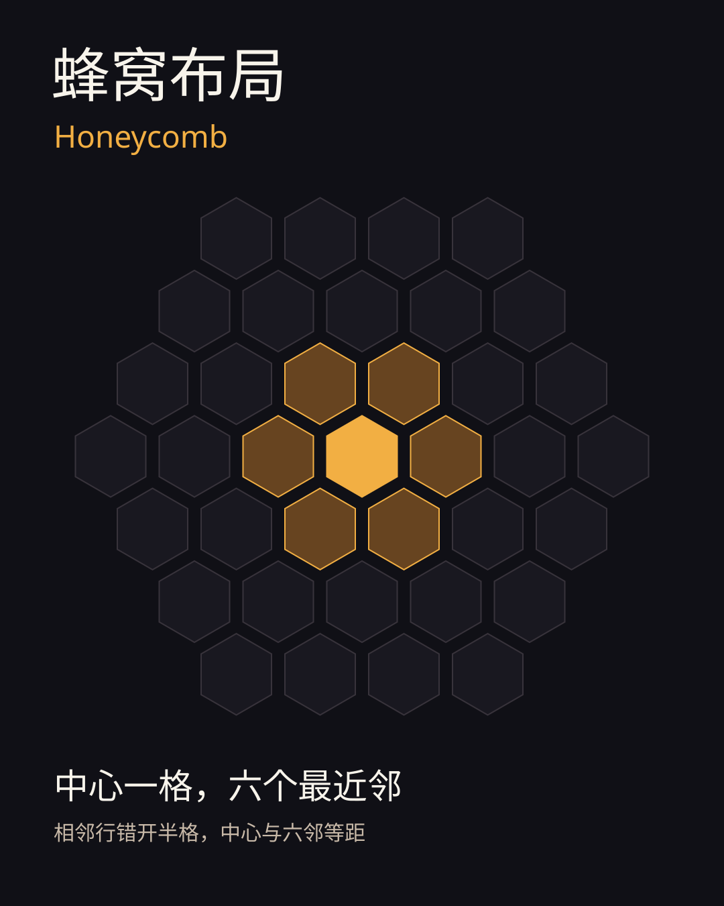
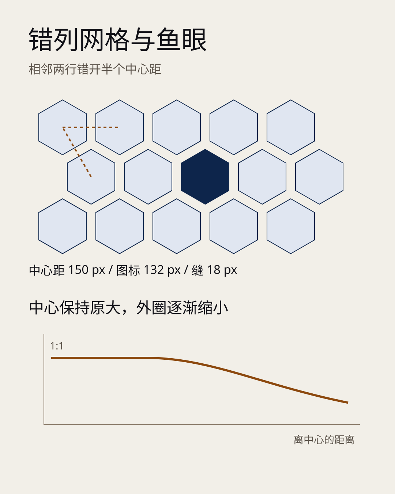
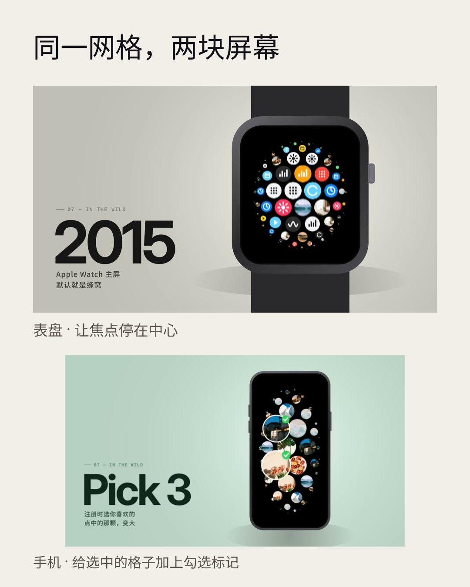
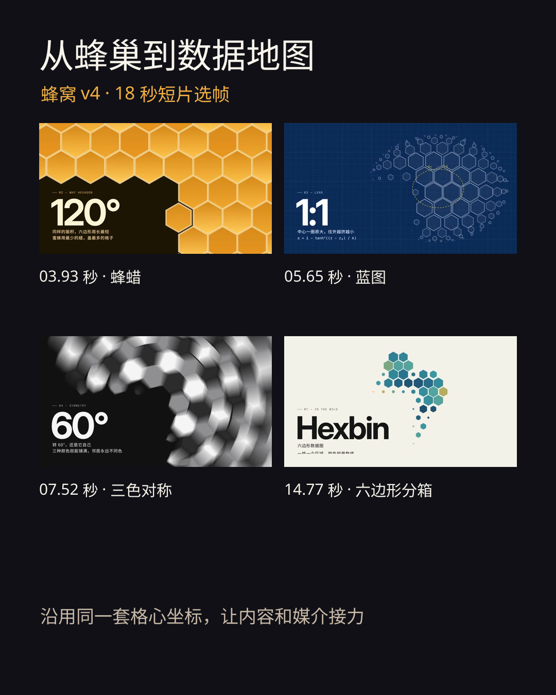

# Layout 03 · Honeycomb

[中文](README.md) · **English**

Offset every other row to give each cell six equidistant neighbors. A fisheye lens keeps the center readable while leaving room to browse more items around the edge.

[Watch the 18-second film](https://github.com/guanmo-ai/design-style/releases/tag/layout-03) · [Making of](PROCESS.en.md) · [Rendering source](video/README.md)

## Geometry and interaction

1. **Set the center spacing.** The film uses 150 px centers and 132 px icons, leaving an 18 px gap near the center. Offset alternate rows by half the center spacing and set the row pitch to √3/2 of that spacing.
2. **Keep a full-size region in the center.** Smaller cells retain a sense of position at the edges. Keep essential information and interactive targets in the readable region.
3. **Snap to the nearest cell after dragging.** The film uses about 170 ms to land the snap. Tune timing to fit the input and viewport of the actual interface.
4. **Expand from the selected cell.** A circular mask grows from the icon into the full screen. Reverse the path to close it.

## Applications

- **Icon browsers** can place circular icons on a hexagonal grid. The watch shot demonstrates panning, focus, and zoom.
- **Interest pickers** can show a checkmark on selected cells, with text labels and keyboard focus in a working interface.
- **Spatial data** can be binned into equal-area hexagons. Assign each point to its cell and use a consistent color scale to show counts.

The photo wall, amber honeycomb, blueprint, and icons share the same grid geometry. See [tokens.json](tokens.json) for the film's palette, spacing, and playback settings.

## Visual references

| Poster | Geometry |
|:-:|:-:|
|  |  |
| **Interfaces** | **Storyboard** |
|  |  |
