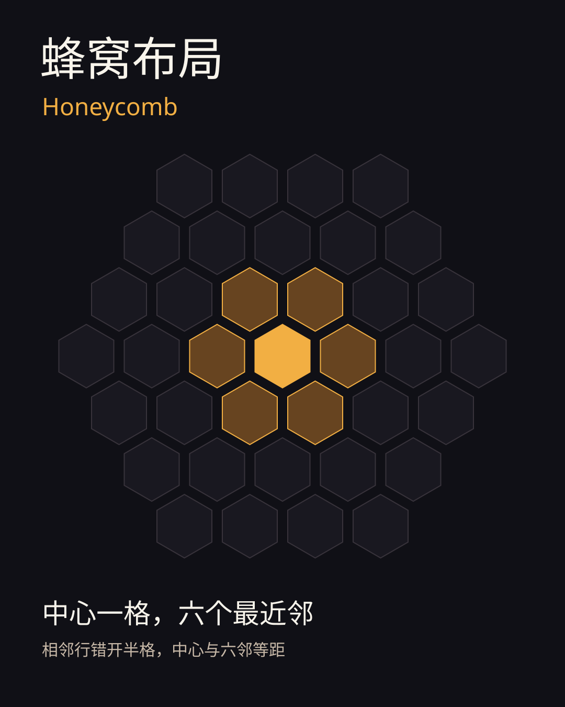
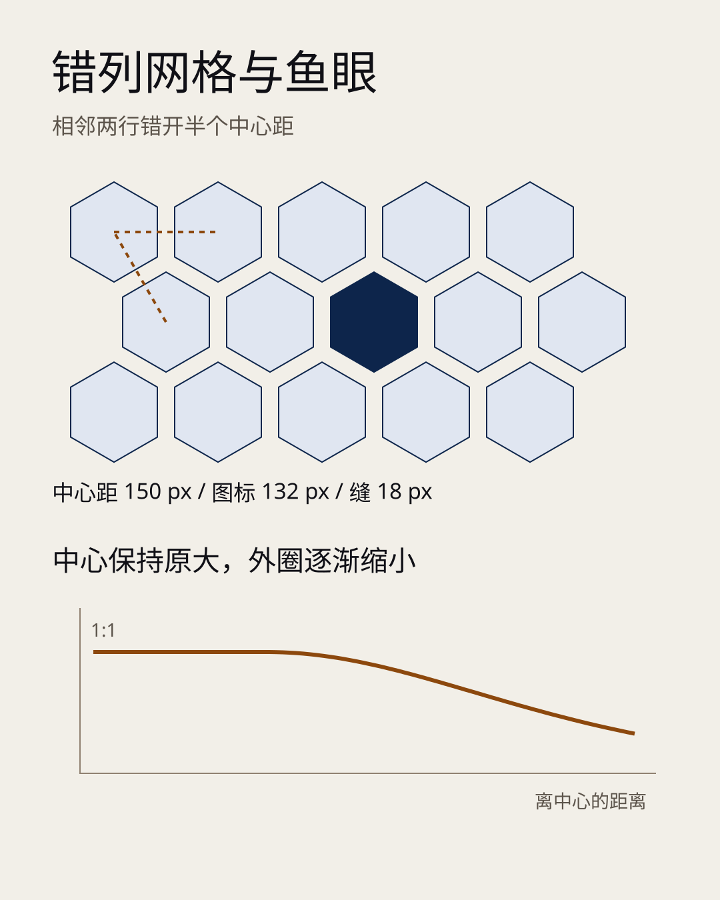
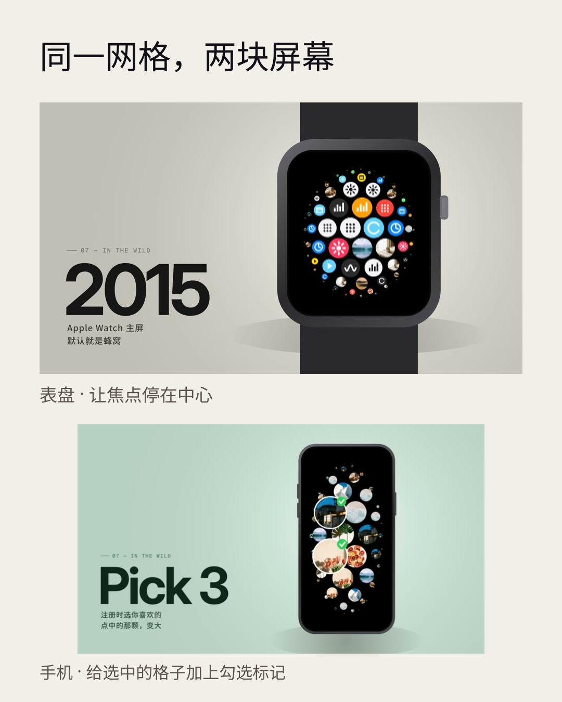
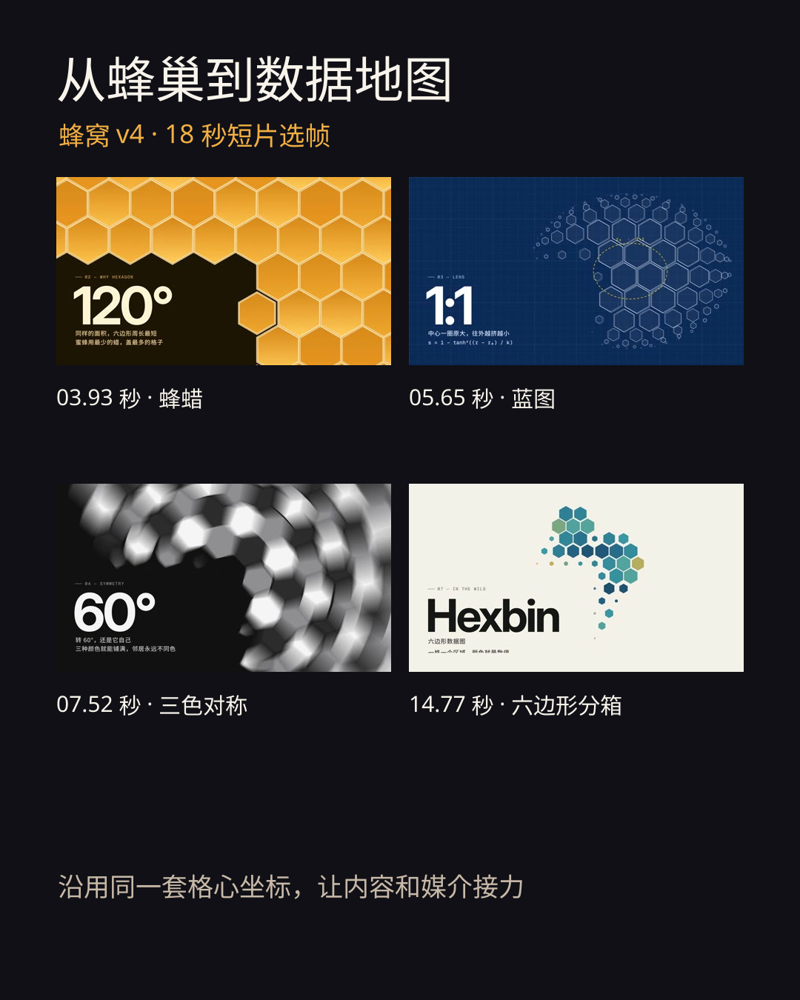

# 布局 03 · 蜂窝布局 Honeycomb

**中文** · [English](README.en.md)

错开相邻行，就能让中心格与六个邻居等距。给网格加一层鱼眼透镜，中心保留阅读空间，外围保留更多可浏览的内容。

[看 18 秒短片](https://github.com/guanmo-ai/design-style/releases/tag/layout-03) · [制作过程](PROCESS.md) · [渲染源码](video/README.md)

## 几何与交互

1. **先定中心距。** 短片用 150 px 的中心距和 132 px 的图标直径，中心区的间隙为 18 px。同一行按中心距排列，相邻行错开半格，行距取中心距的 √3/2。
2. **为中心留一块原大区域。** 鱼眼让边缘单元缩小以保留位置感；把重要信息和可操作目标放在清楚可见的区域。
3. **拖动后吸附到最近的格子。** 短片用约 170 ms 的吸附表现锁定，实际界面可按输入方式和视口尺寸调整。
4. **从原位置展开。** 短片让选中的图标通过圆形遮罩长成全屏，关闭时可以沿同一条路径回去。

## 用在哪里

- **图标浏览**可以用圆形图标沿六边形网格排列。短片里的表盘用于演示平移、对焦和缩放。
- **兴趣选择**可以让选中的格子显示勾选标记。实际界面要同步提供文字标签和键盘焦点。
- **空间数据**可以用等面积六边形分箱。每个点按位置落入一个格子，再用统一色标表达格内计数。

照片墙、蜂蜡、工程蓝图和图标都使用同一套格心关系。短片的色板、网格和播放参数见 [tokens.json](tokens.json)。

## 布局图解

| 布局海报 | 几何速查 |
|:-:|:-:|
|  |  |
| **界面应用** | **分镜选帧** |
|  |  |
