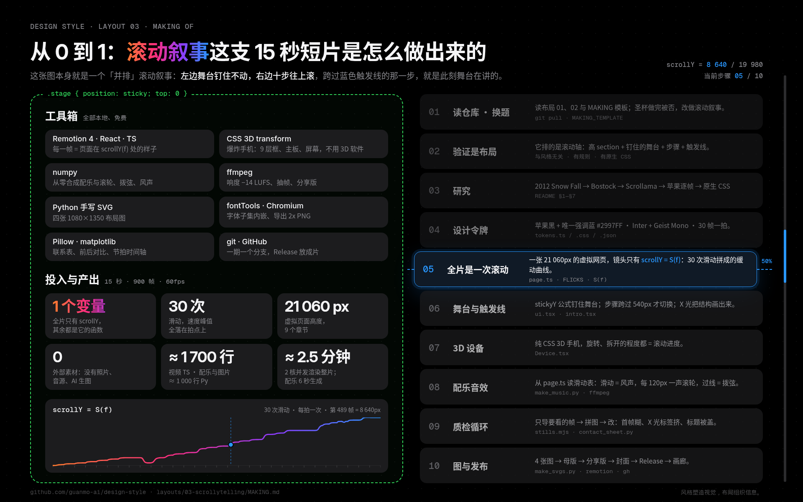

# 布局 03 · 滚动叙事 · 从 0 到 1：这支视频是怎么做出来的

> [`PROCESS.md`](PROCESS.md) 讲**设计上怎么想**：为什么这样选、哪里改过。这份讲**动手怎么做**：用了哪些工具、按什么顺序、每一步敲什么命令、做到什么程度才算过关。
> 照着这份做，可以从一个空文件夹做出同样规格的一期：15 秒 · 1920×1080 · 60fps 短片，加上 4 张布局图、指南和过程文档。

🎬 [看成片（Releases · layout-03）](https://github.com/guanmo-ai/design-style/releases/tag/layout-03) · 📐 [布局指南](README.md) · 🛠 [制作过程](PROCESS.md)



---

## 0 · 先说结论：这一期是怎么“做”的

- **全部是代码。** 没用 Figma、After Effects、Blender，也没用素材库、AI 生图或现成音乐。那台会拆开的 3D 手机是 CSS 3D transform 画的；每一声滚轮、每一下拨弦都由 numpy 合成。改一个数字就能重出。
- **谁做的。** 这一期由 AI 智能体（Notion AI）在一台 Linux 沙盒里完成：读仓库、查资料、写代码、渲染、看图、改版、写文档。人负责定方向（“换成滚动叙事，先确认它真的是布局；要顶尖，视频动效要顶尖”）和最终审片。
- **为什么用代码做。** 滚动叙事本来就是“画面 = f(滚动位置)”。用代码做，视频就能**真的**是一张网页的一次滚动：一个 `scrollY` 变量驱动一切，sticky、触发线、倒着滚，全是浏览器里的同一套公式，而不是“看起来像”。
- **顺序。** 验证选题 → 文字 → 令牌 → **滚动曲线** → 页面与舞台 → 主角设备 → 声音 → 质检 → 图与发布。**先把“怎么滚”定下来，再决定“滚到哪里看到什么”。**

## 1 · 工具箱

| 环节 | 工具 | 版本（本期） | 用来做什么 | 费用 |
|---|---|---|---|---|
| 视频 | [Remotion](https://www.remotion.dev) + React + TypeScript | 4.0.454 | 用 React 组件写视频：每一帧 = 页面在 `scrollY = S(f)` 处的样子；`@remotion/fonts` 加载字体 | 个人与小团队免费（[许可](https://www.remotion.dev/license)） |
| 3D 设备 | CSS 3D transform | — | `preserve-3d` + `translateZ` 叠出背板、9 层框、主板、屏幕、玻璃；旋转、拆开都由滚动算出 | 免费 |
| 运行环境 | Node.js · Python | 24 · 3.13 | Node 跑 Remotion 与截图脚本；Python 写图片、配乐、过程图 | 免费 |
| 布局图 | Python 手写 SVG · [fontTools](https://github.com/fonttools/fonttools) | — | 按公式输出 SVG；子集化字体后内嵌 | 免费 |
| 渲染图片 | Chromium | — | 把 SVG / HTML 渲染成 2x PNG；导出视频关键帧 | 免费 |
| 配乐 | numpy | — | 从零合成 Pad、电钢、鼓、滚轮“嗒”、拨弦、风声、倒带……没有任何外部音源 | 免费 |
| 音视频处理 | [ffmpeg](https://ffmpeg.org) | 7.0 | 响度测量（loudnorm）、精确抽帧、压分享版 | 免费 |
| 过程图 | Pillow · matplotlib · ImageMagick | — | 联系表、修改前后、时间轴图 | 免费 |
| 字体 | [Inter / Inter Display](https://rsms.me/inter/) · [Geist Mono](https://vercel.com/font) · [Noto Sans SC](https://fonts.google.com/noto/specimen/Noto+Sans+SC) · [Instrument Serif](https://fonts.google.com/specimen/Instrument+Serif) | — | 产品页标题与正文、读数与代码、中文、2012 那一章的报纸衬线。都是 OFL，可商用 | 免费 |
| 版本管理 | git · GitHub | — | 一期一个分支；Release 放成片 | 免费 |

全部开源或免费，一台没有显卡的 2 核机器就能跑完整个流程。

## 2 · 准备环境（10 分钟）

```bash
git clone https://github.com/guanmo-ai/design-style.git && cd design-style
npm install                     # Remotion 等
npm run fonts                   # 字体下载到 public/fonts（不入库）
pip install numpy fonttools pillow matplotlib
export CHROMIUM_PATH=$(which chromium)   # 或 npx playwright install chromium
npm run studio                  # 浏览器里打开 L03-Scrollytelling，逐帧拖一遍确认环境可用
```

## 3 · 十步，从 0 到 1

每一步都写了：**做什么 → 产出 → 过关标准**。过关了再进下一步，返工最少。

### 01 · 读仓库，然后换题

- **做什么：** 通读布局 01、02 的 `README.md`、`PROCESS.md`、`tokens.*`、`video/`，和 [`docs/MAKING_TEMPLATE.md`](../../docs/MAKING_TEMPLATE.md)。本期先做了圣杯布局，审片没过（名字和画面都不够吸引人），整期放弃，换题。
- **产出：** 一份“这一期必须有什么”的清单 + 新选题。
- **过关：** 选题本身就让人想点开；新的一期放进目录里，和前两期并排看像一个系列。

### 02 · 验证它“真的是布局”

- **做什么：** 逐条对照：有没有**固定结构**（section · sticky 舞台 · 步骤 · 触发线）？有没有**有名字的排法**（并排 · 覆盖 · 逐帧 · 横移）？**换风格还成立吗**？有没有**规则**和**原生 CSS**？再写清楚它**不是什么**（视差、整屏翻页、劫持滚动）。
- **产出：** 指南 §0 的那张表，和 `PROCESS.md` §1。
- **过关：** 五项都答得上来；能用一句话说清“动画是舞台上演什么，布局是舞台放在哪、什么时候换”。

### 03 · 研究：只写查得到的

- **做什么：** 时间线（2012 Snow Fall → 2014 Bostock → 2017 Pudding / Scrollama / sticky → 2020 苹果 → 2023—2026 CSS）→ 五条规则（每条写“怎么做”和“小心”）→ 广度清单（新闻、数据、产品页、前端）→ 误区。浏览器版本直接查 MDN 的 [browser-compat-data](https://github.com/mdn/browser-compat-data)，不凭记忆。
- **产出：** `README.md` §1—§7 的草稿。广度清单直接变成视频的八章。
- **过关：** 每个人名、标题、日期、版本号都能对上原文或数据源（例如 Firefox 159 写作时还是 beta，就写明正式版日期）。

### 04 · 设计令牌

- **做什么：** 颜色（黑 + 唯一强调蓝）、字体、结构参数（section 高度、sticky、一步一屏、触发线 50%、并排 7fr : 5fr、< 768px 覆盖）、节拍（120 BPM = 30 帧一拍）。一份数值写进 `tokens.ts`（视频）、`tokens.css`（网页，附可直接用的完整滚动叙事）、`tokens.json`（画廊与 AI）。
- **过关：** 视频里的触发线、图里的触发线、CSS 里的 `rootMargin` 是同一个 50%。

### 05 · 全片是一次滚动：先写 S(f)

- **做什么：** 把整支片子设计成一张 21 060px 高的网页（9 个 section），再写 30 次“滑动”拼成的滚动曲线。每次滑动从上一下**此刻的位置**接着走，所以可以打断、可以倒着滚：

  ```ts
  // video/page.ts：[起始帧, 目标 scrollY, 时长, 缓动]
  export const S = (f: number): number => {
    let v = 0;
    for (const [at, to, d, e = 'out'] of FLICKS) {
      if (f < at) break;
      v = v + (to - v) * EASE[e](Math.min(1, (f - at) / d));
    }
    return v;
  };
  ```
- **产出：** `video/page.ts`（section 表、`FLICKS`、`S(f)`、各章步骤位置）+ `process/timeline.json`。
- **过关：** 只看 `S(f)` 的曲线（见本页顶部流程图里的那条线）就能说出每一章在哪；每一下滑动都从拍点出发。

### 06 · 舞台与触发线：用浏览器的公式

- **做什么：** sticky 舞台直接用 `position: sticky` 的公式；步骤是否“过线”只看它和 540px 触发线的关系；舞台里的变化按 S 经过的区间插值：

  ```ts
  export const stickyY = (s: Sec, scroll: number) => Math.min(Math.max(s.top, scroll), s.top + s.h - VH);
  export const span = (s: number, a: number, b: number) => smooth(c01((s - a) / (b - a)));
  ```
- **再加一章 X 光：** 镜头拉远到 0.215 倍，把 section、舞台、视口、触发线画出来，倒着滚一遍。
- **产出：** `video/ui.tsx`（Section / Stage / StepCard / TriggerLine）、`video/intro.tsx`。
- **过关：** 把 S 往回拖，画面严格倒着变；任何一帧暂停，都能指出“现在是第几步”。

### 07 · 3D 设备：一个主角贯穿全片

- **做什么：** 用 CSS 3D 画一台通用手机：背板（相机模组）、9 层框、电池、主板（芯片可高亮）、屏幕（9:41）、玻璃。参数只有位置、缩放、三个旋转角、`explode`（拆开程度）和 `hi`（高亮）。
- **产出：** `video/Device.tsx`。
- **过关：** 开场、定义、X 光、苹果、CSS 五章用的是同一个组件；旋转和拆开全由 S 算出，没有一处是按时间播放的动画。

### 08 · 配乐与音效：从 page.ts 读滑动表

- **做什么：** `audio/make_music.py` 用正则读出 `page.ts` 里的 `FLICKS`、步骤位置和 `RULES_AT`，用同一条贝塞尔缓动重算 S(f)，再按滚动生成音效：

  ```python
  # 滚轮刻度：scrollY 每走过 120px 一声“嗒”
  for lv in range(120, 21000, 120):
      ...
  ```
  滑动开头一声轻扫、步骤过线一声拨弦（倒着滚时音往下走）、各章自己的声音；最后 ffmpeg loudnorm 到 **−14 LUFS**。
  ```bash
  npm run music:L03   # → public/03-scrollytelling/music.wav（约 6 秒）
  ```
- **过关：** 改一下 `FLICKS`，重跑配乐，声音自动跟上；**要有人戴耳机听一遍。**

### 09 · 质检循环：看 → 改 → 再看

不整片重渲，只看受影响的几帧：

```bash
npx remotion bundle src/index.ts --out-dir out/bundle                     # 打包一次
COMP=L03-Scrollytelling PROPS='{"music":false}' \
  node scripts/stills.mjs out/bundle out/check 0 250 520 752              # 几秒钟出这几帧
python3 scripts/contact_sheet.py out/sheet.jpg --cols 4 \
  "out/check/f000.png|f000" "out/check/f250.png|f250 X 光" ...             # 拼成一张图看
```

- **每次滑动必看速度最快的那一帧。** 本期首帧被运动模糊糊掉、X 光标签挤在一起、规则眉题被卡片盖住，都是在这样的帧里发现的（见 [`PROCESS.md` §9](PROCESS.md#9--自查与修改)）。
- 成片出来后：`contact_sheet.py --video` 精确抽帧做联系表，`timeline_chart.py` 叠上配乐波形检查切换点是否落在拍子上，`ffprobe` 核对规格。

### 10 · 图与发布

```bash
npm run images:L03                         # 4 张布局图 → preview/*.svg（内嵌字体）+ png/*.png（2x）
npm run render:L03 -- --concurrency=2      # 配乐 + 母版：out/03-scrollytelling-master.mp4（2 核约 2.5 分钟）
ffmpeg -i out/03-scrollytelling-master.mp4 -vf "scale=in_range=full:out_range=tv,format=yuv420p" \
  -c:v libx264 -preset slow -crf 18 -profile:v high -c:a aac -b:a 192k -movflags +faststart \
  out/03-scrollytelling.mp4                # 分享版
chromium --headless --no-sandbox --hide-scrollbars --window-size=1920,1200 \
  --screenshot=process/05-workflow.png process/05-workflow.html   # 本文顶部的流程图（在本期目录下运行）
```

1. 封面：取第 30 帧 → `video/cover.jpg`。
2. 过程图：分镜联系表、X 光拆解、修改前后、时间轴、十步流程 → `process/`。
3. 提交：一期一个分支，视频不进 git。
4. Release：tag `layout-03`，上传 `03-scrollytelling.mp4`，正文附 SHA-256。
5. 画廊：向 `gallery/data/works.json` 添加条目（SHA-256 与 Release 一致），运行 `npm run gallery:readme`、`gallery:test`、`gallery:build`、`gallery:check`。

## 4 · 和 AI 一起做：开工提示词

这一期就是由 AI 智能体做的。想让 AI 帮你做下一期布局，可以从这段开始（把布局名换掉）：

```text
你在 design-style 仓库里做布局 NN：「布局名」。
1. 先读 layouts/ 下往期的 README.md、PROCESS.md、MAKING.md 和 docs/ 下的模板，列出每期必须有的产出。
2. 先验证它是布局而不是风格或特效：固定结构、有名字的排法、与风格无关、可执行的规则、原生 CSS。写不出来就换题。
3. 研究：时间线（只写能查证的，浏览器版本查 MDN browser-compat-data）、五条规则（怎么做 / 小心）、广度清单、误区。
4. 找到这一期的唯一变量（滚动叙事是 scrollY），所有画面都写成它的函数；先写这条曲线和 timeline.json，每个动作最快的一刻落在拍点上。
5. tokens.ts / .css / .json 用同一套数值；tokens.css 要附一段可直接用的代码。
6. numpy 合成一整首配乐，音效的时间点直接从视频源码里解析，不手抄；响度 −14 LUFS。
7. 每改一处只导出受影响的帧检查，速度最快的那一帧必看；把改版记录写进 PROCESS.md。
8. 交付：母版 + 分享版 MP4、封面、4 张 1080×1350 布局图、process/ 过程图、README / PROCESS / MAKING 三份文档、gallery 条目。
```

**和 AI 协作的经验：**
- **先问“它算不算”，再问“怎么做”。** 让 AI 先写出“为什么它是布局”的论证，比直接开工省下一整期——圣杯布局就是做完才发现选题不对。
- **让 AI 看图，而不是只看代码。** 每一轮都导出截图让它自己检查；本期三处动效问题全是“看图”发现的，代码本身都“没有错”。
- **给数字，不给形容词。** “滚得自然一点”不如“ease-out `bezier(0.12, 0.82, 0.24, 1)`，起手最快、30 帧滑停”；“标签别挤”不如“读数区固定宽度、不换行”。
- **一份数据，多处使用。** 画面、配乐、时间轴图都从 `page.ts` 读，AI 改一处，三处一起对。

## 5 · 投入与产出

| 项 | 数字 |
|---|---|
| 源码 | 视频约 1,700 行 TS · 配乐约 550 行 Python · 布局图约 450 行 Python |
| 变量 | 全片 1 个：`scrollY = S(f)`；30 次滑动，页面 21 060px |
| 外部素材 | 0（没有照片、没有音源、没有 AI 生图） |
| 整片渲染 | 2 核机器约 2.5 分钟（`--concurrency=2`）；配乐约 6 秒 |
| 成片 | 母版约 31MB · 分享版约 18MB（大面积纯黑，压缩率高） |

## 6 · 文件地图

```
layouts/03-scrollytelling/
├─ README.md        # 布局指南：为什么算布局 · 来历 · 规则 · 色板 · 字体 · 参数 · 误区 · 提示词 · 分镜
├─ PROCESS.md       # 制作过程：怎么想、哪里改过
├─ MAKING.md        # 本文：用什么工具、按什么顺序、敲什么命令
├─ tokens.{ts,css,json}
├─ video/           # Remotion 源码（page.ts 是一切的起点）+ cover.jpg
├─ audio/make_music.py
├─ images/          # make_svgs.py → *.svg → preview/（内嵌字体）→ png/（2x）
└─ process/         # 01 分镜 · 02 X 光拆解 · 03 修改前后 · 04 时间轴 · 05 本文流程图（.html 源文件可改）
```
