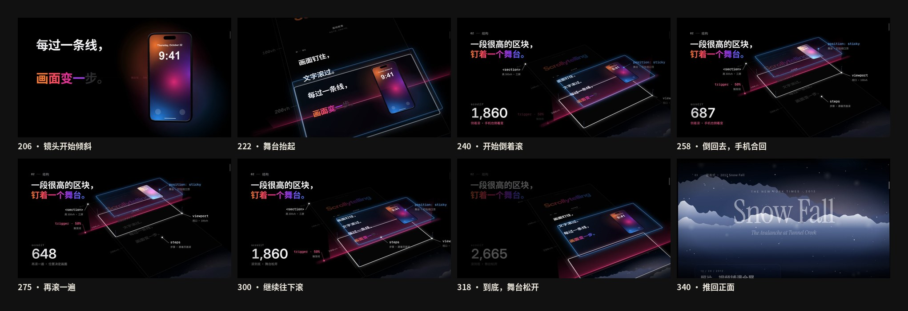
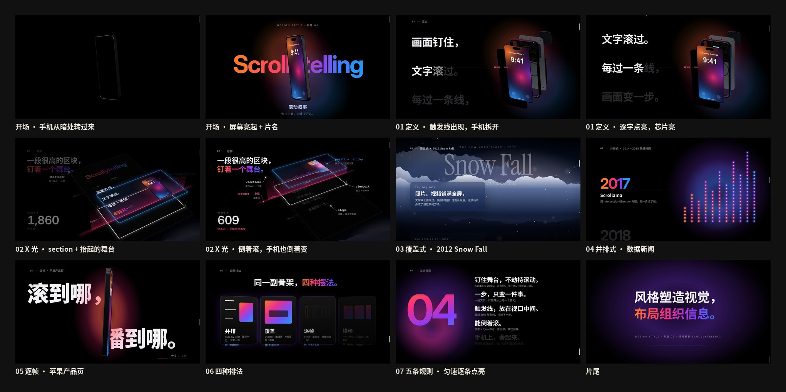
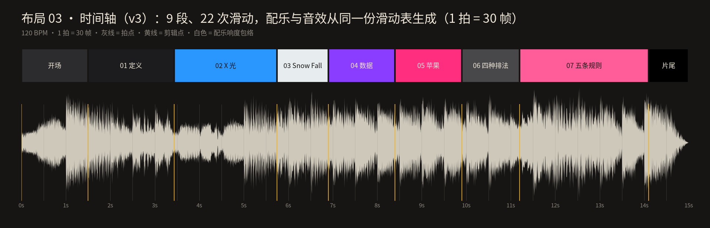
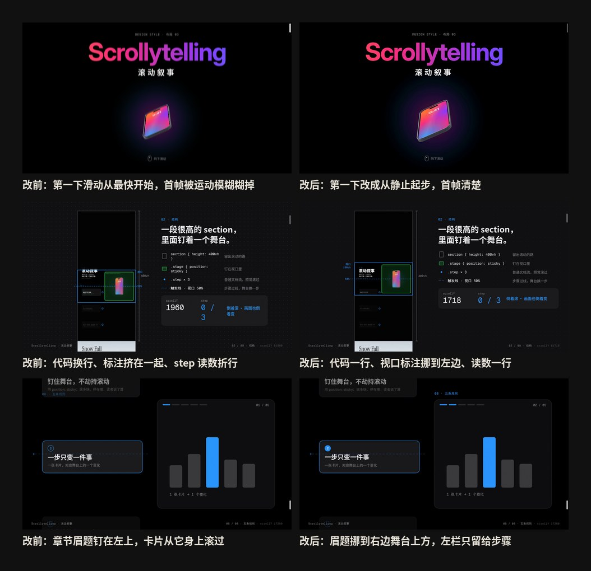
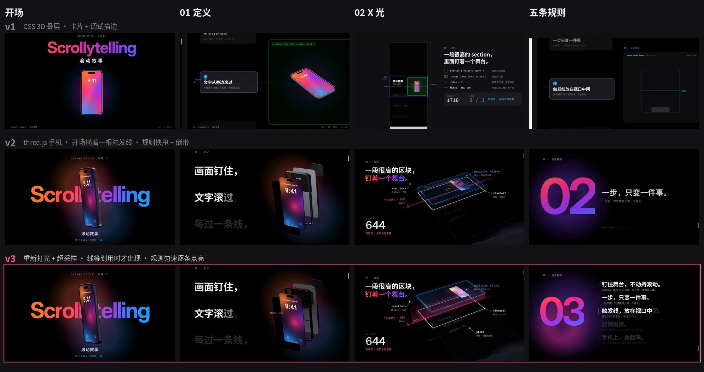

# 布局 03 · 滚动叙事 · 制作过程

> 这一期是怎么从“滚动叙事”四个字变成 15 秒短片和 4 张图的：怎么想的、怎么做的、哪里改过、下次怎么做得更好。
> 短片改过两版：v2 按“苹果发布会”的标准重做（§13），v3 根据审片反馈去掉开场的线、重做 3D 质感、让结尾慢下来、把“教会你”放到前面（§14）。
> 过程图都在 [`process/`](process)，可以复现的代码在 `video/` `audio/` `images/` 和根目录的 `scripts/`。动手层面的工具、命令和十步流程见 [`MAKING.md`](MAKING.md)。

🎬 [看成片（Releases · layout-03）](https://github.com/guanmo-ai/design-style/releases/tag/layout-03) · 📐 [布局指南](README.md) · 🧰 [从 0 到 1](MAKING.md)

---

## 0 · 一览

| # | 步骤 | 产出 | 工具 / 文件 |
|:-:|---|---|---|
| 1 | 选题与定调 | 换题：圣杯布局 → 滚动叙事；先验证它“真的是布局” | — |
| 2 | 研究 | 名字、时间线（2012—2026）、五条规则、四种排法、误区、CSS 现状 | [`README.md`](README.md) §0—§7 |
| 3 | 设计令牌 | 产品页黑 + 一条渐变、蓝 = 钉住、粉 = 触发线；Inter Display + Noto Sans SC + Geist Mono；触发线 50%、30 帧一拍 | `tokens.ts / .css / .json` |
| 4 | 动效设计 | **全片就是一次滚动**：一张 17 280px 的页面，只有一个变量 scrollY = S(f)；主角是 three.js 实时渲染的 3D 手机 | `video/page.ts` · `video/Phone3D.tsx` |
| 5 | 分镜与节拍 | 9 段、22 次滑动（含两段匀速慢滚） | [`process/timeline.json`](process/timeline.json) |
| 6 | 配乐 | 电影预告 × 发布会，D 大调 120 BPM；冲击、braam、倒带、滚动的空气声，全部对齐 `page.ts` | `audio/make_music.py`（numpy 合成） |
| 7 | 布局图 ×4 | 布局海报 · 布局速查 · 四种排法 · 三套页面 | `images/make_svgs.py` · `scripts/build_images.py` |
| 8 | 质检 | 关键帧、联系表、节拍时间轴、成片抽帧 | `scripts/stills.mjs` · `contact_sheet.py` · `timeline_chart.py` |
| 9 | 自查与修改 | v1：3 处动效问题 + 3 处细节 | 本页 §9 |
| 10 | 发布 | 母版 + 分享版 MP4、封面、仓库 | ffmpeg · GitHub Releases |
| 11 | **v2 改版** | 反馈“不够高级”→ 按苹果发布会开场片重做：three.js 3D 手机、超大字、逐字点亮、电影感配乐 | 本页 §13 |
| 12 | **v3 改版** | 反馈“开场有根线、3D 不够精美、结尾乱、要能学到东西”→ 去线、重新打光与超采样、匀速讲规则、删 CSS 章 | 本页 §14 |

---

## 1 · 选题与定调

**先换了一次题。** 布局 03 原本做的是圣杯布局（Holy Grail），短片、图和文档都做完了；审片时觉得这个名字和画面都不够吸引人，决定整期放弃（只留在本地分支，没有发布），换成**滚动叙事**，要求是：“先确认它真的算布局；要顶尖，视频动效要顶尖。”

**它真的算布局吗？** 动手前先回答这个问题，答案写进了指南 §0：

- 布局 01、02 排的是**一屏之内**的格子；滚动叙事排的是**滚动轴**：一段很高的 section、钉住的舞台、滚过的步骤、视口 50% 的触发线。这是**结构**，不是某一种动画。
- 它有**有名字的排法**（并排、覆盖、逐帧、横移），和**与风格无关**（NYT 的衬线、Pudding 的手绘图表、苹果的黑底大字，骨架一样）。
- 它有可执行的**规则**和**原生 CSS**（`position: sticky`、`animation-timeline`）。
- 和“视差滚动”“整屏翻页”划清界限：前两者是效果或交互，滚动叙事是“只读取滚动位置、不改写滚动”的版式结构。

**定调（写在动手之前）：**

- 一句话：*画面钉住，文字滚过；你往下滚，它就往下讲。*
- 受众：设计师拿去就能用（结构、参数、CSS、IntersectionObserver、提示词），普通人看完能说出“原来苹果官网那种往下滚手机就拆开的页面，叫滚动叙事”。
- 质感：苹果产品页——纯黑、一个发光的主角、一屏一句话；动起来要像**真的有人在滚这张网页**：甩一下、惯性滑停、偶尔倒回去。

## 2 · 研究：先列清单，再动手

1. **名字与定义：** scroll + storytelling；The Pudding 的定义“随着滚动，画面发生变化”，并强调它不是 scrolljacking。
2. **时间线：** 2012《Snow Fall》→ 2014 Bostock《How To Scroll》→ 2017 Pudding 六个库 / 响应式最佳实践、Chrome 56 `position: sticky`、Scrollama → 2018《Scrollytelling with position: sticky》→ 2020 前后苹果产品页逐帧 → 2023—2026 `animation-timeline`（Chrome 115 · Safari 26 · Firefox 159）。年份和浏览器版本都核对过原文或 MDN browser-compat-data（来源见指南 §1）。
3. **规则：** 钉住不劫持 / 一步一变 / 触发线在中间 / 能倒着滚 / 手机叠起来 + 减少动态。前两条和 Bostock 的守则、Pudding 的实践一一对得上。
4. **广度清单**（视频的 8 章从这里来）：

   | 领域 | 代表 | 在视频里 |
   |---|---|---|
   | 定义 | 舞台钉住、步骤过线 | 01 定义 |
   | 结构 | section · sticky · step · trigger | 02 结构（X 光） |
   | 新闻特稿 · 2012 | 《Snow Fall》覆盖式 | 03 覆盖式 |
   | 数据新闻 | Bostock · Pudding · Scrollama 并排式 | 04 并排式 |
   | 产品页 | 苹果逐帧 | 05 逐帧 |
   | 设计规范 | 四种排法 | 06 四种排法 |
   | 设计规范 | 五条规则 | 07 五条规则 |
   | 前端 | `position: sticky` · IntersectionObserver · `animation-timeline` | v1 有单独一章；v3 删掉（见 §14），代码放在指南 §7 和 `tokens.css` |

5. **误区：** 不是视差、不是整屏翻页；sticky 失效多半是祖先 `overflow`；别逐帧监听 scroll；动画只播一次就不能倒着滚。

## 3 · 设计令牌

- **颜色：** 舞台黑 `#000000`，面板 `#141416` / `#2C2C2F`，主文字 `#F5F5F7`、次文字 `#86868B`。颜色各管一件事：**蓝 `#2997FF` = 钉住**（X 光里的玻璃舞台、钉住连线、“例：”标注、滚动条），**粉 `#FF5C9A` = 触发线**。主角手机的屏幕用一条橙 → 粉 → 紫 → 蓝的渐变，也是片名、点亮的字和规则编号的颜色；手机的两条轮廓光取渐变两端的橙与蓝。布局图里另用纸 `#F5F5F7` / 墨 `#1D1D1F` 和标“钉住”的绿 `#30D158`。
- **字体：** Inter Display（标题）+ Inter（正文）+ Noto Sans SC，读数和代码用 Geist Mono；Snow Fall 一章借 Instrument Serif 演报纸衬线。全部 OFL。
- **结构：** section ≈（步数 + 1）× 100vh；舞台 `sticky; top: 0; height: 100vh`；一步一屏；触发线 50%；并排 7fr : 5fr，< 768px 改覆盖。
- **节拍：** 120 BPM，1 拍 = 30 帧（60fps）。

## 4 · 动效设计

**核心想法：全片就是一次滚动。** 整支片子是一张 17 280px 高的网页（7 个 section），每一帧只有一个变量 `scrollY = S(f)`。画面上的每一个动作都从它推出来，和浏览器里一模一样：

- 普通内容：屏幕 y = 页面 y − S；
- sticky 舞台：屏幕 y = clamp(页面 y, S, section 底 − 一屏) − S —— 就是 `position: sticky` 的那条公式；
- 舞台里的变化：按 S 经过的区间插值。**所以倒着滚，画面就倒着变**，这正是规则 04。



1. **滚动曲线 = 22 次滑动。** `FLICKS` 表里每一项是 `[起始帧, 目标 scrollY, 时长, 缓动]`：手指一划用 ease-out（起手最快、惯性滑停），换章的长距离用 ease-in-out，讲清单的两段用匀速（`lin`）。滑动是**接力**的——新的一下从“此刻真实的位置”接着走，提前打断也不跳。
2. **该快的快，该读的慢。** 换章用一下甩动；要观众读的地方（01 定义的四行字、06 四种排法、07 五条规则）用匀速慢滚：规则一章 ≈ 8px/帧，读得清、也不触发运动模糊。
3. **速度看得见。** 运动模糊只沿竖直方向，强度 = 速度的函数（`min(10, (v − 16) × 0.075)`），慢滚时完全清楚；X 光时关闭——都是读者在真实网页上熟悉的反馈。
4. **X 光：把结构画出来。** 02 一章整页倾斜成 3D 侧视：页面平面上画出 0—300vh 的刻度和视口框，sticky 舞台**抬起来**成一块 4 层的蓝色玻璃板，文字层浮在页面上、跟着页面滚，触发线是一道竖起来的粉色光幕，四条蓝色虚线把视口钉在舞台四角。然后**倒着滚一遍、再滚一遍、滚到底舞台松开**，观众亲眼看到“状态 = f(滚动位置)”和“sticky 只在父元素范围内钉住”。标注位置用同一套投影从页面坐标算到屏幕。
5. **一个主角贯穿。** three.js 实时渲染的 3D 手机（钛中框、磨砂背板、三摄、MagSafe 中板、电池、主板、屏幕、盖板玻璃）从开场一直用到苹果一章：转过来、钉在右边、拆成 6 层、芯片亮起、跟着滚动转一整圈，旋转角和爆炸量都是 S 的函数。
6. **每章换一种排法，而不是换一种特效。** 每章眉题直接写出排法和致敬对象：Snow Fall 是**覆盖式**（卡片从雪山上滚过）、数据新闻是**并排式**（圆点阵随步骤重排）、苹果是**逐帧**（滚到哪，转到哪）；06 再把四种排法摆在一起回顾、各给一个例子。
7. **片尾的橡皮筋。** 最后一下多冲 60px 再弹回页底——只有“滚到底”才有的那个手感。

## 5 · 分镜与节拍

先写时间轴（[`process/timeline.json`](process/timeline.json)），再写代码：开场 3 拍、定义约 4 拍、X 光约 4.5 拍、Snow Fall 约 2.5 拍、数据 3 拍、苹果 3 拍、四种排法约 2.5 拍、五条规则约 6 拍、片尾约 2 拍。逐帧分镜表见 [布局指南 §9](README.md#9--15-秒分镜)。





上图由 `scripts/timeline_chart.py` 直接读取最终配乐生成：黄线是章节切换，灰线是拍点。

## 6 · 声音

`audio/make_music.py` 用 numpy 从零合成，没有任何外部音源或采样。v1 是轻快的 F 大调电子小品；v2 起改成**电影预告 × 发布会开场**的混合（见 §13），v3 让结尾稳下来（见 §14）。

- **和画面共用一份数据：** 脚本解析 `video/page.ts` 的 `FLICKS`、缓动曲线、`DEF_AT`、`PATTERN_TH`、`RULES_AT` 和 X 光起点，重算 S(f)。改了滑动，配乐自动跟上。
- **结构：** 开场次低频 + 倒放的混响钢琴往上涌 → 第 60 帧屏幕亮起：冲击（次低频下坠 + 噪声爆破）+ 铜管 braam；01 定义进律动（侧链八分贝斯、轻底鼓、拨弦琶音），每行字过线一个钢琴音、往上走；02 结构律动抽空；03—05 完整四踩律动 + 超锯齿弦乐，苹果一章 braam + 合唱；06 四种排法每亮一块一声上行的钟，军鼓滚奏攒劲；07 规则落地，匀速滚动里每点亮一条一下铜管和弦 + 低鼓；片尾最后一击 + D 加九和弦。
- **“能倒着滚”听得见：** 第 240 帧 X 光里倒着滚时，整条音乐（含混响）按变速读头**真的倒放**，再从原位接上。v2 在规则 04 还有一次倒带，v3 去掉了——结尾要稳。
- **滚动的空气声：** 噪声带通，响度和亮度都跟着 S(f) 的速度走——滑得越快越响越亮。
- **引擎：** PolyBLEP 锯齿 / 超锯齿、加法合成钢琴（三弦失谐 + 泛音不和谐度）、STFT 时变滤波、合成立体声混响冲激响应（FFT 卷积）、侧链、RMS 胶水压缩、软削波；ffmpeg 两遍 `loudnorm`（linear）到 **−14 LUFS / −1 dBTP**。
- **局限：** 只能做频谱、响度和对齐检查，**发布前由观默戴耳机试听把关**。

## 7 · 布局图

四张 1080×1350 的图都由 `images/make_svgs.py` 生成，再用 `scripts/build_images.py` 子集化字体，导出自包含 SVG 和 2x PNG。四张图都画同一副骨架：section + 舞台 + 步骤 + 触发线。

| 图 | 目的 | 检查了什么 |
|---|---|---|
| 布局海报 | 时间线 2012—2023 + 三张视口快照：步骤一个个过线，手机正面 → 侧转 → 拆开 | 三张快照里触发线位置一致；只有过了线的那一步是亮的 |
| 布局速查 | 结构解剖、五条规则、可直接用的 CSS、参数 | 数值与 `tokens.*` 一致；CSS 能直接粘贴运行 |
| 四种排法 | 并排 / 覆盖 / 逐帧 / 横移，各适合什么、代表作；底部一条“× 不算”：劫持滚轮、点击翻页、自动轮播 | 四张小图结构可比；“不算”的例子和指南 §7 对得上 |
| 三套页面 | 产品发布页 / 数据报道 / 长篇特稿的整页侧视图，标出每段多高、用哪种排法 | 各段 vh 加起来合理；绿框只画在 sticky 段 |

## 8 · 质检

1. **关键帧截图：** `npx remotion bundle` 打包一次，`node scripts/stills.mjs` 只导出受影响的帧，改一处看一处。
2. **滑动必看最快的那一帧：** 运动模糊、滚动条和文字可读性的问题都出在速度峰值附近，所以每次滑动至少看起点、峰值、落定三帧。
3. **联系表：** `python3 scripts/contact_sheet.py` 从成片里精确抽帧（本页的分镜、X 光拆解、修改前后）。
4. **时间轴：** `python3 scripts/timeline_chart.py` 检查切换点与拍点是否对齐。
5. **成片检查：** `ffprobe` 核对 1920×1080 · 60fps · 900 帧 · 15.0s · H.264 + AAC，响度 −14.1 LUFS，再从成片抽帧复查。

## 9 · 自查与修改（v1）

下面是 v1 的自查；v2、v3 两轮改版见 [§13](#13--v2-改版按苹果发布会的标准重做) 和 [§14](#14--v3-改版去掉多余的线让结尾慢下来让人学得会)。



| 帧 | 问题 | 改了什么 |
|---|---|---|
| 0 | 第一下滑动用 ease-out，第 0 帧就是速度最快的一帧，片子一开头就被运动模糊糊掉 | 第一下改成 ease-in-out 从静止起步（`[0, 360, 30, 'inOut']`），首帧清楚，之后的滑动仍然起手最快 |
| 250 | X 光一章：代码标签换行、“视口”标注和 400vh 刻度挤在一起、step 读数 `0 / 3` 折成两行 | 标签改短、一行放下；“视口 100vh”挪到视口框左边；读数区固定宽度 |
| 752 | 五条规则一章的眉题钉在左上角，规则卡片从它身上滚过去 | 眉题挪到右边舞台上方，左栏只留给步骤——舞台和步骤各占一栏，正是并排式本来的样子 |

另外 3 处细节：

- 运动模糊最初加在 21 060px 的整张页面上，滤镜区域太大、又慢又裁边 → 改成加在 1920×1080 的视口层上；X 光一章拉远时关闭模糊。
- 布局图里的 ✓ / ✗ 在子集化后的字体里是豆腐块 → 改用 ×（“× 不算”）。
- 速查卡的 CSS 代码块里有中文注释，按等宽字宽计算时右边溢出 → 中文按 2 个字宽计算再换行。

## 10 · 渲染与发布

```bash
npm run music:L03                                     # 生成配乐 → public/03-scrollytelling/music.wav
npm run render:L03 -- --gl=swangle --concurrency=2    # 母版 → out/03-scrollytelling-master.mp4
ffmpeg -i out/03-scrollytelling-master.mp4 -vf "scale=in_range=full:out_range=tv,format=yuv420p" \
  -c:v libx264 -preset slow -crf 20 -profile:v high -c:a aac -b:a 192k -movflags +faststart \
  out/03-scrollytelling.mp4                           # 分享版（Releases 附件）
npm run images:L03                                    # 布局图 → images/preview/*.svg + images/png/*.png
```

- 手机是 three.js 实时渲染，无显卡的机器走软件 GL（`--gl=swangle`）。一次渲完 900 帧容易超时，所以分 6 段（每段 150 帧，`--frames=a-b --muted --crf=16`）渲染，再用 ffmpeg 无损拼接、最后混入配乐（AAC 320k）。v3 只渲染手机所在的裁切框（见 §14），2 核整片约 26 分钟（v2 约 37 分钟）。
- 母版约 12MB，分享版约 7MB。
- 视频不进 git 仓库，放在 [Releases · layout-03](https://github.com/guanmo-ai/design-style/releases/tag/layout-03)。
- 封面：第 88 帧（Scrollytelling 片名 + 立起来的 3D 手机）→ `video/cover.jpg`。

## 11 · 踩坑记录

| 问题 | 解决 |
|---|---|
| ease-out 滑动让“最快的一刻”落在拍点上，但第 0 帧也成了最快的一帧 | 只有第一下用 ease-in-out；见 §9 |
| SVG 滤镜加在 21 060px 高的页面上，又慢又会裁边 | 滤镜只加在 1920×1080 的视口层；X 光时关掉 |
| X 光拉远后，按 1 倍设计的标签挤在一起、自动换行 | X 光叠加层单独排版，不复用页面里的标签；读数区固定宽度、`white-space: nowrap` |
| 并排式里眉题和滚动卡片在同一栏，被卡片盖住 | 舞台一栏放标题和图，步骤一栏只放步骤 |
| 子集化字体里没有 ✓ / ✗，图里出现豆腐块 | 图里只用字体里确实有的字符（×） |
| 代码块按等宽字宽排，中文实际占 2 个字宽 | `code_lines()` 计算宽度时中文按 2 计 |
| 配乐脚本想直接 `import` `page.ts`，但 `npx tsx` 会在运行时下载 | 配乐脚本用正则解析 `FLICKS` 等常量，再用 Python 重写同一条贝塞尔缓动，误差 < 0.05px |
| 根目录 README 的画廊和 `works.json` 由发布流程生成 | 这一期没有手动改，发布 Release 后由流程更新 |
| three.js 在 Remotion 里逐帧渲染，WebGL 上下文越开越多 | 每个场景只在所在章节可见时挂载；卸载时 `dispose()` + `forceContextLoss()` |
| 手机只占画面一小块，却按整张 1920×1080 渲染，又慢又有锯齿 | `camera.setViewOffset` 只渲染手机的包围框，按 1.5× 超采样再缩小；X 光里手机变小，超采样降到 0.6× |
| 画布纹理（电池标签、中板）在字体加载前画好，字是默认字体 | 字体加载完成后重画纹理（`redraw`），再 `continueRender` |
| 贴在视口上的触发线从第 0 帧就画着，开场画面上横着一根没人解释的线 | 触发线等到 01 定义第一次用到时才画出来，并标注“触发线 · 50%” |

## 12 · 下期沿用的清单

- [ ] 先判断它是**风格**还是**布局**；拿不准时写下“结构 · 有名字的排法 · 与风格无关 · 规则 · 原生 CSS”五项逐条对照
- [ ] 名字和画面要先过“想不想点开”这一关——圣杯布局就是在这一关被换掉的
- [ ] 找到这一期的**唯一变量**（本期是 scrollY），让所有画面都是它的函数；倒放、打断都不会出错
- [ ] 动作最快的一刻落在拍点上；但第 0 帧要从静止开始
- [ ] 声音和画面共用同一份数据（直接解析源码里的常量），不要手抄帧号
- [ ] 讲结构时给观众一次“X 光”：拉远、标注、倒着走一遍
- [ ] 先写 `timeline.json`，再写分镜，最后写代码；联系表 + 时间轴做质检；`PROCESS.md` 边做边写
- [ ] 画面上每一个元素都要“有人解释”：第一次出现时就说明它是什么（v3 开场那根线就是反例）
- [ ] 要观众读的地方用匀速慢滚，不要连续快甩 + 倒带；“炫”放在换章，“讲”放在章内
- [ ] 每一章写明“这是哪种排法、致敬谁”，看完要能复述出排法和规则

## 13 · v2 改版：按苹果发布会的标准重做

**反馈：** v1 “画面不够高级、普通”——定义一章有绿色调试描边、代码胶囊、步骤卡片，像开发者文档；X 光图太挤；配乐不够电影感。目标：**至少到苹果的水平**。

| | v1 | v2 |
|---|---|---|
| 主角 | CSS 3D 叠层手机（平面拼出来，边缘发硬） | **three.js 实时渲染**：带倒角的钛中框、侧键、三摄（虹彩镀膜）、主板走线、电池、屏幕、盖板玻璃扫光；虚拟摄影棚做环境反射；可沿 Z 轴拆开 |
| 文字 | 步骤卡片 + 小标题 + 代码胶囊 | 苹果式**逐字点亮**：一行字越过触发线才从 `#2C2C2F` 一个字一个字亮成白色，倒着滚就暗回去；标题 92—252px |
| 画面语言 | 浅色章节、HUD、调试描边 | 纯黑底、柔和彩色光晕、暗角、细颗粒；只留 macOS 式细滚动条 |
| X 光 | 平面缩小 + 很多框 | 整页倾斜成 3D（CSS perspective + rotateX/Z），舞台抬起、触发线是粉色激光 |
| 历史章节 | 线框示意 | Snow Fall：蓝调时刻的分形雪山 + 三层景深的雪；数据：发光圆点阵随步骤重排 |
| 配乐 | F 大调电子小品 + 滚轮音效 | 电影预告 × 发布会：冲击、braam、合唱、超锯齿弦乐、四踩；倒着滚时音乐真的倒带 |

**取舍：**
- **为什么上 WebGL：** CSS 3D 拼不出金属倒角和真实反射，这是“高级感”差距最大的地方。three.js 不用 react-three-fiber，直接在 `useLayoutEffect` 里按每帧的 `st` 渲染一次——Remotion 逐帧截图，帧与帧之间没有状态，可以随意跳帧、倒放。
- **保留的骨架：** 全片仍然只有一个变量 `scrollY = S(f)`；sticky 公式、触发线、倒着滚，一样不少。开场手机转过来是唯一按时间播放的动画（相当于“页面加载”），其余全由 S 驱动。

## 14 · v3 改版：去掉多余的线、让结尾慢下来、让人学得会

**反馈（审 v2 成片）：** ① 开场为什么有一根线；② 3D 感觉不够精美；③ 结尾速度有问题，突然很乱；④ 视频要**既展示布局、又让人觉得很牛、又能真学到这个布局是什么**。



| 反馈 | 原因 | v3 怎么改 |
|---|---|---|
| ① 开场有根线 | 视口上的触发线从第 0 帧就画着，横穿片名和手机，却要到 01 定义才用得上；观众不知道它是什么 | 开场只留手机和片名。触发线到第 100 帧（第一行字快要过线时）才从左往右画出来，旁边标注“触发线 · 50%”；进 X 光时淡出，由竖起来的光幕接替 |
| ② 3D 不够精美 | 环境反射是硬边色块，钛框发灰、背板像塑料；屏幕被暖色轮廓光洗白；整帧 1× 渲染，边缘有锯齿 | **重新打光：** 软边柔光箱（shader 画的渐变面板）、橙 `#FF7A2F` / 蓝 `#2997FF` 两条品牌色轮廓光、粉色顶光、一大块柔光背板、左前方一块弱光专门给黑色玻璃反射。**重做材质：** 钛 `#5C5D63` 粗糙度 0.3、磨砂藏青背板 `#2A3344`、镜头虹彩减弱；中板加 MagSafe 线圈和机加工纹理，电池有印字标签，主板走线更亮。**提清晰度：** 只渲染手机所在的裁切框（`setViewOffset`），1.5× 超采样。**X 光：** 舞台改成有厚度的 4 层蓝色玻璃板，触发线改成竖起来的粉色光幕，四条虚线把视口钉在舞台四角，左边加 0—300vh 刻度 |
| ③ 结尾乱 | 06 CSS 一章插在中间、07 四种排法和 08 规则多是一下一下的快速甩动；规则 04 再倒着滚一下、音乐同时倒带——13 秒前后连着高速滑动 + 运动模糊，看起来像出错 | **删掉 CSS 一章**（代码留在指南 §7 和 `tokens.css`）。四种排法改成匀速慢滚、四块面板依次点亮；规则一章清单钉住，**匀速 ≈ 8px/帧滚 2.2 秒**（不触发运动模糊），五条依次逐字点亮，左边大号编号 01 → 05；配乐去掉规则处的倒带，“倒着滚”只在 X 光里演示一次 |
| ④ 要学得到 | v2 每章只写了年份和名字，排法要靠观众自己看出来 | 每章眉题直接写排法 + 致敬：“覆盖式 · 2012 Snow Fall”“并排式 · 2014—2018 数据新闻”“逐帧 · 苹果产品页”；06 把四种排法摆在一起、每块注明例子（数据新闻 / Snow Fall / 苹果产品页 / 时间线、作品集）；07 五条规则每条一行大字 + 一行怎么做；X 光里的文字层标出“steps · 步骤 · 跟着页面滚” |

**结果：** 页面从 21 060px 缩到 17 280px，章节从 8 章减到 7 章，多出来的时间都给了“读”。只渲染裁切框后，整片渲染从约 37 分钟降到约 26 分钟。
