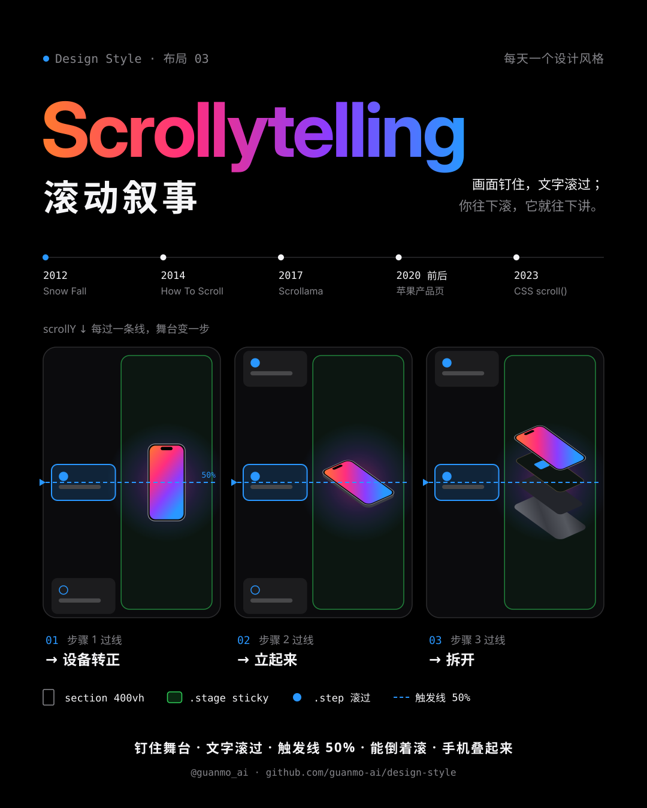
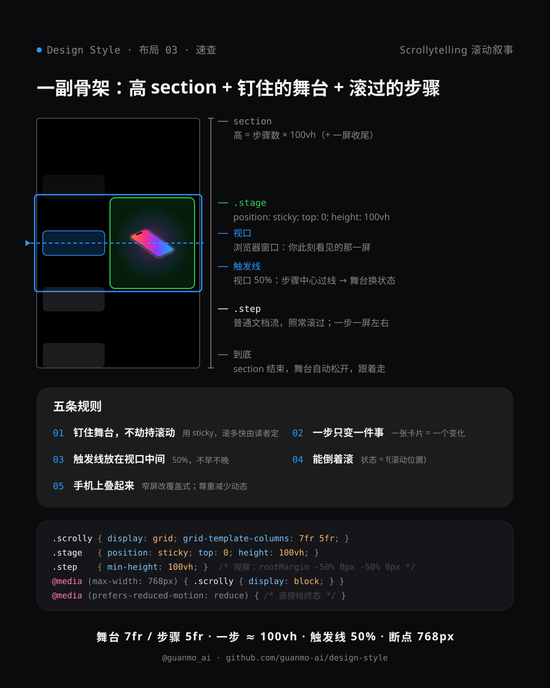
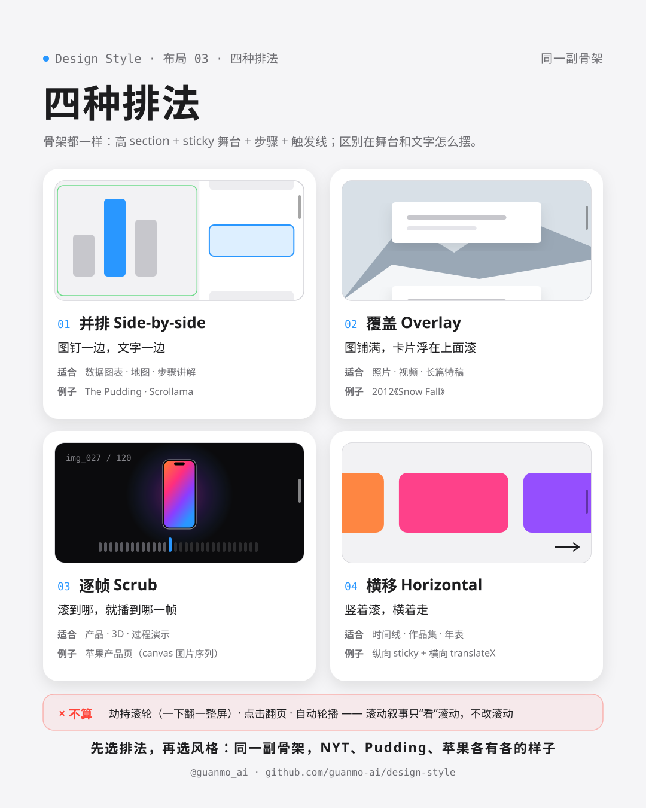
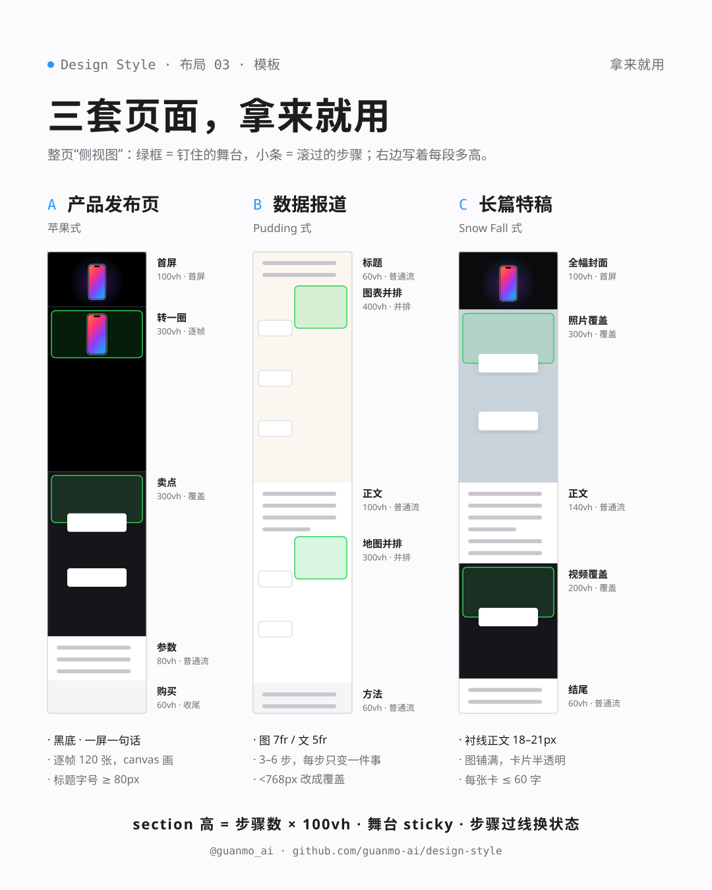

# 布局 03 · 滚动叙事 Scrollytelling（2012—）

> **一句话：** 画面钉住，文字滚过；你往下滚，它就往下讲。

> **风格塑造视觉，布局组织信息。** 滚动叙事不规定颜色、字体和质感，只规定“页面在**滚动方向**上怎么排”：一段很高的区块、一个钉在视口里的舞台、一串滚过去的步骤、一条视口中间的触发线。同一副骨架，可以是《纽约时报》的长篇特稿、The Pudding 的数据报道，也可以是苹果的产品页。

🎬 [看视频](https://github.com/guanmo-ai/design-style/releases/tag/layout-03) · 🛠 [制作过程](PROCESS.md) · 🧰 [从 0 到 1](MAKING.md) · 🖼 [图片源文件](images)

| 布局海报 | 布局速查 |
|:-:|:-:|
|  |  |
| **同一副骨架，四种排法** | **拿来就用：三套页面** |
|  |  |

## 0 · 它为什么算“布局”

便当盒、瀑布流排的是**一屏之内**的格子；滚动叙事排的是**滚动轴**：页面往下的这几千像素，哪一段钉住、哪一段滚过、在哪一刻换状态。它满足一个布局该有的三件事：

| | 布局该有的 | 滚动叙事 |
|---|---|---|
| **固定的结构** | 说得清由哪几块组成 | 高 section（≈ 步数 + 1 屏）· sticky 舞台（100vh）· 步骤（一步一屏）· 触发线（视口 50%） |
| **有名字的排法** | 同一结构的几种摆法 | 并排 Side-by-side · 覆盖 Overlay · 逐帧 Scrub · 横移 Horizontal（见 compare 图） |
| **和风格无关** | 换颜色、字体都成立 | NYT 的报纸衬线、Pudding 的手绘图表、苹果的黑底大字，骨架都一样 |

还有一点：它有**规则**（§2）和**原生 CSS**（`position: sticky`、`animation-timeline`）。动画只是“舞台上演什么”，布局是“舞台放在哪、什么时候换”——这一期讲的是后者。

## 1 · 它从哪来

**名字：** *scroll*（滚动）+ *storytelling*（讲故事）。The Pudding 的 Russell Samora 给它的定义很朴素：**随着滚动，画面发生变化**；他也特别说明，它**不是**“劫持滚动”（scrolljacking）——滚动的速度和方向始终由读者控制（[The Pudding, 2017](https://pudding.cool/process/how-to-implement-scrollytelling/)）。

| 年份 | 事件 |
|---|---|
| **2012** | 12 月 20 日，《纽约时报》发布 John Branch 的《Snow Fall: The Avalanche at Tunnel Creek》：全幅照片、视频、地图随滚动出现，文字从上面滚过（[NYT](https://www.nytimes.com/projects/2012/snow-fall/)）。2013 年获普利策特稿写作奖（[Pulitzer](https://www.pulitzer.org/winners/john-branch)）。新闻编辑部从此多了个动词：*to snowfall* |
| **2014** | 11 月 3 日，D3 作者 Mike Bostock 发表《How To Scroll》：五条用好滚动的守则，头两条是“**宁可滚动，不要点击**”和“**滚动要快速、渐进、可逆**”（[bost.ocks.org](https://bost.ocks.org/mike/scroll/)） |
| **2017** | 1 月，The Pudding 用六个库实现同一个滚动叙事、给出定义；4 月写《响应式滚动叙事》，手机上把并排改成覆盖（[Pudding](https://pudding.cool/process/responsive-scrollytelling/)）。同年 Chrome 56 起 `position: sticky` 在主流浏览器可用；Russell Samora 发布 **Scrollama**：用 IntersectionObserver 判断“哪一步过了线”，代替逐帧监听 scroll 事件（[GitHub](https://github.com/russellsamora/scrollama)） |
| **2018** | 6 月，Pudding 的 Elaina Natario、Russell Samora 写《Scrollytelling with position: sticky》：舞台不再用 JS 固定，交给 CSS（[Pudding](https://pudding.cool/process/scrollytelling-sticky/)） |
| **2020 前后** | 苹果产品页把“逐帧”做成招牌：滚到哪，就在 canvas 上画第几张图，AirPods Pro、iPhone 跟着手指转（拆解见 [CSS-Tricks, 2020](https://css-tricks.com/lets-make-one-of-those-fancy-scrolling-animations-used-on-apple-product-pages/)） |
| **2023—2026** | CSS 原生的滚动驱动动画 `animation-timeline: scroll() / view()`：Chrome 115（2023-07）、Safari 26（2025-09）、Firefox 159（2026-10-27 正式版）（[MDN](https://developer.mozilla.org/en-US/docs/Web/CSS/CSS_scroll-driven_animations) · [Can I use](https://caniuse.com/mdn-css_properties_animation-timeline)） |

## 2 · 五条规则

| # | 规则 | 怎么做 | 小心 |
|:-:|---|---|---|
| 01 | **钉住舞台，不劫持滚动** | 舞台用 `position: sticky; top: 0; height: 100vh`；滚多快、停在哪，读者说了算 | 改 `wheel`、`preventDefault`、一下翻一整屏，就成了“劫持滚动” |
| 02 | **一步只变一件事** | 一张步骤卡片，对应舞台上的一个变化：一条线变红、一张图放大、一个数字跳出来 | 一步里同时换图、换色、换标题，读者不知道该看哪 |
| 03 | **触发线放在视口中间** | 步骤越过视口 50% 那条线才换状态（`rootMargin: '-50% 0px -50% 0px'`） | 线放在底部，卡片刚露头画面就变了，文字还没读到 |
| 04 | **能倒着滚** | 状态 = f(滚动位置)，往回滚就往回变；不要只在“第一次经过”时播一段动画 | 只播一次的动画，倒回去画面对不上文字 |
| 05 | **手机上叠起来，尊重减少动态** | < 768px 改成覆盖式（舞台铺满，卡片半透明浮在上面）；`prefers-reduced-motion` 直接给每一步的终态 | 把并排等比缩小到手机上，图和字都看不清 |

## 3 · 色板

滚动叙事是布局，**没有“正宗配色”**。规则只有一条：**舞台是主角，文字卡片退后**——步骤卡片用低对比的面板色，强调色只留给“此刻正在变的那一处”。下面是视频与布局图用的“产品页黑”配色：

| 名称 | HEX | 用途 |
|---|---|---|
| 舞台黑 | `#000000` | 画布，苹果产品页的底 |
| 面板 | `#1C1C1E` / `#2C2C2E` | 步骤卡片、代码面板 |
| 主文字 | `#F5F5F7` | 深色底上的标题与正文 |
| 次文字 | `#86868B` | 说明、标注 |
| 纸 / 墨 | `#F5F5F7` / `#1D1D1F` | 浅色章节（四种排法、模板图） |
| 蓝 | `#2997FF` | **唯一的强调色**：触发线、步骤编号、滚动条、当前步骤 |
| 绿 | `#30D158` | 只在结构图里标“钉住”的舞台 |
| 屏幕渐变 | `#FF7A2F → #FF2E7E → #8B3DFF → #2997FF` | 主角设备的屏幕、片名 |

## 4 · 字体

| 用途 | 本项目 | 商用原版 / 其他选择 |
|---|---|---|
| 大标题（Scrollytelling、一屏一句话） | **Inter Display** 600 / 700（免费，OFL） | SF Pro Display · Söhne |
| 英文正文 / 界面 | **Inter** 400—600（免费，OFL） | SF Pro Text · Graphik |
| 中文 | **思源黑体 / Noto Sans SC** 400—900（免费，OFL） | 苹方 · HarmonyOS Sans |
| 代码 / 读数（scrollY、step） | **Geist Mono** 400 / 500（免费，OFL） | SF Mono · JetBrains Mono |
| 2012 那一章 | **Instrument Serif**（免费，OFL） | NYT Cheltenham · Georgia |

滚动叙事的文字是“一屏一句话”：步骤卡片里的字要短、要大，长段落放到舞台区块之外的普通正文里。

## 5 · 版式参数

| 场景 | 排法 | 舞台 : 文字 | 步骤卡片 | 触发线 |
|---|---|---|---|---|
| 桌面 ≥ 1024px | 并排 | 7fr : 5fr（舞台在左或右） | 最宽 28rem，间隔 ≈ 1 屏 | 视口 50% |
| 平板 768—1023px | 并排或覆盖 | 1fr : 1fr | 最宽 24rem | 视口 50% |
| 手机 < 768px | 覆盖 | 舞台铺满 100vh | 宽 88vw，底色 86% 不透明 + 模糊 | 视口 50%—60% |

- **section 高度 ≈（步数 + 1）× 100vh**：3 步 ≈ 400vh。舞台 `top: 0; height: 100vh`，在这段距离里一直钉住。
- **步骤 3—6 个**最好读；超过 8 个，拆成两个 section，中间放一段普通正文让读者喘口气。
- **逐帧（Scrub）**：120—150 张图，铺 300—500vh；图片按滚动进度 `round(p × (n − 1))` 选，提前预加载。
- **切换要快**：离散的状态变化 300—600ms；逐帧和 `view()` 动画不要缓动延迟，跟手。
- 视频里：页面 21 060px、视口 1080、触发线 540；01 定义一章 3 步、每步间隔 540px；苹果那一章 120 帧。

## 6 · 这样做 / 别这样

**✅ 这样做：** 首屏就露出“往下滚”的提示 · 舞台用 sticky，不用 JS 固定 · 一步只改一处 · 触发线放视口中间 · 状态跟着滚动位置走（能倒着滚） · 手机改覆盖 · 关掉动画也能读懂（reduced motion 给终态） · 舞台里的图表本身也能单独看懂

**❌ 别这样：** 劫持滚轮（一下翻一整屏） · 步骤卡片塞一大段文字 · 动画只在第一次经过时播 · 每一屏都做成滚动叙事（读者会累） · 关键信息只在动画中间那一帧出现 · 没有滚动提示的全屏封面（读者不知道能往下滚）

## 7 · 其他误区

- **滚动叙事不是视差滚动（parallax）。** 视差是背景和前景以不同速度移动，制造纵深，是“效果”；滚动叙事是“舞台 + 步骤 + 触发线”的结构，是“布局”。两者可以叠用，但不是一回事。
- **也不是整屏翻页（fullPage 式）。** 一下翻一整屏、点圆点切页，是改写了滚动本身——Bostock 和 Pudding 都把它列为要避免的“劫持滚动”。滚动叙事只**读取**滚动位置，从不**改写**它。
- **sticky 不生效，八成是祖先元素的问题。** sticky 只在**父元素的范围内**钉住；任何一层祖先写了 `overflow: hidden / auto`，舞台就会跟着滚走。还要记得写 `top`。
- **不要监听 scroll 事件逐帧计算。** 判断“哪一步过线”用 IntersectionObserver（Scrollama 的做法）；纯视觉的进度动画交给 `animation-timeline: view()`，在合成线程跑，不卡主线程。
- **原生 CSS 已经够用（截至 2026 年 10 月）。** `position: sticky` 全部浏览器可用；`animation-timeline` 在 Chrome 115+、Safari 26+、Firefox 159+；不支持时用 `@supports` 让元素停在终态。可直接用的代码见 [`tokens.css`](tokens.css)。

```css
.scrolly        { display: grid; grid-template-columns: 7fr 5fr; }      /* 并排：舞台 7 : 文字 5 */
.scrolly__stage { position: sticky; top: 0; height: 100vh; }            /* 规则 01：钉住，不劫持 */
.step           { min-height: 100vh; display: flex; align-items: center; } /* 一步一屏 */
.step.is-active { opacity: 1; }                                          /* 过了线的那一步亮起来 */
@media (max-width: 767px) {                                              /* 规则 05：手机改覆盖 */
  .scrolly { display: block; }
  .scrolly__steps { position: relative; margin-top: -100vh; }
}
@supports (animation-timeline: view()) {                                 /* 可选：纯 CSS 滚动驱动 */
  .reveal { animation: reveal linear both; animation-timeline: view(); animation-range: entry 0% cover 40%; }
}
```

```js
// 规则 03：步骤越过视口 50% 那条线，才换状态
const io = new IntersectionObserver(es => es.forEach(e => {
  if (e.isIntersecting) stage.dataset.step = e.target.dataset.step;
}), { rootMargin: '-50% 0px -50% 0px' });
document.querySelectorAll('.step').forEach(s => io.observe(s));
```

## 8 · AI 提示词（直接复制）

**图片（Midjourney / 即梦 / ChatGPT 图像）**

```
A scrollytelling web page shown as a tall vertical strip (side view of one long page): a sticky
full-height stage holding a large product render / chart, with narrow text cards scrolling past it,
a thin dashed blue line across the middle of the viewport marking the trigger; Apple-style product
page, pure black background #000000, dark gray cards #1C1C1E, white Inter Display headlines,
one accent blue #2997FF, an orange-pink-violet gradient glow on the hero device, clean, cinematic --ar 4:5
```

**风格 + 布局（把任意一期风格套进滚动叙事）**

```
[Bauhaus / Swiss International / Constructivism …] style, laid out as a scrollytelling page:
a tall section with a sticky full-viewport stage and 3–5 short text steps that scroll past it;
each step changes exactly one thing on the stage when it crosses the middle of the viewport;
scrolling back reverses the change. Use the colors, typography and textures of the style;
keep the scrollytelling structure (side-by-side on desktop, overlay on mobile).
```

**视频（Runway / 可灵 / Sora）**

```
Screen-recording style motion graphics of one continuous scroll down a long web page:
a sleek smartphone is pinned in the center while text cards scroll past; each time a card crosses
the middle of the screen the phone rotates, then explodes into layers (glass, screen, board, frame);
smooth inertial flick scrolling with slight vertical motion blur, Apple product page look,
black background, white type, one blue accent, 120 bpm, every flick lands on the beat, no camera shake.
```

**代码（让 AI 写网页 / 组件）**

```
用滚动叙事（Scrollytelling）做这一段：<section class="scrolly"> 里放一个 position: sticky; top: 0;
height: 100vh 的舞台和 3–5 个 .step；桌面 grid-template-columns: 7fr 5fr 并排，<768px 改成覆盖
（舞台铺满，卡片半透明浮在上面）。用 IntersectionObserver（rootMargin '-50% 0px -50% 0px'）判断
当前步骤，只给舞台写 data-step，样式全部由 data-step 驱动；状态必须能倒着滚回去。
不要监听 wheel、不要 preventDefault、不要整屏翻页；prefers-reduced-motion 时直接显示每一步的终态。
颜色和字体沿用【你的风格】，设计令牌见 tokens.css。
```

## 9 · 15 秒分镜

全片就是**一次滚动**：整支片子是一张 21 060px 高的网页，每一帧只有一个变量 **scrollY = S(f)**，镜头、设备、卡片、数字全是它的函数。30 次“甩一下、惯性滑停”的滑动拼成整条曲线；120 BPM，1 拍 = 30 帧，每次滑动速度最快的一刻落在拍点上，配乐也从同一份滑动表生成。

| 时间 | 帧 | 章节 | 画面 | 致敬 |
|---|---|---|---|---|
| 0:00—1.5 | 0—90 | 开场 | 片名「Scrollytelling 滚动叙事」+ 滚动提示；手机随三下滑动转过来 → 立起来 → 拆成 9 层 | 苹果产品页 |
| 1.5—3.5 | 90—210 | 01 定义 | 拆开的手机挪到右栏钉住，三张步骤卡片从左边滚过、依次过线，每过一次舞台变一步 | — |
| 3.5—5.5 | 210—330 | 02 结构 | X 光：镜头拉远，画出 400vh 的 section、绿色 sticky 舞台、视口框和 50% 触发线，右边实时读数 scrollY / step；**倒着滚一遍**，画面也倒着变 | — |
| 5.5—6.75 | 330—405 | 03 2012 | 覆盖式：雪山视差、飘雪、红色路线“Tunnel Creek”，衬线标题，两张卡片从画面上滚过 | NYT《Snow Fall》 |
| 6.75—8.25 | 405—495 | 04 数据 | 并排式：48 个圆点随步骤 散点 → 网格 → 柱状；卡片写着 2014 Bostock、2017—2018 Scrollama → sticky | Bostock · The Pudding |
| 8.25—9.75 | 495—585 | 05 苹果 | 逐帧：手机跟着滚动转 200°，底下胶片条和 `img_031.jpg / 120` 读数；“一屏，一句话。” | 苹果产品页 |
| 9.75—10.75 | 585—645 | 06 CSS | `animation-timeline: view()` 代码逐行高亮，进度条和手机跟着滚；Chrome 115 · Safari 26 · Firefox 159 | CSS 滚动驱动动画 |
| 10.75—12.2 | 645—730 | 07 四种排法 | 四个小浏览器窗口依次亮起：并排 · 覆盖 · 逐帧 · 横移 | — |
| 12.2—14.2 | 730—850 | 08 五条规则 | 规则本身就是步骤：五张卡片逐条过线，右边舞台演示每一条；规则 04 时**倒着滚一下**；音乐低通 | — |
| 14.2—15.0 | 850—900 | 片尾 | 滑到页底，橡皮筋回弹 →「风格塑造视觉，布局组织信息。」 | — |

<a href="https://github.com/guanmo-ai/design-style/releases/tag/layout-03"></a>

> 画面里的《Snow Fall》页面、数据图表、产品页与浏览器窗口都是重绘的示意，不是截图；手机是用 CSS 3D 画的通用机型，不对应任何真实产品。全片没有照片和外部素材。

## 10 · 文件

```
03-scrollytelling/
├─ PROCESS.md                             # 制作过程
├─ MAKING.md                              # 从 0 到 1：工具、环境、十步流程、和 AI 协作
├─ process/                               # 过程图：成片分镜 · X 光拆解 · 自查前后对比 · 节拍时间轴 · 十步流程
├─ tokens.ts / tokens.css / tokens.json   # 同一份设计令牌（tokens.css 附一个可直接用的并排滚动叙事 + 手机覆盖 + reduced motion）
├─ video/Scrollytelling.tsx               # 短片主合成：一张 21 060px 的页面、镜头、运动模糊、HUD、滚动条、配乐
├─ video/page.ts                          # 页面结构与滚动曲线：章节位置、30 次滑动 FLICKS、S(f)、sticky 公式、各章步骤
├─ video/Device.tsx                       # CSS 3D 手机：背板、9 层框、电池、主板、屏幕、玻璃，可旋转、可拆开
├─ video/intro.tsx                        # 开场、01 定义、02 结构（X 光）
├─ video/history.tsx                      # 03 Snow Fall · 04 数据新闻 · 05 苹果逐帧 · 06 CSS
├─ video/outro.tsx                        # 07 四种排法 · 08 五条规则 · 片尾
├─ video/ui.tsx                           # Section / Stage（sticky）/ 步骤卡片 / 触发线等小部件
├─ video/cover.jpg                        # 视频封面
├─ audio/make_music.py                    # 配乐：numpy 合成，F 大调 120 BPM，-14 LUFS；滑动音效从 page.ts 读
└─ images/
   ├─ make_svgs.py    # 生成下面四张图：python3 make_svgs.py
   ├─ poster.svg      # 布局海报：三张视口快照，步骤一个个过线，舞台一步步变
   ├─ cheatsheet.svg  # 布局速查：结构解剖 · 五条规则 · CSS · 参数
   ├─ compare.svg     # 四种排法：并排 / 覆盖 / 逐帧 / 横移，各适合什么；什么不算
   ├─ templates.svg   # 三套页面：产品发布页 / 数据报道 / 长篇特稿（整页侧视图）
   └─ preview/        # 内嵌字体的自包含 SVG
```

**延伸阅读：** [Snow Fall（NYT, 2012）](https://www.nytimes.com/projects/2012/snow-fall/) · [How To Scroll（Mike Bostock）](https://bost.ocks.org/mike/scroll/) · [How to implement scrollytelling with six different libraries（The Pudding）](https://pudding.cool/process/how-to-implement-scrollytelling/) · [Responsive scrollytelling best practices](https://pudding.cool/process/responsive-scrollytelling/) · [Scrollytelling with position: sticky](https://pudding.cool/process/scrollytelling-sticky/) · [Scrollama](https://github.com/russellsamora/scrollama) · [MDN：CSS scroll-driven animations](https://developer.mozilla.org/en-US/docs/Web/CSS/CSS_scroll-driven_animations)
