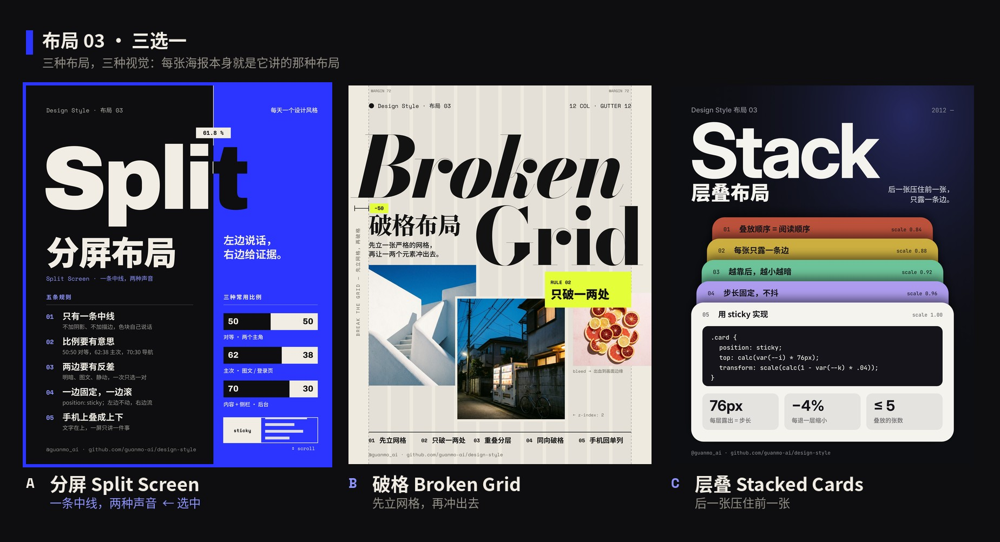
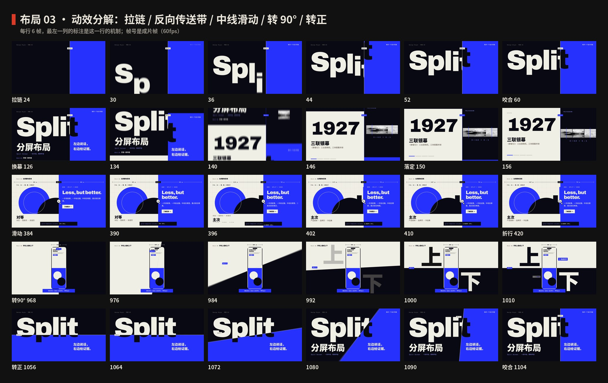
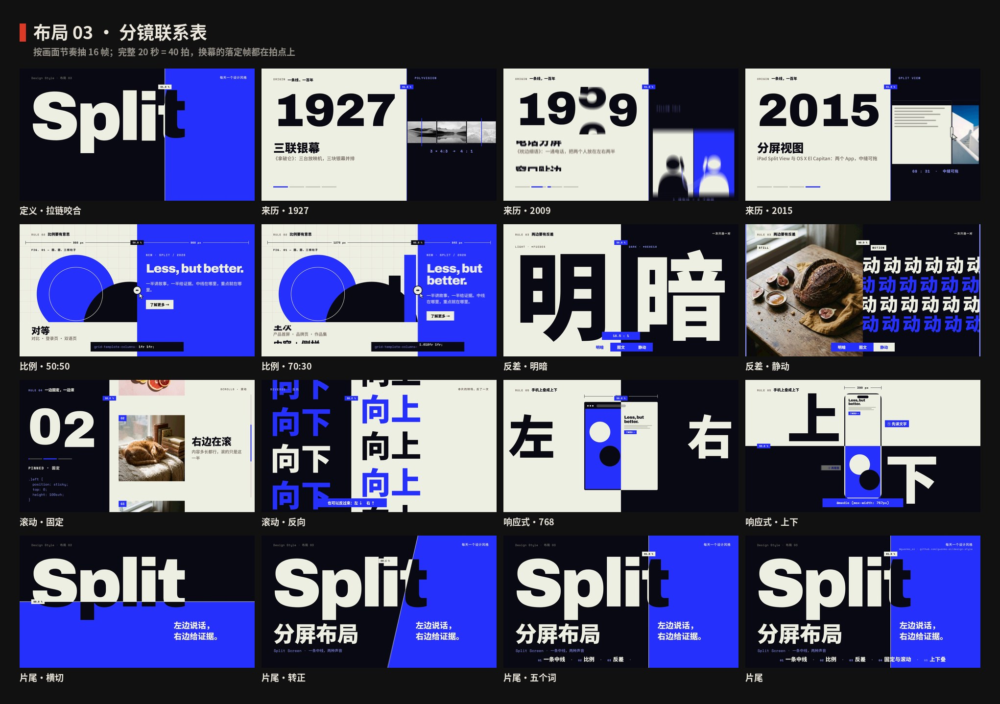
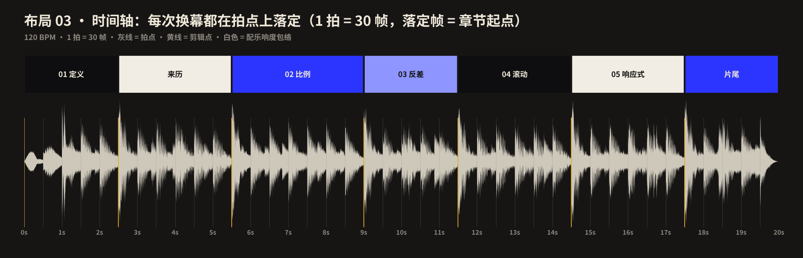

# 布局 03 · 分屏布局 · 制作过程

**中文** · [English](PROCESS.en.md)

> 这一期是怎么从“分屏”两个字变成 20 秒短片和 4 张图的：三选一怎么选的、动效怎么想的、哪里改过、下次怎么做得更好。
> 过程图都在 [`process/`](process)，可以复现的代码在 `video/` `audio/` `images/` 和根目录的 `scripts/`。

🎬 [看成片（Releases · layout-03）](https://github.com/guanmo-ai/design-style/releases/tag/layout-03) · 📐 [布局指南](README.md) · 🧰 [从 0 到 1](MAKING.md)

---

## 0 · 一览

| # | 步骤 | 产出 | 工具 / 文件 |
|:-:|---|---|---|
| 1 | 三选一 | 三张候选海报（分屏 / 破格 / 层叠），观默选分屏 | `drafts/layout-03` · [`process/01-candidates.jpg`](process/01-candidates.jpg) |
| 2 | 研究 | 来历、五条规则、色板对比度、常见误区、CSS 现状 | [`README.md`](README.md) §1—§7 |
| 3 | 设计令牌 | 墨 / 纸 / 钴蓝三个颜色、Archivo 900、120 BPM | `tokens.ts / .css / .json` |
| 4 | 动效设计 | **一个主角：中线**；反向传送带换幕；中线滑动、旋转 | `video/SplitScreen.tsx` · `tracks.ts` |
| 5 | 分镜与节拍 | 7 段、40 拍，每次换幕的落定帧 = 拍点 | [`process/timeline.json`](process/timeline.json) |
| 6 | 配乐与音效 | A 小调，左声道说话、右声道证据，换幕扫频左上右下 | `audio/make_music.py`（numpy 合成） |
| 7 | 布局图 ×4 | 海报 · 速查 · 分屏≠两栏 · 三套模板 | `images/make_svgs.py` · `scripts/build_images.py` |
| 8 | 质检 | 关键帧、联系表、节拍时间轴、成片抽帧 | `scripts/stills.mjs` · `contact_sheet.py` · `timeline_chart.py` |
| 9 | 自查与修改 | 候选阶段 3 处 + 成片 9 处 | 本页 §9 |
| 10 | 发布 | 母版 MP4、封面、仓库 | ffmpeg · GitHub Releases |

---

## 1 · 选题与定调：先给三张图，再选

观默的要求是：**做一个新的布局方式，先给三张图选风格；做出来要对设计师有帮助，动效要非常顶尖。** 所以第一步不是动手做视频，而是先把三个候选各画成一张海报——每张本身就是它所讲的那种布局，各用一种完全不同的视觉：

| 候选 | 布局 | 一句话 | 视觉 |
|---|---|---|---|
| **A 分屏** | Split Screen | 一条 61.8% 的中线，两种声音 | 墨黑 × 钴蓝，硬色块，Archivo 900 巨字被中线劈成两种颜色 |
| B 破格 | Broken Grid | 先立严格的 12 列网格，再让一两个元素冲出去 | 纸色 × 荧光黄，Bodoni 斜体，真实照片互相压叠 |
| C 层叠 | Stacked Cards | 后一张压住前一张，只露一条边 | 夜色 × 糖果色，卡片堆叠，前卡里放 sticky 的 CSS |

观默选了 **A 分屏**。B 和 C 没丢：它们留在 `drafts/`，各有一张海报，可以直接接着做成布局 04、05。

**为什么分屏适合做动效：** 它只有一个结构元素——那条线。线可以滑动（比例）、可以画出来、可以转 90°（响应式）；每一半又可以各自动（一边固定、一边滚；左上、右下）。动效的“一个主角”在这里是现成的，不用发明。

**定调（写在动手之前）：**

- 一句话：*一条中线，两种声音；左边说话，右边给证据。*
- 受众：设计师拿去就能用（比例、CSS、断点、反差、无障碍），普通人看完能说出“原来 Windows 的‘贴边’和电影里的分屏是一回事”。
- 质感：硬边、满幅、没有缝；只有墨、纸、钴蓝三个颜色；动起来要准、要有分量，不飘。
- 反向条件：**动效优先**。文档和图要做全，但每一次取舍都先问“动起来好不好看”。

## 2 · 研究：先列清单，再动手

1. **来历：** 1927《拿破仑》三联银幕 → 1959《枕边细语》电话分屏 → 2009 Windows 7 Aero Snap → 2010 响应式网页设计 → 2015 iPad Split View → 2017 CSS Grid → 2022 `svh`（见指南 §1，来源可点）。
2. **规则：** 一条中线 / 比例要有意思 / 两边要有反差 / 一边固定一边滚 / 手机上叠成上下，每条写了“怎么做”和“小心”。
3. **广度清单**（视频的章节从这里来）：

   | 领域 | 代表 | 在视频里 |
   |---|---|---|
   | 定义 | 中线、两个声部 | 01 定义 |
   | 电影 / 系统 | 1927、1959、2009、2015 | 来历 |
   | 比例 | 登录页 50:50、首屏 62:38、后台 70:30 | 02 比例 |
   | 反差 | 明暗、图文、静动 | 03 反差 |
   | 固定与滚动 | sticky、反向滚动 | 04 滚动 |
   | 响应式 | 1440 → 768 → 390，叠成上下 | 05 响应式 |

4. **规则 → 章节 → 演示：** 五条规则各对应一个演示，视频里每一章的左上角都有 `RULE 0N` 角标。来历一章是背景，不挂规则。
5. **误区：** 分屏不是两栏、不是侧栏；`100vh` 在手机上偏高；横屏手机要取消 sticky；`order` 会让视觉顺序和阅读顺序脱节；不能只靠颜色分两半。

## 3 · 设计令牌

- **颜色：** 墨 `#0E0E10`、纸 `#F1EDE4`、钴蓝 `#2B35FF`；墨色上的小标签用浅钴蓝 `#8E95FF`（7.2 : 1）。算了一遍对比度：墨 / 纸 16.5 : 1，纸 / 蓝 5.9 : 1，**墨 / 蓝只有 2.8 : 1**——所以蓝底上只放纸色字，墨色字只出现在巨型标题里（大字不受 4.5 : 1 限制）。
- **字体：** Archivo 900（wdth 62—125，巨字和标题）+ Noto Sans SC（中文）+ Space Mono（标注和代码）。全部 OFL，`scripts/fetch_fonts.sh` 下载。
- **中线：** 默认 61.8%（1187px），三个常用比例 50 / 62 / 70，反过来 38 / 62。
- **节拍：** 120 BPM，1 拍 = 30 帧（60fps）；全片 40 拍 = 1200 帧 = 20 秒。
- **缓动：** 换幕 `cubic-bezier(0.72, 0, 0.14, 1)`（起步稍慢、中段极快、落定干脆）；中线滑动 `(0.6, 0, 0.12, 1)`；拉链 `(0.05, 0.9, 0.12, 1)`。

## 4 · 动效设计

**核心想法：全片只有一个主角——中线。画面永远被它切成两半，每一半各自说话。**

1. **每一章被画两遍。** 每个章节组件都画整幅 1920×1080，舞台把它在中线左边裁一份、右边裁一份（`clip-path`）。所以一个词可以横跨中线、在线两边变颜色——开场的“Split”左半是纸色字、右半是墨色字，就是同一份内容画了两遍。需要两边不同的东西（比如底色），章节组件用 `side` 区分。
2. **反向传送带换幕。** 中线不动，左半向上、右半向下同时滑走 1080px，新章节从反方向进来；章节起点前 24 帧开始滑，**第 24 帧（p ≥ 0.98）正好是章节起点 = 拍点**，最快的一刻在起点前约 10 帧。章节内容比页面晚到、早走 90px，画面有层次（`Page` 的视差）。换幕的声音也是左半上行、右半下行，和画面一一对应。
3. **中线是一条可以编辑的轨道。** `tracks.ts` 里只有两条轨道：位置 `xAt(f)` 和角度 `thetaAt(f)`。章节只读它们。位置在比例章 50 → 62 → 70 滑动，在滚动章变成 38；角度在响应式章转到 90°，在片尾转回 0°。
4. **转 90°。** 左右两半的裁切是“过中心点的半平面”：`clip-path: polygon(...)`。角度一变，左半变上半、右半变下半，**章节组件完全不用改**——窗口横跨中线，边框颜色每半各一个，所以窗口越过中线时颜色会翻过来。传送带的方向也跟着中线转：竖线时上下走，横线时左右走（响应式 → 片尾那一次是横向的）。
5. **真实的盒子，真实的折行。** 比例章不是切图：海报是一个宽度等于中线 x 的盒子，右半的文字是一个宽度等于 `1920 − x − 144` 的盒子，浏览器自己折行（50:50 两行，70:30 三行）。中线一动，数字、折行、海报上长出的柱子都是现算的。响应式章同理：窗口里的两个窗格用同一套尺寸插值，从并排流成上下。
6. **每一章都有一个“只此一份”的演示。**
   - 开场：**拉链**。左半四个字母从下往上、右半的 t 从上往下，逐字母错开 3 帧，咬合时中线上跑过一束光。
   - 来历：**里程表**。左边年份是四个数字滚轮（个位先动、千位最后动，错开 0/2/3/4 帧，只往前滚），右边四幅示意图向反方向滚。
   - 比例：**中线上的把手**。光标按住把手拖动，两边宽度实时标注，底部 CSS 的值跟着滚。
   - 反差：**撕开**。新的一对从中线向两边撕开，撕开的前沿有一条 10px 的蓝边。
   - 滚动：**惯性滚轮** + **反过来**。左边的序号滚轮跟着右边滚到哪一段变；第二段两边反向滚动。
   - 响应式：**转 90°**。
   - 片尾：**横切**。海报先被横着劈开（上墨下蓝，字也上下翻色），再转回竖直。
7. **镜头和质感。** 没有胶片颗粒、没有阴影、没有缩放：分屏的硬边不需要它们。全片只做一件“镜头”的事——**运动模糊**：快门 140°、10 次采样，只给最快的传送带和转动抹平锯齿。

## 5 · 分镜与节拍

先写时间轴（[`process/timeline.json`](process/timeline.json)），再写代码。40 拍、7 段：定义 5 拍、来历 6、比例 7、反差 5、滚动 6、响应式 6、片尾 5。逐帧分镜表见 [布局指南 §9](README.md#9--20-秒分镜)。

上图由 `scripts/timeline_chart.py` 直接读取最终配乐生成：灰线是拍点，黄线是剪辑点，**每个剪辑点都落在拍点上**。

## 6 · 声音

`audio/make_music.py` 用 numpy 从零合成，没有任何外部音源：

- **编排：** A 小调，每章一个和弦，一路走到终点：Am9 → Fmaj7 → Cadd9 → G6/9 → Dm9 → E9（属，推向终点）→ Am9（回家）。鼓从第 60 帧（拉链咬合）才进来，之前只有中线落下的低音和字母的拨弦。
- **声像就是中线：** 左声道演奏低音区的拨弦（“左边说话”），右声道演奏高音区的玻璃音（“右边给证据”）；和声的低音在左、高音在右。
- **换幕的声音：** 左半的带通扫频上行、右半的下行，各自硬声像在左右；落定帧一声低频下滑的重击（正弦 120 → 34 Hz）+ 点击；落定前 9 帧整条音乐“屏住一口气”（压到 30%），到点弹回来，重击才有分量。
- **每章自己的声音：** 年份滚轮的“咔哒”越到后面越疏；窗口贴边一声“啪”；比例章每滑一次一道扫频 + 读数的嘀嗒；反差章**一次只换一对**——图文那一对左边的拨弦被低通“闷住”；滚动章第二段两个声部的左右声像互换；响应式章窗口每缩 40px 一声嘀、窄过 768 一声钟；**中线转 90° 时一道扫频绕着声像转一圈**（左 → 右 → 左）；片尾两个声部从左右汇到中间，五个词五声上行的五声音阶。
- **对齐：** 所有时间点直接写帧号，和 `video/` 各章的关键帧一一对应；换幕落定 = 章节起点（`AT`）。
- **响度：** ffmpeg `loudnorm` 标准化到 −14 LUFS，真峰值 −1.1 dBFS，时长 20.0 秒。
- **局限：** 只做了响度和时间对齐检查（波形 / 频谱 / 时间轴），发布前由观默试听把关。

## 7 · 布局图

四张 1080×1350 的图都由 `images/make_svgs.py` 生成，再用 `scripts/build_images.py` 子集化字体、内嵌照片，导出自包含 SVG 和 PNG。

| 图 | 目的 | 检查了什么 |
|---|---|---|
| 布局海报 | 海报本身是一幅 61.8 : 38.2 的分屏，“Split”被中线劈成两种颜色 | “p”的下沿不压中文标题；t 全在蓝色一半 |
| 布局速查 | 反过来：左窄右宽（38.2 : 61.8），左边是数字（比例、断点、色板），右边是规则、CSS、无障碍 | 对比度数值用 WCAG 公式算过；CSS 能直接粘贴 |
| 分屏 ≠ 两栏 | 同样两块内容：分屏 / 两栏网页 / 侧栏 / 便当盒，标出“边到不到边、有没有缝、是不是像素宽度” | 标注（0 px、边距、间距、240 px）与图形一致 |
| 三套模板 | 登录页 50:50 · 产品首屏 62:38 · 后台 70:30，每套配手机叠放版 | 手机版文字在上；比例尺与 `fr` 值一致 |

## 8 · 质检

1. **关键帧截图：** `npx remotion bundle` 打包一次，用 `node scripts/stills.mjs` 只导出受影响的帧（开发时用 `scripts/l03_check.sh` 一条命令打包、抽帧、拼联系表）。
2. **联系表：** `python3 scripts/contact_sheet.py` 从成片里按拍点抽帧（本页的分镜、动效分解）。
3. **时间轴：** `python3 scripts/timeline_chart.py` 检查剪辑点与拍点是否对齐。
4. **成片检查：** `ffprobe` 核对 1920×1080 · 60fps · 20.0s · H.264 + AAC，再从成片抽帧复查。

## 9 · 自查与修改

### 候选阶段（三张海报）

| 问题 | 解决 |
|---|---|
| A：“Split”的 p 下沿压到中文标题 | 巨字上移 30px，标题下移 20px，其余整体顺延 |
| B：Grid 的 G 盖住“破格布局”和那句话 | “Grid”右移 144px、字号 300 → 280；荧光黄块下移，不再切掉“id” |
| B：右下两条注释叠在一起 | 重排：出血注释在照片下，`z-index` 注释放到另一张照片旁 |
| C：前卡下半截空着、代码缩进丢了、后排卡片上的字太淡 | 补三个参数（76px / −4% / ≤ 5）；缩进改用每行 x 偏移；后排卡片变暗从 10% 降到 7%，字加粗 |

### 成片阶段

| # | 问题 | 诊断 | 改了什么 |
|:-:|---|---|---|
| 1 | 换幕落定在章节起点后 12 帧，音乐的重击和画面差 0.2 秒 | 传送带窗口是 [−12, +18]，p ≥ 0.98 在 t = 0.8，即起点后 12 帧 | 窗口改成 [−24, +6]：落定正好在拍点，章节内容提前 12 帧开始动 |
| 2 | 比例章 70:30 时“了解更多”按钮被底部代码标签盖住 | 文字折成三行后整块往下长 | 文字块上移 64px |
| 3 | 反差章“明 / 暗”字号 900，溢出半屏 | 半屏只有 960px 宽 | 字号 780，居中 |
| 4 | 静 / 动那一对，五行“动”叠到底部药丸 | 行距不够 | 改成四行、行距 160 |
| 5 | 反差章图文那一对，右上角“一次只选一对”在纸色底上看不见 | 纸字落在纸上 | 按状态取色（图文那对用墨色） |
| 6 | 来历章四幅示意图太小，右半下半截是空的 | 示意图按 600px 画，右半宽 733 | 整体放大 1.18 倍，窗口和电话画面加高 |
| 7 | 响应式章“① 先读文字”徽标压在手机的内容上 | 徽标放在手机窗格里 | 贴到手机两侧：① 在上半的右边、② 在下半的左边 |
| 8 | 响应式章和比例章落定那一拍画面是空的，内容要半秒后才冒出来 | 入场动画从第 14 帧起 | 提前到落定之前（−8 / −6 / 0 帧），页面带着内容一起滑进来 |
| 9 | 运动模糊 6 次采样时，最快的传送带上能看到一格一格的“重影” | 一帧位移约 70px，6 次采样每格 ≈ 5px | 10 次采样，重影消失；渲染时间约 6 分钟（4 核） |

## 10 · 发布

- 母版 `out/03-split-screen-master.mp4`（`npm run render:L03`）：1920×1080 · 60fps · H.264 crf 16 + AAC，约 9 MB——平涂画面压缩率极高，不需要另做分享版。
- 封面 `video/cover.jpg`：取片尾中线转到约 30° 的那一帧，海报被斜着切开，是全片最有辨识度的一刻。
- 仓库：代码、4 张图、文档都在 `layouts/03-split-screen/`；候选 B、C 留在 `drafts/`。
- 画廊上架需要 Release 成片和 SHA-256，云端会话没有创建 Release 的权限，已写进 `docs/HANDOFF.md`。

## 11 · 踩坑记录

| 问题 | 解决 |
|---|---|
| 云端环境里 `github.com/.../raw/...` 下载字体返回 403 | 改用 `raw.githubusercontent.com`（同一份文件）；`fetch_fonts.sh` 的 GitHub 下载在受限网络里要换这个主机 |
| 云端 Chromium 的路径和 Playwright 期望的不一样，`build_images.py` 找不到浏览器 | 设 `CHROMIUM_PATH=/opt/pw-browsers/chromium` |
| `sticky` 在 Grid 里不动（做指南里的 CSS 时先自己踩了一遍） | Grid 子项默认拉伸到整行高，要写 `align-self: start`（指南 §2 规则 04） |
| 在运动模糊里，随时间平移的整屏元素会“糊成条” | 只在最快的换幕和旋转时糊；静止的章节内容不受影响（采样叠加，位移为零就不糊） |
| 做了半平面裁切后，`clip-path` 的多边形坐标是相对元素左上角的 | 裁切层固定为 1920×1080 的整幅，多边形用屏幕坐标直接写 |

## 12 · 下期沿用的清单

- **“一个主角”先行：** 选题时先问“这个布局有没有一个可以全片贯穿的结构元素”（便当盒是格子、瀑布流是卡片、分屏是中线）。有，就先把它做成一条可编辑的轨道，再往里放章节。
- **每章画两遍 / 画 N 遍：** 当画面被切成几份时，让同一份内容在每份里各画一遍再裁，比“把内容拆成几份”更省事，还能做出跨线变色。
- **落定帧 = 拍点：** 先算清缓动曲线到 98% 的帧数，再反推起点（本期是 `PRE = 24`、`POST = 6`）；入场动画放在落定之前，不要让页面落定后再空等。
- **写文档前先看一遍联系表：** 每章 3 张、每个换幕 3 张，问题大多在落定那一拍和过渡的中间帧里。
- **候选先出海报：** “先给三张图选”比“先做完再改”省两三轮返工。落选的候选直接进 `drafts/`，不浪费。
