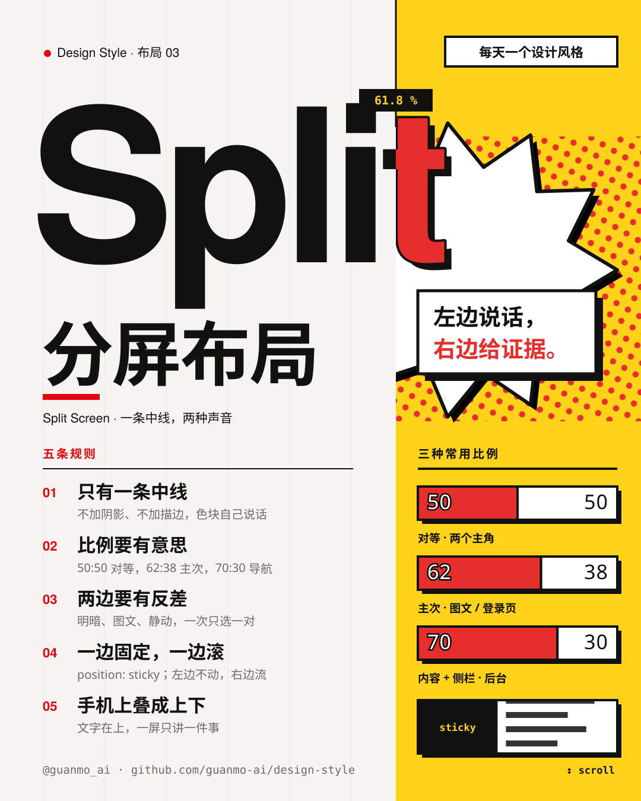
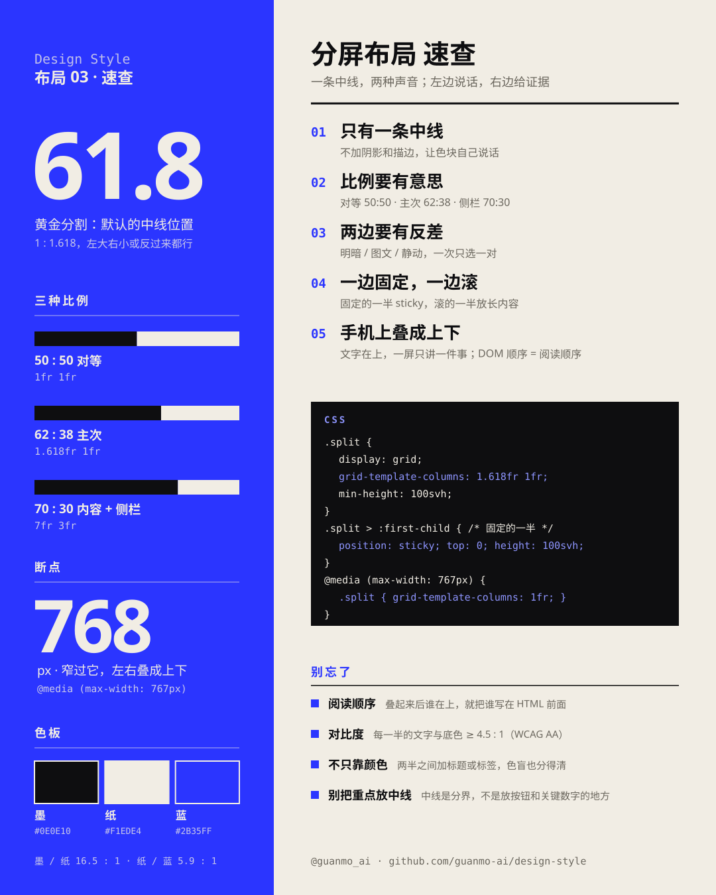
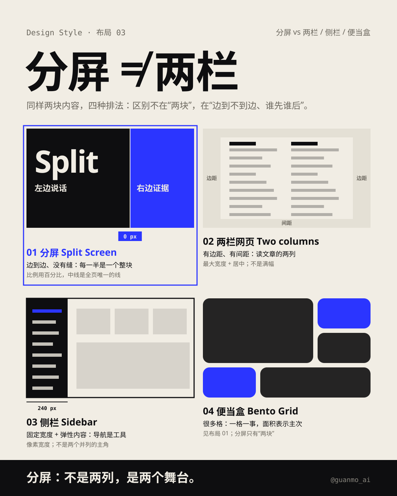
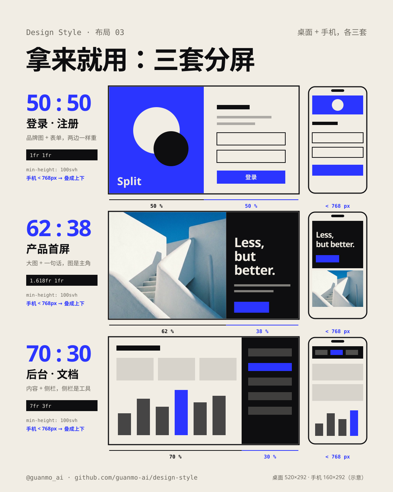

# 03 · Split Screen

[中文](README.md) · **English** · [Watch the film](https://github.com/guanmo-ai/design-style/releases/tag/layout-03) · [Making of](PROCESS.en.md)

> English quick guide to this episode. Videos and SVG artwork retain their original Chinese labels. The [detailed Chinese guide](README.md) includes the longer history, the CSS notes, and the frame-by-frame storyboard.

## Overview

One dividing line, two voices: the left half makes the statement, the right half gives the evidence. A 20-second film about the split-screen layout, from the 1927 triptych to responsive pages that rotate the divider from vertical to horizontal.

Series: **Layouts**. Period shown in this episode: **1927—**.

## Five practical rules

| Rule | How to apply it |
|---|---|
| **One dividing line** | Two full-bleed halves, no gap. The edge between the two colors is the divider — no shadows, no outlines, no rounded cards. |
| **Pick a meaningful ratio** | 50:50 for equal roles (sign-in, before/after), 62:38 for a main and a supporting role (hero, brand), 70:30 for content plus a sidebar (dashboards, docs). Avoid "almost even" splits like 49:51. |
| **Contrast between the halves** | Choose one pair: light/dark, image/text, or still/motion. Keep text-to-background contrast at 4.5:1 or higher on each half. |
| **One half pinned, one half scrolls** | `position: sticky; top: 0; height: 100svh; align-self: start` on the pinned half. In a Grid, skip `align-self: start` and sticky will not move. |
| **Stack on phones** | Below 768px switch to one column; write the more important half first in the HTML; one idea per screen. |

## Project palette and typography

This is the palette used by this project, not a universal specification for every split-screen layout.

- Colors: ink `#0E0E10`, paper `#F1EDE4`, cobalt `#2B35FF`, periwinkle `#8E95FF` (small labels on ink), greys `#6B675E` / `#8A877F` (secondary text). Ink on paper is 16.5:1; paper on cobalt is 5.9:1; ink on cobalt is only 2.8:1 — do not set body text that way.
- Typefaces: Archivo 900 (wdth 62–125), Noto Sans SC, Space Mono.
- Editable values: [JSON tokens](tokens.json), [CSS tokens](tokens.css), and [TypeScript tokens](tokens.ts).

## Visual references

The four editable diagrams explain the same rules from different angles. Their embedded labels are in Chinese.

### Split Screen at a glance



### Ratios, breakpoint, five rules, CSS, palette, and accessibility notes



### Split screen is not "two columns"



### Three ready-to-use templates, desktop and phone



## Starter CSS

```css
.split {
  display: grid;
  grid-template-columns: 1.618fr 1fr;      /* 62 : 38 */
  min-height: 100vh;
  min-height: 100svh;                      /* browsers without svh keep the line above */
}
.split > * { min-width: 0; }
.split__pinned { position: sticky; top: 0; height: 100svh; align-self: start; }
@media (max-width: 767px) {
  .split { grid-template-columns: 1fr; min-height: 0; }
  .split__pinned { position: static; height: auto; }
}
```

## Common pitfalls

- Split screen is not a two-column page: it is edge to edge with no gap, each half is one piece. It is not a sidebar either: the proportions are percentages (`fr`), not a fixed pixel width.
- `100vh` is too tall on phones because of the browser toolbar; use `100svh` with a `100vh` fallback. On short landscape phones, release the pin.
- Visual order must match reading order: do not use CSS `order` to move the second half in front of the first (WCAG 1.3.2, 2.4.3). Do not rely on color alone to tell the halves apart (WCAG 1.4.1). Stacking on narrow screens also satisfies WCAG 1.4.10 Reflow.

## AI image prompt

The original episode includes this English prompt:

```text
Split-screen layout poster: the canvas is cut by one vertical line at 61.8% into two full-bleed
halves with no gap — left half ink black #0E0E10, right half cobalt blue #2B35FF; a gigantic
heavy grotesque word "Split" crosses the line and flips color at the cut (paper white on black,
black on blue); flat color, no shadows, no outlines, no gradients; small monospace labels,
a ratio readout "61.8 %" on the line; Swiss poster, calm, confident --ar 4:5
```

## Note

Browser windows, phones, and apps in the film are redrawn illustrations, not screenshots; page copy is fictional. Photographs are AI-generated and shared with layout 02.
