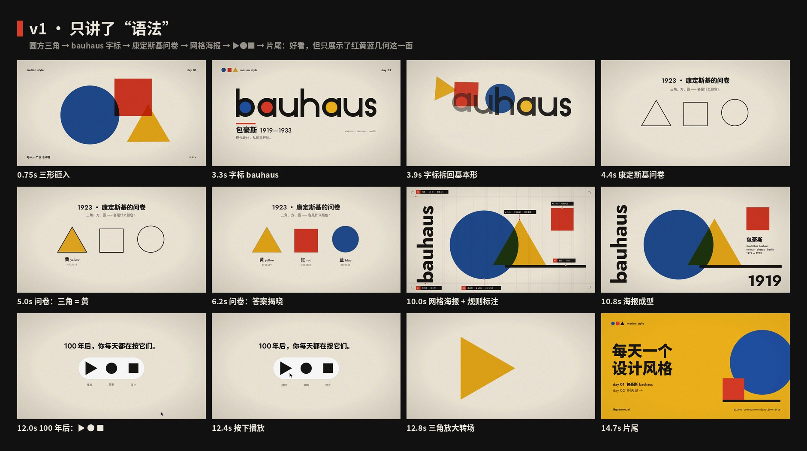
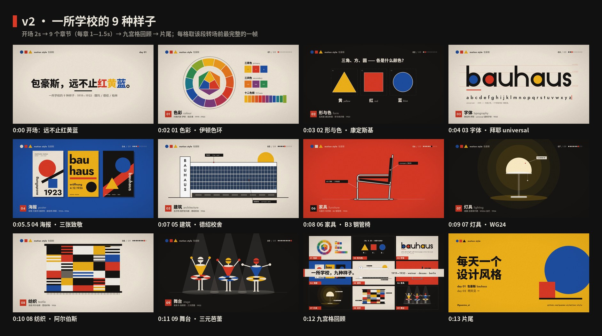

# Bauhaus · Making of

[中文](PROCESS.md) · **English** · [English guide](README.en.md)

> A concise English production overview. The [full Chinese production log](PROCESS.md) records the revisions, detailed feedback, and additional checks. The released film and process images retain their original labels.

## Design constraint

Build with circles, squares, triangles, and their slices. Start with two to four shapes. Align edges to a grid. Use strong black dividers when structure needs to be visible.

The film and four reference sheets share the values in `tokens.ts`, `tokens.css`, and `tokens.json`. Typography in this episode uses Jost, Noto Sans SC, JetBrains Mono.

## Production workflow

1. Read the [English guide](README.en.md) and choose one visual idea for each chapter.
2. Use `process/timeline.json` as the chapter timing reference. Its segments cover the entire composition.
3. Build the animation in `video/` with Remotion and React. Reuse the episode's shape and layout helpers.
4. Generate the soundtrack with `audio/make_music.py`; the project synthesizes its music and effects with Python and NumPy.
5. Build the four reference sheets from the editable files in `images/`. Preview SVGs embed font subsets so they can be viewed independently.
6. Inspect affected frames, a contact sheet, the timing chart, and the encoded video. Listening and visual review are separate from automated checks.

## Timing and output

| Property | Project value |
|---|---|
| Canvas | 1920 × 1080 |
| Frame rate | 60 fps |
| Composition duration | 15 seconds |
| Frames | 900 |
| Tempo | 120 BPM |

## Reproduce locally

From the repository root, after installing the dependencies and fonts described in the [English project README](../../README.en.md):

```bash
npm run studio
npm run render:001
npm run images:001
```

The render command first generates the music and then renders the composition. The downloadable release is a separate encoded artifact; check its actual media properties rather than assuming byte-for-byte equality with a local render.

## Process images





## Files and further reading

- [English design guide](README.en.md)
- [Full production log in Chinese](PROCESS.md)
- [Timing data](process/timeline.json)
- [Animation source](video)
- [Released video](https://github.com/guanmo-ai/design-style/releases/tag/day-01)

When sharing the film or artwork, credit **Guanmo / @guanmo_ai**.
