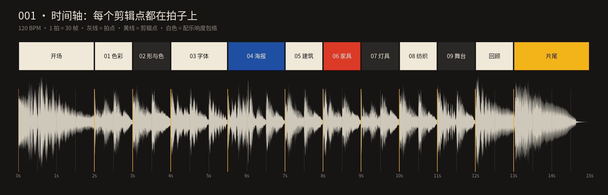
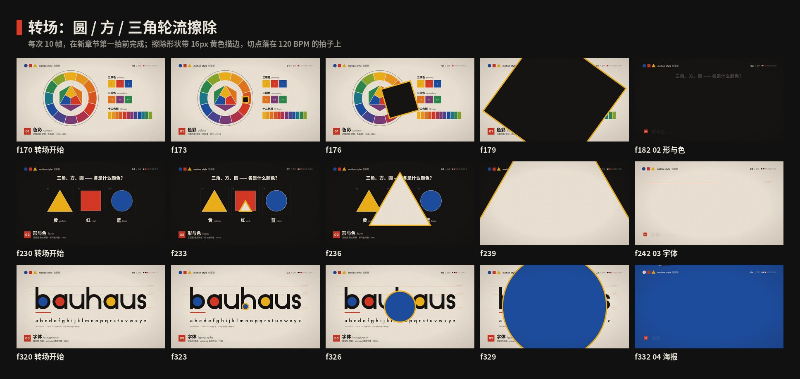

# 001 · 包豪斯 · 制作过程

**中文** · [English](PROCESS.en.md)

> 这一期是怎么从一个想法变成 15 秒短片和 4 张图的：怎么想的、怎么做的、哪里推翻重来、下次怎么做得更好。
> 过程图都在 [`process/`](process)，可以复现的代码在 `video/` `audio/` `images/` 和根目录的 `scripts/`。

🎬 [看成片（Releases · day-01）](https://github.com/guanmo-ai/design-style/releases/tag/day-01) · 📐 [风格指南](README.md)

---

> 2026-10-20：项目统一更名为 **Design Style**，当前成片、封面与风格图已同步更新；下文过程截图保留制作时的历史版本。

## 0 · 一览

| # | 步骤 | 产出 | 工具 / 文件 |
|:-:|---|---|---|
| 1 | 选题与定调 | 一句话定义 + 受众 | — |
| 2 | 研究 | 时间线、五条规则、9 个人物与作品、常见误区 | [`README.md`](README.md) §1—§7 |
| 3 | 设计令牌 | 5 色、3 款开源字体、线宽、节拍网格 | `tokens.ts / .css / .json` · `src/lib/anim.ts` |
| 4 | 风格图 ×4 | 海报 · 速查卡 · app 概念 · 图案生成器 | 手写 SVG · `pattern.py` · `scripts/build_images.py` |
| 5 | 视频 v1 | 6 段式短片：讲“包豪斯的语法” | `Remotion` · React |
| 6 | 反馈 | “视频没有把包豪斯的各种风格展示出来” | — |
| 7 | 视频 v2 | 9 个章节，讲“一所学校的 9 种样子” | `video/Bauhaus.tsx` · `video/chapters.tsx` |
| 8 | 配乐与音效 | 120 BPM，所有音效对齐关键帧，−14 LUFS | `audio/make_music.py`（numpy 合成） |
| 9 | 质检 | 关键帧截图、联系表、节拍时间轴 | `scripts/stills.mjs` · `contact_sheet.py` · `timeline_chart.py` |
| 10 | 发布 | 母版 + 分享版 MP4、封面、仓库 | ffmpeg · GitHub Releases |

---

## 1 · 选题与定调

**为什么第一期是包豪斯：** 它是现代设计的起点，后面要讲的瑞士风格、扁平化、极简 UI 都能追溯到这里；而“圆方三角 + 红黄蓝”又是最容易被普通人认出来的视觉语法，适合做系列的开篇。

**定调（写在动手之前）：**

- 一句话：*只用圆、方、三角和红黄蓝，把“好看”变成一套可以教、可以量产的规则。*
- 受众：设计师拿去就能用（色值、字体、版式参数、提示词），普通人看完就能认出来。
- 质感：未漂白纸 + 印刷黑 + 细颗粒，像 1920 年代的印刷品，而不是“扁平化矢量图”。

## 2 · 研究：先列清单，再动手

1. **时间线：** 1919 魏玛建校 → 1925 迁德绍 → 1932 迁柏林 → 1933 关闭。
2. **规则：** 从大量作品里归纳出 5 条可执行的规则（基本形 / 三原色 / 全小写 / 不对称平衡 / 网格粗线），每条都写“怎么做”和“小心”。
3. **人物与作品清单**（v2 的 9 个章节就是从这张表来的）：

   | 领域 | 人物 | 作品 / 课程 | 年份 |
   |---|---|---|---|
   | 色彩 | 约翰内斯·伊顿 | 色彩课、十二色相环 | 1919—1923 |
   | 形与色 | 瓦西里·康定斯基 | 形与色问卷 | 1923 |
   | 字体 | 赫伯特·拜耶 | universal 通用字体 | 1925 |
   | 海报 | 约斯特·施密特 · 赫伯特·拜耶 | 展览与开幕海报 | 1923—1926 |
   | 建筑 | 瓦尔特·格罗皮乌斯 | 德绍校舍 | 1926 |
   | 家具 | 马塞尔·布劳耶 | B3 钢管椅 | 1925 |
   | 灯具 | 威廉·瓦根菲尔德 | WG24 台灯 | 1924 |
   | 纺织 | 安妮·阿尔伯斯 | 壁挂织物 | 1926 |
   | 舞台 | 奥斯卡·施莱默 | 三元芭蕾 | 1922 |

4. **误区：** 例如名叫“ITC Bauhaus”的字体其实是 1975 年的商业字体，不出自包豪斯学校；包豪斯也远不止红黄蓝。

> **复盘：** v1 只用到了第 2 步（规则），没把第 3 步（广度）拍进视频——这正是后来被指出的问题。

## 3 · 设计系统先行

先把“这一期的世界观”写成令牌，视频、图片、网页共用一份，保证三处看起来是同一个风格。

| 令牌 | 值 | 说明 |
|---|---|---|
| paper | `#F0E9DA` | 未漂白纸，所有浅色底 |
| ink | `#161514` | 印刷黑，不用纯黑 |
| red | `#DB3A26` | 朱红 |
| yellow | `#F2B419` | 铬黄 |
| blue | `#1F4FA3` | 钴蓝 |
| 字体 | Jost / Noto Sans SC / JetBrains Mono | 全部 SIL OFL，可免费商用；Jost 是 Futura 的开源替代 |
| 节拍 | 60 fps · 120 BPM → 1 拍 = 30 帧 | 写在 `src/lib/anim.ts`，所有动画和剪辑点都以拍为单位 |
| 缓动 | `out / inOut / in / soft` 四条贝塞尔曲线 | 同一期只用这四条，动作才“像一家人” |
| 颗粒 | `Grain.tsx` | 浏览器里用确定性随机数生成噪点，不依赖任何图片素材 |

## 4 · 风格图（4 张）

| 图 | 目的 |
|---|---|
| 海报 | 一张图说明风格：基本形、三原色、不对称、粗线全部用上 |
| 速查卡 | 设计师能直接抄的色值、字体、规则、误区 |
| 如果包豪斯来做 app | 把 100 年前的语法放到今天的界面里 |
| 图案生成器 | `pattern.py`：7 种基本形 × 5 色 × 固定随机种子，改 seed 就是一张新图 |

**管线：** 手写 SVG → `scripts/build_images.py` 把用到的字形子集化、以 base64 WOFF 内嵌进 `preview/*.svg`（GitHub 预览 SVG 时不能加载外部字体，内嵌后打开就是最终效果）→ `scripts/svg_to_png.mjs` 用 Chromium 渲染 2x PNG（2160×2700）用于发帖。每张图都在 2x 下放大检查文字溢出、对齐和留白。

## 5 · 视频 v1：只讲了“语法”


6 段：三形砸入 → 用基本形拼出 bauhaus 字标 → 康定斯基问卷 → 在网格上搭一张海报并标注规则 → “100 年后，你每天都在按它们”（▶ ● ■）→ 片尾。

- **做对的：** 节拍对齐、纸张质感、动作干净。
- **问题：** 整支片子都在讲“红黄蓝 + 圆方三角”，观众看完得到的仍是刻板印象，看不到包豪斯真正的广度。

## 6 · 反馈 → 诊断 → 重做

> “图片可能是可以的，但是你的视频没有把包豪斯的各种风格展示出来。”

**诊断：** v1 讲的是“包豪斯怎么画”（规则），没讲“包豪斯做过什么”（广度）。包豪斯是一所什么都教的学校：色彩、字体、海报、建筑、家具、灯具、纺织、舞台……这些才是它“各种风格”的样子。

**v2 的规则（之后每期沿用）：**

1. **一章一个主角：** 每章只有 1—1.5 秒，所以只放一个主角物件 + 一个动作 + 一行标签，1 秒内要能看懂。
2. **统一外框：** 左上台标、右上 `0N / 09` 进度、左下“章节名 + 作者 · 作品 · 年份”。快切时观众始终知道自己在哪。
3. **背景色轮换：** 纸 / 黑 / 蓝 / 红交替，每一次切换都有明确的“翻页感”。
4. **转场就是风格：** 用圆 / 方 / 三角本身做擦除转场，轮流出现。
5. **结尾回顾：** 9 个章节缩成九宫格，同时也是视频封面。
6. **致敬而非复刻：** 海报、椅子、台灯、织物、舞者都用基本形重新画，不贴原作照片——风格统一，也避开版权问题。

## 7 · 分镜与节拍


先写时间轴（[`process/timeline.json`](process/timeline.json)），再写代码。字体、海报两章信息量大，各给 3 拍（90 帧），其余 2 拍（60 帧）；开场 4 拍，回顾 2 拍，片尾 4 拍。逐帧分镜表见 [风格指南 §9](README.md#9--15-秒分镜)。



上图由 `scripts/timeline_chart.py` 直接读取最终配乐生成：黄线（剪辑点）全部落在灰线（拍点）上，配乐的鼓点和每次转场的“咚”一一对应。

## 8 · 每一章怎么做

| 章 | 主角 | 动作 | 实现要点（`video/chapters.tsx`） |
|---|---|---|---|
| 01 色彩 | 伊顿十二色相环 | 外环旋转入场，中心是三原色拼成的色星和三间色 | 12 个色相写成数组 `HUES`，色环与右侧图例共用同一份颜色 |
| 02 形与色 | 三角 / 方 / 圆 | 先描边，再按问卷答案依次填色 | `pathLength=1` + `strokeDashoffset` 画线；三次揭晓各配一声木琴 |
| 03 字体 | 用圆和竖条搭出的 bauhaus | 参考线出现 → 字母拼装 → a—z 打字 | x 高 240、笔画 46，全部由几何参数算出；字母表用 `textLength` 撑到与字标同宽 |
| 04 海报 | 三张致敬海报 | 依次落下、回正，元素弹入 | 一个 `Poster` 组件 + 三份内容；落下时间错开 10 帧，对应三声低音 |
| 05 建筑 | 德绍校舍立面 | 线条画出体块，玻璃幕墙网格铺开 | 标注“平屋顶 · 玻璃幕墙”，教学楼竖排 BAUHAUS 字样 |
| 06 家具 | B3 钢管椅侧视图 | 钢管逐段画出，再绷上铁纱布带 | 4 段钢管写成 SVG 路径 `TUBES`，三层描边（黑 / 金属灰 / 高光）模拟镀铬钢管 |
| 07 灯具 | WG24 台灯 | 拉线 → 灯亮（第 32 帧）→ 光晕扩散 | `LAMP_ON = 32`；灯罩颜色从灰插值到暖白，叠一层闪光 |
| 08 纺织 | 阿尔伯斯壁挂 | 经线先拉好，纬线自下而上一行行织出 | 31 行 × 色带图案 `WEAVE`；每行一声短促的“梭子”音 |
| 09 舞台 | 三元芭蕾的三个舞者 | 聚光灯依次亮起，三人踩着拍子跳动、摆臂，圆盘裙旋转 | 舞者由圆、三角、圆盘裙组成，三人用三原色区分；跳动周期 = 1 拍（30 帧） |

共用的小部件（标注卡片、排版、几何工具）在 `video/ui.tsx`；开场、外框、转场、回顾、片尾在 `video/Bauhaus.tsx`。

**转场拆解：**



每次 10 帧（`WIPE = 10`），在新章节的第一拍之前完成。擦除形状带 16px 黄色描边——相邻两章背景同色时（例如开场 → 01 色彩都是纸色），没有描边就看不出发生了转场。

## 9 · 声音

`audio/make_music.py` 用 numpy 从零合成，没有任何外部音源：

- **编排：** 120 BPM，A 小调 → C 大调收尾。第 2 拍进铺底和弦，第 4 拍（= 第 120 帧，第一章开始）鼓、贝斯、拨弦一起进；回顾段切半速，片尾前用上升音效铺垫。
- **音效：** 每个剪辑点一声“嗖 + 咚”；每章有自己的声音（色环的五声音阶木琴、问卷三次揭晓、打字声、海报三声落地、织布梭子声……），时间点直接写帧号，和画面共用同一套数字。
- **响度：** ffmpeg `loudnorm` 标准化到 −14 LUFS（社交平台常用标准）。
- **局限：** 配乐只做了响度和时间对齐检查，没有人耳试听——发布前由观默试听把关。

## 10 · 质检

1. **关键帧截图：** `npx remotion bundle` 打包一次，然后 `node scripts/stills.mjs out/bundle out/check 164 224 …` 批量导出，每次改完只看受影响的帧，不必整片重渲。
2. **联系表：** `python3 scripts/contact_sheet.py` 把一组帧拼成一张图，一眼看完整片的节奏和颜色轮换（本页的 01—03 图就是这样来的）。
3. **时间轴：** `python3 scripts/timeline_chart.py` 检查剪辑点与拍点、音效是否对齐。
4. **成片检查：** `ffprobe` 核对 1920×1080 · 60fps · 15.06s · H.264 + AAC，再从成片里抽 13 帧复查（防止渲染和预览不一致）。

## 11 · 渲染与发布

```bash
npm run music:001                                   # 生成配乐 → public/001-bauhaus/music.wav
npx remotion render src/index.ts S001-Bauhaus out/001-bauhaus.mp4 --crf=16       # 母版
ffmpeg -i out/001-bauhaus.mp4 -c:v libx264 -preset slow -crf 21 -profile:v high \
  -pix_fmt yuv420p -c:a aac -b:a 192k -movflags +faststart out/001-bauhaus-share.mp4  # 分享版
```

- 母版约 116MB，分享版约 36MB（X 上传友好）。
- 视频不进 git 仓库，放在 [Releases · day-01](https://github.com/guanmo-ai/design-style/releases/tag/day-01)：每天一支视频，进仓库一年后会超过 GitHub 的容量上限。
- 封面：回顾段第 12.75 秒的九宫格帧 → `video/cover.jpg`。

## 12 · 踩坑记录

| 问题 | 解决 |
|---|---|
| Remotion 的打包器会调用 TypeScript 的 JS API，而新版原生 TypeScript 不再提供 | `remotion.config.ts` 里直接给 esbuild 传 `tsconfigRaw`，绕开这次调用 |
| GitHub 预览 SVG 时不加载外部字体，中文会掉成系统字 | 构建时子集化字体并以 base64 WOFF 内嵌，见 `scripts/build_images.py` |
| 同色背景之间的擦除转场看不出来 | 擦除形状加 16px 黄色描边 |
| 第一次推送 GitHub 被拒（403，令牌没有写权限） | 改用 GitHub CLI 设备码登录后推送 |

## 13 · 下期沿用的清单

- [ ] 研究阶段先列 **广度清单**：这个风格出现在哪些领域、媒介、人物身上（至少 6—9 个）
- [ ] 先写 `timeline.json`，再写分镜，最后写代码
- [ ] 每章一个主角 + 一个动作 + 一行标签
- [ ] 统一外框；转场用这个风格自己的元素
- [ ] 联系表 + 时间轴做质检；`PROCESS.md` 边做边写，别做完再补
