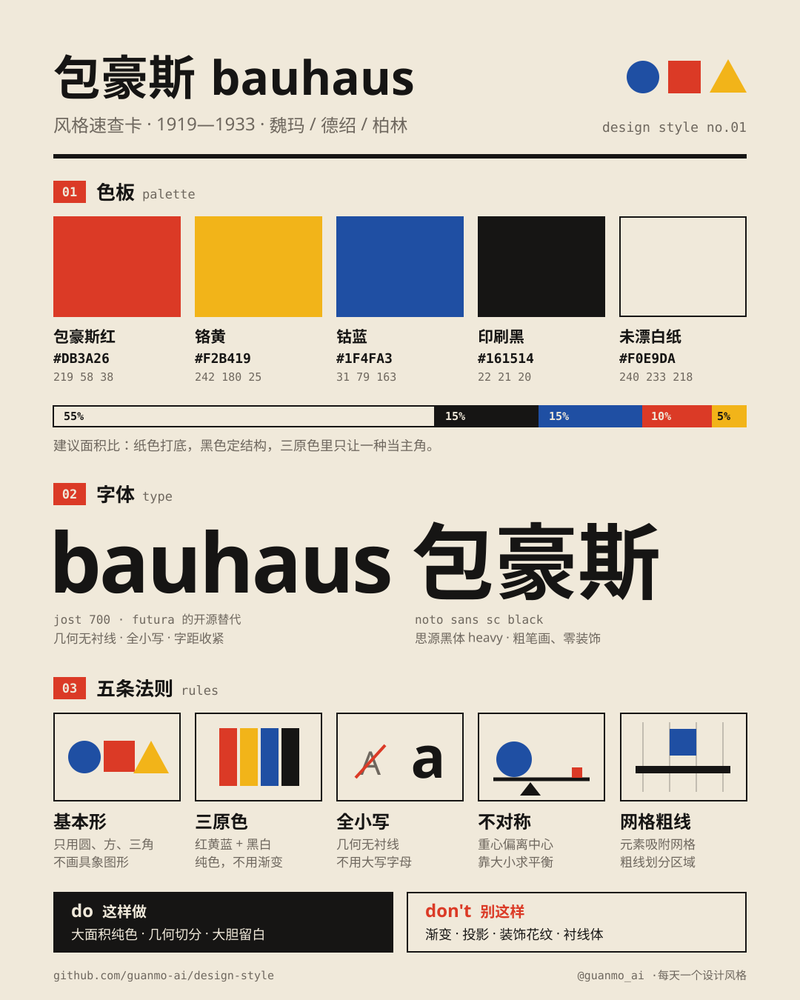
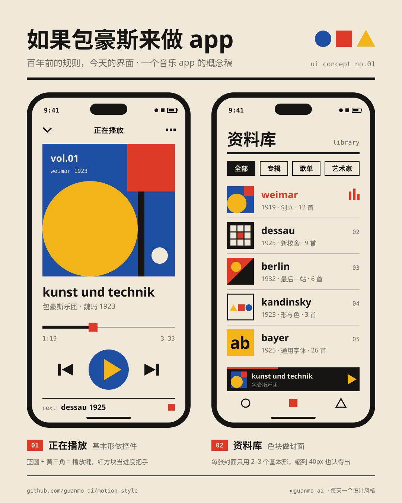
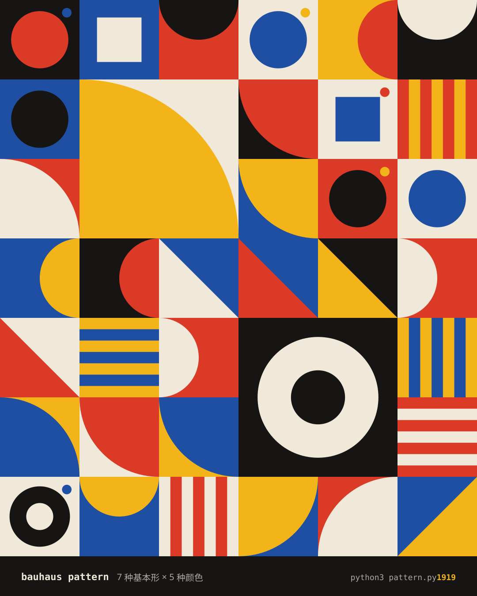

# 001 · 包豪斯 Bauhaus（1919—1933）

> **一句话：** 只用圆、方、三角和红黄蓝，把“好看”变成一套可以教、可以量产的规则。

| 海报 | 速查卡 |
|:-:|:-:|
|  |  |
| **如果包豪斯来做 app** | **图案生成器（seed 1919）** |
|  |  |

---

## 1 · 它从哪来

| 年份 | 事件 |
|---|---|
| **1919** | 建筑师瓦尔特·格罗皮乌斯（Walter Gropius）在魏玛创办“国立包豪斯”，把美术学院和工艺学校合并成一所学校 |
| **1923** | 第一次大展，格罗皮乌斯提出口号 *“kunst und technik — eine neue einheit”*（艺术与技术：新的统一）；同年康定斯基在校内发出那份著名的“形与色”问卷 |
| **1925** | 迁往德绍；赫伯特·拜耶（Herbert Bayer）设计“通用字体”（universal），并推动全小写书写 |
| **1926** | 格罗皮乌斯设计的德绍新校舍落成，玻璃幕墙成为现代建筑的标志 |
| **1928—1930** | 汉内斯·迈耶、密斯·凡·德·罗先后接任校长 |
| **1932** | 被迫迁往柏林 |
| **1933** | 在纳粹的压力下关闭。只存在了 14 年 |
| **之后** | 师生流亡各地：格罗皮乌斯去了哈佛，密斯去了芝加哥，莫霍利-纳吉 1937 年在芝加哥创办“新包豪斯”。1996 年，魏玛和德绍的包豪斯建筑列入世界遗产 |

**为什么重要：** 包豪斯第一次把设计当成可以系统教学的学科——先学基本形、颜色和材料，再做产品。今天的设计课、网格系统、扁平图标，都能在这里找到源头。

## 2 · 五条规则

| # | 规则 | 怎么做 | 小心 |
|:-:|---|---|---|
| 01 | **基本形** | 画面只用圆、方、三角（及其切片：半圆、四分之一圆、对角三角）。一张图 2–4 个形就够 | 不画具象图形；形状不加描边以外的修饰 |
| 02 | **三原色** | 红黄蓝 + 黑白。纯色平涂，叠在一起用“正片叠底”产生第三色 | 不用渐变；三原色里只让一种当主角 |
| 03 | **全小写** | 几何无衬线，字距收紧（-2% ~ -3%）。拉丁字母全部小写，中文用最粗的黑体 | 别用衬线体，别用大写字母 |
| 04 | **不对称平衡** | 重心偏离中心，靠“大小、颜色、留白”找平衡：大块靠近支点，小块放远处 | 别居中对称排版——那是古典，不是包豪斯 |
| 05 | **网格粗线** | 元素吸附网格，用粗黑线划分区域、托住形状。外边距保持一致 | 线条要么很粗、要么不出现，别用细装饰线 |

## 3 · 色板

| 名称 | HEX | RGB | 建议面积 | 用途 |
|---|---|---|:-:|---|
| 未漂白纸 | `#F0E9DA` | 240 233 218 | 55% | 底色。比纯白更像印刷品 |
| 印刷黑 | `#161514` | 22 21 20 | 15% | 文字、粗线、结构 |
| 钴蓝 | `#1F4FA3` | 31 79 163 | 15% | 圆；大面积主色 |
| 包豪斯红 | `#DB3A26` | 219 58 38 | 10% | 方；强调、标签 |
| 铬黄 | `#F2B419` | 242 180 25 | 5% | 三角；最亮，用得最少 |
| 辅助灰 | `#6E675E` | 110 103 94 | — | 次要文字（非经典色，为屏幕阅读添加） |

> 康定斯基 1923 年问卷的“标准答案”：**黄 = 三角，红 = 方，蓝 = 圆**。这一期所有作品都遵守这个对应关系。

## 4 · 字体

| 用途 | 本项目 | 商用原版 / 其他选择 |
|---|---|---|
| 拉丁标题 | **Jost** 700（免费，OFL） | Futura（1927，保罗·伦纳）· Century Gothic · Avenir |
| 中文 | **思源黑体 Heavy / Noto Sans SC Black**（免费，OFL） | 阿里巴巴普惠体 Heavy · HarmonyOS Sans Black |
| 标注 | **JetBrains Mono** 500（免费，OFL） | 任意等宽字体 |

**误区：** 名叫“ITC Bauhaus”的字体是 1975 年才设计的商业字体，并不出自包豪斯学校；它参考的是拜耶的 universal。想要“正宗”的感觉，用 Futura / Jost 这类几何无衬线更准确。

## 5 · 版式参数（1080×1350 竖图）

- 外边距 **72px**（≈ 6.7%），所有文字左对齐到同一条线
- 主粗线 **22px**，分隔线 **6px**
- 超大字：英文 `bauhaus` 257px，字距 -6；中文标题 104px Black
- 竖排小字放在页边，作为“第二层信息”
- 视频里：12 栏网格、槽宽 24，基本形吸附在网格交点

## 6 · 这样做 / 别这样

**✅ 这样做：** 大面积纯色 · 几何切分 · 大胆留白 · 文字也当成图形 · 形状互相相切、压线
**❌ 别这样：** 渐变 · 投影 · 圆角卡片 · 装饰花纹 · 衬线体 · 所有东西都居中

## 7 · 其他误区

- **“形式追随功能”不是包豪斯的口号。** 它出自美国建筑师路易斯·沙利文 1896 年的文章；包豪斯 1923 年的口号是“艺术与技术：新的统一”。
- **包豪斯不只有红黄蓝。** 学校的作品很多元（纺织、陶瓷、金属、摄影……）。红黄蓝 + 几何形是最具代表性、也最容易学的那一支。

## 8 · AI 提示词（直接复制）

**图片（Midjourney / 即梦 / ChatGPT 图像）**

```
Bauhaus poster, 1923 style, flat primary colors red #DB3A26 yellow #F2B419 blue #1F4FA3 and black on unbleached paper #F0E9DA,
only circles squares and triangles, asymmetric balance, thick black rules, bold geometric sans-serif lowercase typography,
grid-based layout, generous negative space, subtle print grain, no gradients, no shadows, no photorealism --ar 4:5
```

**视频（Runway / 可灵 / Sora）**

```
Motion graphics in Bauhaus style: a blue circle, a red square and a yellow triangle drop onto cream paper on the beat,
overlap with multiply blending, then assemble into a geometric poster on a visible grid. Flat colors, crisp edges,
snappy spring easing, subtle film grain, 120 bpm rhythm, no 3D, no gradients.
```

**代码（让 AI 写网页 / 组件）**

```
用包豪斯风格做这个界面：背景 #F0E9DA，文字 #161514，强调色只用 #DB3A26 / #F2B419 / #1F4FA3。
字体 Jost（英文全小写，字重 700，字距 -0.025em）+ Noto Sans SC Black。
所有容器直角（border-radius: 0），只有圆形按钮是圆的；用 6px 黑色粗线分隔区域；
不对称布局，不用渐变和阴影。设计令牌见 tokens.css。
```

## 9 · 15 秒分镜

包豪斯远不止红黄蓝——它是一所什么都教的学校。短片用 9 个章节、每章 1—1.5 秒，把它的 9 个侧面依次拍出来；圆 / 方 / 三角三种形状轮流做转场（黄色描边），所有剪辑点都落在 120 BPM 的拍子上。


| 时间 | 帧 | 章节 | 画面 | 致敬 |
|---|---|---|---|---|
| 0:00—2.0 | 0—120 | 开场 | 蓝圆、红方、黄三角砸进画面 → 飞到左上角成为台标 →「包豪斯，远不止红黄蓝。」 | — |
| 2.0—3.0 | 120—180 | 01 色彩 | 十二色相环：三原色 → 三间色 → 十二色相依次弹出 | 约翰内斯·伊顿 · 色彩课 |
| 3.0—4.0 | 180—240 | 02 形与色 | 问卷：三角、方、圆各是什么颜色？依次填上黄、红、蓝 | 瓦西里·康定斯基 · 1923 |
| 4.0—5.5 | 240—330 | 03 字体 | 在 ascender / x-height / baseline 构造线上，用圆和竖条搭出小写 bauhaus，再打出 a—z | 赫伯特·拜耶 · universal · 1925 |
| 5.5—7.0 | 330—420 | 04 海报 | 三张海报依次落下：展览 1923 / 德绍开幕 1926 / 讲座与舞蹈 | 约斯特·施密特 · 赫伯特·拜耶 |
| 7.0—8.0 | 420—480 | 05 建筑 | 德绍校舍立面：楼梯塔竖排 BAUHAUS、玻璃幕墙网格、平屋顶 | 瓦尔特·格罗皮乌斯 · 1926 |
| 8.0—9.0 | 480—540 | 06 家具 | 钢管一笔弯出 B3 椅的侧影，铁纱布一条条绷上 | 马塞尔·布劳耶 · 1925 |
| 9.0—10.0 | 540—600 | 07 灯具 | 乳白玻璃灯罩落下，拉绳“咔哒”，灯亮 | 威廉·瓦根菲尔德 · WG24 · 1924 |
| 10.0—11.0 | 600—660 | 08 纺织 | 梭子来回穿行，一行行织出色块与条纹 | 安妮·阿尔伯斯 · 1926 |
| 11.0—12.0 | 660—720 | 09 舞台 | 三盏追光依次打开，几何舞者踩着拍子起跳 | 奥斯卡·施莱默 · 三元芭蕾 · 1922 |
| 12.0—13.0 | 720—780 | 回顾 | 舞台缩进九宫格，九章同屏 ——「一所学校，九种样子。」 | — |
| 13.0—15.0 | 780—900 | 片尾 | 黄色片尾：每天一个设计风格 · day 02 明天见 → | — |

> 画面中的海报、椅子、台灯、织物、舞者均为几何化的“致敬”重绘，不是原作复刻。

## 10 · 文件

```
001-bauhaus/
├─ tokens.ts / tokens.css / tokens.json   # 同一份设计令牌
├─ video/Bauhaus.tsx                      # 短片主合成：开场 / 转场 / 回顾 / 片尾（Remotion，React）
├─ video/chapters.tsx                     # 九个章节场景
├─ video/ui.tsx                           # 共用小部件：排版、标注、几何工具
├─ audio/make_music.py                    # 配乐：numpy 合成，A 小调 → C 大调，-14 LUFS
└─ images/
   ├─ poster.svg      # 海报
   ├─ cheatsheet.svg  # 速查卡
   ├─ app-ui.svg      # 如果包豪斯来做 app
   ├─ pattern.py      # 图案生成器 → pattern.svg（python3 pattern.py 1933 换一张）
   └─ preview/        # 内嵌字体的自包含 SVG
```

**延伸阅读：** Magdalena Droste《Bauhaus 1919—1933》（Taschen）· 柏林包豪斯档案馆 Bauhaus-Archiv · 德绍包豪斯基金会 Stiftung Bauhaus Dessau
