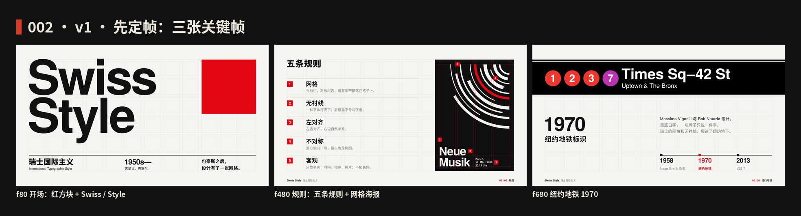
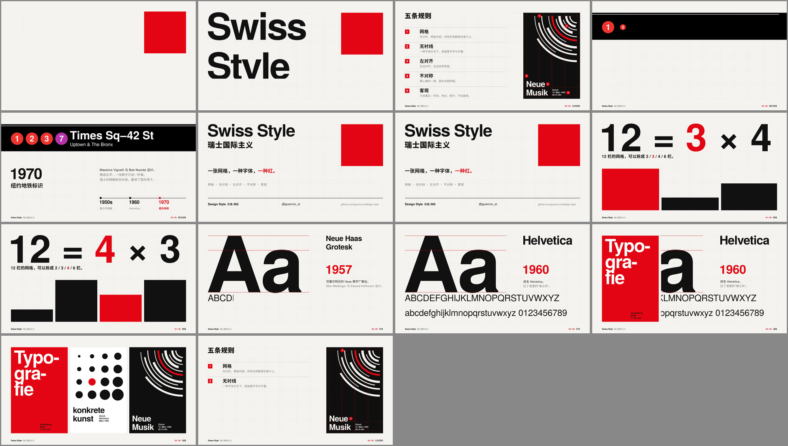
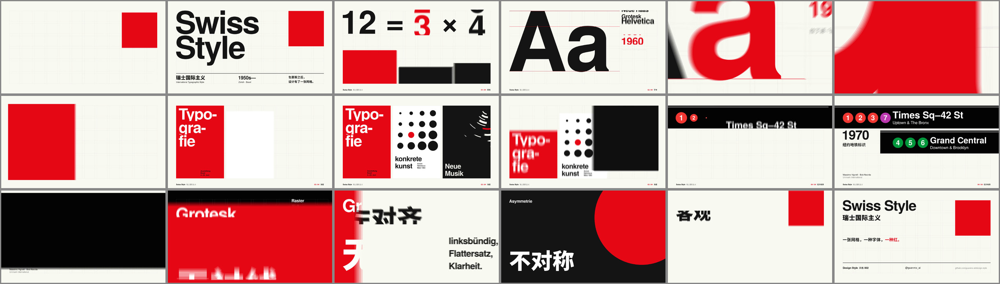
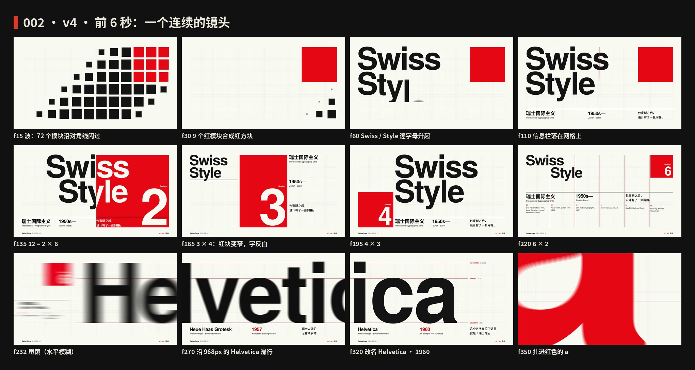
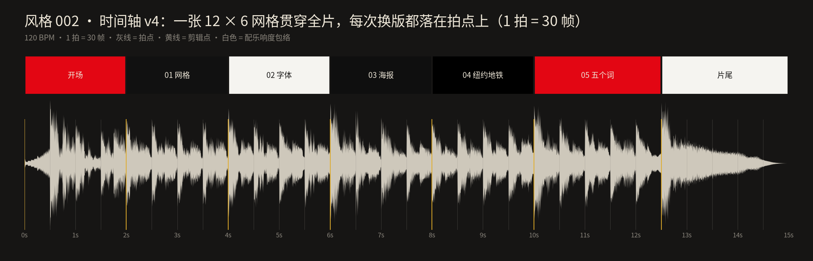

# 002 · 瑞士国际主义 · 制作过程

**中文** · [English](PROCESS.en.md)

> 这一期是怎么从一个想法变成 15 秒短片和 4 张图的：怎么想的、怎么做的、哪里推翻重来、下次怎么做得更好。
> 过程图都在 [`process/`](process)，可以复现的代码在 `video/` `audio/` `images/` 和根目录的 `scripts/`。

🎬 [看成片（Releases · day-02）](https://github.com/guanmo-ai/design-style/releases/tag/day-02) · 📐 [风格指南](README.md)

---

## 0 · 一览

| # | 步骤 | 产出 | 工具 / 文件 |
|:-:|---|---|---|
| 1 | 选题与定调 | 一句话定义 + 受众 | — |
| 2 | 研究 | 时间线、五条规则、广度清单、误区 | [`README.md`](README.md) §1—§7 |
| 3 | 设计令牌 | 4 色、1 款拉丁字体 + 1 款中文、两张网格、节拍 | `tokens.ts / .css / .json` · `src/lib/anim.ts` |
| 4 | 风格图 ×4 | 海报 · 速查卡 · app 概念 · 一张网格四种排法 | `images/make_svgs.py` · `scripts/build_images.py` |
| 5 | 视频 v1 | 三张定帧，先定画面再做动画 | Remotion · React |
| 6 | 视频 v2 | 讲课版：6 段，每段讲一条知识 | `video/scenes.tsx` |
| 7 | 视频 v3 | 炫技版：红色接力、运动模糊、一整首配乐 | `@remotion/motion-blur` |
| 8 | 视频 v4 | 重做前 6 秒：一个连续的镜头 | `video/opening.tsx` |
| 9 | 配乐与音效 | 120 BPM，一首不断档的小曲，−14 LUFS | `audio/make_music.py`（numpy 合成） |
| 10 | 质检 | 关键帧、局部放大、联系表、节拍时间轴 | `scripts/stills.mjs` · `contact_sheet.py` · `timeline_chart.py` |
| 11 | 发布 | 母版 + 分享版 MP4、封面、仓库 | ffmpeg · GitHub Releases |

---

## 1 · 选题与定调

**为什么第二期是瑞士风格：** 第一期包豪斯讲的是“现代设计从哪来”，瑞士风格就是它最直接的下一站——比尔、奇肖尔德都和包豪斯有关。而且今天几乎所有的网页栅格、App 界面、机场地铁导视，都在用这一套方法，观众每天都见过，只是叫不出名字。

**定调（写在动手之前）：**

- 一句话：*一张网格、一种无衬线、一种红——把版面变成一道可以计算的题。*
- 受众：设计师拿去就能用（网格参数、色值、字体、提示词），普通人看完能认出“原来这就是瑞士风格”。
- 质感：干净的纸白 + 黑 + 唯一的红。不要颗粒、不要阴影，“好看”只来自秩序和比例。
- 和第一期接上：包豪斯的红方块是这一期开场的主角，它落进网格的右上角，从“形”变成“版面”。

## 2 · 研究：先列清单，再动手

1. **时间线：** 1918 凯勒在苏黎世任教 → 1928 奇肖尔德《新文字设计》→ 1947 巴塞尔学派 → 1950s 苏黎世音乐厅海报 → 1957 Neue Haas Grotesk → 1958—65《新平面设计》→ 1960 改名 Helvetica → 1970 纽约地铁标准手册（详见 [风格指南 §1](README.md#1--它从哪来)）。
2. **规则：** 归纳成 5 条可执行的规则：网格 / 无衬线 / 左对齐 / 不对称 / 客观，每条写“怎么做”和“小心”。
3. **广度清单**（视频章节和风格图都从这张表来）：

   | 领域 | 人物 | 作品 | 年份 | 用在哪 |
   |---|---|---|---|---|
   | 网格 | 约瑟夫·米勒-布罗克曼 | 《平面设计中的网格系统》 | 1981 | 01 网格 · 网格图 |
   | 字体 | 马克斯·米丁格 · 爱德华·霍夫曼 | Neue Haas Grotesk → Helvetica | 1957 / 1960 | 02 字体 |
   | 字体排印 | 埃米尔·鲁德 | 《字体排印》、断字海报 | 1967 | 03 海报 ① |
   | 具体艺术 | 马克斯·比尔 | konkrete kunst 展览海报 | 1944—1960 | 03 海报 ② |
   | 音乐会海报 | 米勒-布罗克曼 | 苏黎世音乐厅系列 | 1950s | 03 海报 ③ · 风格图海报 |
   | 杂志 | 米勒-布罗克曼等四人 | 《新平面设计》*Neue Grafik* | 1958—1965 | 风格指南 §1 |
   | 导视 | 马西莫·维涅利 · 鲍勃·诺尔达 | 纽约地铁标识系统 | 1970 | 04 纽约地铁 · app 图 |
   | 今天 | — | 网页栅格、App 界面、铁路导视 | — | app 概念图 |

4. **误区：** 瑞士风格 ≠ Helvetica（1950 年代的海报大多用 Akzidenz-Grotesk）；1970 年的纽约地铁手册规定的是 Standard Medium，统一成 Helvetica 是 1989 年；网格不等于死板。所以视频里一句都没写“纽约地铁用了 Helvetica”。

## 3 · 设计系统先行

先把“这一期的世界观”写成令牌，视频、图片、网页共用一份。这一期最重要的令牌不是颜色，而是**网格**。

| 令牌 | 值 | 说明 |
|---|---|---|
| paper | `#F5F4F0` | 纸白，比纯白略暖 |
| ink | `#111111` | 黑 |
| red | `#E30613` | 瑞士红：全片唯一的彩色，每个画面只给一样东西 |
| grey | `#7A7A78` | 次要文字 |
| 字体 | TeX Gyre Heros 400 / 700 · Noto Sans SC | Heros 是 Helvetica 最接近的开源替身（GUST Font License）；中文 OFL |
| 视频网格 | 12 栏 × 6 行，模块 122（正方形），间距 24，边距 96 / 114 | `video/ui.tsx` 的 `cx / cw / ry / rh` 把“第几栏、占几栏”换算成像素 |
| 图片网格 | 6 栏 × 8 行，模块 135，间距 18，边距 90 / 72，基线 9 | 模块 + 间距 = 153 = 17 条基线 |
| 文字定位 | 按基线，不按行框 | `<T y={基线}>` 用 hhea 度量换算；大字减去左侧字距（lsb），让笔画本身贴住栏线 |
| 节拍 | 60 fps · 120 BPM → 1 拍 = 30 帧 | 所有剪辑点、每次重排都在拍点上 |
| 形状 | 圆角 0，粗线 3，细线 1，大字字距 −3% | 只有直角 |

## 4 · 风格图（4 张）

| 图 | 目的 |
|---|---|
| 海报 | 一张图说明风格：339px 的 Swiss 正好撑满 6 栏，红方块 4 × 4 模块；字压到红上的部分反白 |
| 速查卡 | 网格参数、色板与面积比、字体度量、五条规则、这样做 / 别这样 |
| 如果瑞士风格来做 app | 苏黎世火车站的发车表和一张车票：网格、无衬线和唯一的红（站台号）照样成立 |
| 一张网格，四种排法 | 同一张 6 栏网格分成 1 × 6、2 × 3、3 × 2、6 × 1，排出四张完全不同的版面——回应“网格很死板” |

**管线：** `images/make_svgs.py` 生成四张 SVG。所有坐标从网格算出来，字宽用 fontTools 读取真实字体的度量（字宽、lsb）计算，所以“正好撑满 6 栏”是算出来的，不是目测的 → `scripts/build_images.py` 子集化字体、以 base64 WOFF 内嵌进 `preview/*.svg`（GitHub 预览时不加载外部字体）→ Chromium 渲染 2x PNG（2160×2700）用于发帖。每张图都按 2x 放大检查溢出、对齐和留白。

## 5 · 改版记录

| 版本 | 反馈 | 诊断 | 改了什么 |
|---|---|---|---|
| v1 → v2 | 三张定帧通过 | — | 把定帧连成 15 秒，6 段，每段讲一条知识 |
| v2 → v3 | “不明白这里为啥有一大堆字母……把它当做一个非常顶级的宣传片……BGM 好像不连贯……整个视频要丝滑一点……就是整体炫技” | v2 是一堂课：字母表、规则清单都是“讲解”，不是“表演”；每段各配各的音乐，段与段之间是硬切 | 删掉字母表和规则清单；红色接力把六段串成一条线；整片运动模糊；配乐重写成一整首 |
| v3 → v4 | “前 5 秒感觉做的一般……做到顶尖，全球最顶尖的……我们是顶尖艺术家，水平不能降下来” | 前 5 秒仍是三页“幻灯片”：方块落下 → 标题出现 → 数字换一换；镜头不动，动作只有出现和消失，没有一个让人“哇”的瞬间 | 前 6 秒重做成一个连续镜头：模块波 → 逐字母标题 → 网格机器 → 甩镜 → 沿着 Helvetica 滑行 → 扎进 a |

## 6 · 视频 v1：先定帧



先不做动画，只做三张最能代表全片的画面，确认网格、字号、颜色和信息层级：

- **f80 开场：** 红方块落进右上 3 × 3 模块；Swiss / Style 每个词的大写高度正好 2 个模块 + 1 个间距；底栏三组信息。
- **f480 规则：** 五条规则 + 一张按 4 栏网格搭出来的音乐会海报，红色结构线把网格露出来。
- **f680 纽约地铁：** 1970 年的黑色标识带：线路圆标 + 站名 + 方向。

> **复盘：** 定帧让“网格对不对、字号对不对”在动画之前就定下来，后面四版都没再改过网格。

## 7 · 视频 v2：讲课版



6 段：红方块落下、网格画出、标题两下重击 → 01 网格：“12 = a × b”一拍一换 → 02 字体：巨大的 Aa + 度量线 + 改名 + 字母表 → 03 三张海报 → 04 五条规则 → 05 纽约地铁 → 片尾。

- **做对的：** 每段都对得上网格，信息准确。
- **问题：** 它是一堂课。字母表、规则清单是“讲解”，观众要停下来读；每段的音乐各自开始、各自结束，听起来是几段拼起来的。

## 8 · 视频 v3：炫技版



**v3 的规则（之后每期沿用）：**

1. **不讲课，表演：** 能用动作说明的就不写字。五条规则从清单变成高潮里的“五个词”，每个词用自己的版式演示自己（“左对齐”那一张就是左对齐的）。
2. **红色接力：** 每一幕只有一个红色主角，换幕时它直接变成下一幕的红：a 变红 → 镜头扎进 a 的笔画 → 红色铺满全屏 → 收成第一张海报；黑海报拉长成地铁标识带 → 标识带铺满全屏 → 高潮。全片没有一次硬切。
3. **运动模糊：** `@remotion/motion-blur` 的 `CameraMotionBlur`（快门 180°，每帧 6 次采样），快的东西才“有速度”。
4. **一整首配乐：** 鼓从头到尾不断，和弦按段落走，只在 12.25 秒停一口气。
5. **首尾呼应：** 片尾的红方块落回开场的位置。

## 9 · 视频 v4：重做前 6 秒



前 5 秒决定观众会不会看下去。v4 把开场重做成**一个连续的镜头**：网格线固定在屏幕上像取景框，机器层和字体层在同一个“世界”里，镜头只做水平移动。

| 帧 | 动作 | 实现要点（`video/opening.tsx`） |
|---|---|---|
| 0—30 | **波：** 72 个模块沿对角线依次闪过；右上 9 个红模块留下，吞掉间距合成红方块，第 30 帧重击 | 每格起点 `−9 + (i + j) × 1.7` 帧；22—30 帧 9 个模块从 122 + 24 间距插值到 138 × 3，正好是红方块 |
| 36—120 | **标题：** Swiss / Style 逐字母升起；横线、三组信息落在网格上；红线一栏一栏扫过 | 368px 的 Swiss，大写高度 268 = 2 个模块 + 1 个间距 |
| 120—224 | **网格机器：** 同一组元素每拍重排一次：12 = 2 × 6 → 3 × 4 → 4 × 3 → 6 × 2；红块的宽度 = 12 / n 栏，压在红上的字自动反白 | 套印：同一段字画两份，墨色那份把红块挖掉，纸白那份只留红块里面，两份严丝合缝 |
| 224—242 | **甩镜：** 整版 18 帧甩出画面 | 镜头 18 帧走 1920px；在运动模糊之外，按镜头速度加一层水平高斯模糊（`stdDeviation = 速度 / 24`），只在甩镜那几帧生效 |
| 232—312 | **滑行：** 镜头沿着 968px 的 Helvetica 一路滑过去；Neue Haas Grotesk · 1957 → 改名 Helvetica · 1960 | 字体层放在世界坐标 4757px 处，镜头再走 2837px（sineInOut）；968px 的大写高度 706 = 5 个模块 + 4 个间距 |
| 330—358 | **扎进 a：** a 变红，镜头扎进 a 的笔画，红色铺满全屏，接上 v3 的海报段 | 放大 60 倍，焦点选在 a 的碗和竖笔相接处——笔画最粗（半径 76），放大后最先铺满全屏 |

## 10 · 分镜与节拍

先写时间轴（[`process/timeline.json`](process/timeline.json)），再写代码。7 段：开场 4 拍、五个词 5 拍、片尾 5 拍，其余各 4 拍。逐帧分镜表见 [风格指南 §9](README.md#9--15-秒分镜)。



上图由 `scripts/timeline_chart.py` 直接读取最终配乐生成：剪辑点全部落在拍点上。

| 幕 | 主角（唯一的红） | 动作 | 实现要点 |
|---|---|---|---|
| 开场 | 红方块 | 波 → 合成 → 标题逐字母升起 | `Wave` · `Machine`（`opening.tsx`） |
| 01 网格 | 红色色块 | 每拍换一次分组，红块变宽变窄 | `LAY_AT = [120, 150, 180, 210]`，每种分组一份布局表 |
| 02 字体 | 字母 a | 镜头滑行 → a 变红 → 扎进去 | `camX(f)`、`TypeWorld`、`zoomScale` |
| 03 海报 | 第一张海报的红底 | 全屏红收成海报 → 点阵 → 同心圆 | 三张海报同一个 4 栏 × 6 行版心；同心圆 12 圈各有转速 `SPIN` |
| 04 纽约地铁 | 红色线路圆标 | 黑海报拉成标识带，第二块牌子滑进来 | 线路颜色用今天 MTA 的配色；`EXPAND = 584` 标识带铺满全屏 |
| 05 五个词 | 每个词各自的红 | 一拍一个：网格 / 无衬线 / 左对齐 / 不对称 / 客观 | `WORD_AT` · `WORD_BG`：每个词换一次底色和版式 |
| 片尾 | 红方块 | 落回右上角 → 「一张网格，一种字体，一种红。」 | 和开场同一个 `R0` |

底栏常驻（左边“Swiss Style 瑞士国际主义”，右边红色的 `0N / 0N` 进度 + 章节名），网格线也常驻：快节奏下观众始终知道自己在哪。

## 11 · 声音

`audio/make_music.py` 用 numpy 从零合成，没有任何外部音源：

- **编排：** 120 BPM，A 小调 → C 大调收尾。和弦 Am | F | C | G | Am，高潮每拍一个和弦；第 2 秒 Drop（四拍底鼓、拍手、反拍镲、侧链泵感的 Pad 与贝斯、主旋律）。
- **开场音效（v4）：** 模块波 = 钟表嘀嗒 + 一串往上爬的钟琴，声像跟着波从左扫到右；每个字母一声轻拨；红线扫过 12 栏一栏一声；网格每次重排前一声“唰”、拍点上“咚 + 咔”；甩镜一声呼啸，落在第 4 秒的重击上；扎进 a 时上升音效 + 军鼓滚奏。
- **之后：** 海报落定、圆点“啵啵啵”、地铁报站“叮—咚”；12.25 秒鼓停 0.25 秒，12.5 秒红方块落地，C 大和弦收束。所有时间点直接写帧号，和画面共用同一套数字。
- **响度：** −14 LUFS，真峰值 < −1 dBTP。
- **局限：** 配乐只用频谱、响度和时间对齐检查过，没有人耳试听——发布前由观默试听把关。

## 12 · 质检

1. **关键帧截图：** `npx remotion bundle` 打包一次，用 `node scripts/stills.mjs` 只导出受影响的帧，不整片重渲。
2. **局部放大：** 套印反白、红块边缘、i 的点和 S 的过冲这类 1—2px 的问题，按 2x 裁出局部看。
3. **联系表：** `python3 scripts/contact_sheet.py` 从成片里精确抽帧（本页 01—04 图）。
4. **时间轴：** `python3 scripts/timeline_chart.py` 检查剪辑点与拍点、音效是否对齐。
5. **成片检查：** `ffprobe` 核对 1920×1080 · 60fps · 15s · H.264 + AAC，响度复测，再从成片抽帧复查。

## 13 · 渲染与发布

```bash
npm run music:002                                     # 生成配乐 → public/002-swiss-style/music.wav
npx remotion render src/index.ts S002-SwissStyle out/002-swiss-style-master.mp4 --codec=h264 --crf=16   # 母版
ffmpeg -i out/002-swiss-style-master.mp4 -vf "scale=in_range=full:out_range=tv,format=yuv420p" \
  -c:v libx264 -preset slow -crf 18 -profile:v high -c:a aac -b:a 192k -movflags +faststart \
  out/002-swiss-style.mp4                             # 分享版（Releases 附件）
```

- 运动模糊每帧要渲染 6 次，甩镜几帧还有大半径的模糊滤镜：2 核机器上母版要渲染一个多小时。改动时只渲受影响的帧，最后才整片渲。
- 视频不进 git 仓库，放在 [Releases · day-02](https://github.com/guanmo-ai/design-style/releases/tag/day-02)。
- 母版约 6.7MB，分享版约 5MB：大面积纯色压缩率很高。
- 封面：网格机器第 2.25 秒（第 135 帧，12 = 2 × 6，字压在红上反白）→ `video/cover.jpg`。

## 14 · 踩坑记录

| 问题 | 解决 |
|---|---|
| Helvetica 是商用字体，不能随仓库分发 | 用 TeX Gyre Heros（GUST Font License，源自 URW Nimbus Sans），`scripts/fetch_fonts.sh` 从 CTAN 下载 |
| 用 CSS 行框排字，基线和栏线总是差几像素 | 按字体的 hhea 度量把“基线 y”换算成行框位置；大字再减去 lsb，让笔画贴住栏线 |
| 套印反白时，纸白字叠在墨色字上，边缘会透出一圈灰 | 不叠：墨色那份挖掉红块，纸白那份只留红块里面，两份互补 |
| 红块贴着网格顶边时，i 的点和 S 的过冲高出大写高度，露出一条黑边 | 红块的裁切框往上多留 8px |
| 甩镜最快每帧走 320px，6 次采样的运动模糊之间会出现台阶（几份残影） | 再按镜头速度叠一层只沿水平方向的高斯模糊，把台阶抹平，只在甩镜帧生效 |
| “纽约地铁用的是 Helvetica”是流行说法 | 查 1970 年手册：Standard Medium；文案只写设计者和年份 |
| 母版渲染慢，同时开浏览器预览会更慢 | 渲染期间只做文档和图片这类轻活，不跑预览 |

## 15 · 下期沿用的清单

- [ ] 先定帧（3 张），再做动画
- [ ] 前 5 秒单独当一支片子来做：第一拍就要有“哇”的东西，镜头要动
- [ ] 不讲课，表演：能用动作说明的就不写字
- [ ] 换幕用这个风格自己的元素接力（这一期是红），不硬切
- [ ] 配乐是一整首，不是几段拼起来
- [ ] 所有尺寸从令牌算出来（网格、基线、字体度量），不目测
- [ ] 联系表 + 时间轴 + 局部放大做质检；`PROCESS.md` 边做边写
