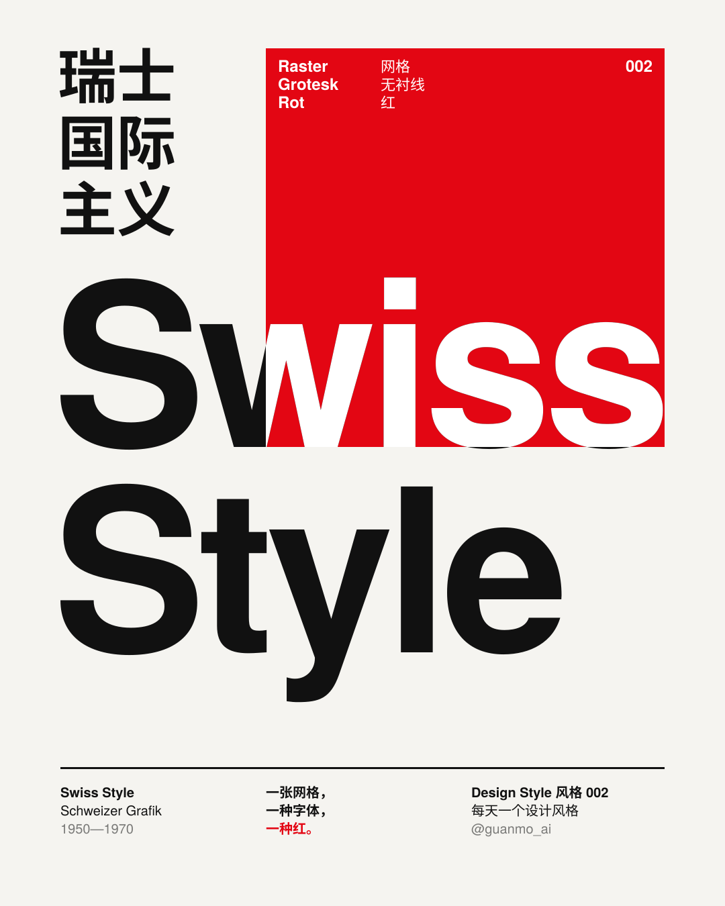
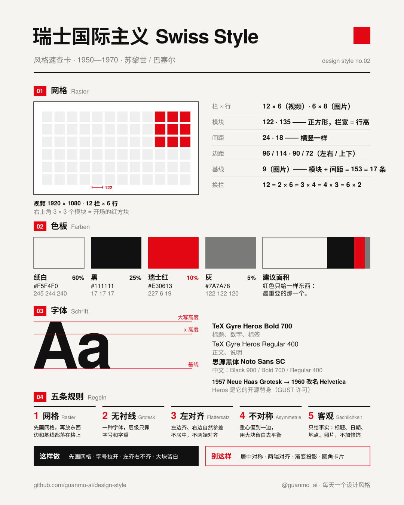
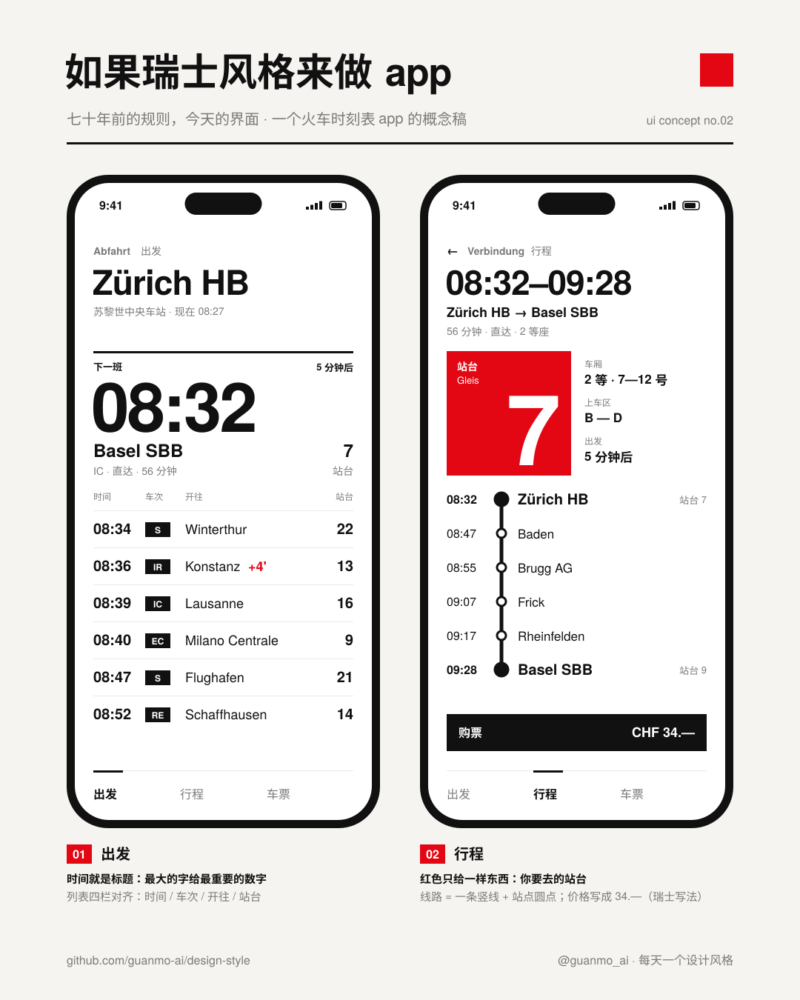
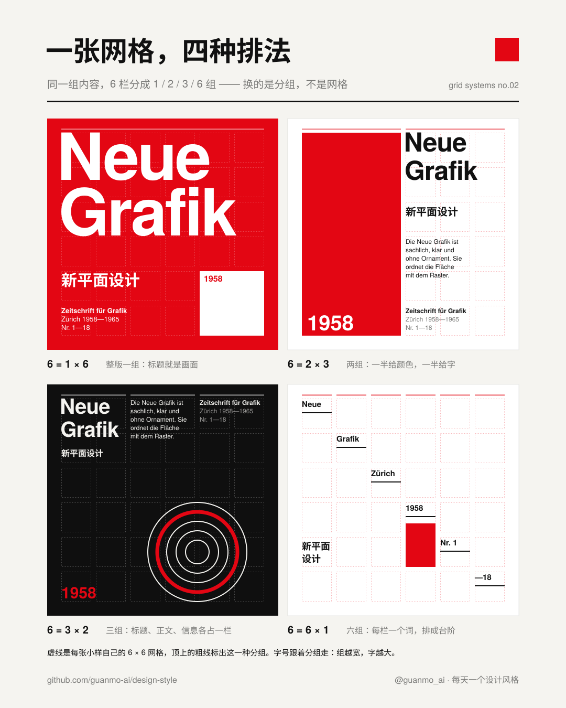

# 002 · 瑞士国际主义 Swiss Style（1950—1970）

> **一句话：** 一张网格、一种无衬线、一种红——把版面变成一道可以计算的题，答案清楚到全世界都看得懂。

🎬 [看视频](https://github.com/guanmo-ai/design-style/releases/tag/day-02) · 🛠 [制作过程](PROCESS.md) · 🖼 [图片源文件](images)

| 海报 | 速查卡 |
|:-:|:-:|
|  |  |
| **如果瑞士风格来做 app** | **一张网格，四种排法** |
|  |  |

---

## 1 · 它从哪来

| 年份 | 事件 |
|---|---|
| **1918—1920s** | 恩斯特·凯勒（Ernst Keller）在苏黎世工艺美术学校教字体与海报，提出“设计要从内容出发”，被称为瑞士平面设计之父 |
| **1928—1933** | 扬·奇肖尔德（Jan Tschichold）出版《新文字设计》（*Die neue Typographie*），提出不对称排版和无衬线；1933 年他离开德国，来到巴塞尔 |
| **1930s—1944** | 包豪斯毕业生马克斯·比尔（Max Bill）回到苏黎世，提出“具体艺术”（konkrete Kunst）：只用数学和几何，不画任何具体的东西 |
| **1947** | 阿明·霍夫曼（Armin Hofmann）开始在巴塞尔设计学校任教，埃米尔·鲁德（Emil Ruder）在同一所学校教字体排印。“巴塞尔学派”成形 |
| **1950s** | 约瑟夫·米勒-布罗克曼（Josef Müller-Brockmann）为苏黎世音乐厅（Tonhalle）做了一系列音乐会海报：同心圆、网格、无衬线，没有一张画乐器 |
| **1957** | 马克斯·米丁格（Max Miedinger）与爱德华·霍夫曼（Eduard Hoffmann）在哈斯铸字厂做出 **Neue Haas Grotesk**；同年阿德里安·弗鲁蒂格（Adrian Frutiger）在巴黎发表 Univers |
| **1958—1965** | 米勒-布罗克曼、洛泽、诺伊堡、维瓦雷利合办杂志《新平面设计》（*Neue Grafik*），德、英、法三语，一共 18 期——这种风格开始走向世界 |
| **1960** | D. Stempel AG 与 Linotype 把 Neue Haas Grotesk 改名 **Helvetica**——拉丁语里“瑞士的”（Helvetia） |
| **1967—1970** | 鲁德出版《字体排印》（*Typographie*）；Unimark 的马西莫·维涅利（Massimo Vignelli）与鲍勃·诺尔达（Bob Noorda）为纽约地铁做标识系统，1970 年出版标准手册 |
| **之后** | 1968 年起沃尔夫冈·魏因加特（Wolfgang Weingart）在巴塞尔把规则拆开玩，引出“新浪潮”；1981 年米勒-布罗克曼出版《平面设计中的网格系统》。今天的网页栅格、App 界面、机场与地铁导视，都在用这一套 |

**为什么重要：** 瑞士风格第一次把“排版”变成了一套可以计算、可以复用的方法：先画网格，再放内容；字体只用一种，层级只靠字号和字重。它让信息在任何语言、任何国家都能被一眼读懂——所以叫“国际主义”。

## 2 · 五条规则

| # | 规则 | 怎么做 | 小心 |
|:-:|---|---|---|
| 01 | **网格** Raster | 先画网格再排版。模块用正方形，横竖间距一样；色块的边、文字的基线都落在网格上 | 网格不是装饰，成品里通常看不见它，但处处都在 |
| 02 | **无衬线** Grotesk | 全篇只用一种无衬线（Helvetica / Akzidenz / Univers）。层级只靠字号和字重：标题和正文的字号拉开 4 倍以上 | 别混三种以上字体；别用斜体、描边、阴影做强调 |
| 03 | **左对齐** Flattersatz | 文字左边对齐，右边自然参差（齐左不齐右）。大字的笔画本身贴住栏线 | 不要两端对齐（会撑出难看的字间空隙），也不要居中 |
| 04 | **不对称** Asymmetrie | 重心偏向一边，用大块留白去平衡。一个画面只有一个主角（通常是最大的字或唯一的红） | 别把所有东西都摆在中轴线上——那是古典，不是瑞士 |
| 05 | **客观** Sachlichkeit | 只给事实：标题、日期、地点、照片。用摄影代替插画，用几何代替图案 | 不讲故事、不加修饰；“好看”来自秩序，不是装饰 |

## 3 · 色板

| 名称 | HEX | RGB | 建议面积 | 用途 |
|---|---|---|:-:|---|
| 纸白 | `#F5F4F0` | 245 244 240 | 60% | 底色。比纯白略暖，屏幕上不刺眼 |
| 黑 | `#111111` | 17 17 17 | 25% | 文字、粗线、海报黑底 |
| 瑞士红 | `#E30613` | 227 6 19 | 10% | 全篇唯一的彩色，只给最重要的一样东西 |
| 灰 | `#7A7A78` | 122 122 120 | 5% | 次要文字、说明 |
| 网格线 | `rgba(17,17,17,.09)` | — | — | 只在讲解时显示网格 |

> 这一期所有作品都只有一种彩色。红块压住文字时，压在红上的那一部分笔画直接反白（像套印），不另外换色。

## 4 · 字体

| 用途 | 本项目 | 商用原版 / 其他选择 |
|---|---|---|
| 拉丁 | **TeX Gyre Heros** 400 / 700（免费，GUST Font License） | Helvetica（1957）· Akzidenz-Grotesk（1898）· Univers（1957）· Neue Haas Unica |
| 中文 | **思源黑体 / Noto Sans SC** 400—900（免费，OFL） | 阿里巴巴普惠体 · HarmonyOS Sans |

**说明：** Helvetica 是商用字体，不能随仓库分发。TeX Gyre Heros 来自 URW 的 Nimbus Sans，字形和字宽都按 Helvetica 做，是最接近的开源替身。中文没有“瑞士黑体”，用笔画干净、字重齐全的黑体就对了。

## 5 · 版式参数

**视频（1920×1080）**
- 网格 **12 栏 × 6 行**，模块 **122 × 122**（正方形），间距 **24**，左右边距 **96**、上下边距 **114**
- 开场 `Swiss` 368px：大写高度 268 = **2 个模块 + 1 个间距**
- 字体那一幕的 Helvetica 968px：大写高度 706 = **5 个模块 + 4 个间距**
- 换栏：12 = 2 × 6 = 3 × 4 = 4 × 3 = 6 × 2——网格不变，只换“几栏算一组”

**图片（1080×1350 竖图）**
- 网格 **6 栏 × 8 行**，模块 **135**，间距 **18**，左右边距 **90**、上下边距 **72**；模块 + 间距 = 153 = **17 条 9px 基线**
- 海报 `Swiss` 339px，字宽正好 6 栏（900px）；红方块 4 × 4 个模块（594 × 594）
- 字号阶梯：339 / 52 / 22 / 20 / 16；字距：大字 -3%，小字 0
- 线：粗线 3px，细线 1px；所有直角，不用圆角

## 6 · 这样做 / 别这样

**✅ 这样做：** 先画网格 · 字号大小拉开 · 左齐右不齐 · 大块留白 · 一个画面一个主角 · 只用一种红
**❌ 别这样：** 居中对称 · 两端对齐 · 三种以上字体 · 渐变 · 投影 · 圆角卡片 · 装饰性插画

## 7 · 其他误区

- **瑞士风格 ≠ Helvetica。** Helvetica 1957 年才出现，1960 年才叫这个名字；1950 年代的大部分瑞士海报用的是 1898 年的 Akzidenz-Grotesk。
- **纽约地铁一开始用的也不是 Helvetica。** 1970 年的标准手册规定的是 Standard Medium（即 Akzidenz-Grotesk 在美国的名字），全线统一成 Helvetica 是 1989 年的事。
- **Arial 不是 Helvetica。** Arial 是 1982 年按 Helvetica 的字宽做的替代品，R、G、t、a 的形状都不一样。
- **网格不等于死板。** 同一张 12 栏网格可以分成 2、3、4、6 组，排出完全不同的版面（见 [`images/grid.svg`](images/grid.svg)）。网格限制的是“边落在哪”，不是“长什么样”。

## 8 · AI 提示词（直接复制）

**图片（Midjourney / 即梦 / ChatGPT 图像）**

```
Swiss International Typographic Style poster, 1958 Zurich, strict modular grid with square modules,
one bold neo-grotesque sans-serif (Helvetica / Akzidenz-Grotesk), flush-left ragged-right text, huge tight headline,
asymmetric layout with large white space, only black #111111 and Swiss red #E30613 on off-white paper #F5F4F0,
small factual info block (date, place, time), objective, no illustration, no gradients, no shadows --ar 4:5
```

**视频（Runway / 可灵 / Sora）**

```
Motion graphics in Swiss International Style: a visible 12-column grid on off-white paper, a red square snaps into
the top-right modules on the beat, a bold Helvetica headline rises letter by letter, the layout re-flows into 2, 3, 4
and 6 column groups on every beat, text that overlaps the red block turns white. Flat colors, crisp edges, precise
cubic easing, fast whip pans with motion blur, 120 bpm, minimal, no 3D, no gradients.
```

**代码（让 AI 写网页 / 组件）**

```
用瑞士国际主义风格做这个界面：背景 #F5F4F0，文字 #111111，唯一的强调色 #E30613（只用在一个最重要的元素上）。
字体 TeX Gyre Heros / Helvetica（标题 700、正文 400，大字 letter-spacing: -0.03em）+ Noto Sans SC。
CSS Grid 6 栏，栏宽 = 行高（正方形模块），gap 18px；所有文字左对齐、右边参差，不要居中，不要两端对齐；
border-radius: 0，不用阴影和渐变；标题和正文字号相差 4 倍以上。设计令牌见 tokens.css。
```

## 9 · 15 秒分镜

瑞士风格最有名的不是哪一张海报，而是“一张网格能排出无数种版面”。短片从头到尾只用一张 12 栏 × 6 行的网格、一种无衬线、一种红；每一幕只有一个红色主角，换幕时它直接变成下一幕的红色主角（红色接力）。所有剪辑点都落在 120 BPM 的拍子上。

<a href="https://github.com/guanmo-ai/design-style/releases/tag/day-02"></a>

| 时间 | 帧 | 章节 | 画面 | 致敬 |
|---|---|---|---|---|
| 0:00—0.5 | 0—30 | 开场 · 波 | 72 个模块沿对角线闪过，右上 9 个红模块留下，合成红方块 | — |
| 0.5—2.0 | 30—120 | 开场 · 标题 | Swiss / Style 逐字母升起，大写高度正好 2 个模块 + 1 个间距；信息栏落在网格上，红线一栏一栏扫过 | — |
| 2.0—4.0 | 120—240 | 01 网格 | 同一组元素每拍重排：12 = 2 × 6 → 3 × 4 → 4 × 3 → 6 × 2；红块跟着变宽变窄，压在红上的字自动反白；最后整版甩出画面 | 约瑟夫·米勒-布罗克曼 · 网格系统 |
| 4.0—6.0 | 240—360 | 02 字体 | 镜头沿着 968px 的 Helvetica 滑过去；Neue Haas Grotesk 1957 → Helvetica 1960；a 变红，镜头扎进 a 的笔画 | 马克斯·米丁格 · 爱德华·霍夫曼 |
| 6.0—8.0 | 360—480 | 03 海报 | 红色铺满全屏，收成第一张海报：红底断字（Typo-gra-fie）· 白底点阵（konkrete kunst）· 黑底同心圆（Neue Musik） | 埃米尔·鲁德 · 马克斯·比尔 · 米勒-布罗克曼 |
| 8.0—10.0 | 480—600 | 04 纽约地铁 | 黑海报拉成 1970 年纽约地铁的标识带：线路圆标、站名、方向；第二块牌子滑进来 | 马西莫·维涅利 · 鲍勃·诺尔达 · Unimark |
| 10.0—12.5 | 600—750 | 05 五个词 | 标识带铺满全屏；网格 / 无衬线 / 左对齐 / 不对称 / 客观，一拍一个，每个词用自己的版式演示自己 | — |
| 12.5—15.0 | 750—900 | 片尾 | 红方块落回右上角，和开场同一个位置 ——「一张网格，一种字体，一种红。」 | — |

> 画面中的海报和标识牌都是按原作手法重新设计的“致敬”，不是原作复刻；地铁的线路颜色用的是今天的配色，app 概念图里的车次与时刻是虚构的。

## 10 · 文件

```
002-swiss-style/
├─ PROCESS.md                             # 制作过程
├─ process/                               # 过程图：v1 定帧 · v2 / v3 联系表 · v4 开场拆解 · 节拍时间轴
├─ tokens.ts / tokens.css / tokens.json   # 同一份设计令牌（颜色、字体、两张网格）
├─ video/SwissStyle.tsx                   # 短片主合成：按时间窗挂载场景、章节条、甩镜模糊、配乐（Remotion，React）
├─ video/opening.tsx                      # 0—6 秒：波、标题、网格机器、甩镜、字体
├─ video/scenes.tsx                       # 6—15 秒：海报、纽约地铁、五个词、片尾
├─ video/ui.tsx                           # 网格坐标 cx / cw / ry / rh、按基线定位的文字 <T>、网格线
├─ video/cover.jpg                        # 视频封面
├─ audio/make_music.py                    # 配乐：numpy 合成，120 BPM，A 小调 → C 大调，-14 LUFS
└─ images/
   ├─ make_svgs.py    # 四张图的生成脚本：6 栏 × 8 行网格，字宽按真实字体度量计算
   ├─ poster.svg      # 海报
   ├─ cheatsheet.svg  # 速查卡
   ├─ app-ui.svg      # 如果瑞士风格来做 app
   ├─ grid.svg        # 一张网格，四种排法
   └─ preview/        # 内嵌字体的自包含 SVG
```

**延伸阅读：** Josef Müller-Brockmann《Grid Systems in Graphic Design》（1981）· Emil Ruder《Typographie》（1967）· Armin Hofmann《Graphic Design Manual》（1965）· Richard Hollis《Swiss Graphic Design》（2006）· 纪录片《Helvetica》（Gary Hustwit，2007）· 《NYCTA Graphics Standards Manual》（1970，2014 年复刻版）
