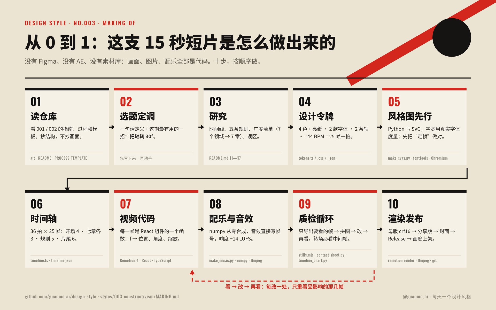

# 003 · 构成主义 · 从 0 到 1：这支视频是怎么做出来的

> [`PROCESS.md`](PROCESS.md) 讲**设计上怎么想**：为什么这样选、哪里推翻重来。这份讲**动手怎么做**：用了哪些工具、按什么顺序、每一步敲什么命令、做到什么程度才算过关。
> 照着这份做，可以从一个空文件夹做出同样规格的一期：15 秒 · 1920×1080 · 60fps 短片，加上 4 张风格图、指南和过程文档。

🎬 [看成片（Releases · day-03）](https://github.com/guanmo-ai/design-style/releases/tag/day-03) · 📐 [风格指南](README.md) · 🛠 [制作过程](PROCESS.md)



---

## 0 · 先说结论：这一期是怎么“做”的

- **全部是代码。** 没用 Figma、After Effects、Premiere，也没用素材库、AI 生图或现成音乐。每个形、每个字、每一帧动画、每一声铁砧都由仓库里的源码生成，改一个数字就能重出。
- **谁做的。** 这一期由 AI 智能体（Notion AI）在一台 Linux 沙盒里完成：读仓库、查资料、写代码、渲染、看图、改版、写文档。人负责定方向（“做一个新风格，要对大家有用，要顶尖，动效要好”）和最终审片。
- **为什么用代码做。** ① 可复现：别人 `git clone` 下来就能重出一模一样的成片；② 可精确：所有角度、字号、帧号都能从公式算出来，“斜 30°”就真的是 30°；③ 可迭代：改一处只重渲那几帧，几秒钟就能看到结果。
- **顺序。** 文字 → 令牌 → 静态图 → 时间轴 → 动画 → 声音 → 质检 → 发布。**先把静止的画面做对，再让它动。**

## 1 · 工具箱

| 环节 | 工具 | 版本（本期） | 用来做什么 | 费用 |
|---|---|---|---|---|
| 视频 | [Remotion](https://www.remotion.dev) + React + TypeScript | 4.0.454 | 用 React 组件写视频：每一帧都是 `frame → 画面` 的函数；`@remotion/motion-blur` 做运动模糊，`@remotion/fonts` 加载字体 | 个人与小团队免费（[许可](https://www.remotion.dev/license)） |
| 运行环境 | Node.js · Python | 24 · 3.13 | Node 跑 Remotion 与截图脚本；Python 写图片、配乐、过程图 | 免费 |
| 风格图 | Python 手写 SVG · [fontTools](https://github.com/fonttools/fonttools) | — | 按公式输出 SVG；用真实字体度量算字宽；子集化字体后内嵌进 SVG | 免费 |
| 渲染图片 | Playwright + Chromium | — | 把 SVG 渲染成 2x PNG；导出视频关键帧 | 免费 |
| 配乐 | numpy | — | 从零合成鼓、贝斯、铜管、铁砧、打字机、盖章……没有任何外部音源 | 免费 |
| 音视频处理 | [ffmpeg](https://ffmpeg.org) | 7.0 | 响度测量（loudnorm）、精确抽帧、压分享版 | 免费 |
| 过程图 | Pillow · matplotlib · ImageMagick | — | 联系表、时间轴图、拼图 | 免费 |
| 字体 | [Oswald](https://fonts.google.com/specimen/Oswald) · [Noto Sans SC](https://fonts.google.com/noto/specimen/Noto+Sans+SC) | — | 窄体西文 + 西里尔字母；中文黑体。都是 OFL，可商用 | 免费 |
| 版本管理 | git | — | 一期一个分支、一个提交；补丁可以 `git am` | 免费 |

全部开源或免费，一台没有显卡的 2 核机器就能跑完整个流程。

## 2 · 准备环境（10 分钟）

```bash
git clone https://github.com/guanmo-ai/design-style.git && cd design-style
npm install                     # Remotion 等
npm run fonts                   # 字体下载到 public/fonts（不入库）
pip install numpy fonttools pillow matplotlib
npx playwright install chromium # 或用系统 Chromium：export CHROMIUM_PATH=$(which chromium)
npm run studio                  # 浏览器里逐帧预览，确认环境可用
```

## 3 · 十步，从 0 到 1

每一步都写了：**做什么 → 产出 → 过关标准**。过关了再进下一步，返工最少。

### 01 · 读仓库（抄结构，不抄画面）

- **做什么：** 通读 001、002 的 `README.md`、`PROCESS.md`、`tokens.*`、`video/` 和 [`docs/PROCESS_TEMPLATE.md`](../../docs/PROCESS_TEMPLATE.md)、[`docs/GALLERY.md`](../../docs/GALLERY.md)。列出每期都有的东西：15 秒 / 60fps / 一整首配乐 / 4 张 1080×1350 图 / 统一的页眉页脚 / 指南 10 节 / 过程文档。
- **产出：** 一份“这一期必须有什么”的清单。
- **过关：** 新的一期放进目录里，和前两期并排看像是一个系列。

### 02 · 选题与“最有用的一招”

- **做什么：** 在计划列表里选下一个；写出一句话定义，再写出**这一期观众能带走的一招**。本期是：*把轴转 30°，版面就开始动。*
- **产出：** 写在 `PROCESS.md` §1 的三行字。
- **过关：** 后面每一个画面、每一张图，都能回答“它在演示哪一招”。答不上来的画面删掉。

### 03 · 研究：先列清单，再动手

- **做什么：** 时间线（只写查得到的年份）→ 3—5 条可执行的规则（每条写“怎么做”和“小心”）→ **广度清单**：这个风格出现在哪些领域（海报、电影、建筑、纺织、舞台、书籍、今天）→ 常见误区。
- **产出：** `README.md` §1—§7 的草稿。广度清单直接变成视频的七章。
- **过关：** 每个人名、作品名、年份都能对上来源；俄文是真正的俄文，不用假西里尔字母。

### 04 · 设计令牌：先定“系统”，再画画面

- **做什么：** 颜色（含面积比例）、字体、线宽、节拍，以及这一期最关键的令牌：**两条轴**。一份数值写进 `tokens.ts`（视频用）、`tokens.css`（网页用）、`tokens.json`（画廊与 AI 用）。
- **关键代码：** 所有斜的东西都用同一个函数定位，视频和图片是同一套数学：

  ```ts
  // video/ui.tsx：沿主轴走 u、沿副轴走 n
  export const on = (p: Pt, u: number, n = 0): Pt => ({x: p.x + U.x * u + N.x * n, y: p.y + U.y * u + N.y * n});
  ```
  ```python
  # images/make_svgs.py：同一个函数的 Python 版
  def P(o, d, n=0.0):
      return (o[0] + U[0] * d + N[0] * n, o[1] + U[1] * d + N[1] * n)
  ```
- **过关：** 画面上没有一个数字是“目测”的。

### 05 · 风格图先行（先把静止的画面做对）

- **做什么：** `images/make_svgs.py` 一次生成 4 张 SVG（海报 · 速查卡 · app 概念 · 四步改造）→ `scripts/build_images.py` 子集化字体、内嵌进 `preview/*.svg` → Chromium 渲染 2x PNG。
  ```bash
  npm run images:003
  ```
- **要点：** 字宽用 fontTools 读真实度量；Oswald 是可变字体，**先 instancer 实例化到 700 再量**，否则差 5%—10%。
- **过关：** 缩小到 900px 看，主角只有一个；放大到 2x 看，没有溢出、没有撞字。这几张图就是视频的“定帧”，视频里的版式直接从这里搬。

### 06 · 时间轴：先写节拍，再写动画

- **做什么：** 先定 BPM，再把 15 秒切成拍。144 BPM、60fps → 1 拍 = 25 帧，900 帧 = 36 拍：开场 4 · 七章各 3 · 五条规则 5 · 片尾 6。
- **产出：** `video/timeline.ts`（代码用）+ `process/timeline.json`（画图、画廊用，每章写清楚哪一帧发生什么）。
- **过关：** 每次换幕都落在拍点上；每章只有一个主角、一个动作。

### 07 · 视频代码：每一帧是一个函数

- **文件结构：**

  | 文件 | 内容 |
  |---|---|
  | `video/Constructivism.tsx` | 总装：按时间轴挂载各章、运动模糊（每帧 5 次采样）、6% 胶片颗粒、配乐 |
  | `video/ui.tsx` | 本期的“工具箱”：轴函数 `on()`、楔子 `wedge()`、粗条 `bar()`、盖章 `stamp()`、网点 `halftone()`、指数推镜 `zoomIn()` |
  | `video/opening.tsx` | 开场：红楔子击中 → 打字 + 盖章 → 三次换轴 → 甩出 |
  | `video/chapters.tsx` · `workshop.tsx` | 七章：大字 · 蒙太奇 · 塔 · 纺织 · 舞台 · 书 |
  | `video/finale.tsx` | 五条规则、片尾、常驻底栏 |
  | `src/Root.tsx` | 注册 `S003-Constructivism` |

- **一个动作是怎么写出来的（盖章）：** 7 帧内从 1.5 倍压到 1，前 2.5 帧淡入，时间点直接写帧号：
  ```ts
  export const stamp = (f: number, at: number, from = 1.5, d = 7) => {
    if (f < at) return {s: from, o: 0};
    const p = tween(f, at, d, 0, 1, E.out);
    return {s: lerp(from, 1, p), o: c01((f - at) / 2.5)};
  };
  ```
- **三条让动效“顶尖”的做法：**
  1. **转场用形状接力，不硬切。** 每章都从上一章的一个形长出来：嘴 → 镜头 → 瞳孔 → 斜带 → 圆 → 红轮 → 红页 → 红方块。
  2. **前 25 帧就要有“哇”。** 第 25 帧红楔子击中，配一记冲击缩放和铁砧。
  3. **推镜用指数插值。** `zoomIn(p, k) = exp(ln k · p)`，每帧放大同样的倍数，速度感均匀；线性放大会“先不动、最后突然冲脸”。
- **过关：** `npm run studio` 里逐帧拖，任何一帧截下来都能当海报。

### 08 · 配乐与音效：和画面共用帧号

- **做什么：** `audio/make_music.py` 用 numpy 合成一整首 144 BPM、D 小调的“工厂”节奏，片尾转 D 大调。音效直接写帧号，和画面用同一套数字：
  ```python
  sfx(anvil(midi(33 + 12), 0.25, 1.4), fr(325), send=0.5)   # f325 塔出现：低沉的金属共振
  ```
- **响度：** 合成后用 ffmpeg loudnorm 测量、迭代到 **−14 LUFS**（流媒体平台的标准），真峰值 < −1 dBTP。
  ```bash
  npm run music:003   # → public/003-constructivism/music.wav
  ```
- **过关：** 每一次画面重击都有声音；一整首，不是几段拼起来。**要有人戴耳机听一遍。**

### 09 · 质检循环：看 → 改 → 再看

不整片重渲，只看受影响的几帧：

```bash
npx remotion bundle src/index.ts --out-dir out/bundle                     # 打包一次
COMP=S003-Constructivism PROPS='{"blur":1,"music":false}' \
  node scripts/stills.mjs out/bundle out/check 25 100 118 137 160         # 几秒钟出这几帧
python3 scripts/contact_sheet.py out/sheet.jpg --cols 5 \
  "out/check/f025.png|f025 击中" "out/check/f100.png|f100 0°" ...          # 拼成一张图看
```

- 转场至少看起点、中点、终点三帧，**错误大多出在中间帧**（本期开场换轴时标签互相遮挡，就是在 f100—160 的中间帧发现的）。
- 成片出来后：`contact_sheet.py --video` 精确抽帧做联系表，`timeline_chart.py` 叠上配乐波形检查剪辑点是否落在拍子上，`ffprobe` 核对规格。
- 改版记录写进 `PROCESS.md` §5：位置 · 问题 · 诊断 · 改了什么。

### 10 · 渲染与发布

```bash
npm run render:003    # 配乐 + 母版：out/003-constructivism-master.mp4（crf16，2 核约 4 分钟）
ffmpeg -i out/003-constructivism-master.mp4 -vf "scale=in_range=full:out_range=tv,format=yuv420p" \
  -c:v libx264 -preset slow -crf 18 -profile:v high -c:a aac -b:a 192k -movflags +faststart \
  out/003-constructivism.mp4                         # 分享版（各平台都能播）
```

1. 封面：取第 90 帧 → `video/cover.jpg`。
2. 过程图：联系表、开场拆解、转场链、时间轴 → `process/`。
3. 提交：一期一个提交，视频不进 git。
4. Release：tag `day-03`，上传 `003-constructivism.mp4`，正文附 SHA-256。
5. 画廊：向 `gallery/data/works.json` 添加条目（SHA-256 与 Release 一致），运行 `npm run gallery:readme`、`gallery:test`、`gallery:build`、`gallery:check`。

## 4 · 和 AI 一起做：开工提示词

这一期就是由 AI 智能体做的。想让 AI 帮你做下一期，可以从这段开始（把风格名换掉）：

```text
你在 design-style 仓库里做第 NNN 期：「风格名」。
1. 先读 styles/001、002、003 的 README.md、PROCESS.md、MAKING.md 和 docs/ 下的模板，列出每期必须有的产出。
2. 写一句话定义和「这一期观众能带走的一招」，之后所有画面都围着它。
3. 研究：时间线（只写能查证的）、3—5 条可执行规则、广度清单（≥6 个领域）、常见误区。
4. 先写 tokens（颜色+面积比、开源字体、线宽、BPM 换算成帧），再用 Python 生成 4 张 1080×1350 SVG。
5. 先写 timeline（每章 3 拍、换幕落在拍点），再写 Remotion 组件；转场用这个风格自己的元素接力，不硬切。
6. numpy 合成一整首配乐，音效写帧号，响度 −14 LUFS。
7. 每改一处只导出受影响的帧检查，转场必看中间帧；把改版记录写进 PROCESS.md。
8. 交付：母版 + 分享版 MP4、封面、process/ 过程图、README / PROCESS / MAKING 三份文档、gallery 条目。
```

**和 AI 协作的经验：**
- **让 AI 看图，而不是只看代码。** 每一轮都导出截图让它自己检查；本期六处改版全是“看图”发现的，代码本身都“没有错”。
- **给数字，不给形容词。** “斜一点”不如“主轴 −30°，信息 0°”；“大一点”不如“字号 = 0.4 × 到嘴的距离”。
- **先静后动。** 先让 AI 把 4 张图做对，视频的版式直接复用，返工最少。

## 5 · 投入与产出

| 项 | 数字 |
|---|---|
| 源码 | 视频约 1,500 行 TS · 配乐约 770 行 Python · 风格图约 650 行 Python |
| 外部素材 | 0（没有照片、没有音源、没有 AI 生图） |
| 单帧预览 | 每帧几百毫秒（半尺寸、关掉模糊） |
| 整片渲染 | 2 核机器约 4 分钟（每帧 5 次运动模糊采样） |
| 成片 | 母版约 102MB · 分享版约 69MB（6% 胶片颗粒每 2 帧换一次，最占体积；见 [PROCESS §13](PROCESS.md#13--渲染与发布)） |

## 6 · 文件地图

```
styles/003-constructivism/
├─ README.md        # 风格指南：历史 · 规则 · 色板 · 字体 · 版式 · 误区 · 提示词 · 分镜
├─ PROCESS.md       # 制作过程：怎么想、哪里推翻重来
├─ MAKING.md        # 本文：用什么工具、按什么顺序、敲什么命令
├─ tokens.{ts,css,json}
├─ video/           # Remotion 源码 + cover.jpg
├─ audio/make_music.py
├─ images/          # make_svgs.py → *.svg → preview/（内嵌字体）→ png/（2x）
└─ process/         # 01 联系表 · 02 开场拆解 · 03 转场链 · 04 时间轴 · 05 本文流程图（.html 源文件可改）
```
