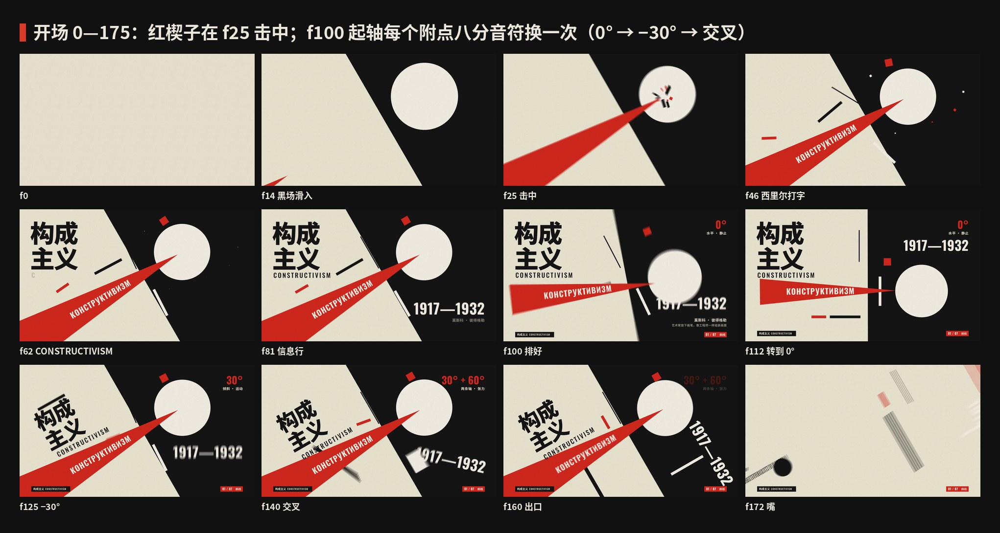
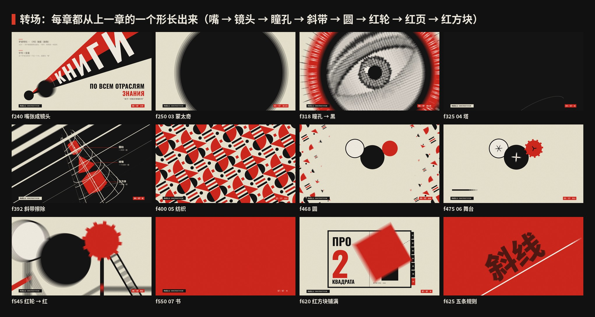
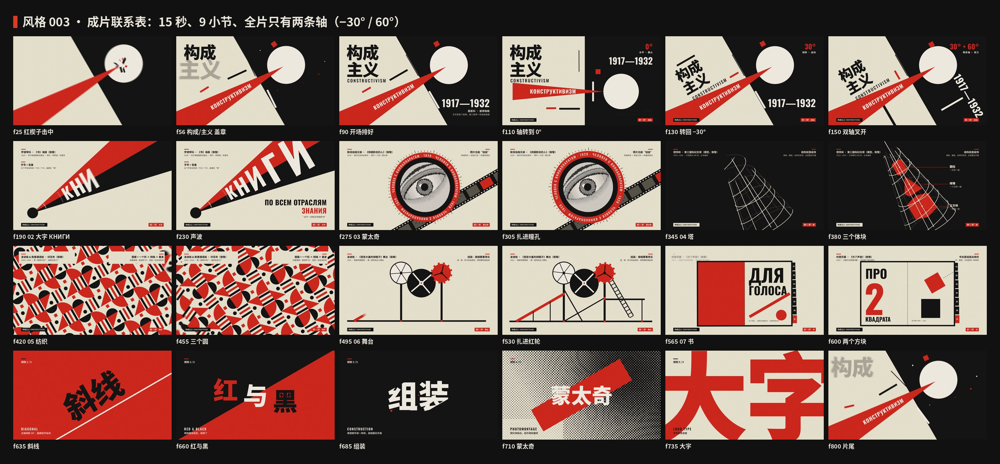
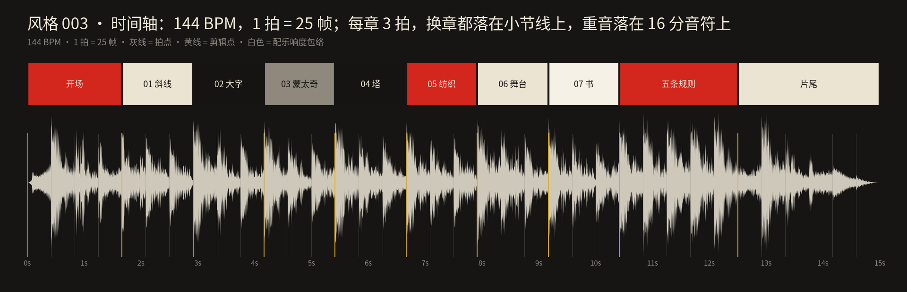

# 003 · 构成主义 · 制作过程

> 这一期是怎么从一个想法变成 15 秒短片和 4 张图的：怎么想的、怎么做的、哪里推翻重来、下次怎么做得更好。
> 过程图都在 [`process/`](process)，可以复现的代码在 `video/` `audio/` `images/` 和根目录的 `scripts/`。

🎬 [看成片（Releases · day-03）](https://github.com/guanmo-ai/design-style/releases/tag/day-03)· 📐 [风格指南](README.md)

---

## 0 · 一览

| # | 步骤 | 产出 | 工具 / 文件 |
|:-:|---|---|---|
| 1 | 选题与定调 | 一句话定义 + 受众 + “这一期最有用的一招” | — |
| 2 | 研究 | 时间线、五条规则、广度清单、误区 | [`README.md`](README.md) §1—§7 |
| 3 | 设计令牌 | 4 色 + 亮纸、1 款窄体 + 1 款中文、**两条轴**、节拍 | `tokens.ts / .css / .json` |
| 4 | 风格图 ×4 | 海报 · 速查卡 · 跑步 app · 四步改造 | `images/make_svgs.py` · `scripts/build_images.py` |
| 5 | 分镜与节拍 | 10 段 × 3 拍，转场链：每章从上一章的一个形长出来 | `video/timeline.ts` · `process/timeline.json` |
| 6 | 视频：开场 | 红楔子击中 → 打字 + 盖章 → 三次换轴 → 甩出 | `video/opening.tsx` |
| 7 | 视频：七章 | 大字 · 蒙太奇 · 塔 · 纺织 · 舞台 · 书 | `video/chapters.tsx` · `video/workshop.tsx` |
| 8 | 视频：高潮与片尾 | 五条规则一拍一个；回到开场构图 | `video/finale.tsx` |
| 9 | 配乐与音效 | 144 BPM，D 小调“工厂”节奏，一整首，−14 LUFS | `audio/make_music.py`（numpy 合成） |
| 10 | 质检 | 关键帧拼图、联系表、转场链、节拍时间轴 | `contact_sheet.py` · `timeline_chart.py` |
| 11 | 发布 | 母版 + 分享版 MP4、封面、仓库 | ffmpeg · GitHub |

---

## 1 · 选题与定调

**为什么第三期是构成主义：** 包豪斯（001）讲“现代设计从哪来”，瑞士风格（002）讲“怎么把版面排得清楚”；构成主义比两者都早一点（1917），却回答了它们都没回答的问题——**怎么让一张静止的纸“动”起来**。它也是今天运动品牌、音乐节、发布会主视觉、短视频片头里“斜着冲出来”的源头，观众天天见，却很少有人讲清楚它的方法。

**这一期最有用的一招（写在动手之前）：** *把轴转 30°，版面就开始动。* 所有画面、所有图都围着这一招转：开场同一组元素换三次轴，速查卡第一节就是“两条轴”，第四张图专门演示“普通海报怎么四步改成构成主义”。

**定调：**

- 一句话：*一条斜线，一块红，一个大声的字。*
- 受众：设计师拿去就能用（两条轴的角度、色值、字体、提示词、CSS 写法），普通人看完能认出“原来这就是构成主义”，也知道它和“苏联风贴纸”的区别。
- 质感：旧新闻纸 + 印刷黑 + 朱红，带一点胶片颗粒；凸版印刷只有实色，所以没有渐变、没有阴影。
- 和前两期接上：同一套页眉页脚、同一套速查卡结构、同一个 15 秒 / 60fps / 一整首配乐的规格；红色接力换成**形状接力**。
- 边界：只讲设计方法；画面里的作品都是“致敬”重绘，不复刻原作里的政治口号。

## 2 · 研究：先列清单，再动手

1. **时间线：** 1915 至上主义 / 反浮雕 → 1919—20 红楔子、塔特林塔 → 1920 VKhUTEMAS → 1921 第一构成主义者工作小组 → 1922 波波娃舞台 → 1923—24《为了声音》《书》、印花布 → 1929《持摄影机的人》→ 1932 解散 → 1934 社会主义现实主义（详见 [风格指南 §1](README.md#1--它从哪来)）。
2. **规则：** 归纳成 5 条可执行的规则：斜线 / 红与黑 / 组装 / 蒙太奇 / 大字，每条写“怎么做”和“小心”。
3. **广度清单**（视频七章和风格图都从这张表来——每章换一个领域，证明它不只是海报）：

   | 领域 | 人物 | 作品 | 年份 | 用在哪 |
   |---|---|---|---|---|
   | 海报 · 几何 | 利西茨基 | 《以红楔子打击白军》 | 1919—1920 | 开场 · 角标 · 第四张图 |
   | 海报 · 大字 | 罗德琴科（照片：莉莉娅·布里克） | 《书》 | 1924 | 02 大字 · 风格图海报 |
   | 电影海报 · 蒙太奇 | 斯坦伯格兄弟 | 《持摄影机的人》 | 1929 | 03 蒙太奇 |
   | 建筑 | 塔特林 | 第三国际纪念塔（模型） | 1919—1920 | 04 塔 |
   | 纺织 | 波波娃 · 斯捷潘诺娃 | 第一国营印花厂的印花布 | 1923—1924 | 05 纺织 |
   | 舞台 | 波波娃 · 梅耶荷德 | 《宽宏大量的绿帽子》 | 1922 | 06 舞台 |
   | 书籍 | 利西茨基 · 马雅可夫斯基 | 《为了声音》《关于两个方块》 | 1923 / 1922 | 07 书 |
   | 今天 | — | 运动 app、活动海报 | — | app 概念图 · 四步改造 |

4. **误区：** 至上主义 ≠ 构成主义；假西里尔字母（Я 当 R）不是构成主义；“斜”不是随便斜；不是所有苏联海报都是构成主义。所以全片的俄文都是真正的俄文（КНИГИ、ПО ВСЕМ ОТРАСЛЯМ ЗНАНИЯ、ДЛЯ ГОЛОСА……），西里尔字母用的是自带西里尔字形的 Oswald，不是拉丁字母“装”的。

## 3 · 设计系统先行

这一期最重要的令牌不是颜色，而是**轴**：全片只有两条。

| 令牌 | 值 | 说明 |
|---|---|---|
| paper | `#ECE4D2` | 旧纸：略黄的新闻纸 |
| ink | `#161412` | 印刷黑：带一点暖 |
| red | `#D3261C` | 构成红：偏橙的朱红；面积 15%，比瑞士风格的 10% 大——这里红是“力”，不是点缀 |
| grey | `#8F897D` | 网点灰：照片网点、次要文字 |
| light | `#F6F1E6` | 亮纸：只给“白圆”和黑底上的字 |
| 字体 | Oswald 500—700 · Noto Sans SC 400—900 | Oswald 是 OFL 的可变窄体，自带西里尔字母 |
| 轴 | 主轴 −30°（U = 0.866, −0.5）· 副轴 60°（N = 0.5, 0.866）· 信息 0° | `P(o, d, n)`：从 o 沿主轴走 d、沿副轴走 n。所有斜的东西都用它定位，视频（`ui.tsx`）和图片（`make_svgs.py`）是同一个函数 |
| 节拍 | 60 fps · 144 BPM → 1 拍 = 25 帧 | 每章 3 拍；重音落在 16 分音符（6.25 帧） |
| 形状 | 楔 · 圆 · 粗条；圆角 0；粗条 24 ≈ 字高 1/4 | 只有直角 |

**为什么是 −30° 而不是 45°：** 45° 是“对角线”，横竖一样重，看起来是“倒下”；30° 更平，读起来是“往前冲”，而且和水平信息栏夹出的角度足够大，一眼分得清哪些是“斜的主角”、哪些是“平的信息”。

## 4 · 风格图（4 张）

| 图 | 目的 |
|---|---|
| 海报 | 致敬《书》：一张嘴沿主轴喊出红锥，锥里“构成主义”四个字按离嘴的距离放大（字号 = 0.36 × 距离，下一个字远 1.56 倍）；黑圆贴左边距、离锥 20px，将碰未碰；黑带从红锥底下穿过 |
| 速查卡 | 两条轴（图解 + 参数）、色板与面积比、字体度量、五条规则小图标、这样做 / 别这样 |
| 如果构成主义来做 app | 一个跑步训练 app：斜的只有主视觉里那条红带和“越跑越宽的进度楔子”；训练内容、配速、心率全部水平，跑步中也能一眼读完 |
| 四步改造 | 同一张普通活动海报，每一步只改一件事：原稿 → 转轴 → 红与黑 → 大字 + 组装。这是这一期“最能直接拿去用”的一张 |

**管线：** `images/make_svgs.py` 生成四张 SVG。所有斜的坐标都用 `P(o, d, n)` 算；字宽用 fontTools 读真实度量——Oswald 是可变字体，**先用 `instancer` 实例化到要用的字重再量**（默认实例是 400，直接量 700 会差 5%—10%）→ `scripts/build_images.py`（本期给 `FACES` 加了 Oswald）子集化字体、以 base64 WOFF 内嵌进 `preview/*.svg` → Chromium 渲染 2x PNG（2160×2700）。

## 5 · 改版记录

本期没有经过外部反馈轮次；下面是自查时推翻重来的地方（每次都用缩小图 + 关键帧拼图检查）。

| 位置 | 问题 | 诊断 | 改了什么 |
|---|---|---|---|
| 海报 v1 | 锥里的四个字挤在一起，笔画相碰 | 下一个字只远 1.47 倍，两字中心距 = 0.47d，正好等于两个半字高之和 | 改成 0.36d 字号 + 1.56 倍间距，字之间留出约 0.1d 的缝 |
| 海报 v2 | 黑圆掉到了锥下面，压住了字 | 求“黑圆到锥边距离 = R + 20”时法线方向取反 | 重新推导：`cy = Oy + ((cx − Ox)·sin a − (R + 20)) / cos a` |
| 海报 v3 | 黑带和“义”字撞在一起 | 锥是张开的（下沿离主轴 0.25d），平行于主轴的黑带走远了一定会撞上 | 把黑带放到红锥**底下**：撞上的地方变成“从锥底下穿过”，层次反而更强 |
| 第四张图 v1 | 第 4 步“读书夜”只剩半个字 | 出血太多，字被切得认不出来 | 字号 168 → 134，起点挪回画面；黑圆移到右上角，和“夜”刚好相切 |
| 开场 | 角度标签、年份和标题在换轴时互相遮挡 | 三种轴的布局表各自排得好，但切换途中的中间帧会撞 | 年份挪到右上 (1824, 340)、角度标签固定在右上角；逐个检查 f100—160 的中间帧 |
| 02 大字 | 字母大小“像随便放大” | 字号和位置是分开调的 | 改成同一个公式：字号 = 0.4 × 到嘴的距离，距离按 1.3 倍递增——五个字母自然塞满锥 |

## 6 · 开场：红楔子 + 三次换轴



| 帧 | 动作 | 实现要点（`video/opening.tsx`） |
|---|---|---|
| 0—25 | 黑场从右上滑入，红楔子沿主轴推进，**f25 击中**（铁砧声） | 楔子沿 U 插值；镜头 26 帧内从 −7° 回正、从 1.14 倍推到 1；f25 一记 3.5% 的冲击缩放 + 抖动（`HITS` 表：f25 最强，之后几次盖章各一下轻的） |
| 28—87 | КОНСТРУКТИВИЗМ 逐字打出（打字机声）→ 构成 / 主义 f50 / 56 盖章 → CONSTRUCTIVISM → 1917—1932 → 两行信息 | 盖章 = 7 帧内从 1.5 倍压到 1（ease-out）+ 2.5 帧淡入；每一下都对在 16 分音符上 |
| 100—150 | 同一组元素换三次轴：`LAY_AT = [100, 118.75, 137.5]`（附点八分音符）0° → −30° → 双轴交叉；右上角的大号角度标签跟着跳 | 每种轴一份布局表（位置、角度、尺寸），之间用同一条缓动插值——观众看到的是“同样的东西，转一下就活了” |
| 160—175 | 整组沿主轴甩出，只留下嘴 (236, 872) | 嘴就是下一章喇叭的起点 |

## 7 · 七章：形状接力



每章都从上一章的一个形长出来，全片没有硬切：**嘴 → 镜头 → 瞳孔 → 斜带 → 圆 → 红轮 → 红页 → 红方块**。

| 章 | 主角 | 动作 | 实现要点 |
|---|---|---|---|
| 02 大字 | 嘴里喊出的锥 | КНИГИ 一个字母比一个大，声波弧，ПО ВСЕМ ОТРАСЛЯМ ЗНАНИЯ 盖章；嘴张成镜头盖满全屏 | 锥半角 13°；字母落在 16 分音符上 |
| 03 蒙太奇 | 一只网点眼睛 | 切成三条沿 −30° 滑入；红色刻度环 + 环形字 + 胶片；推镜 ×34 扎进瞳孔变黑 | 网点：几千个圆合成**一条 path** 并缓存，渲染很快；推镜用指数插值（`zoomIn`），线性放大会“先慢后突然” |
| 04 塔 | 双螺旋塔架 | 3D 线框按投影生长，立方体 / 棱锥 / 圆柱依次点红；纸色斜带擦掉画面 | 自己写的小投影：两条螺旋、8 根母线、3 道环、桅杆；体块用凸包填色 |
| 05 纺织 | 2 × 2 几何图案 | 沿 −30° 网格滚动，四次旋转波；图案收拢、长出三个圆 | 图案块 150px；每道旋转波让每块转 90°，从左往右（下一道从右往左）错开 12 帧扫过 |
| 06 舞台 | 三个轮子 | 梁、坡道、斜撑、平台、梯子按 16 分音符搭起来；红色螺栓；推镜 ×16 扎进红色齿轮 | 每根构件一个出场帧，先“长”再“铆” |
| 07 书 | 一本带指引索引的书 | 从红页拉远；翻两页：《为了声音》→《关于两个方块》；红方块飞出铺满 | 拇指索引 01—07 = 全片的章节号，07 是红的 |

底栏常驻（左边“构成主义 CONSTRUCTIVISM”，右边红色的 `0N / 07` + 章节名），塔那一章黑底时底栏换成纸色。

## 8 · 高潮与片尾

- **五条规则（f625—750）：** 一拍一个词，每个词用自己的方法演示自己：“斜线”沿主轴斜放在红底上；“红与黑”的三个字沿红黑分界线错开；“组装”由四条切片拼起来；“蒙太奇”压在网点场上；“大字”大到出血。词与词之间是 7 帧、沿副轴推进的扫屏。
- **片尾（f750—900）：** 回到开场的构图再刺一次（首尾呼应），标语「一条斜线，一块红，一个大声的字。」+ 署名。

## 9 · 联系表



## 10 · 分镜与节拍

先写时间轴（[`process/timeline.json`](process/timeline.json)），再写代码：开场 4 拍，七章各 3 拍，五条规则 5 拍，片尾 6 拍。逐帧分镜表见 [风格指南 §9](README.md#9--15-秒分镜)。



上图由 `scripts/timeline_chart.py` 直接读取最终配乐生成：章节切换全部落在小节线上，鼓点包络和画面重击对齐。

## 11 · 声音

`audio/make_music.py` 用 numpy 从零合成，没有任何外部音源（沿用 002 的合成器，种子 1921）：

- **编排：** 144 BPM，D 小调。灵感是莫索洛夫的《铁工厂》（1926—27）：一条不停的 16 分音符机器节奏（侧链泵感），和弦按章节走 Dm → B♭ → Gm → A → Dm → B♭ → C → A，高潮每拍一个和弦，片尾转 **D 大调**。
- **新乐器（本期新增）：** 铁砧、铜管、金属撞击、打字机按键、盖章、棘轮、木块、翻书、放映机、刮擦、喇叭、反向起音。
- **对位：** 红楔子击中 = 铁砧；西里尔字母 = 打字机；盖章 = 盖章声；КНИГИ = 喇叭；胶片 = 放映机；舞台搭建 = 金属撞击 + 棘轮；翻页 = 翻书；f735—750 停一口气，f775 D 大调终止和弦 + 钟。所有时间点直接写帧号，和画面共用同一套数字。
- **响度：** −14.0 LUFS（分享版复测 −14.0），峰值约 −1.5 dB。高潮 RMS −11.6 dB，换气 −16.3 dB，片尾 −15.2 dB。
- **局限：** 配乐只用频谱、响度和时间对齐检查过，**没有人耳试听**——发布前需要试听把关。

## 12 · 质检

1. **关键帧拼图：** `npx remotion bundle` 打包一次，`COMP=S003-Constructivism node scripts/stills.mjs` 只导出受影响的几帧（检查时关掉运动模糊和配乐：`{"blur":1,"music":false}`），再拼成一张图；每改一处只看那几帧，不整片重渲。
2. **中间帧：** 换轴、扫屏、推镜这类“途中”最容易出事：每个转场至少看起点、中点、终点三帧。
3. **联系表 / 转场链：** `python3 scripts/contact_sheet.py` 从成片里精确抽帧（本页 01—03 图）。
4. **时间轴：** `python3 scripts/timeline_chart.py` 检查剪辑点与拍点。
5. **成片检查：** `ffprobe` 核对 1920×1080 · 60fps · 900 帧 · 15.06s · H.264 + AAC；分享版 yuv420p（TV range）；响度复测。
6. **风格图：** 缩小到 900px 看整体（层次、主角是不是只有一个），再看 2x 原图查溢出和对齐。

## 13 · 渲染与发布

```bash
npm run music:003                                     # 生成配乐 → public/003-constructivism/music.wav
npm run render:003                                    # 配乐 + 母版 → out/003-constructivism-master.mp4
ffmpeg -i out/003-constructivism-master.mp4 -vf "scale=in_range=full:out_range=tv,format=yuv420p" \
  -c:v libx264 -preset slow -crf 18 -profile:v high -c:a aac -b:a 192k -movflags +faststart \
  out/003-constructivism.mp4                          # 分享版
npm run images:003                                    # 四张图：SVG → preview（内嵌字体）→ 2x PNG
```

- 运动模糊每帧 5 次采样；2 核机器上 `--concurrency=2` 整片只要几分钟（比 002 快得多：本期没有大半径模糊滤镜）。
- **体积：** 母版约 102MB，分享版约 69MB——比 002 大一个数量级，原因是全片 6% 的胶片颗粒每 2 帧换一次，噪点几乎没法压缩。想要更小的文件，可以把 `Grain` 的透明度降到 0.03 或改成每 4 帧换一次。
- 视频不进 git 仓库，发布时放 Releases（建议 tag `day-03`）。
- 封面：开场排好的第 90 帧（构成主义 + 红楔子 + 1917—1932）→ `video/cover.jpg`。

## 14 · 踩坑记录

| 问题 | 解决 |
|---|---|
| 没有现成的“1920 年代构成主义字体”，Bebas 一类的窄体很多不带西里尔字母 | 用 Oswald（OFL，可变字重，自带西里尔），`scripts/fetch_fonts.sh` 从 Google Fonts 仓库下载 |
| Oswald 是可变字体，fontTools 直接读到的是 400 的字宽 | `fontTools.varLib.instancer` 先实例化到 500 / 600 / 700 再量 |
| Playwright 找不到自带的 Chromium（headless shell 没下载） | `CHROMIUM_PATH=$(which chromium) python3 scripts/build_images.py …`，`svg_to_png.mjs` 本来就支持这个变量 |
| 网点照片几千个 `<circle>`，每帧重建很慢 | 合成一条 path 并缓存，只在需要时变换整组 |
| 推镜用线性放大，前半段几乎不动、最后几帧突然冲脸 | 按对数插值缩放（每帧放大同样的倍数），速度感均匀 |
| 斜线排版里元素互相撞，而且只在切换途中撞 | 所有元素都用 `P(o, d, n)` 在同一套轴坐标里定位，检查时专门看中间帧 |
| 红锥是张开的，和它平行的东西走远了必然撞上 | 撞不过就叠：让黑带从锥底下穿过（海报），或让字号跟着锥一起长（02 大字） |
| 颗粒让视频体积暴涨 | 记录在 §13；保留质感，必要时降透明度或降低换帧频率 |

## 15 · 下期沿用的清单

- [ ] 先写“这一期最有用的一招”，所有画面和图都围着它转
- [ ] 第四张图做成“怎么改”的教程，而不是又一张作品
- [ ] 前 5 秒单独当一支片子来做：第一拍就要有“哇”的东西（本期是 f25 的击中）
- [ ] 换幕用这个风格自己的元素接力（本期是形状接力），不硬切
- [ ] 配乐是一整首，不是几段拼起来；新风格配新乐器
- [ ] 所有尺寸从令牌算出来（轴、字号公式、字体度量），不目测
- [ ] 转场检查中间帧；联系表 + 时间轴 + 缩略图做质检；`PROCESS.md` 边做边写
