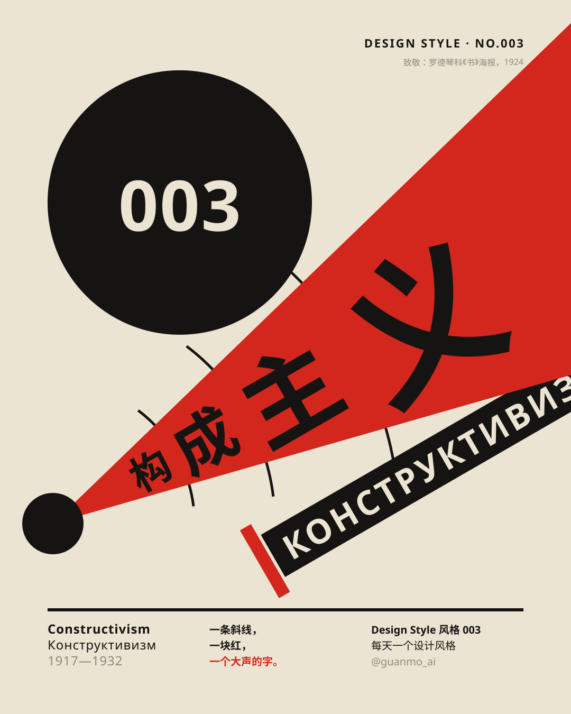
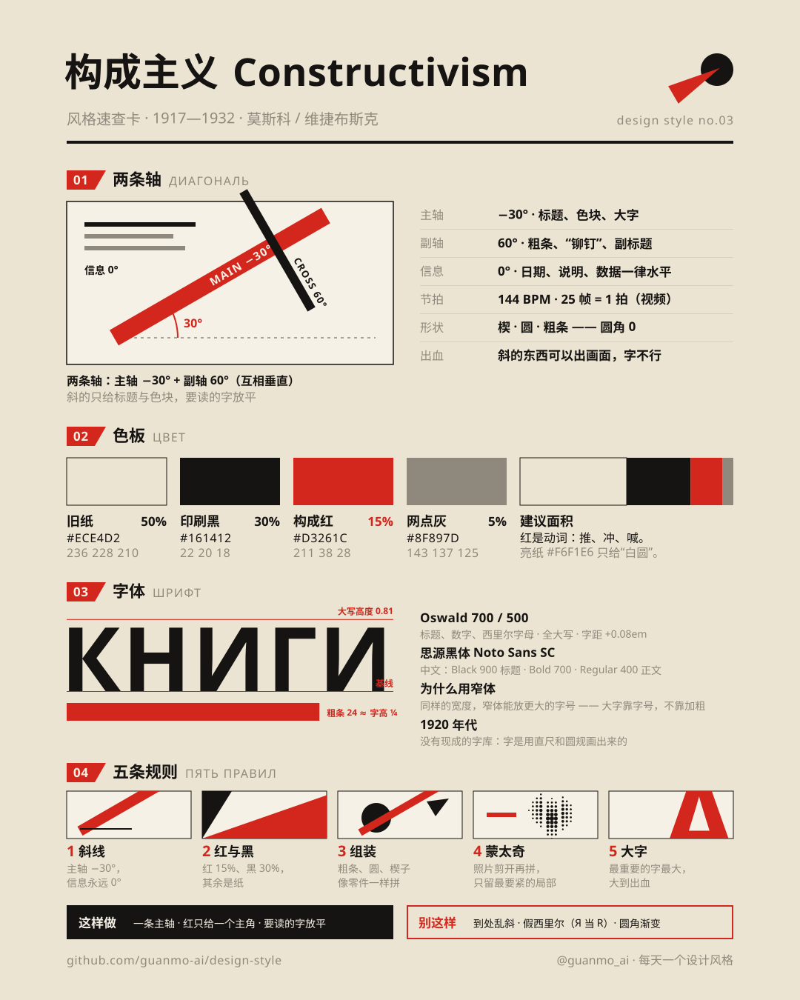
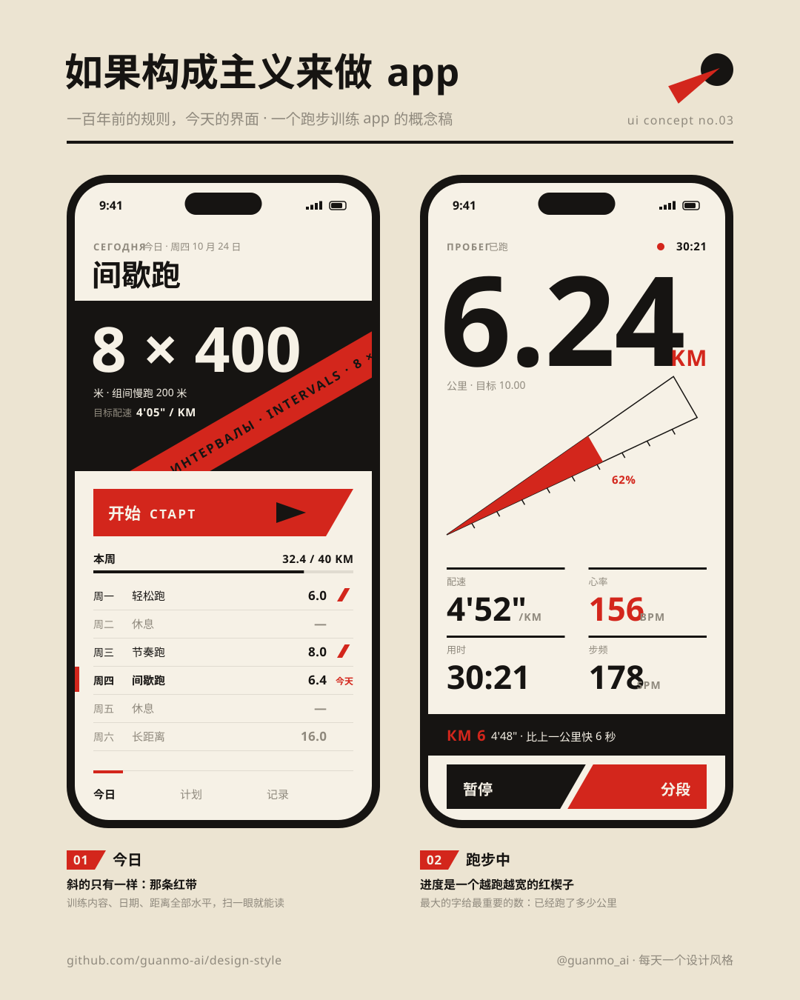

# 003 · 构成主义 Constructivism（1917—1932）

> **一句话：** 一条斜线，一块红，一个大声的字——把版面从“摆好”变成“冲出去”。

🎬 [看视频](https://github.com/guanmo-ai/design-style/releases/tag/day-03)· 🛠 [制作过程](PROCESS.md) · 🖼 [图片源文件](images)

| 海报 | 速查卡 |
|:-:|:-:|
|  |  |
| **如果构成主义来做 app** | **四步改造** |
|  |  |

---

## 1 · 它从哪来

| 年份 | 事件 |
|---|---|
| **1915—1919** | 马列维奇在彼得格勒展出《黑方块》（1915），提出“至上主义”：只用纯几何、不画任何东西。塔特林同年做“反浮雕”，把铁皮、木头、玻璃直接钉在墙角——“材料本身就是作品”。两条路一个往天上走，一个往工厂走 |
| **1919—1920** | 利西茨基在维捷布斯克做出《以红楔子打击白军》：一个红色三角刺进一个白圆，没有一个具体的人，却人人都看得懂。同年塔特林做出第三国际纪念塔的模型：计划高约 400 米，里面的立方体一年转一圈、棱锥一月一圈、圆柱一天一圈，从未建成 |
| **1920** | 莫斯科成立高等艺术与技术工作室（VKhUTEMAS），和同期的包豪斯一样，把艺术、建筑、工业设计放进同一所学校 |
| **1921** | 罗德琴科展出《纯红、纯黄、纯蓝》三块单色画，宣布“绘画结束了”。3 月，罗德琴科、斯捷潘诺娃、甘在莫斯科艺术文化研究所（INKhUK）成立“第一构成主义者工作小组”：艺术家不再画画，而是去“构成”——做海报、书、布、舞台、家具 |
| **1922** | 波波娃为梅耶荷德的《宽宏大量的绿帽子》做舞台：没有布景，只有梯子、坡道、轮子和平台，被称为第一座构成主义舞台。利西茨基在柏林出版《关于两个方块》（1920 年做成） |
| **1923—1924** | 利西茨基为马雅可夫斯基设计诗集《为了声音》，书边像通讯录一样做了指引索引。罗德琴科做《书》海报（1924，列宁格勒国家出版社），照片里莉莉娅·布里克手拢着嘴大喊，喊出来的字沿着斜线一个比一个大。波波娃和斯捷潘诺娃走进第一国营印花厂，设计几何印花布 |
| **1925—1929** | 斯坦伯格兄弟为电影做了几百张海报，用投影仪把电影画面放大描下来，再和几何拼在一起。1929 年维尔托夫的纪录片《持摄影机的人》海报，是“照片 + 几何 = 蒙太奇”最有名的一张 |
| **1930—1932** | VKhUTEMAS 关闭（1930）。1932 年苏共中央决议解散所有独立文艺团体，1934 年“社会主义现实主义”成为唯一的官方方法——构成主义作为运动结束 |
| **之后** | 包豪斯、瑞士国际主义都从这里借过斜线和无衬线。1978 年 Kraftwerk 的专辑《人机》（*The Man-Machine*）封面直接致敬利西茨基；1980 年代内维尔·布罗迪在《The Face》杂志上重新用起了它；2005 年 Franz Ferdinand 的专辑封面致敬《书》。今天的运动品牌、音乐节和发布会主视觉，只要“斜着冲出来”，多半都有它的影子 |

**为什么重要：** 构成主义第一次把“动”放进了一张静止的纸。它发现：**只要把轴转 30°，同样的几块形状和几个字就开始往前冲**。它还第一次把照片当作零件，剪开、放大、和几何拼在一起——这就是今天海报、封面、短视频片头里“照片抠图 + 色块 + 大字”的源头。

> 这一期只讲设计方法。画面里的海报、书、舞台、印花布都是按原作手法重新设计的“致敬”，不复刻原作里的政治口号。

## 2 · 五条规则

| # | 规则 | 怎么做 | 小心 |
|:-:|---|---|---|
| 01 | **斜线** Диагональ | 全图只用两条轴：主轴 −30°（从左下冲向右上）给标题和色块，副轴 60°（与主轴垂直）给粗条和副标题。要读的字（日期、说明、数据）一律水平 | 斜线不是“随便斜”：一张图里出现第三个角度，力就散了 |
| 02 | **红与黑** Красный и чёрный | 旧纸上只压红和黑两种油墨。红是动词：推、冲、喊——只给一个主角 | 别加第三种彩色；别用渐变（当年是凸版印刷，只有实色） |
| 03 | **组装** Конструкция | 用楔、圆、粗条像零件一样拼：粗条把元素“铆”在一起，楔子刺进圆，形和形之间“将碰未碰” | 别画插图、别画装饰花纹；所有东西都是直角，没有圆角 |
| 04 | **蒙太奇** Фотомонтаж | 照片剪开、放大、只留最要紧的局部（一只眼、一张嘴），再和几何拼在一起；照片做成网点灰 | 不是拼贴越多越好：一张图一个照片主角 |
| 05 | **大字** Громкий шрифт | 最重要的字放到最大，大到出血；字号可以随“音量”变：离嘴越远越大 | 别用假西里尔字母（拿 Я 当 R、И 当 N）——那是“苏联风”贴纸，不是构成主义 |

## 3 · 色板

| 名称 | HEX | RGB | 建议面积 | 用途 |
|---|---|---|:-:|---|
| 旧纸 | `#ECE4D2` | 236 228 210 | 50% | 底色。略黄的新闻纸，红和黑压上去才“印”得住 |
| 印刷黑 | `#161412` | 22 20 18 | 30% | 文字、圆、粗条、黑底。带一点暖，不是纯黑 |
| 构成红 | `#D3261C` | 211 38 28 | 15% | 楔子、锥、主角。偏橙的朱红，像廉价纸上的油墨 |
| 网点灰 | `#8F897D` | 143 137 125 | 5% | 照片网点、次要文字 |
| 亮纸 | `#F6F1E6` | 246 241 230 | — | 只给“白圆”这类需要比纸更亮的形，以及黑底上的字 |
| 构造线 | `rgba(22,20,18,.10)` | — | — | 只在讲解时显示 |

> 红的面积比瑞士风格（10%）大一些：在构成主义里，红不是点缀，而是推动画面的那股力。

## 4 · 字体

| 用途 | 本项目 | 商用原版 / 其他选择 |
|---|---|---|
| 拉丁 + 西里尔 | **Oswald** 500 / 600 / 700（免费，OFL；可变字体，自带西里尔字母） | 1920 年代没有现成字库，海报字多是用直尺和圆规手绘的压缩无衬线 · Bebas Neue（免费）· Alternate Gothic · Futura Bold Condensed |
| 中文 | **思源黑体 / Noto Sans SC** 400—900（免费，OFL） | 站酷高端黑 · 优设标题黑（免费商用的窄长标题黑体） |

**说明：** 窄体的好处是“同样的宽度能放更大的字号”——大字要大，靠的是字号，不是加粗。拉丁和西里尔字母用全大写，字距 +0.08em；中文标题用 Black 900，不加字距。

## 5 · 版式参数

**视频（1920×1080，60fps，144 BPM）**
- 轴：主轴 **−30°**，单位向量 U = (0.866, −0.5)；副轴 **60°**，N = (0.5, 0.866)。所有斜的东西都用“沿 U 走多远、沿 N 走多远”定位
- 节拍：**1 拍 = 25 帧**，每章 3 拍（75 帧），换章落在小节线上；重音落在 16 分音符（6.25 帧）上
- 开场：红楔子在 **f25** 击中黑场；f100 起，同一组元素每个附点八分音符（18.75 帧）换一次轴：0° → −30° → 双轴交叉
- 02 大字：КНИГИ 五个字母离嘴 470 / 611 / 795 / 1033 / 1343，**字号 = 0.4 × 距离**，锥的半角 13°
- 粗条 24 ≈ 大字字高的 1/4；细线 2；圆角 0；运动模糊 5 次采样；胶片颗粒 6%

**图片（1080×1350 竖图）**
- 左右边距 **90**、上下边距 **72**；速查卡沿用 001 / 002 的 6 栏（栏宽 135、间距 18）
- 海报：嘴在 (100, 990)，锥半角 14°；四个字的字号 = **0.36 × 距离**，下一个字离嘴远 1.56 倍；黑圆贴左边距，离锥的上沿 20px（将碰未碰）
- 字号阶梯：标题 52 / 小节 22 / 正文 16 / 注释 14；拉丁全大写字距 +0.08em
- 线：页眉粗线 4px，细线 1px；所有直角

## 6 · 这样做 / 别这样

**✅ 这样做：** 一条主轴 + 一条副轴 · 红只给一个主角 · 要读的字放平 · 最重要的字放到最大、允许出血 · 照片剪开只留局部 · 粗条把零件“铆”起来
**❌ 别这样：** 到处乱斜（第三个角度）· 假西里尔字母 · 渐变 · 投影 · 圆角 · 三种以上颜色 · 把斜线用在正文上

## 7 · 其他误区

- **至上主义 ≠ 构成主义。** 马列维奇的至上主义追求“纯粹的感觉”，几何漂浮在白色的宇宙里；构成主义要的是“有用”：海报、书、布、舞台。利西茨基两边都沾，所以最常被混在一起。
- **假西里尔字母不是构成主义。** 把 R 写成 Я、把 N 写成 И 是西方后来的“苏联风”玩法，俄语读者看到的是乱码。真正的构成主义海报用的就是正常的俄文。
- **不是“随便斜”。** 原作里的斜线几乎都沿着一两条固定的轴，元素之间互相平行或垂直——乱中有序，所以才有力量。
- **不是所有苏联海报都是构成主义。** 1932 年以后的宣传画大多是社会主义现实主义：写实的人物、油画质感，和构成主义正好相反。

## 8 · AI 提示词（直接复制）

**图片（Midjourney / 即梦 / ChatGPT 图像）**

```
Russian Constructivist poster, 1924 Moscow, homage to Rodchenko and El Lissitzky, one strong diagonal axis at 30 degrees,
a red wedge piercing a black circle, bold condensed sans-serif headline in real Cyrillic, letters growing larger along the diagonal
like a shout, photomontage of a halftone eye cut into strips, thick black bars bolted together, only red #D3261C and black #161412
on aged newsprint paper #ECE4D2, flat letterpress colors, sharp corners, no gradients, no shadows, no fake Cyrillic --ar 4:5
```

**视频（Runway / 可灵 / Sora）**

```
Motion graphics in Russian Constructivist style on aged newsprint: a red wedge thrusts diagonally and hits a black circle on the beat,
condensed Cyrillic letters burst out of a megaphone cone growing larger, a halftone eye slides in as three cut strips, a rotating
lattice tower, geometric textile pattern scrolling on a 30-degree grid, a stage machine of ladders and wheels assembling, a book
with thumb index flipping pages. Only red, black and paper colors, hard cuts on 16th notes, fast motion blur, 144 bpm industrial
rhythm, flat colors, no 3D render, no gradients.
```

**代码（让 AI 写网页 / 组件）**

```
用构成主义风格做这个界面：背景 #ECE4D2，文字 #161412，强调色 #D3261C（只给一个主角：主视觉或主按钮）。
字体 Oswald（拉丁 / 西里尔，全大写，letter-spacing: 0.08em）+ Noto Sans SC（标题 900）。
只有主视觉、色块和大标题沿 transform: rotate(-30deg) 倾斜，副元素用 60deg；所有要读的文字保持水平、左对齐。
用楔形（clip-path 三角）、圆、24px 粗条拼版面；border-radius: 0，不用阴影和渐变；按钮右边按 60° 切斜。
动效：元素沿 −30° 方向冲进来、猛地停住（cubic-bezier(0.2, 0.9, 0.1, 1)），落在 144 BPM 的拍子上。设计令牌见 tokens.css。
```

## 9 · 15 秒分镜

构成主义最有用的一招，是“把轴转 30°，版面就开始动”。短片从头到尾只有两条轴（−30° / 60°）、三种颜色（纸 / 黑 / 红），每一章都从上一章的一个形长出来：嘴 → 镜头 → 瞳孔 → 斜带 → 圆 → 红轮 → 红页 → 红方块。配乐是 144 BPM 的 D 小调“工厂”节奏，所有剪辑点都落在拍子上。

<a href="https://github.com/guanmo-ai/design-style/releases/tag/day-03"></a>

| 时间 | 帧 | 章节 | 画面 | 致敬 |
|---|---|---|---|---|
| 0:00—1.7 | 0—100 | 开场 | 黑场滑入，红楔子在 f25 击中（铁砧）；西里尔字母逐字打出，构成 / 主义 盖章，1917—1932 | 利西茨基 · 《以红楔子打击白军》 |
| 1.7—2.9 | 100—175 | 01 斜线 | 同一组元素每个附点八分音符重排一次：0° → −30° → 双轴交叉；整组沿主轴甩出，只留下一张嘴 | — |
| 2.9—4.2 | 175—250 | 02 大字 | 嘴里喊出红黑两色的锥，КНИГИ 一个字母比一个大；ПО ВСЕМ ОТРАСЛЯМ ЗНАНИЯ 盖章；嘴张成镜头盖满全屏 | 罗德琴科 · 《书》（1924） |
| 4.2—5.4 | 250—325 | 03 蒙太奇 | 网点眼睛切成三条滑进来，红色刻度环 + 环形字 + 胶片；推镜 34 倍扎进瞳孔 | 斯坦伯格兄弟 · 《持摄影机的人》（1929） |
| 5.4—6.7 | 325—400 | 04 塔 | 黑底上投影生长出双螺旋塔架，立方体 / 棱锥 / 圆柱依次点红；纸色斜带擦掉画面 | 塔特林 · 第三国际纪念塔（1919—1920） |
| 6.7—7.9 | 400—475 | 05 纺织 | 几何印花沿 −30° 网格滚动，四次旋转波；图案收拢，长出三个圆 | 波波娃 & 斯捷潘诺娃 · 印花布（1923—1924） |
| 7.9—9.2 | 475—550 | 06 舞台 | 三个圆变成轮子，梁、坡道、斜撑、梯子按 16 分音符搭起来；推镜扎进红色齿轮 | 波波娃 · 《宽宏大量的绿帽子》（1922） |
| 9.2—10.4 | 550—625 | 07 书 | 从红页拉远成一本带指引索引的书，翻两页：《为了声音》→《关于两个方块》；红方块飞出铺满 | 利西茨基 · 《为了声音》（1923）· 《关于两个方块》（1922） |
| 10.4—12.5 | 625—750 | 五条规则 | 斜线 / 红与黑 / 组装 / 蒙太奇 / 大字，一拍一个，每个词用自己的方法演示自己 | — |
| 12.5—15.0 | 750—900 | 片尾 | 回到开场的构图 ——「一条斜线，一块红，一个大声的字。」D 大调终止 | — |

> 画面中的海报、书、舞台、印花布都是按原作手法重新设计的“致敬”，不是原作复刻；app 概念图里的训练数据是虚构的。

## 10 · 文件

```
003-constructivism/
├─ PROCESS.md                             # 制作过程
├─ process/                               # 过程图：成片联系表 · 开场拆解 · 转场链 · 节拍时间轴
├─ tokens.ts / tokens.css / tokens.json   # 同一份设计令牌（颜色、字体、两条轴、节拍）
├─ video/Constructivism.tsx               # 短片主合成：一张 SVG 舞台按时间窗挂载各章、底栏、运动模糊、颗粒、配乐（Remotion，React）
├─ video/timeline.ts                      # 各章起点（帧）与总长
├─ video/opening.tsx                      # 开场 + 01 斜线：红楔子、标题、三次换轴；片尾复用同一构图
├─ video/chapters.tsx                     # 02 大字 · 03 蒙太奇 · 04 塔
├─ video/workshop.tsx                     # 05 纺织 · 06 舞台 · 07 书
├─ video/finale.tsx                       # 五条规则（五个词）
├─ video/ui.tsx                           # 轴坐标 P(o, d, n)、粗条、楔子、网点、推镜、盖章、致敬标注
├─ video/cover.jpg                        # 视频封面
├─ audio/make_music.py                    # 配乐：numpy 合成，144 BPM，D 小调 → D 大调，-14 LUFS
└─ images/
   ├─ make_svgs.py    # 四张图的生成脚本：主轴 / 副轴坐标，字宽按 Oswald 指定字重的真实度量计算
   ├─ poster.svg      # 海报（致敬《书》）
   ├─ cheatsheet.svg  # 速查卡
   ├─ app-ui.svg      # 如果构成主义来做 app：跑步训练
   ├─ steps.svg       # 四步改造：普通海报 → 构成主义
   └─ preview/        # 内嵌字体的自包含 SVG
```

**延伸阅读：** Christina Lodder《Russian Constructivism》（1983）· Aleksei Gan《Constructivism》（1922，2013 年英译本）· Margarita Tupitsyn《El Lissitzky: Beyond the Abstract Cabinet》（1999）· Alexander Lavrentiev《Alexander Rodchenko: Photography 1924–1954》· V&A / MoMA 线上馆藏中的 Stenberg 兄弟电影海报
