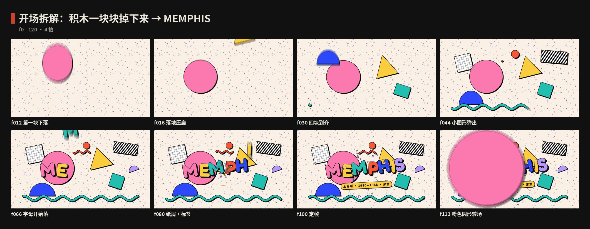
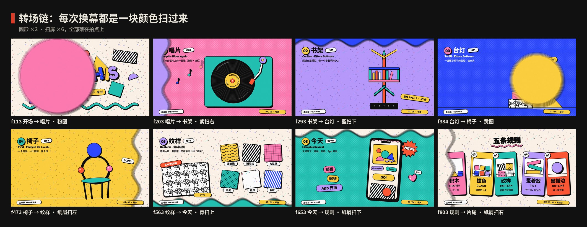
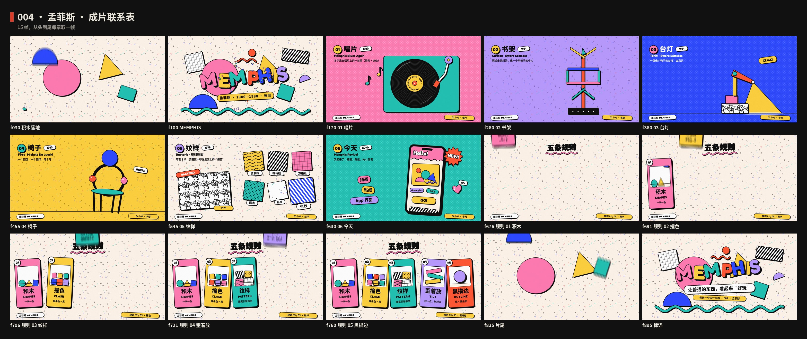
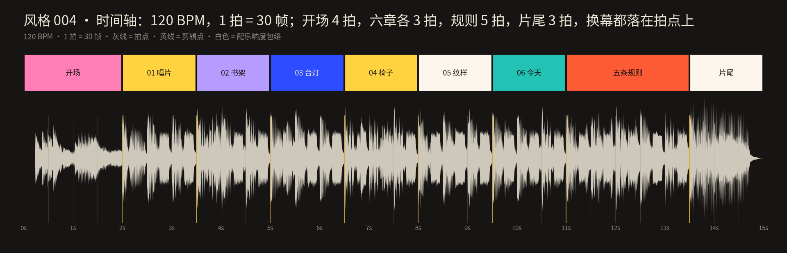

# 004 · 孟菲斯 · 制作过程

**中文** · [English](PROCESS.en.md)

> 这一期是怎么从一个想法变成 15 秒短片和 4 张图的：怎么想的、怎么做的、哪里推翻重来、下次怎么做得更好。
> 过程图都在 [`process/`](process)，可以复现的代码在 `video/` `audio/` `images/` 和根目录的 `scripts/`。

🎬 [看成片（Releases · day-04）](https://github.com/guanmo-ai/design-style/releases/tag/day-04) · 📐 [风格指南](README.md) · 🧰 [从 0 到 1：工具与流程](MAKING.md)

---

## 0 · 一览

| # | 步骤 | 产出 | 工具 / 文件 |
|:-:|---|---|---|
| 1 | 选题与定调 | 一句话定义 + 受众 + “这一期最有用的一招” | — |
| 2 | 研究 | 时间线、五条规则、广度清单、误区 | [`README.md`](README.md) §1—§7 |
| 3 | 设计令牌 | 米白 + 6 糖果色 + 黑、圆头字体、描边与硬投影、三档歪、节拍 | `tokens.ts / .css / .json` |
| 4 | 风格图 ×4 | 海报 · 速查卡 · 习惯打卡 app · 四步改造 | `images/make_svgs.py` · `scripts/build_images.py` |
| 5 | 分镜与节拍 | 9 段，30 拍；转场链：每次换幕是一块糖果色扫过来 | `video/timeline.ts` · `process/timeline.json` |
| 6 | 视频：开场 | 积木砸下来 → 波浪线 → MEMPHIS 字母落地 → 纸屑 → 圆形转场 | `video/opening.tsx` |
| 7 | 视频：六章 | 唱片 · 书架 · 台灯 · 椅子 · 纹样 · 今天 | `video/opening.tsx` · `video/chapters.tsx` · `video/finale.tsx` |
| 8 | 视频：高潮与片尾 | 五条规则五张卡片；开场积木再砸一次 | `video/finale.tsx` |
| 9 | 配乐与音效 | 120 BPM，F 大调 Italo Disco，一整首，−14 LUFS | `audio/make_music.py`（numpy 合成） |
| 10 | 质检 | 关键帧拼图、联系表、转场链、节拍时间轴 | `contact_sheet.py` · `timeline_chart.py` |
| 11 | 发布 | 分享版 MP4、封面、源码包、仓库 | ffmpeg · GitHub |

---

## 1 · 选题与定调

**为什么第四期是孟菲斯：** 前三期（包豪斯、瑞士风格、构成主义）都是现代主义一路的：克制、理性、“形式追随功能”。孟菲斯正好是反过来的那一个——它第一次大声地说“设计也可以好玩”。今天到处都是的“扁平插画 + 黑描边 + 硬投影 + 撞色”（贴纸、品牌插画、App 空状态、新粗野主义网页），源头就在这里。观众天天见，却很少有人知道它来自 1980 年米兰的一个设计小组。

**这一期最有用的一招（写在动手之前）：** *一块一色，描一圈黑边，再歪一点。* 同样的圆、三角、方块，这样处理之后就从“图标”变成了“玩具”。所有画面都围着这一招转：开场的积木、每一件家具都是“一块一色 + 黑边 + 硬投影”；速查卡第一节就是“积木”；第四张图专门演示“普通海报怎么四步改成孟菲斯”。

**定调：**

- 一句话：*让普通的东西，看起来“好玩”。*
- 受众：设计师拿去就能用（色值、描边和投影的数值、三档角度、字体、提示词、CSS 写法），普通人看完能认出“原来这就是孟菲斯”，也知道它和“80 年代霓虹怀旧”的区别。
- 质感：暖白底 + 糖果色 + 黑；所有东西都像能拿起来的塑料积木——掉下来会压扁、会回弹。
- 和前几期接上：同一套页眉页脚、同一套速查卡结构、同一个 15 秒 / 60fps / 一整首配乐的规格；前三期“红色 / 形状接力”，这一期换成**颜色接力**：每次换幕是一块糖果色扫过来。
- 边界：只讲设计方法；画面里的家具和纹样都是按原作手法重新画的“致敬”，不是原作复刻。

## 2 · 研究：先列清单，再动手

1. **时间线：** 1969 Valentine 打字机 → 1976 Studio Alchimia → 1978 Bacterio → **1980.12.11** 在索特萨斯家里成立、名字来自迪伦的歌 → **1981.9** Arc '74 首展 55 件 → 1983 First → 1985 索特萨斯离开 → 1988 解散 → 2010 年代复兴（详见 [风格指南 §1](README.md#1--它从哪来)）。
2. **规则：** 归纳成 5 条可执行的规则：积木 / 撞色 / 纹样 / 歪着放 / 黑描边，每条写“怎么做”和“小心”。
3. **广度清单**（视频六章和风格图都从这张表来——每章换一种东西，证明它不只是一种“画风”）：

   | 领域 | 人物 | 作品 | 年份 | 用在哪 |
   |---|---|---|---|---|
   | 名字 | 鲍勃·迪伦 | 《Stuck Inside of Mobile with the Memphis Blues Again》 | 1966 / 1980 | 01 唱片 |
   | 家具 · 书架 | 索特萨斯 | Carlton | 1981 | 02 书架 · 首展标签 |
   | 灯具 | 索特萨斯 | Tahiti | 1981 | 03 台灯 |
   | 椅子 | 米凯莱·德·卢基 | First | 1983 | 04 椅子 |
   | 材料 · 纹样 | 索特萨斯 · Abet Laminati | Bacterio 塑料贴面 | 1978 | 05 纹样 · 速查卡 |
   | 今天 | — | 插画、贴纸、App 界面 | 2010s— | 06 今天 · app 概念图 · 四步改造 |

4. **误区：** 孟菲斯 ≠ 美国孟菲斯市；不只是“80 年代复古”；不是越乱越好；不是儿童风。所以全片每一块都只用一种颜色、边界清楚，信息（年份、作品名、作者）全部水平排在白色标签上。
5. **核对日期：** 成立是 1980 年 12 月，首展是 1981 年 9 月——很多资料把“1981—1988”当成起止年份，本期统一用 **1980—1988**，并在书架那一章单独标出「首展 1981.9 · 55 件」。

## 3 · 设计系统先行

这一期最重要的令牌不是哪一个颜色，而是**“积木”的做法**：糖果色 + 黑描边 + 硬投影，加上落地时的“压扁”。

| 令牌 | 值 | 说明 |
|---|---|---|
| paper | `#FDF6EC` | 米白：暖一点的白，35% 面积 |
| candy ×6 | `#FF7EB6` `#FFD23F` `#22C3B5` `#2D4BFF` `#FF5A36` `#B79CFF` | 泡泡糖粉 · 柠檬黄 · 薄荷青 · 钴蓝 · 番茄红 · 淡紫；相邻两块必须不同色 |
| ink | `#111111` | 描边、硬投影、纹样、正文 |
| 字体 | Fredoka 600—700 · Noto Sans SC 500—900 · JetBrains Mono | Fredoka 是 OFL 的圆头几何无衬线，可变字重 |
| 描边 / 投影 | 视频 5 / (10, 10)；图片 4 / (8, 8)；CSS 3px / 6px | 投影不模糊，只往右下 |
| 歪 | 6° · 12° · 18° | 只给“玩具”：图形、标签、标题 |
| 压扁 | 0.24 | 落地时纵向压到 0.76、横向撑开，底边不动，再回弹 |
| 节拍 | 60 fps · 120 BPM → 1 拍 = 30 帧 | 每章 3 拍；小动作落在八分 / 十六分音符上 |

**为什么投影是“硬”的：** 柔和的阴影让东西“浮起来”、像真实的光；孟菲斯要的是“贴纸”和“印刷”的感觉——黑色的投影和描边一样，是画上去的一块形。它也让所有糖果色有了同一个“底”，再撞色也不会散。

## 4 · 风格图（4 张）

| 图 | 目的 |
|---|---|
| 海报 | 积木、方格纸、斑马纹、波浪线一起砸下来，MEMPHIS 七个字母各一种颜色、整行歪着；底部三栏信息水平排：「让普通的东西，看起来“好玩”。再加一圈黑边。」 |
| 速查卡 | 01 积木（六种形）· 02 色板与面积 · 03 纹样（细菌纹、波浪线、斑马纹、方格纸、圆点、纸屑）· 04 字体 · 05 五条规则小卡片 · 这样做 / 别这样 |
| 如果孟菲斯来做 app | 一个习惯打卡 app：每个习惯 = 一块积木，打勾 = 压一下；“全部完成！”页面像一件孟菲斯家具；连续打卡的柱状图是一摞积木。信息（习惯名、进度、日期）全部水平、黑字、白底 |
| 四步改造 | 同一张普通活动海报（周末市集），每一步只改一件事：原稿 → 积木（照片换成几何）→ 黑描边（4px 黑边 + 8px 硬投影）→ 纹样 + 歪着放。这是这一期“最能直接拿去用”的一张 |

**管线：** `images/make_svgs.py` 生成四张 SVG，四张图共用一套积木函数（每样东西 = 一块糖果色 + 4px 黑描边 + 往右下 8px 的黑色硬投影）。字宽用 fontTools 读真实度量——Fredoka 是可变字体，**先用 `instancer` 实例化到要用的字重再量** → `scripts/build_images.py`（本期给 `FACES` 加了 Fredoka）子集化字体、以 base64 WOFF 内嵌进 `preview/*.svg` → Chromium 渲染 2x PNG（2160×2700）。

## 5 · 改版记录

| 位置 | 问题 | 诊断 | 改了什么 |
|---|---|---|---|
| 日期 v1 | 开场标签和令牌写的是 1981—1988 | 把首展年份当成了成立年份 | 统一改成 **1980—1988**；书架那一章单独加标签「首展 1981.9 · 55 件」（标签宽度 400，装得下整行） |
| 开场字标（审片反馈） | MEMPHIS 七个字母的排版乱了，字母间距和位置不对 | 每个字母是一个 `<tspan>`，用绝对 `y` 定位、再加 `rotate`；在 Chromium 里这样写会打断文字的排布 | 改成相对位移 `dy`（每个字母只写和上一个字母的高度差），字母沿同一行自然排开，只让“掉下来、压扁、回弹”的动画各自错开 |
| 台灯光束（审片反馈） | 光束是淡入的，看起来发灰、像一层雾 | 透明度动画让黄色和底色混在一起，失去了“一块一色” | 光束改成从灯头往外**长出来**（按比例缩放），全程是完整的黄色，去掉透明度 |
| 底栏 | 五条规则里，底栏的“规则 0N / 05”比卡片早跳一下 | 底栏按卡片的起始帧切换，但卡片要 13 帧后才落地 | 切换点统一往后挪 13 帧（`ruleT(i) + 13`），底栏和卡片落地同时变 |
| 速查卡 | 第五节“五条规则”的小卡片底部被裁掉一截 | 小卡片的画布高度只算到卡片底边，没算投影 | 小卡片画布加高 60px，把投影也包进去 |

台灯光束和开场字标来自第一轮审片反馈，其余是用缩小图 + 关键帧拼图自查发现的。

## 6 · 开场：积木一块块掉下来



| 帧 | 动作 | 实现要点（`video/opening.tsx`） |
|---|---|---|
| 0—36 | 四块积木（粉圆、蓝半圆、黄三角、青方块）在 f14 / 22 / 29 / 36 砸下来，每一块一声“咚”（F C A F） | `drop(f, t0, fall=14, from=−900)`：14 帧加速下落 → 落地压扁 0.24 → 弹簧回弹；以底边为原点缩放，压扁时“站”在地上 |
| 28—58 | 青色波浪线从左往右画出来；f30—44 四个小图形（方格、斑马、小红圆、半圆）弹出 | 波浪线是 `Tube`：先画投影、再画黑边、再画颜色，三层同一条 path，按长度露出 |
| 62—86 | MEMPHIS 七个字母一个一个掉下来，每 4 帧一个，各一种颜色；f76 纸屑炸开；f80 黄标签「孟菲斯 · 1980—1988 · 米兰」 | 每个字母一个 `<tspan>`，用相对 `dy` 排在同一行；纸屑 44 片，带重力 |
| 100—120 | 整堆积木跟着拍子轻轻跳；f106—120 粉色圆从大圆的位置长满全屏 | `beatPulse` 每拍压一下；`Iris` 圆形转场接到下一章的粉色底 |

## 7 · 六章：颜色接力



每次换幕都是一块糖果色扫过来，扫屏的边缘是一条波浪线：**粉圆 → 紫扫右 → 蓝扫下 → 黄圆 → 纸屑扫左 → 青扫上 → 纸屑扫下 → 纸屑扫右**。上一章最后一拍的颜色，就是下一章的底色。

| 章 | 主角 | 动作 | 实现要点 |
|---|---|---|---|
| 01 唱片 | 一张唱片 | 转起来，标签环写着 MEMPHIS BLUES AGAIN · 1966；f150 唱臂摆进来落下，音符飘出 | 标签字用 `textPath` 绕圆排；唱臂落下那一帧配唱针“沙沙” |
| 02 书架 | Carlton | 底座落下，立柱长高，斜隔板一对对左右对称地弹出来，最上面一对像举起的手 | 每对隔板一个出场帧，落在八分音符上；黄标签「首展 1981.9 · 55 件」 |
| 03 台灯 | Tahiti | 底座、灯身、灯头一块块落下；f346 “咔哒”亮灯，黄色光束长出来；灯头点头 | 光束从灯头按比例长出来（完整的黄，不淡入）；黄色圆从灯头位置长满全屏，接到下一章的黄底 |
| 04 椅子 | First | 腿伸出来 → 坐垫 → 圆环画出来 → 靠背圆盘砸上去 → 两颗球“嘣嘣”弹两下 | 只用圆盘、圆环、两个球和几条腿：和原作一样，“积木”就是全部 |
| 05 纹样 | Bacterio | 一大块细菌纹贴面，六块纹样小样十六分音符一块弹出来 | 六种纹样都是 `<pattern>`，id 固定，`patternTransform` 每帧滚动一点 |
| 06 今天 | 一部手机 | 手机落地，界面元素一个个弹出；插画 / 贴纸 / App 界面三张贴纸一拍一张；NEW! 和一颗心；f622 通知“叮咚” | 手机界面就是 app 概念图的简化版——视频和图片用同一套积木 |

底栏常驻（左边“孟菲斯 MEMPHIS”，右边黄色的 `0N / 06` + 章节名），每章左上角一个章节标题：编号圆 + 标题 + 年份标签 + 作品名 + 一句话。

## 8 · 高潮与片尾

- **五条规则（f660—810）：** 五张卡片在 f670 / 685 / 700 / 715 / 730 一张张砸下来（八分音符一张），每张卡用自己的方法演示自己：“积木”掉下三块形；“撞色”六个方块的颜色一拍轮换一次；“纹样”四块方块各铺一种图案；“歪着放”三根条子以 −15° / 11° / −7° 叠起来、轻轻晃；“黑描边”一个圆先只有颜色，再画上黑线，最后投影滑出来。f780—810 军鼓滚奏 + 上升音。
- **片尾（f810—900）：** 回到开场那一堆积木再砸一次（首尾呼应），MEMPHIS 再落一遍，标语「让普通的东西，看起来“好玩”」+ 「每天一个设计风格 · 004 · 孟菲斯」。

## 9 · 联系表



## 10 · 分镜与节拍

先写时间轴（[`process/timeline.json`](process/timeline.json)），再写代码：开场 4 拍，六章各 3 拍，五条规则 5 拍，片尾 3 拍，一共 30 拍。逐帧分镜表见 [风格指南 §9](README.md#9--15-秒分镜)。



上图由 `scripts/timeline_chart.py` 直接读取最终配乐生成：章节切换全部落在拍点上，鼓点包络和积木落地对齐。

## 11 · 声音

`audio/make_music.py` 用 numpy 从零合成，没有任何外部音源（种子 1981）：

- **编排：** 120 BPM，F 大调，80 年代米兰的意大利迪斯科（Italo Disco）：四拍底鼓、八度跳跃的合成贝斯、反拍开镲、十六分音符琶音、一支方波主旋律，外加一只牛铃。和弦按章节走：F（开场 / 唱片）→ Dm（书架）→ B♭（台灯）→ C（椅子）→ Am（纹样）→ B♭ → C（今天）→ F Dm B♭ C（五条规则）→ F（片尾）。
- **音效全是“卡通”的：** 积木落地 = 调过音的“咚”（音高跟着和弦走）、弹簧球 = “嘣”、贴纸弹出 = 气泡音、字母落地 = 五声音阶一路往上的“嘀”、换幕 = 风声 + 滑哨（往下扫 = 往下滑，往上扫 = 往上滑）、台灯 = “咔哒”、唱臂 = 唱针沙沙 + 搓碟、纹样小样 = 马林巴、手机通知 = “叮咚”。
- **对位：** 所有时间点直接写帧号，和画面共用同一套数字（帧 / 60 = 秒）。
- **响度：** −14.0 LUFS，真峰值约 −3.2 dBFS。
- **局限：** 配乐只用频谱、响度和时间对齐检查过，**没有人耳试听**——发布前需要试听把关。

## 12 · 质检

1. **关键帧拼图：** `npx remotion bundle` 打包一次，`COMP=S004-Memphis node scripts/stills.mjs` 只导出受影响的几帧（检查时关掉运动模糊和配乐：`{"blur":1,"music":false}`），再拼成一张图；每改一处只看那几帧，不整片重渲。
2. **中间帧：** 掉落、压扁、扫屏这类“途中”最容易出事：每个动作至少看起点、压扁最深的那一帧、终点三帧。
3. **联系表 / 转场链：** `python3 scripts/contact_sheet.py` 从成片里精确抽帧（本页 01—03 图）。
4. **时间轴：** `python3 scripts/timeline_chart.py` 检查剪辑点与拍点。
5. **成片检查：** `ffprobe` 核对 1920×1080 · 60fps · 900 帧 · 15.06s · H.264 + AAC · yuv420p；响度复测。
6. **风格图：** 缩小到 900px 看整体（颜色是不是一块一种、主角是不是只有一个），再看 2x 原图查溢出、投影有没有被裁。

## 13 · 渲染与发布

```bash
npm run music:004                                     # 生成配乐 → public/004-memphis/music.wav
npm run render:004                                    # 配乐 + 母版 → out/004-memphis-master.mp4
ffmpeg -i out/004-memphis-master.mp4 -vf "scale=in_range=full:out_range=tv,format=yuv420p" \
  -c:v libx264 -preset slow -crf 18 -profile:v high -c:a aac -b:a 192k -movflags +faststart \
  out/004-memphis.mp4                                 # 分享版
npm run images:004                                    # 四张图：SVG → preview（内嵌字体）→ 2x PNG
```

- 运动模糊每帧 5 次采样；整片是 SVG，2 核机器上几分钟就能渲完。
- **体积：** 分享版约 43MB——颗粒只有 3.5%（003 是 6%），大块平涂的颜色也好压缩。
- 视频不进 git 仓库，发布时放 Releases（tag `day-04`），同时附一份源码包。
- 封面：开场排好的第 100 帧（MEMPHIS + 积木 + 1980—1988）→ `video/cover.jpg`。

## 14 · 踩坑记录

| 问题 | 解决 |
|---|---|
| 圆头字体很多不带完整的字重，或许可不清楚 | 用 Fredoka（OFL，可变字重 300—700），`scripts/fetch_fonts.sh` 从 Google Fonts 仓库下载 |
| Fredoka 是可变字体（字重 + 字宽两个轴），fontTools 直接读到的是默认实例的字宽 | `fontTools.varLib.instancer` 先实例化到要用的字重（字宽 100）再量 |
| 压扁动画以中心缩放，积木会“陷进地里”又“浮起来” | 以底边为原点缩放：`Drop` 传入中心到底边的距离 `hb`，压扁时底边不动 |
| 投影被画布裁掉（图片里的小卡片、视频里贴边的积木） | 画布 / 包围盒一律按“形 + 描边 + 投影”算 |
| 透明度动画让糖果色发灰（台灯光束） | 孟菲斯里尽量不用半透明：出现用“长出来 / 弹出来”，不用淡入 |
| `<tspan>` 用绝对 `y` + `rotate` 时字母排版错乱 | 改用相对 `dy`，字母沿同一行排开 |
| 沙盒中途回滚，未提交的改动全部丢失 | 从会话记录里逐条重放命令恢复，并逐像素比对重新生成的图片与审过的版本（完全一致）；之后每完成一步就先在本地提交、打包备份 |

## 15 · 下期沿用的清单

- [ ] 先写“这一期最有用的一招”，所有画面和图都围着它转
- [ ] 第四张图做成“怎么改”的教程，而不是又一张作品
- [ ] 前 2 秒就要有“哇”的东西（本期是第 14 帧砸下来的第一块积木）
- [ ] 换幕用这个风格自己的元素接力（本期是颜色接力），不硬切
- [ ] 配乐是一整首，不是几段拼起来；新风格配新乐器、新音效
- [ ] 所有尺寸从令牌算出来（描边、投影、角度、字体度量），不目测
- [ ] 核对年份：成立 / 首展 / 解散分开写清楚
- [ ] 每完成一步就本地提交 + 打包备份；`PROCESS.md` 边做边写
