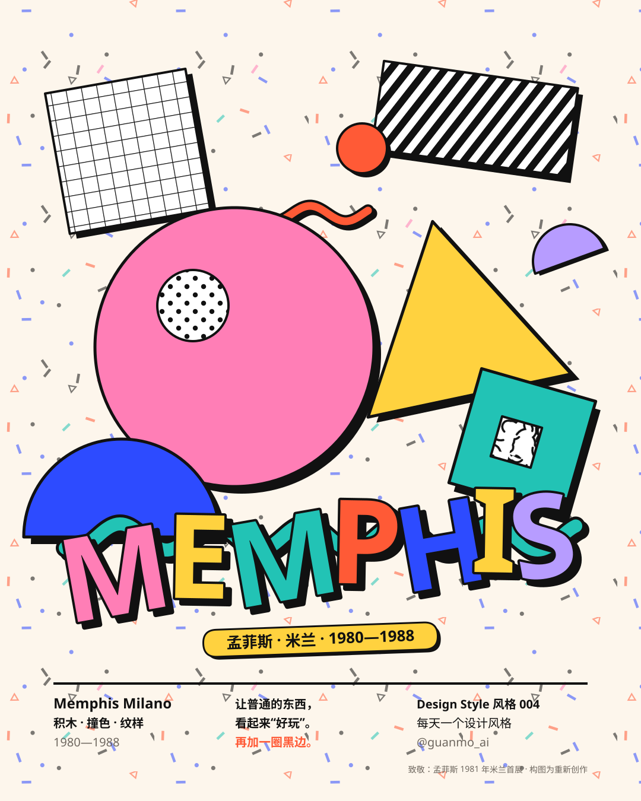
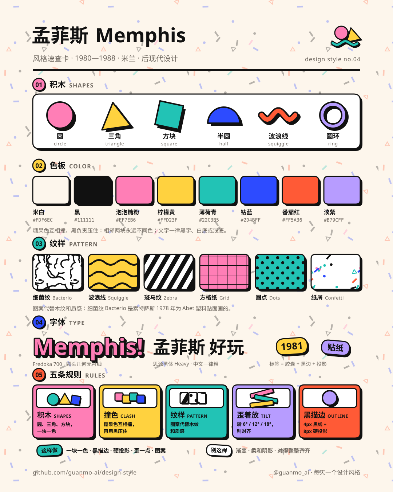
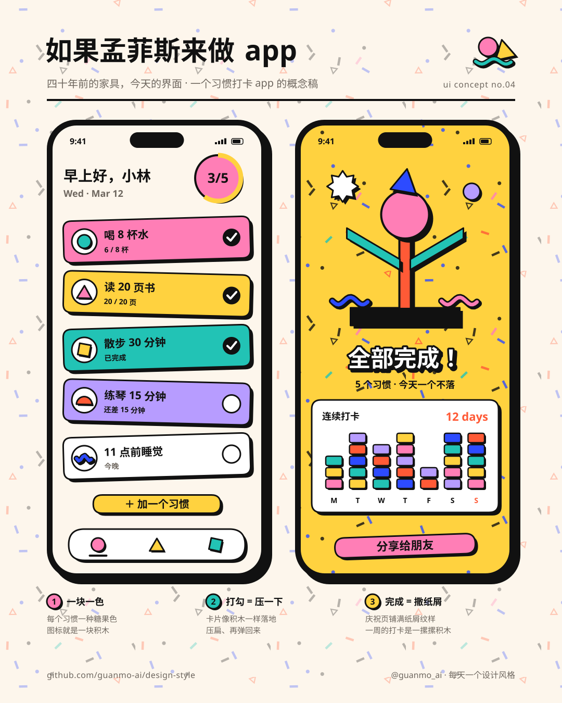
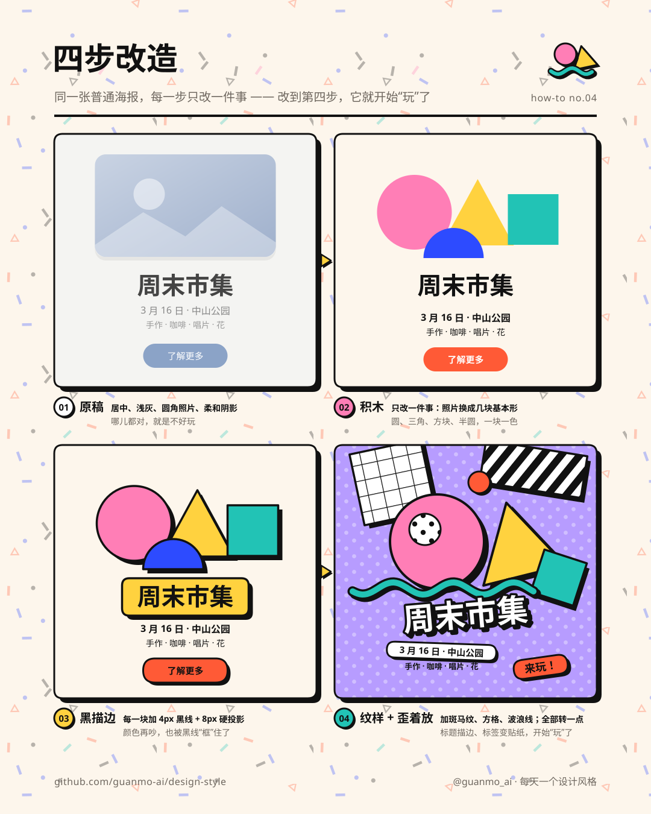

# 004 · 孟菲斯 Memphis（1980—1988）

**中文** · [English](README.en.md)

> **一句话：** 一块一色、描一圈黑边、再歪一点——让普通的东西，看起来“好玩”。

🎬 [看视频](https://github.com/guanmo-ai/design-style/releases/tag/day-04) · 🛠 [制作过程](PROCESS.md) · 🧰 [从 0 到 1：工具与流程](MAKING.md) · 🖼 [图片源文件](images)

| 海报 | 速查卡 |
|:-:|:-:|
|  |  |
| **如果孟菲斯来做 app** | **四步改造** |
|  |  |

---

## 1 · 它从哪来

| 年份 | 事件 |
|---|---|
| **1960s—1970s** | 埃托雷·索特萨斯（Ettore Sottsass）给 Olivetti 设计打字机和电脑，1969 年的红色便携打字机 Valentine 被他叫作“写诗用的打字机”。1970 年代意大利“激进设计”（Radical Design）流行起来：设计不一定要“好用、克制、正确”，也可以是一种态度。1976 年米兰成立 Studio Alchimia，索特萨斯和门迪尼（Alessandro Mendini）都参与过 |
| **1978** | 索特萨斯为塑料贴面厂 Abet Laminati 画出 **Bacterio** 纹样：一团团像显微镜下细菌的黑色小虫。塑料贴面原本是便宜的“厨房材料”，常用来仿木纹，他偏要把它印成图案，放到家具最显眼的地方 |
| **1980.12.11** | 一群年轻设计师晚上聚在索特萨斯米兰的家里，唱机一遍遍放着鲍勃·迪伦的《Stuck Inside of Mobile with the Memphis Blues Again》（1966）。大家决定成立一个设计小组，名字就叫 **Memphis**：它既是美国猫王和蓝调的城市孟菲斯，也是古埃及的都城孟菲斯——流行文化和古老文明，正好是这群人想放在一起的东西 |
| **1981.9** | 第一次展览在米兰 Arc '74 画廊开幕，一共 **55 件**家具、灯具、陶瓷和玻璃，门口挤满了人。代表作：索特萨斯的书架 **Carlton**（隔板全是斜的，像一个举着手的小人）、台灯 **Tahiti**（像一只小鸭子）、餐边柜 Casablanca；玛蒂娜·贝丁（Martine Bedin）装着轮子的台灯 Super |
| **1981—1985** | 成员和合作者越来越多：米凯莱·德·卢基（Michele De Lucchi）、娜塔莉·杜·帕斯基耶（Nathalie Du Pasquier，很多花纹和布料出自她手）、乔治·索登（George Sowden）、马泰奥·图恩（Matteo Thun）、阿尔多·奇比奇（Aldo Cibic），以及美国的彼得·夏尔（Peter Shire）、日本的仓俣史朗、梅田正德。德·卢基的椅子 **First**（1983）只用一个圆盘、一个圆环、两个球就做完了。卡尔·拉格斐用一整套孟菲斯家具布置了他在蒙特卡洛的公寓 |
| **1985** | 索特萨斯离开 Memphis，回去专心做建筑和自己的事务所 |
| **1988** | 小组正式解散。前后不到八年，却改变了整个 80 年代的样子 |
| **之后** | 1980 年代末到 90 年代初，电视片头、儿童节目、MTV、运动服和学生文具到处是糖果色、斑马纹和波浪线。2016 年大卫·鲍伊收藏的孟菲斯家具在苏富比拍卖。2010 年代它在插画、贴纸、包装和 App 界面里再一次流行起来，今天的“新粗野主义”网页和很多品牌插画，都能看到它的影子 |

**为什么重要：** 现代主义说“形式追随功能”，家具要克制、正确、耐看；孟菲斯第一次大声地说：**家具也可以好玩**。它把便宜的塑料贴面印上图案、把几何积木刷成糖果色、把书架做成一个小人——设计不只是“好用”，也可以让人笑出来。今天“扁平插画 + 黑描边 + 硬投影 + 撞色”的那一套语言，就是从这里来的。

> 这一期只讲设计方法。画面里的书架、台灯、椅子和纹样都是按原作手法重新画的“致敬”，不是原作复刻，也不是测绘图。

## 2 · 五条规则

| # | 规则 | 怎么做 | 小心 |
|:-:|---|---|---|
| 01 | **积木** SHAPES | 只用最简单的几何：圆、三角、方块、半圆、圆环、波浪线。每一块是一个完整的“零件”，一块一种颜色 | 别画写实的东西：灯就是“圆 + 三角 + 方块”，不是一盏真实的灯 |
| 02 | **撞色** CLASH | 糖果色 + 黑：粉、黄、青、蓝、橙红、淡紫，相邻的两块必须不同色；底色用暖白，让糖果色跳出来 | 别用渐变，别降饱和度；但也别一次用满七种——一个画面 3—4 种彩色就够热闹 |
| 03 | **纹样** PATTERN | 用图案代替材质：细菌纹、波浪线、斑马纹、方格纸、圆点、纸屑。图案只用黑一种颜色，铺在大块面上 | 图案下面别放要读的字；正文永远放在白底或浅底上 |
| 04 | **歪着放** TILT | 让“玩具”转一点：6°、12°、18° 三档；标签、贴纸、图形互相错开，像随手丢在桌上 | 只歪玩具，不歪信息：日期、价格、正文一律水平、左对齐 |
| 05 | **黑描边** OUTLINE | 每一块都描一圈黑边，加一个往右下的黑色**硬投影**（不模糊）；视频里描边 5 / 投影 10，图片里 4 / 8 | 投影只往一个方向；别用柔和的阴影和发光，那是另一种风格 |

## 3 · 色板

| 名称 | HEX | RGB | 建议面积 | 用途 |
|---|---|---|:-:|---|
| 米白 | `#FDF6EC` | 253 246 236 | 35% | 底色。暖一点的白，让糖果色更亮 |
| 泡泡糖粉 | `#FF7EB6` | 255 126 182 | 14% | 主角色之一：大圆、标题字母 |
| 柠檬黄 | `#FFD23F` | 255 210 63 | 14% | 三角、标签、按钮 |
| 薄荷青 | `#22C3B5` | 34 195 181 | 10% | 方块、波浪线、大底色 |
| 钴蓝 | `#2D4BFF` | 45 75 255 | 10% | 半圆、点缀；最“重”的一个彩色 |
| 番茄红 | `#FF5A36` | 255 90 54 | 5% | 小圆、强调 |
| 淡紫 | `#B79CFF` | 183 156 255 | 4% | 半圆、贴纸、背景块 |
| 黑 | `#111111` | 17 17 17 | 8% | 描边、硬投影、纹样、正文 |

> 黑是孟菲斯的“胶水”：所有糖果色靠一圈黑边才拼得住。没有黑边，同样的颜色只是“儿童风”。

## 4 · 字体

| 用途 | 本项目 | 商用原版 / 其他选择 |
|---|---|---|
| 拉丁 | **Fredoka** 600 / 700（免费，OFL；圆头几何无衬线，可变字重 300—700） | 80 年代的海报字多是手绘或照排的粗圆头字 · Cooper Black · ITC Bauhaus · Baloo 2（免费）· Rubik（免费） |
| 中文 | **思源黑体 / Noto Sans SC** 500 / 700 / 900（免费，OFL） | 站酷快乐体 · 阿里妈妈方圆体（免费商用的圆体） |
| 等宽 | **JetBrains Mono**（免费，OFL） | 小标注、页码 |

**说明：** 标题字母可以一个字母一种颜色、每个字母都描黑边加投影、整行转 −5°；正文还是普通的黑字、水平排。中文标题用 Black 900，圆头的 Fredoka 和方头的黑体放在一起，正好是“好玩 + 好读”。

## 5 · 版式参数

**视频（1920×1080，60fps，120 BPM）**
- 节拍：**1 拍 = 30 帧**；开场 4 拍，六章各 3 拍，五条规则 5 拍，片尾 3 拍；换幕都落在拍点上
- 积木：描边 **5**、硬投影 **(10, 10)**、模糊 0；掉落 14 帧，落地压扁 **0.24** 再回弹（压扁时底边不动）
- 弹出：从 0 放大、过冲再回到 1（弹簧）；退场 10 帧缩小
- 歪：**6° / 12° / 18°** 三档；字标整行 −5°，章节标签 −6°
- 转场：一块颜色扫满全屏 14 帧（扫屏 6 次）或一个圆长满全屏（2 次）；扫屏边缘是波浪线
- 运动模糊 5 次采样（快门 180°）；胶片颗粒 3.5%

**图片（1080×1350 竖图）**
- 左右边距 **90**、上下边距 **72**，与 001—003 同一套页眉页脚
- 描边 **4**、硬投影 **(8, 8)**；要读的字一律水平、黑色、放在白底或浅底上
- 字宽按 Fredoka / 思源黑体指定字重的真实度量计算；底色铺一层淡淡的纸屑

## 6 · 这样做 / 别这样

**✅ 这样做：** 一块一色 · 每块都描黑边加硬投影 · 只歪“玩具”不歪信息 · 用图案代替木纹和金属质感 · 底色留出足够的米白 · 一个画面 3—4 种彩色
**❌ 别这样：** 渐变 · 柔和阴影和发光 · 写实插画 · 把纹样铺在正文下面 · 所有东西都歪（信息也歪就读不了了）· 七种颜色一次用满

## 7 · 其他误区

- **孟菲斯 ≠ 美国孟菲斯市。** 它是 1980 年在意大利米兰成立的设计小组，名字来自一首歌；美国的孟菲斯和古埃及的孟菲斯都只是“双关”。
- **不只是“80 年代复古”。** 孟菲斯是一群设计师有意识地反对现代主义的“好品味”，有清楚的方法：几何积木、塑料贴面、图案、撞色。随便堆一些霓虹色和棕榈树，那是 Vaporwave 或 80 年代怀旧，不是孟菲斯。
- **不是“越乱越好”。** 原作看起来热闹，其实每件家具都只用几种简单的形，颜色一块一种，边界非常清楚。乱的是组合，不是每一块。
- **不是儿童风。** 孟菲斯的颜色很甜，但描边、投影和比例都很硬，作品本身是给大人的、而且往往很贵——它的幽默是“故意的不正经”。

## 8 · AI 提示词（直接复制）

**图片（Midjourney / 即梦 / ChatGPT 图像）**

```
Memphis Milano design poster, 1981, homage to Ettore Sottsass and Nathalie Du Pasquier, playful geometric shapes: a big pink circle,
a yellow triangle, a teal square, a cobalt blue half circle, a squiggle line, black and white zebra stripes and grid paper,
every shape flat candy color with a thick black outline and a hard black offset shadow (no blur), shapes slightly tilted 6 to 18 degrees,
bold rounded sans-serif title MEMPHIS with each letter in a different color, warm off-white background #FDF6EC with tiny confetti,
colors #FF7EB6 #FFD23F #22C3B5 #2D4BFF #FF5A36 #B79CFF #111111, flat vector, no gradients, no soft shadows, no 3D --ar 4:5
```

**视频（Runway / 可灵 / Sora）**

```
Motion graphics in Memphis Milano style on a warm off-white background: chunky geometric blocks (circle, triangle, square, half circle)
drop from above, squash on landing and bounce back on the beat, a teal squiggle draws itself, the word MEMPHIS falls letter by letter
in candy colors, a vinyl record spins, a tilted bookshelf pops out like a little figure, a duck-like table lamp nods and switches on,
a chair made of a disc, a ring and two balls bounces, pattern swatches (bacteria, zebra, grid, dots) pop in on 16th notes.
Every shape has a thick black outline and a hard offset shadow, transitions are flat color wipes with wavy edges, 120 bpm Italo disco,
flat 2D, no gradients, no 3D render.
```

**代码（让 AI 写网页 / 组件）**

```
用孟菲斯风格做这个界面：背景 #FDF6EC，文字 #111111，糖果色 #FF7EB6 #FFD23F #22C3B5 #2D4BFF #FF5A36 #B79CFF（每块一种，相邻不同色）。
字体 Fredoka（标题 700）+ Noto Sans SC（中文标题 900，正文 500）。
每个卡片、按钮、标签：border: 3px solid #111；box-shadow: 6px 6px 0 #111（不模糊）；圆角 12px 或 999px。
装饰图形（圆、三角、波浪线、斑马纹）可以 transform: rotate(6deg / -12deg / 18deg)；正文、日期、数字保持水平、左对齐、放在白底上。
按下按钮时 transform: translate(6px, 6px) 并收回投影；元素出现用弹簧缩放（0 → 1.08 → 1）。不用渐变、不用柔和阴影。设计令牌见 tokens.css。
```

## 9 · 15 秒分镜

孟菲斯最有用的一招，是“**一块一色，描一圈黑边，再歪一点**”——同样的圆、三角、方块，这样处理之后就从“图标”变成了“玩具”。短片里所有东西都是这样的积木：它们掉下来、压扁、弹回去，跟着 120 BPM 的意大利迪斯科（Italo Disco）一拍一拍地动；每次换幕都是一块糖果色扫过来。

<a href="https://github.com/guanmo-ai/design-style/releases/tag/day-04"></a>

| 时间 | 帧 | 章节 | 画面 | 致敬 |
|---|---|---|---|---|
| 0:00—2.0 | 0—120 | 开场 | 四块积木一块块砸下来、压扁、回弹；小图形弹出，青色波浪线画出来；MEMPHIS 七个字母一个个掉下来，纸屑炸开，标签「孟菲斯 · 1980—1988 · 米兰」；粉色圆形转场 | — |
| 2.0—3.5 | 120—210 | 01 唱片 | 鼓组进来；一张唱片转起来，标签上写着 MEMPHIS BLUES AGAIN，唱臂摆进来落下——名字来自鲍勃·迪伦的一首歌 | 鲍勃·迪伦 · 《Stuck Inside of Mobile with the Memphis Blues Again》（1966） |
| 3.5—5.0 | 210—300 | 02 书架 | 立柱和斜隔板一对对弹出来，长成一个举着手的小人；标签「首展 1981.9 · 55 件」 | 索特萨斯 · Carlton 书架（1981） |
| 5.0—6.5 | 300—390 | 03 台灯 | 底座、灯身、灯头一块块落下，“咔哒”一声亮灯，黄色光束从灯头长出来，灯头点头；黄色圆从灯头长满全屏 | 索特萨斯 · Tahiti 台灯（1981） |
| 6.5—8.0 | 390—480 | 04 椅子 | 腿伸出来、坐垫落下、圆环画出来、靠背圆盘砸上去，两颗球“嘣嘣”弹两下 | 德·卢基 · First 椅子（1983） |
| 8.0—9.5 | 480—570 | 05 纹样 | 一大块 Bacterio 塑料贴面，六块纹样小样十六分音符一块弹出来：波浪线、斑马纹、方格纸、圆点、纸屑、条纹 | 索特萨斯 · Bacterio（1978，Abet Laminati） |
| 9.5—11.0 | 570—660 | 06 今天 | 手机落地，界面元素一个个弹出；插画 / 贴纸 / App 界面三张贴纸一拍一张；通知“叮咚” | 2010 年代的孟菲斯复兴 |
| 11.0—13.5 | 660—810 | 五条规则 | 积木 / 撞色 / 纹样 / 歪着放 / 黑描边，五张卡片八分音符一张砸下来，每张卡用自己的方法演示自己 | — |
| 13.5—15.0 | 810—900 | 片尾 | 开场的积木再砸一次，MEMPHIS 再落一遍 ——「让普通的东西，看起来“好玩”」 | — |

> 画面中的书架、台灯、椅子、纹样都是按原作手法重新画的“致敬”，不是原作复刻；app 概念图里的习惯数据是虚构的。

## 10 · 文件

```
004-memphis/
├─ PROCESS.md                             # 制作过程
├─ MAKING.md                              # 从 0 到 1：用了哪些工具、按什么顺序、敲什么命令
├─ process/                               # 过程图：成片联系表 · 开场拆解 · 转场链 · 节拍时间轴 · 制作流程图
├─ tokens.ts / tokens.css / tokens.json   # 同一份设计令牌（颜色与面积、字体、描边与投影、歪的角度、节拍）
├─ video/Memphis.tsx                      # 短片主合成：一张 SVG 舞台按时间窗挂载各章、底栏、运动模糊、颗粒、配乐（Remotion，React）
├─ video/timeline.ts                      # 各章起点（帧）与总长
├─ video/opening.tsx                      # 开场（积木 → MEMPHIS）+ 01 唱片；片尾复用同一堆积木
├─ video/chapters.tsx                     # 02 书架 Carlton · 03 台灯 Tahiti · 04 椅子 First
├─ video/finale.tsx                       # 05 纹样 · 06 今天 · 五条规则 · 片尾 · 底栏
├─ video/ui.tsx                           # 积木 Blk、掉落 Drop（压扁回弹）、弹出 Pop、贴纸 Tag、波浪线、六种纹样、扫屏 / 圆形转场
├─ video/cover.jpg                        # 视频封面
├─ audio/make_music.py                    # 配乐：numpy 合成，120 BPM，F 大调 Italo Disco，-14 LUFS
└─ images/
   ├─ make_svgs.py    # 四张图的生成脚本：积木、纹样、贴纸，字宽按 Fredoka / 思源黑体的真实度量计算
   ├─ poster.svg      # 海报
   ├─ cheatsheet.svg  # 速查卡
   ├─ app-ui.svg      # 如果孟菲斯来做 app：习惯打卡
   ├─ steps.svg       # 四步改造：普通海报 → 孟菲斯
   └─ preview/        # 内嵌字体的自包含 SVG
```

**延伸阅读：** Barbara Radice《Memphis: Research, Experiences, Results, Failures and Successes of New Design》（1984）· Richard Horn《Memphis: Objects, Furniture, and Patterns》（1985）· Memphis Milano 官方网站 memphis-milano.com · 维特拉设计博物馆、V&A 的线上馆藏
