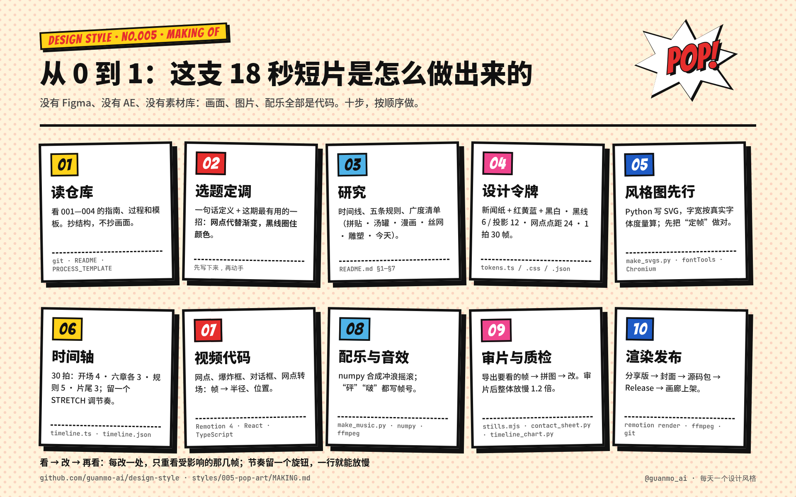

# 005 · 波普艺术 · 从 0 到 1：这支视频是怎么做出来的

> [`PROCESS.md`](PROCESS.md) 讲**设计上怎么想**：为什么这样选、哪里推翻重来。这份讲**动手怎么做**：用了哪些工具、按什么顺序、每一步敲什么命令、做到什么程度才算过关。
> 照着这份做，可以从一个空文件夹做出同样规格的一期：18 秒 · 1920×1080 · 60fps 短片，加上 4 张风格图、指南和过程文档。

🎬 [看成片（Releases · day-05）](https://github.com/guanmo-ai/design-style/releases/tag/day-05) · 📐 [风格指南](README.md) · 🛠 [制作过程](PROCESS.md) · 📦 源码包：Release 附件 `005-pop-art-source.zip`



---

## 0 · 先说结论：这一期是怎么“做”的

- **全部是代码。** 没用 Figma、After Effects、Premiere，也没用素材库、AI 生图或现成音乐。每一颗网点、每一条黑线、每一帧动画、每一声“砰”都由仓库里的源码生成，改一个数字就能重出。
- **谁做的。** 这一期由 AI 智能体（Notion AI）在一台 Linux 沙盒里完成：读仓库、查资料、写代码、渲染、看图、改版、写文档。人负责定方向、审片（本期审片的意见是“节奏有点快”，于是整体放慢 1.2 倍：15 秒 → 18 秒）和最终确认发布。
- **为什么用代码做。** ① 可复现：别人 `git clone` 下来就能重出一模一样的成片；② 可精确：黑线 6、投影 12、点距 24、最大半径 = 点距 × 0.6，全都是写死的数字；③ 可迭代：改一处只重渲那几帧，几秒钟就能看到结果——“整体放慢 1.2 倍”也只改了一个常数；④ 可恢复：本期沙盒中途**回滚了两次**，本地文件和提交全部丢失，靠从会话记录里重放命令把一切找了回来（重新渲染的成片与审过的版本逐帧比对 PSNR ≥ 35 dB，四张图一致），之后先把 WIP 分支推到了 GitHub。
- **顺序。** 文字 → 令牌 → 静态图 → 时间轴 → 动画 → 声音 → 质检 → 发布。**先把静止的画面做对，再让它动。**

## 1 · 工具箱

| 环节 | 工具 | 版本（本期） | 用来做什么 | 费用 |
|---|---|---|---|---|
| 视频 | [Remotion](https://www.remotion.dev) + React + TypeScript | 4.0.454 | 用 React 组件写视频：每一帧都是 `frame → 画面` 的函数；整片画在一张 1920×1080 的 SVG 上；`@remotion/motion-blur` 做运动模糊，`@remotion/fonts` 加载字体 | 个人与小团队免费（[许可](https://www.remotion.dev/license)） |
| 运行环境 | Node.js · Python | 24 · 3.13 | Node 跑 Remotion 与截图脚本；Python 写图片、配乐、过程图 | 免费 |
| 风格图 | Python 手写 SVG · [fontTools](https://github.com/fonttools/fonttools) | — | 按公式输出 SVG（网点、爆炸框、对话框都是算出来的路径）；用真实字体度量算字宽；子集化字体后内嵌进 SVG | 免费 |
| 渲染图片 | Playwright + Chromium | — | 把 SVG 渲染成 2x PNG；导出视频关键帧；把流程图 HTML 截成 PNG | 免费 |
| 配乐 | numpy | — | 从零合成摇摆舞鼓组、布吉贝斯、Farfisa 风琴、Karplus–Strong 冲浪吉他、铜管齐奏，以及“砰”“啵”“咔—叮！”“噗叽”“滴”……没有任何外部音源 | 免费 |
| 音视频处理 | [ffmpeg](https://ffmpeg.org) | 7.0 | 响度测量（loudnorm）、精确抽帧、封面、压分享版、逐帧比对（PSNR） | 免费 |
| 过程图 | Pillow · matplotlib · ImageMagick | — | 联系表、时间轴图、拼图、缩略图比对（`magick compare`） | 免费 |
| 字体 | [Bangers](https://fonts.google.com/specimen/Bangers) · [Noto Sans SC](https://fonts.google.com/noto/specimen/Noto+Sans+SC) · [JetBrains Mono](https://www.jetbrains.com/lp/mono/) | — | 漫画标题字；中文黑体；等宽标注。都是 OFL，可商用 | 免费 |
| 版本管理 | git · GitHub | — | 一期一个分支；视频与源码包放 Releases；画廊由 GitHub Pages 自动发布 | 免费 |

全部开源或免费，一台没有显卡的 2 核机器就能跑完整个流程。

## 2 · 准备环境（10 分钟）

```bash
git clone https://github.com/guanmo-ai/design-style.git && cd design-style
npm install                     # Remotion 等
npm run fonts                   # 字体下载到 public/fonts（不入库；本期新增 Bangers）
pip install numpy fonttools pillow matplotlib
npx playwright install chromium # 或用系统 Chromium：export CHROMIUM_PATH=$(which chromium)
npm run studio                  # 浏览器里逐帧预览，确认环境可用（选 S005-PopArt）
```

## 3 · 十步，从 0 到 1

每一步都写了：**做什么 → 产出 → 过关标准**。过关了再进下一步，返工最少。

### 01 · 读仓库（抄结构，不抄画面）

- **做什么：** 通读 001—004 的 `README.md`、`PROCESS.md`、`MAKING.md`、`tokens.*`、`video/` 和 [`docs/PROCESS_TEMPLATE.md`](../../docs/PROCESS_TEMPLATE.md)、[`docs/GALLERY.md`](../../docs/GALLERY.md)。列出每期都有的东西：60fps / 一整首配乐 / 4 张 1080×1350 图 / 统一的页眉页脚 / 指南 10 节 / 过程文档。
- **产出：** 一份“这一期必须有什么”的清单。
- **过关：** 新的一期放进目录里，和前几期并排看像是一个系列。

### 02 · 选题与“最有用的一招”

- **做什么：** 在计划列表里选下一个；写出一句话定义，再写出**这一期观众能带走的一招**。本期是：*用网点代替渐变，用粗黑线把每块颜色圈起来。*
- **产出：** 写在 `PROCESS.md` §1 的三行字。
- **过关：** 后面每一个画面、每一张图，都能回答“它在演示哪一招”。答不上来的画面删掉。

### 03 · 研究：先列清单，再动手

- **做什么：** 时间线（只写查得到的年份；本期特别核对了**1956.8「这就是明天」**、32 罐汤是 **32 张画**、首展在**洛杉矶**而不是纽约）→ 5 条可执行的规则（网点 / 黑线 / 原色 / 重复 / 拟声字，每条写“怎么做”和“小心”）→ **广度清单**：拼贴、汤罐、网点、丝网、软雕塑、今天 → 常见误区（波普不是从美国开始的、网点不是装饰花纹）。
- **产出：** `README.md` §1—§7 的草稿。广度清单直接变成视频的六章。
- **过关：** 每个人名、作品名、年份都能对上来源。

### 04 · 设计令牌：先定“系统”，再画画面

- **做什么：** 新闻纸底 + 红黄蓝三原色 + 两个点缀色（含面积比例）、字体、黑线与硬投影、**网点（点距、最大半径、六角排列）**、节拍。一份数值写进 `tokens.ts`（视频用）、`tokens.css`（网页用）、`tokens.json`（画廊与 AI 用）。
- **关键代码：** 这一期最重要的令牌是本戴点。一片网点 = 六角排列的一堆点，半径由一个函数决定；上万颗点合成**一条 path**，渲染才跑得动：

  ```tsx
  // video/ui.tsx：一片网点，半径 r(x, y) 决定深浅（≤ 0.4 不画）
  export const dotsD = (x0, y0, w, h, pitch, r) => {
    let d = '';
    const dy = pitch * 0.866;                                   // 六角排列：行距 = 点距 × √3/2
    let j = 0;
    for (let y = y0; y <= y0 + h + dy; y += dy, j++)
      for (let x = x0 + (j % 2 ? pitch / 2 : 0); x <= x0 + w + pitch; x += pitch) {   // 每行错开半个点距
        const rr = r(x, y);
        if (rr > 0.4) d += circ(rr, x, y);
      }
    return d;
  };
  ```

  每样东西都是同一块“漫画积木”——先画硬投影，再画平涂色、网点，最后描黑线：

  ```tsx
  export const Blk = ({d, fill, sw = LINE.outline, sh = SHADOW.dx, pat, po = 1, o}) => (
    <g opacity={o}>
      {sh > 0 && <path d={d} fill={C.ink} transform={`translate(${sh} ${sh})`} />}
      <path d={d} fill={fill} />
      {pat && <path d={d} fill={`url(#${pat})`} opacity={po} />}
      {sw > 0 && <path d={d} fill="none" stroke={C.ink} strokeWidth={sw} strokeLinejoin="round" />}
    </g>
  );
  ```
- **过关：** 画面上没有一个数字是“目测”的；画面里没有一处渐变，深浅全靠网点。

### 05 · 风格图先行（先把静止的画面做对）

- **做什么：** `images/make_svgs.py` 一次生成 4 张 SVG（海报 · 速查卡 · 便利店点单 app · 四步改造）→ `scripts/build_images.py`（本期给 `FACES` 加了 Bangers）子集化字体、内嵌进 `preview/*.svg` → Chromium 渲染 2x PNG。
  ```bash
  npm run images:005
  ```
- **要点：** 对话框和尾巴要**一笔画完**（一条完整轮廓），否则接缝处两条黑线叠在一起；估中文字宽时，思源黑体的“·”是全角，按 1 个字宽算。
- **过关：** 缩小到 900px 看，网点在表达深浅、主角只有一个；放大到 2x 看，没有溢出、投影没有被裁。这几张图就是视频的“定帧”：手机里的对话框、爆炸框和 app 概念图用的是同一套画法。

### 06 · 时间轴：先写节拍，再写动画

- **做什么：** 先定 BPM，再把时长切成拍。剧本按 120 BPM、60fps 写 → 1 拍 = 30 帧，900 帧 = 30 拍：开场 4 · 六章各 3 · 五条规则 5 · 片尾 3。
- **整体放慢：** 审片说“节奏有点快”，于是加了一个常数 `STRETCH = 1.2`：剧本帧 × 1.2 = 成片帧，900 → 1080 帧（15 → 18 秒），120 → 100 BPM。所有关键帧一个都不用改：
  ```tsx
  // video/PopArt.tsx：场景按“剧本帧”写；成片帧 ÷ STRETCH = 剧本帧（小数帧也能算，动作平滑地慢下来）
  const f = useCurrentFrame() / STRETCH;
  ```
- **产出：** `video/timeline.ts`（代码用）+ `process/timeline.json`（画图、画廊用，写的是成片帧）。
- **过关：** 每次换幕都落在拍点上；每章只有一个主角、一个动作。

### 07 · 视频代码：每一帧是一个函数

- **文件结构：**

  | 文件 | 内容 |
  |---|---|
  | `video/PopArt.tsx` | 总装：一张 SVG 舞台按时间轴挂载各章、`STRETCH` 换算、运动模糊（每帧 5 次采样）、胶片颗粒、配乐 |
  | `video/ui.tsx` | 本期的“工具箱”：漫画积木 `Blk`、网点 `dotsD` / `Dots`、集中线 `Speed`、爆炸框 `burstD`、对话框 `Bubble`、拟声字 `Bang`、旁白框 `Box`、弹出 `Pop`、拍上来 `Slap`、掉落 `Drop`、网点转场 `DotWipe`、爆炸框转场 `BurstIris`、章节标题 `Caption` |
  | `video/opening.tsx` | 开场（网点长出来 → 爆炸框“砰” → POP!）+ 01 拼贴 |
  | `video/chapters.tsx` | 02 汤罐 · 03 网点 · 04 丝网 |
  | `video/finale.tsx` | 05 放大 · 06 今天 · 五条规则 · 片尾 · 常驻底栏 |
  | `video/timeline.ts` | 时间轴 `AT`、`STRETCH`、章节表 |
  | `src/Root.tsx` | 注册 `S005-PopArt` |

- **一个转场是怎么写出来的（网点接力）：** 下一章的底色以网点的形式长出来：一个“前沿”扫过画面，前沿后面的点半径从 0 长到点距 × 0.62，相邻的点连成一片，就变成了实色——像印刷时油墨越压越重：
  ```tsx
  // 示意：第 02 章结束前 16 帧，白点从上往下长满，成为第 03 章的底色
  <DotWipe f={f} t={AT.dots} c={C.white} dir="down" />
  ```
- **三条让动效“顶尖”的做法：**
  1. **一切都像印出来的。** 没有渐变、没有柔光：深浅用网点，边界用黑线，阴影是往右下错开的一块黑；丝网那一章故意让黑版错开 (12, −8)。
  2. **转场用网点接力，不硬切。** 章与章之间的六次换幕都是网点长满（方向轮流换：右、下、左、从中心、左、上），长出来的颜色就是下一章的底色；进出开场和片尾用一个长满全屏的爆炸框。
  3. **一个动作配一个拟声字。** 爆炸框“砰”、POP!、POW!、BANG!、ZOOM!——画面上写出来的字，耳朵里也听得到。
- **过关：** `npm run studio` 里逐帧拖，任何一帧截下来都能当一格漫画。

### 08 · 配乐与音效：和画面共用帧号

- **做什么：** `audio/make_music.py` 用 numpy 合成一整首 C 大调、I–vi–IV–V 的 60 年代小曲（种子 1962）。音效直接写**剧本帧号**，和画面用同一套数字；`fr()` 里乘上同一个 `STRETCH`，放慢之后依然严丝合缝：
  ```python
  def fr(frame):                    # 剧本帧 → 秒：frame × 1.2 / 60
      return frame * STRETCH / 60.0

  sfx(boom(1.0), fr(58), 0.55, send=0.25)            # 爆炸框“砰”
  sfx(cork(1.0), fr(61), 0.45, send=0.3)             # POP! 拔瓶塞“啵”
  sfx(register(1.0), fr(270), 0.32, 0.1, send=0.3)   # 汤罐翻面换色：收银机“咔—叮！”
  ```
- **响度：** 合成后用 ffmpeg loudnorm 测量、迭代到 **−14 LUFS**（流媒体平台的标准），真峰值 < −1 dBTP。
  ```bash
  npm run music:005   # → public/005-pop-art/music.wav
  ```
- **过关：** 每一次拍上来、弹出、翻面都有声音；一整首，不是几段拼起来。**要有人戴耳机听一遍。**

### 09 · 质检循环：看 → 改 → 再看

不整片重渲，只看受影响的几帧：

```bash
npx remotion bundle src/index.ts --out-dir out/bundle                     # 打包一次
COMP=S005-PopArt PROPS='{"blur":1,"music":false}' \
  node scripts/stills.mjs out/bundle out/check 60 110 300 420 700          # 几秒钟出这几帧（成片帧号）
python3 scripts/contact_sheet.py out/sheet.jpg --cols 5 \
  "out/check/f060.png|f060 网点" "out/check/f110.png|f110 POP!" ...       # 拼成一张图看
```

- 动作至少看起点、中间、终点三帧——**网点转场、汤罐翻面、刮板这类“途中”最容易出事**。
- 成片出来后：`contact_sheet.py --video` 精确抽帧做联系表，`timeline_chart.py` 叠上配乐波形检查剪辑点是否落在拍子上，`ffprobe` 核对规格（1920×1080 · 60fps · 1080 帧 · H.264 + AAC · yuv420p）。
- 改版记录写进 `PROCESS.md` §5：位置 · 问题 · 诊断 · 改了什么。

### 10 · 渲染与发布

```bash
npm run render:005    # 配乐 + 母版：out/005-pop-art-master.mp4（crf16）
ffmpeg -i out/005-pop-art-master.mp4 -vf "scale=in_range=full:out_range=tv,format=yuv420p" \
  -c:v libx264 -preset slow -crf 18 -profile:v high -c:a aac -b:a 192k -movflags +faststart \
  out/005-pop-art.mp4                                # 分享版（各平台都能播）
ffmpeg -i out/005-pop-art.mp4 -vf "select=eq(n\,110)" -frames:v 1 -q:v 2 styles/005-pop-art/video/cover.jpg   # 封面
```

1. 过程图：联系表、开场拆解、转场链、时间轴、流程图 → `process/`。
2. 提交：一期一个分支，视频不进 git。**做到一半就先推一个 WIP 分支**——本期就是靠它扛过了沙盒回滚。
3. 源码包：`git archive` 打出本期的源码（含共享脚本和工具清单）→ `005-pop-art-source.zip`。
4. Release：tag `day-05`，上传 `005-pop-art.mp4` 和源码包，正文附 SHA-256。
5. 画廊：向 `gallery/data/works.json` 添加条目（SHA-256 与 Release 一致），运行 `npm run gallery:readme`、`gallery:test`、`gallery:build`、`gallery:check`。

## 4 · 和 AI 一起做：开工提示词

这一期就是由 AI 智能体做的。想让 AI 帮你做下一期，可以从这段开始（把风格名换掉）：

```text
你在 design-style 仓库里做第 NNN 期：「风格名」。
1. 先读 styles/001—005 的 README.md、PROCESS.md、MAKING.md 和 docs/ 下的模板，列出每期必须有的产出。
2. 写一句话定义和「这一期观众能带走的一招」，之后所有画面都围着它。
3. 研究：时间线（只写能查证的，首展 / 成立 / 解散分开写）、3—5 条可执行规则、广度清单（≥6 个领域）、常见误区。
4. 先写 tokens（颜色+面积比、开源字体、线宽、BPM 换算成帧），再用 Python 生成 4 张 1080×1350 SVG。
5. 先写 timeline（每章 3 拍、换幕落在拍点），再写 Remotion 组件；转场用这个风格自己的元素接力，不硬切。
   场景按「剧本帧」写，留一个 STRETCH 常数，方便审片后整体调快慢。
6. numpy 合成一整首配乐，音效写帧号（和画面共用同一个 STRETCH），响度 −14 LUFS。
7. 每改一处只导出受影响的帧检查，转场必看中间帧；把改版记录写进 PROCESS.md。
8. 每完成一步就本地提交，并尽早推一个 WIP 分支到远端。
9. 交付：分享版 MP4、封面、process/ 过程图、README / PROCESS / MAKING 三份文档、源码包、gallery 条目。
```

**和 AI 协作的经验：**
- **让 AI 看图，而不是只看代码。** 每一轮都导出截图让它自己检查；本期对话框的接缝、剪纸白边压住黑线、汉堡的影子提前出现，都是“看图”发现的。
- **给数字，不给形容词。** “网点密一点”不如“点距 24、最大半径 = 点距 × 0.6”；“慢一点”不如“整体放慢 1.2 倍”。
- **人来看节奏、听声音。** AI 能测响度、对齐拍点，但“快不快”“好不好听”要人来判断——本期唯一一条审片意见就是节奏。
- **勤提交、早推送。** 本地提交扛不住沙盒回滚；本期回滚两次之后，靠重放命令恢复，再也没出事的办法是**每一步都推到远端**。

## 5 · 投入与产出

| 项 | 数字 |
|---|---|
| 源码 | 视频约 1,170 行 TS · 配乐约 780 行 Python · 风格图约 790 行 Python |
| 外部素材 | 0（没有照片、没有音源、没有 AI 生图） |
| 单帧预览 | 每帧几百毫秒（半尺寸、关掉模糊） |
| 整片渲染 | 2 核机器约 13 分钟（每帧 5 次运动模糊采样；满屏网点的 path 比上一期多很多） |
| 成片 | 分享版约 48MB（满屏网点 + 颗粒，比大块平涂难压缩） |

## 6 · 文件地图

```
styles/005-pop-art/
├─ README.md        # 风格指南：历史 · 规则 · 色板 · 字体 · 版式 · 误区 · 提示词 · 分镜
├─ PROCESS.md       # 制作过程：怎么想、哪里推翻重来
├─ MAKING.md        # 本文：用什么工具、按什么顺序、敲什么命令
├─ tokens.{ts,css,json}
├─ video/           # Remotion 源码 + cover.jpg
├─ audio/make_music.py
├─ images/          # make_svgs.py → *.svg → preview/（内嵌字体）→ png/（2x）
└─ process/         # 01 联系表 · 02 开场拆解 · 03 转场链 · 04 时间轴 · 05 本文流程图（.html 源文件可改）
```
