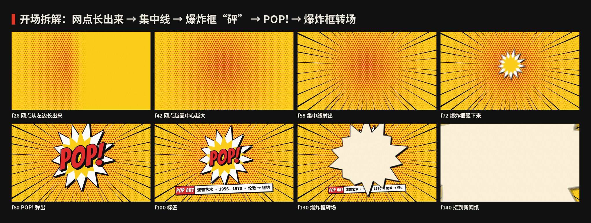
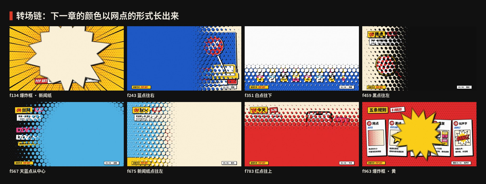
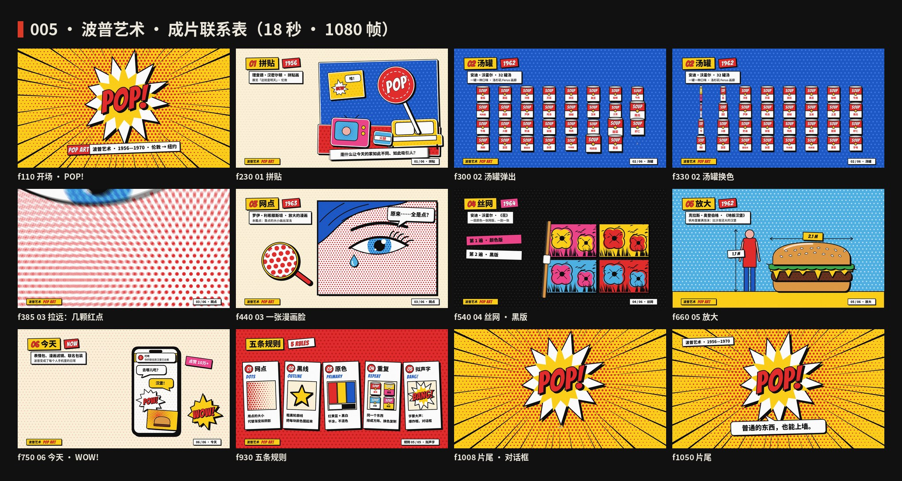
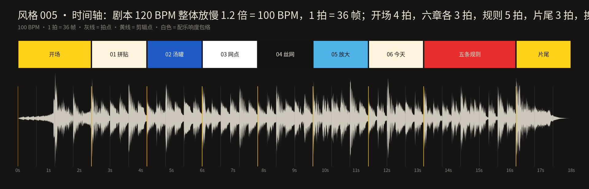

# 005 · 波普艺术 · 制作过程

**中文** · [English](PROCESS.en.md)

> 这一期是怎么从一个想法变成 18 秒短片和 4 张图的：怎么想的、怎么做的、哪里推翻重来、下次怎么做得更好。
> 过程图都在 [`process/`](process)，可以复现的代码在 `video/` `audio/` `images/` 和根目录的 `scripts/`。

🎬 [看成片（Releases · day-05）](https://github.com/guanmo-ai/design-style/releases/tag/day-05) · 📐 [风格指南](README.md) · 🧰 [从 0 到 1：工具与流程](MAKING.md)

---

## 0 · 一览

| # | 步骤 | 产出 | 工具 / 文件 |
|:-:|---|---|---|
| 1 | 选题与定调 | 一句话定义 + 受众 + “这一期最有用的一招” | — |
| 2 | 研究 | 时间线、五条规则、广度清单、误区 | [`README.md`](README.md) §1—§7 |
| 3 | 设计令牌 | 新闻纸 + 红黄蓝 + 荧光粉 / 天蓝 + 黑白、Bangers、粗黑线与硬投影、本戴点、节拍 | `tokens.ts / .css / .json` |
| 4 | 风格图 ×4 | 海报 · 速查卡 · 便利店点单 app · 四步改造 | `images/make_svgs.py` · `scripts/build_images.py` |
| 5 | 分镜与节拍 | 9 段，30 拍；转场链：下一章的颜色以网点的形式长出来 | `video/timeline.ts` · `process/timeline.json` |
| 6 | 视频：开场 | 网点长出来 → 集中线 → 爆炸框“砰” → POP! → 爆炸框转场 | `video/opening.tsx` |
| 7 | 视频：六章 | 拼贴 · 汤罐 · 网点 · 丝网 · 放大 · 今天 | `video/opening.tsx` · `video/chapters.tsx` · `video/finale.tsx` |
| 8 | 视频：高潮与片尾 | 五条规则五张卡片；开场的爆炸框再砸一次 | `video/finale.tsx` |
| 9 | 配乐与音效 | 60 年代冲浪摇滚，C 大调，一整首，−14 LUFS | `audio/make_music.py`（numpy 合成） |
| 10 | 审片与放慢 | 审片后整体放慢 1.2 倍：15 秒 → 18 秒，120 → 100 BPM | `timeline.ts` 的 `STRETCH` |
| 11 | 质检 | 关键帧拼图、联系表、转场链、节拍时间轴 | `contact_sheet.py` · `timeline_chart.py` |
| 12 | 发布 | 分享版 MP4、封面、源码包、仓库 | ffmpeg · GitHub |

---

## 1 · 选题与定调

**为什么第五期是波普：** 上一期孟菲斯讲“家具也可以好玩”，波普比它早二十多年，说的是一件更大的事：**普通的东西，也能上墙**。今天电商大促页、包装、表情包、手机里的“漫画滤镜”，用的几乎都是波普那几招——网点、粗黑线、原色、重复、拟声字。观众天天在用，却很少知道它们都来自 60 年代的印刷品。

**这一期最有用的一招（写在动手之前）：** *用网点代替渐变，用粗黑线把每块颜色圈起来。* 同样的红黄蓝，这样处理之后就从“扁平插画”变成了“从漫画书里剪下来的”。所有画面都围着这一招转：开场是一页长满红点的黄纸；第三章的镜头从几颗红点拉远成一张脸；速查卡第一节就是“网点 10% → 100%”；第四张图演示“普通海报怎么四步改成波普”。

**定调：**

- 一句话：*普通的东西，也能上墙。*
- 受众：设计师拿去就能用（色值、黑线和投影的数值、网点的点距和半径、对话框和爆炸框的做法、字体、提示词、CSS 写法），普通人看完能认出“原来这就是波普”，也知道它不只是沃霍尔。
- 质感：新闻纸 + 原色 + 黑；所有东西都像印出来的——平涂、网点、墨线，偶尔对不准。
- 和前几期接上：同一套页眉页脚、同一套速查卡结构、60fps / 一整首配乐的规格；转场换成**网点接力**：下一章的底色以网点的形式长出来，越长越大，最后连成一片（像印刷时油墨越压越重）。
- 边界：只讲设计方法；画面里的作品都是按原作手法重新画的“致敬”；汤罐不用任何真实品牌的标识和字样。

## 2 · 研究：先列清单，再动手

1. **时间线：** 1947 包洛奇拼贴里的 POP! → 1952 独立小组 → **1956.8** 「这就是明天」与汉密尔顿的拼贴 → 1957 汉密尔顿的定义 → 1961—1963 利希滕斯坦 → **1962** 沃霍尔 32 罐汤、奥登伯格《地板汉堡》、「新现实主义者」展 → 1964 《花》与“工厂” → 1967 《佩珀军士》封面 → 1970 前后散开 → 今天（详见 [风格指南 §1](README.md#1--它从哪来)）。
2. **规则：** 归纳成 5 条可执行的规则：网点 / 黑线 / 原色 / 重复 / 拟声字，每条写“怎么做”和“小心”。
3. **广度清单**（视频六章和风格图都从这张表来——每章换一个人、一种方法）：

   | 领域 | 人物 | 作品 | 年份 | 用在哪 |
   |---|---|---|---|---|
   | 拼贴 | 理查德·汉密尔顿 | 《是什么让今天的家如此不同、如此吸引人？》 | 1956 | 01 拼贴 |
   | 绘画 · 重复 | 安迪·沃霍尔 | 32 罐汤 | 1962 | 02 汤罐 · 规则 04 · app 概念图 |
   | 绘画 · 网点 | 罗伊·利希滕斯坦 | 放大的漫画（《溺水的女孩》等） | 1961—1963 | 03 网点 · 规则 01 · 海报 |
   | 丝网印刷 | 安迪·沃霍尔 | 《花》 | 1964 | 04 丝网 · 四步改造 |
   | 雕塑 | 克拉斯·奥登伯格 | 《地板汉堡》 | 1962 | 05 放大 |
   | 今天 | — | 表情包、漫画滤镜、联名包装 | 2010s— | 06 今天 · app 概念图 |

4. **误区：** 波普不是从美国开始的；网点不是装饰花纹；不等于孟菲斯；不只是“赞美消费”。所以开场标签写「1956—1970 · 伦敦 → 纽约」，第一章从伦敦的拼贴讲起；第三章专门让画里的人说一句「原来……全是点？」。
5. **核对：** 汤罐是 **32 张**（不是 32 罐挂在墙上的照片），首展在**洛杉矶** Ferus 画廊、不是纽约；《地板汉堡》约 1.3 × 2.1 米，视频里的比例尺按这个画。

## 3 · 设计系统先行

这一期最重要的令牌是**本戴点**：它决定了深浅、底纹，甚至转场。

| 令牌 | 值 | 说明 |
|---|---|---|
| paper | `#FFF4DC` | 新闻纸：偏黄的白，25% 面积 |
| 原色 ×3 | `#FFD31A` `#E62E2D` `#1E5BC6` | 黄 · 红 · 蓝，平涂 |
| 点缀 ×2 | `#F0458E` `#4FB3E8` | 沃霍尔荧光粉（丝网的“错版色”）· 漫画天蓝 |
| ink / white | `#111111` / `#FFFFFF` | 墨线、投影 / 对话框、网点的空隙 |
| 本戴肤色 | `#F7B5A8` | 白底上的红点远看就是这个颜色；画面里尽量用“白底 + 红点”，不用这个实色 |
| 字体 | Bangers · Noto Sans SC 500—900 · JetBrains Mono | Bangers 是 OFL 的漫画标题字 |
| 黑线 / 投影 | 视频 6 / (12, 12)；图片 4 / (8, 8)；CSS 4px / 6px | 投影不模糊，只往右下 |
| 网点 | 六角排列，点距 24（图片 14），最大半径 = 点距 × 0.6 | 半径 0.6 × 点距时相邻的点正好连成一片 |
| 节拍 | 剧本 120 BPM / 1 拍 30 帧 → 成片放慢 1.2 倍 = 100 BPM / 1 拍 36 帧 | 每章 3 拍；小动作落在八分 / 十六分音符上 |

**为什么网点是六角排列：** 方格排列的点在斜方向上会露出一条条“空道”，看起来像格子布；六角排列（每行错开半个点距）是印刷网屏的做法，远看更均匀，近看又是一颗颗点。代码里一块“砖”只放两颗点，铺出来就是六角形。

## 4 · 风格图（4 张）

| 图 | 目的 |
|---|---|
| 海报 | 一格漫画：黄底上红色网点从中心往外变小，集中线，白色爆炸框里一声 POP!；角上一罐汤、一个对话框「普通的东西，也能上墙。」；底部三栏信息水平排 |
| 速查卡 | 01 网点（10%—100% 七档，外加“红点 + 白 = 肤色”）· 02 色板与面积 · 03 对话框与拟声字（对话 / 想法 / 旁白 / 爆炸 / 拟声字 / 集中线）· 04 字体 · 05 五条规则小卡片 · 这样做 / 别这样 |
| 如果波普来做 app | 一个便利店点单 app：货架页每件商品是一格漫画（汤罐、汉堡、汽水、冰淇淋）；“下单成功！”页是一页三格漫画：接单 → 骑手出发 ZOOM! → 敲门 KNOCK KNOCK!；价格用 Bangers，信息放在白框和黄框里 |
| 四步改造 | 同一张普通活动海报（周末市集），每一步只改一件事：原稿 → 平涂 + 黑线 → 原色 + 网点 → 重复 + 拟声字。这是这一期“最能直接拿去用”的一张 |

**管线：** `images/make_svgs.py` 生成四张 SVG，共用一套“漫画书”积木（平涂原色 + 4px 黑线 + 往右下 8px 的硬投影；深浅一律用网点）。字宽用 fontTools 读 Bangers 和思源黑体的真实度量 → `scripts/build_images.py`（本期给 `FACES` 加了 Bangers）子集化字体、以 base64 WOFF 内嵌进 `preview/*.svg` → Chromium 渲染 2x PNG（2160×2700）。

## 5 · 改版记录

| 位置 | 问题 | 诊断 | 改了什么 |
|---|---|---|---|
| 对话框 | 尾巴和框之间有一道黑缝，像两块拼起来的 | 框和尾巴是两个形，各描一圈黑线，接缝处两条线叠在一起 | `bubbleD` 改成**一条完整的轮廓**：圆角框走到尾巴根部时拐出去到尾巴尖、再拐回来，一笔画完 |
| 拼贴的剪纸 | 白边盖住了黑线，剪纸像“发光” | 先画黑线再画白边，白边把线压掉了一半 | 改成：黑色硬投影 → 22px 黑线 → 14px 白边 → 颜色，留出一圈细黑线包住白边——像从杂志上剪下来再描了一道 |
| 中文标签宽度 | 带“·”的中文标签右边空出一截，或者字顶到框边 | 估字宽时把“·”按半个字算，但思源黑体里的“·”是全角 | `tw()` 里中文字体的“·”按 1 个字宽算 |
| 01 沙发 | 沙发看起来像一块面包 | 只画了一个外轮廓，没有扶手和靠垫 | 重画：靠背 + 两块靠垫 + 坐垫 + 两条腿 |
| 04 丝网的花 | 黑版的花瓣轮廓互相压在一起，花心一团黑 | 四片花瓣各自描边，重叠处的线都画出来了 | 用 `mask` 只描花朵的**外轮廓**，花瓣之间改成四条细线 |
| 02 汤罐 | 32 罐在画面里显得小、四周空 | — | 整体放大 1.08 倍 |
| 06 今天 | 通知横幅压到了群聊标题上；POW! 太靠边 | — | 通知往上收 50px；POW! 往里挪 20px |
| 05 放大 | 汉堡下面的黑色影子在落地前就出现了 | 影子是固定的一个椭圆，不跟着汉堡动 | 去掉影子：每一层自己的硬投影已经够了 |
| 速查卡 | 五节之间的间距不均，最后一节挤到页脚；“=”号太细 | 每节高度手写，没有按内容算 | 五节的起点改为 236 / 450 / 664 / 878；字体那一节字号缩小一档；“=”换成思源黑体 Black |
| 四步改造 | 第 3 步的白框只包住了标题，日期和副标题压在网点上；第 4 步太空 | — | 白框加高到包住标题、日期、副标题；第 4 步重画：四个换色的杯子 + WOW! + 红色爆炸框里的「周末市集」+ 对话框「来逛！」+ 黄色旁白框 |
| **整体节奏（审片反馈）** | “节奏有点快” | 120 BPM、每章 1.5 秒，信息多的章节（拼贴、今天）来不及看清 | 整体放慢 **1.2 倍**：15 秒 → 18 秒，120 → 100 BPM。画面和配乐用同一个 `STRETCH = 1.2`，不改任何一个关键帧（见下） |

除了节奏是审片反馈，其余都是用关键帧拼图自查发现的。

**怎么整体放慢而不重排：** 所有场景都按“剧本帧”写（120 BPM，1 拍 = 30 帧），总装时用 `useCurrentFrame() / STRETCH` 把成片帧换算成剧本帧（小数帧也能算，动作因此平滑地慢下来）；配乐的 `fr(frame)` 也乘上同一个 `STRETCH`。一行改动，画面、音效、拍点全部一起变慢，仍然严格对齐。

## 6 · 开场：一页漫画被印出来



| 成片帧 | 动作 | 实现要点（`video/opening.tsx`） |
|---|---|---|
| 2—50 | 红色网点从左往右长出来，越靠近中心越大 | 一个“前沿”从左扫到右，前沿后面的点半径 = `13 − 0.0098 × 到中心的距离`；所有点合成一条 path，渲染快 |
| 46—70 | 46 条集中线从中心往外射出 | `Speed`：每条是一根三角形，长短随机（同一个 seed 永远一样） |
| 70—73 | 白色爆炸框“砰”地砸下来，里面一层黄；POP! 弹出、抖一下 | `burstD` 生成 13 个尖角的爆炸框；弹簧过冲 + `shake`；之后每拍轻轻鼓一下 |
| 94 | 标签「POP ART · 波普艺术 · 1956—1970 · 伦敦 → 纽约」弹出 | 红色块 + 白框，宽度按字宽算 |
| 125—144 | 一个新闻纸色的爆炸框从中心长满全屏 | `BurstIris`：爆炸框按比例放大，接到下一章的底色 |

## 7 · 六章：网点接力



每次换幕，都是下一章的底色以**网点**的形式长出来：点越长越大，最后连成一片。顺序是 **爆炸框（新闻纸）→ 蓝点往右 → 白点往下 → 黑点往左 → 天蓝点从中心 → 新闻纸点往左 → 红点往上 → 爆炸框（黄）**。上一章最后一拍长出来的颜色，就是下一章的底色。

| 章 | 主角 | 动作 | 实现要点 |
|---|---|---|---|
| 01 拼贴 | 汉密尔顿的客厅 | 墙、地板、漫画、电视、沙发、火腿罐头一块块“拍”上来；棒棒糖从右边滑进来，落定后晃两下 | `Slap`：7 帧从 1.35 倍落到 1，像把剪下来的纸拍在桌上；每块剪纸都有白边 + 细黑线 |
| 02 汤罐 | 32 罐汤 | 沿对角线一排排弹出；拍点上一列列**翻面**换色 | 翻面 = 横向缩放 `|cos|`，翻到侧面那一刻换配色；五套配色不用蓝（蓝是这一幕的底色） |
| 03 网点 | 一张漫画脸 | 镜头从 9 倍拉远：几颗红点 → 一张哭泣的脸；眨一下眼，眼泪滑下来 | 以眼睛为中心缩放 `9^(1−p)`；肤色是白底 + 红点，不是实色；放大镜里的点和画面里的点同一个点距 |
| 04 丝网 | 沃霍尔的《花》 | 刮板往右刮出颜色版，再往左刮出黑版 | 两个 `clipPath` 跟着刮板走；黑版整体错开 (12, −8)，这就是丝网的“手感” |
| 05 放大 | 地板汉堡 | 五层软软地落下，最后整个“噗叽”一下；旁边一个 1.7 米的人和两把尺子 | 软雕塑用更大的压扁（0.34）；整体以地面为原点做一次衰减振荡 |
| 06 今天 | 一部手机 | 群聊「周末吃啥？」：对话框、POW!、漫画滤镜照片、通知「你的联名款汉堡已出餐」；三张标签一拍一张 | 手机里用的是和前几章同一套对话框、爆炸框、网点——波普住进了手机 |

底栏常驻（左边黄框“波普艺术 POP ART”，右边白框 `0N / 06` + 章节名），每章左上角一个章节标题：编号 + 标题 + 年份 + 作品名 + 一句话。

## 8 · 高潮与片尾

- **五条规则（成片 f792—972）：** 五张卡片在 f811 / 829 / 847 / 865 / 883 一张张拍下来（八分音符一张），每张卡用自己的方法演示自己：“网点”从左往右长出一片由大到小的红点；“黑线”一颗黄星星被描上黑线，再滑出投影；“原色”红黄蓝三根柱子长出来；“重复”四个汤罐各一种配色；“拟声字”一个 BANG! 砸下来。f936—972 军鼓滚奏。
- **片尾（f972—1080）：** 回到开场的主视觉，爆炸框和 POP! 再砸一次（首尾呼应），对话框「普通的东西，也能上墙。」+ 标签「波普艺术 · 1956—1970」。

## 9 · 联系表



## 10 · 分镜与节拍

先写时间轴（[`process/timeline.json`](process/timeline.json)），再写代码：开场 4 拍，六章各 3 拍，五条规则 5 拍，片尾 3 拍，一共 30 拍。逐帧分镜表见 [风格指南 §9](README.md#9--18-秒分镜)。



上图由 `scripts/timeline_chart.py` 直接读取最终配乐生成：章节切换全部落在拍点上（放慢之后 1 拍 = 36 帧）。

## 11 · 声音

`audio/make_music.py` 用 numpy 从零合成，没有任何外部音源（种子 1962）：

- **编排：** 100 BPM（剧本 120 BPM 放慢 1.2 倍），C 大调，50—60 年代的“万能进行” I–vi–IV–V：“摇摆舞”（Twist）鼓——底鼓 1、3 拍，军鼓 + 拍手 2、4 拍，十六分音符铃鼓；布吉走法的电贝斯；反拍上“哒、哒”的 Farfisa 电风琴；**Karplus–Strong** 合成的冲浪吉他（一段噪声在延迟线里来回衰减，就是拨弦的声音），长音用颤音拨奏；重音用铜管齐奏。和弦按章节走：C（开场 / 拼贴）→ Am（汤罐）→ F（网点）→ G（丝网）→ C（放大）→ Am → F（今天）→ F G Em Am G7（五条规则）→ C（片尾）。
- **音效全是“漫画”的：** 网点长出来 = 一串越来越高的小气泡、爆炸框 = “砰”、POP! = 拔瓶塞“啵”、剪纸 = 拍桌子、汤罐换色 = 收银机“咔—叮！”、眼泪 = “滴”、刮板 = 带一点“吱”的摩擦声、软汉堡 = “噗叽”、POW! = 一拳、BANG! = 卡通枪声、通知 = “叮咚”。
- **对位：** 所有时间点直接写剧本帧号，和画面共用同一套数字；`fr(frame) = frame × 1.2 / 60` 秒。
- **响度：** −14.0 LUFS，真峰值 < −1 dBTP。
- **局限：** 配乐只用频谱、响度和时间对齐检查过，AI 听不到“好不好听”——审片时已由人试听。

## 12 · 质检

1. **关键帧拼图：** `npx remotion bundle` 打包一次，`COMP=S005-PopArt node scripts/stills.mjs` 只导出受影响的几帧（检查时关掉运动模糊和配乐：`{"blur":1,"music":false}`），再拼成一张图；每改一处只看那几帧，不整片重渲。
2. **中间帧：** 网点转场、翻面、刮板这类“途中”最容易出事：每个动作至少看起点、中间、终点三帧。
3. **联系表 / 转场链：** `python3 scripts/contact_sheet.py --video` 从成片里精确抽帧（本页 01—03 图）。
4. **时间轴：** `python3 scripts/timeline_chart.py` 检查剪辑点与拍点。
5. **成片检查：** `ffprobe` 核对 1920×1080 · 60fps · 1080 帧 · 18s · H.264 + AAC · yuv420p；响度复测。
6. **风格图：** 缩小到 900px 看整体（网点是不是在表达深浅、主角是不是只有一个），再看 2x 原图查溢出、投影有没有被裁。

## 13 · 渲染与发布

```bash
npm run music:005                                     # 生成配乐 → public/005-pop-art/music.wav
npm run render:005                                    # 配乐 + 母版 → out/005-pop-art-master.mp4
ffmpeg -i out/005-pop-art-master.mp4 -vf "scale=in_range=full:out_range=tv,format=yuv420p" \
  -c:v libx264 -preset slow -crf 18 -profile:v high -c:a aac -b:a 192k -movflags +faststart \
  out/005-pop-art.mp4                                 # 分享版
npm run images:005                                    # 四张图：SVG → preview（内嵌字体）→ 2x PNG
```

- 运动模糊每帧 5 次采样；整片是 SVG，2 核机器上十几分钟渲完（满屏网点比上一期的积木多很多 path）。
- 视频不进 git 仓库，发布时放 Releases（tag `day-05`），同时附一份源码包。
- 封面：开场排好的第 110 帧（爆炸框 + POP! + 标签）→ `video/cover.jpg`。

## 14 · 踩坑记录

| 问题 | 解决 |
|---|---|
| 满屏网点有上万颗，一颗一个 `<circle>` 太慢 | 所有点合成**一条 path**（每颗点两段圆弧），一片网点只有一个节点 |
| 网点转场的点在边缘被裁成半颗 | 铺点的范围比画面四边各多一个点距 |
| 对话框的尾巴和框之间有接缝 | 一条完整的轮廓，一笔画完 |
| 估中文字宽时“·”算成半个字 | 思源黑体的“·”是全角，按 1 个字宽算 |
| 想整体放慢，又不想重排几百个关键帧 | 剧本帧 / 成片帧分开：`useCurrentFrame() / STRETCH`；配乐用同一个 `STRETCH` |
| 沙盒中途回滚了两次，本地的提交和文件全部丢失 | 从会话记录里逐条重放命令恢复（重放脚本直接从记录里取出原命令执行），之后**先推一个 WIP 分支到 GitHub**，并把 git bundle 另存一份 |

## 15 · 下期沿用的清单

- [ ] 先写“这一期最有用的一招”，所有画面和图都围着它转
- [ ] 第四张图做成“怎么改”的教程，而不是又一张作品
- [ ] 前 2 秒就要有“哇”的东西（本期是 1.2 秒砸下来的爆炸框）
- [ ] 换幕用这个风格自己的元素接力（本期是网点接力），不硬切
- [ ] 信息多的章节给够时间：每章至少 1.8 秒（本期审片后从 1.5 秒放慢到 1.8 秒）
- [ ] 动画按“剧本帧”写、留一个 `STRETCH`，节奏可以一行改
- [ ] 所有尺寸从令牌算出来（黑线、投影、点距、字体度量），不目测
- [ ] 每完成一步就本地提交 + **推一个 WIP 分支**；`PROCESS.md` 边做边写
