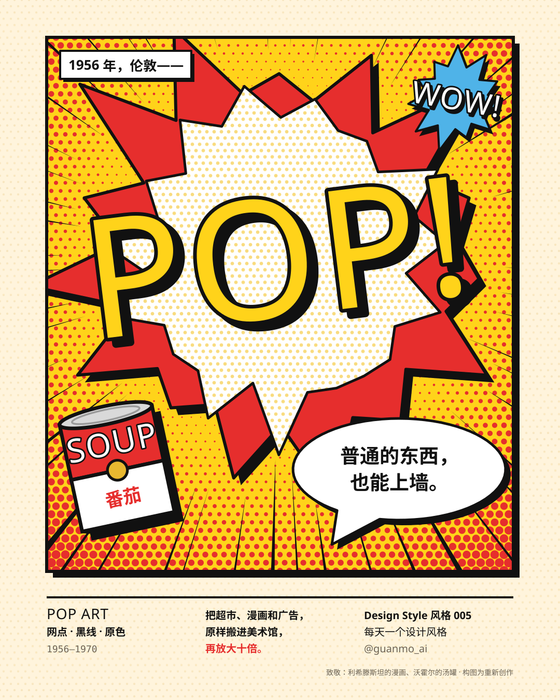
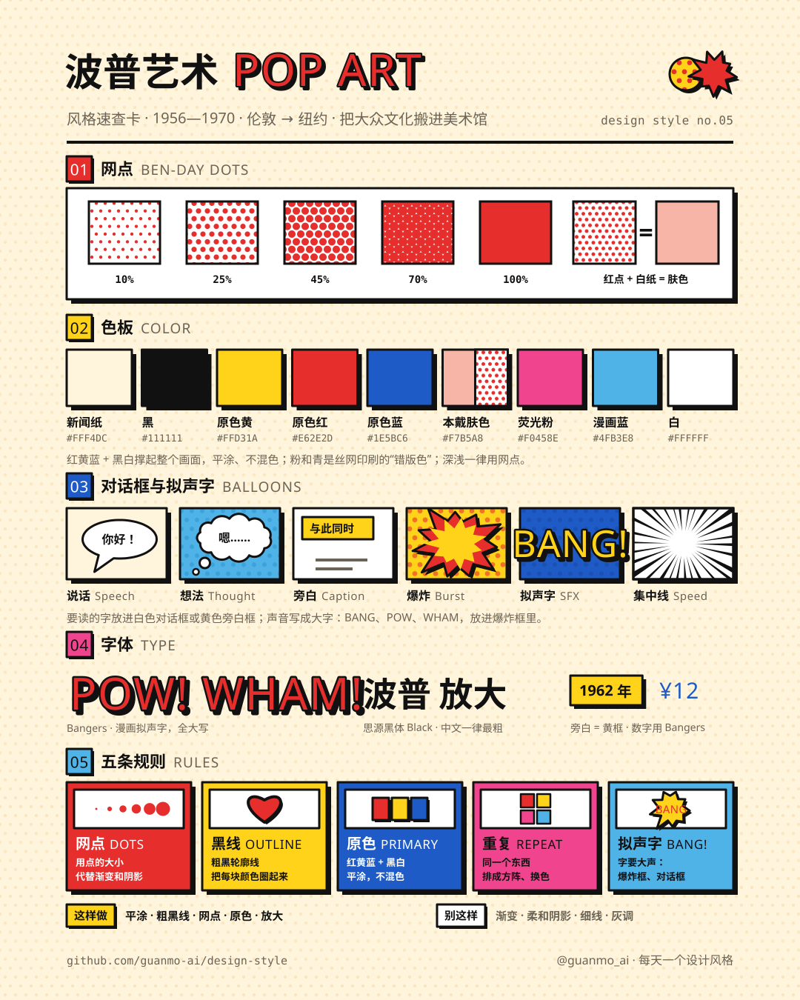
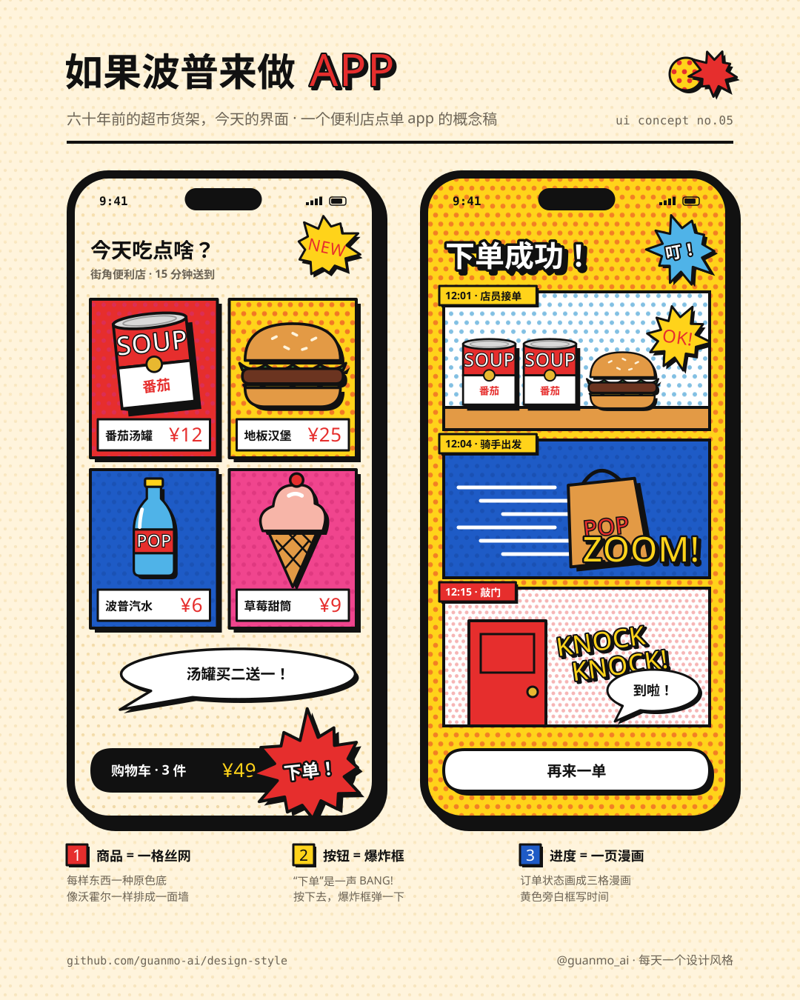
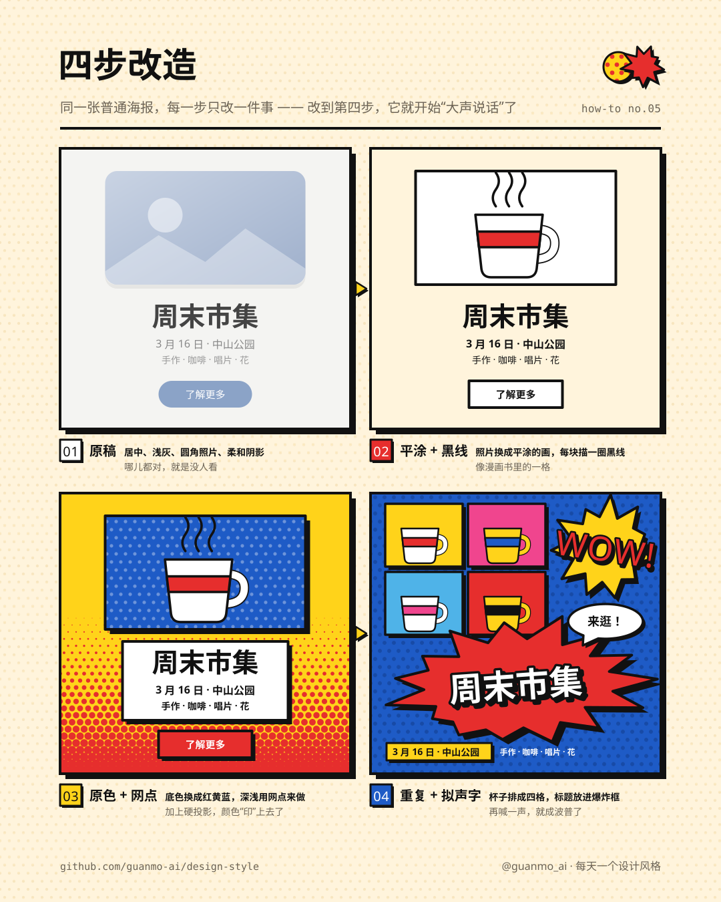

# 005 · 波普艺术 Pop Art（1956—1970）

**中文** · [English](README.en.md)

> **一句话：** 把超市货架、漫画和广告原样放大、印出来——普通的东西，也能上墙。

🎬 [看视频](https://github.com/guanmo-ai/design-style/releases/tag/day-05) · 🛠 [制作过程](PROCESS.md) · 🧰 [从 0 到 1：工具与流程](MAKING.md) · 🖼 [图片源文件](images)

| 海报 | 速查卡 |
|:-:|:-:|
|  |  |
| **如果波普来做 app** | **四步改造** |
|  |  |

---

## 1 · 它从哪来

| 年份 | 事件 |
|---|---|
| **1947—1952** | 爱德华多·包洛奇（Eduardo Paolozzi）把美国杂志上剪下来的广告、漫画拼成一页页拼贴，其中一张《我曾是富人的玩物》（*I was a Rich Man's Plaything*，1947）里，一把手枪冒出一团烟，烟里写着 **POP!**。1952 年，伦敦当代艺术学院（ICA）里的一群年轻人组成“独立小组”（Independent Group），开始认真讨论广告、电影、汽车和家电——那些“不配进美术馆”的东西 |
| **1956.8** | 伦敦白教堂画廊（Whitechapel）的展览 **「这就是明天」**（*This Is Tomorrow*）。理查德·汉密尔顿（Richard Hamilton）为它做了一张不到 A4 大的拼贴：《**是什么让今天的家如此不同、如此吸引人？**》——客厅里有电视、录音机、一罐火腿、墙上挂着漫画，健美先生手里举着一根巨大的棒棒糖，上面写着 **POP**。这张拼贴常被叫作“第一件波普作品” |
| **1957** | 汉密尔顿在一封信里给“波普”下了定义：*大众的、短暂的、可丢弃的、便宜的、批量生产的、年轻的、机灵的、性感的、花哨的、迷人的、大生意*。评论家劳伦斯·阿洛维（Lawrence Alloway）这几年把“Pop”这个词带进了评论里 |
| **1961—1963** | 纽约。罗伊·利希滕斯坦（Roy Lichtenstein）把漫画的一格放大到画布上：《看，米老鼠》（*Look Mickey*，1961）、《溺水的女孩》（*Drowning Girl*，1963）、《轰！》（*Whaam!*，1963）。他连印刷用的**本戴点**（Ben-Day dots，1879 年本杰明·戴发明的网点印刷法）都一颗颗画出来：靠点的大小，画出深浅 |
| **1962** | 波普“爆发”的一年。7 月，安迪·沃霍尔（Andy Warhol）在洛杉矶 Ferus 画廊挂出《**金宝汤罐头**》：32 张画，一张一种口味，像超市货架一样排在一条窄架子上。同年他开始用丝网印刷做《玛丽莲双联画》。克拉斯·奥登伯格（Claes Oldenburg）在纽约的“商店”里卖石膏做的食物，又用帆布塞满泡沫做出《**地板汉堡**》（*Floor Burger*，约 1.3 × 2.1 米）。11 月，西德尼·贾尼斯画廊的「新现实主义者」展让“波普”一夜成名 |
| **1964** | 沃霍尔在纽约成立工作室“工厂”（The Factory），用丝网一张张印《**花**》：一层颜色一张网版，黑版故意对不准。同年罗伯特·劳申伯格（Robert Rauschenberg）拿下威尼斯双年展金狮奖——美国波普走上了世界舞台 |
| **1967—1970** | 彼得·布莱克（Peter Blake）和简·霍沃思（Jann Haworth）做了披头士《佩珀军士》的唱片封面；波普的拼贴、原色和网点进了唱片、海报、杂志和广告。到 1970 年前后，作为一场“运动”的波普散开了，它的方法却留了下来 |
| **之后** | 80 年代凯斯·哈林（Keith Haring）把粗黑线画进地铁；杰夫·昆斯（Jeff Koons）把气球狗做成不锈钢；2000 年村上隆提出“超扁平”。今天的表情包、手机里的“漫画滤镜”、各种联名包装和快闪店——波普变成了每个人手机里的日常 |

**为什么重要：** 在波普之前，“艺术”要画神话、风景、或者抽象的情绪；波普第一次说：**汤罐、汉堡、漫画、明星照片，本身就值得被看**。它借来的不只是题材，还有**印刷的方法**——网点、粗黑线、四色、丝网、重复——让“便宜的东西”有了自己的美学。今天几乎所有“想让人一眼看见”的设计：包装、海报、表情包、电商大促页，都在用它的那几招。

> 这一期只讲设计方法。画面里的拼贴、汤罐、漫画、花和汉堡都是按原作手法重新画的“致敬”，不是原作复刻；汤罐上的字和口味是自拟的，没有使用任何品牌标识。

## 2 · 五条规则

| # | 规则 | 怎么做 | 小心 |
|:-:|---|---|---|
| 01 | **网点** DOTS | 用点的大小代替渐变和阴影：六角排列，点越大颜色越深；白底 + 红点，远看就是“肤色” | 点距要一致；别用透明度或模糊做深浅——那是照片，不是印刷 |
| 02 | **黑线** OUTLINE | 粗黑轮廓线把每块颜色圈起来；加一个往右下的黑色**硬投影**（不模糊）。视频里线 6 / 投影 12，图片里 4 / 8 | 线要粗细一致，像漫画的墨线；别用柔和阴影和发光 |
| 03 | **原色** PRIMARY | 红、黄、蓝 + 黑白，平涂、不混色；加一点沃霍尔的荧光粉和漫画天蓝。一块一种颜色 | 别用渐变，别降饱和度；一个画面 2—3 种原色就够 |
| 04 | **重复** REPEAT | 同一个东西排成方阵、换色复制（汤罐、玛丽莲、花）；丝网的黑版故意错开一点 | 重复的是“同一张图”，变的只有颜色；别每个都画得不一样 |
| 05 | **拟声字** BANG! | 字要大声：POW! WHAM! 放进爆炸框，对话放进白色对话框，旁白放进黄色方框 | 拟声字只用一两个、要短；正文、价格、日期还是好好排在框里 |

## 3 · 色板

| 名称 | HEX | RGB | 建议面积 | 用途 |
|---|---|---|:-:|---|
| 新闻纸 | `#FFF4DC` | 255 244 220 | 25% | 底色。漫画书便宜的纸，偏黄 |
| 原色黄 | `#FFD31A` | 255 211 26 | 18% | 爆炸框、旁白框、大底色 |
| 原色红 | `#E62E2D` | 230 46 45 | 14% | 拟声字、网点、汤罐 |
| 原色蓝 | `#1E5BC6` | 30 91 198 | 12% | 大底色、头发、天空 |
| 黑 | `#111111` | 17 17 17 | 12% | 轮廓线、硬投影、拟声字的边 |
| 白 | `#FFFFFF` | 255 255 255 | 8% | 对话框、网点的“空隙” |
| 漫画天蓝 | `#4FB3E8` | 79 179 232 | 5% | 浅底色、眼泪 |
| 荧光粉 | `#F0458E` | 240 69 142 | 4% | 沃霍尔丝网的“错版色” |
| 本戴肤色 | `#F7B5A8` | 247 181 168 | 2% | 白底上的红点“看起来”就是这个颜色；需要实色时才用 |

> 黑线和网点是波普的“印刷机”：同样的红黄蓝，没有黑线就是儿童画，没有网点就是扁平插画；两样都有，才像是从漫画书里剪下来的。

## 4 · 字体

| 用途 | 本项目 | 商用原版 / 其他选择 |
|---|---|---|
| 拉丁 | **Bangers**（免费，OFL；Vernon Adams 设计的漫画标题字，窄、粗、往上斜） | 漫画对白多是手写字（letterer 一个个写）· Comicraft 的 CC Wild Words / Badaboom · Blambot 的漫画字 · Luckiest Guy（免费） |
| 中文 | **思源黑体 / Noto Sans SC** 500 / 700 / 900（免费，OFL） | 站酷快乐体 · 庞门正道标题体（免费商用） |
| 等宽 | **JetBrains Mono**（免费，OFL） | 年份、时间码、页码 |

**说明：** 拟声字用 Bangers：红字、粗黑边、往右下的硬投影、整体转 −6° 到 −8°。中文用思源黑体 Black 900，放进白色对话框或黄色旁白框里；对话框里的字永远水平、黑色。Bangers 没有中文字，中英混排时中文交给思源黑体；价格里的“¥12”这种短数字可以用 Bangers，读起来更“大声”。

## 5 · 版式参数

**视频（1920×1080，60fps，100 BPM）**
- 节拍：剧本按 120 BPM、**1 拍 = 30 帧**写，成片整体放慢 **1.2 倍**（1 拍 = 36 帧 = 0.6 秒，100 BPM）；开场 4 拍，六章各 3 拍，五条规则 5 拍，片尾 3 拍，换幕都落在拍点上
- 黑线 **6**、硬投影 **(12, 12)**、模糊 0；剪纸拼贴多一圈白边（像从杂志上剪下来的）
- 本戴点：六角排列，点距 **24**（开场主视觉 32），最大半径 = 点距 × 0.6，正好连成一片
- 动作：“拍上去”7 帧从 1.35 倍落到 1；弹出用弹簧过冲；软雕塑落地压扁 **0.34**、其他 0.24
- 转场：下一章的底色以**网点**的形式长出来、连成一片（6 次），或一个**爆炸框**长满全屏（2 次）
- 运动模糊 5 次采样（快门 180°）；胶片颗粒 4%

**图片（1080×1350 竖图）**
- 左右边距 **90**、上下边距 **72**，与 001—004 同一套页眉页脚
- 黑线 **4**、硬投影 **(8, 8)**；本戴点点距 **14**；要读的字一律放在白色对话框或黄色旁白框里
- 字宽按 Bangers / 思源黑体指定字重的真实度量计算；底色铺一层淡淡的网点

## 6 · 这样做 / 别这样

**✅ 这样做：** 用网点代替渐变 · 每块颜色都圈一道粗黑线 · 红黄蓝平涂 · 同一张图换色重复 · 拟声字放进爆炸框 · 选一样“普通的东西”当主角，放大
**❌ 别这样：** 渐变和柔和阴影 · 细线和发丝线 · 低饱和的“高级灰” · 拟声字满屏都是 · 把正文压在网点上 · 用真实品牌的标识

## 7 · 其他误区

- **波普不是从美国开始的。** 名字和第一批作品都来自 50 年代的伦敦（包洛奇、汉密尔顿、独立小组）；60 年代的纽约（沃霍尔、利希滕斯坦、奥登伯格）让它变得世界闻名。
- **网点不是装饰花纹。** 本戴点是便宜印刷用来“做出深浅”的办法；利希滕斯坦把它放大，是为了让人看见“图像是怎么被印出来的”。点的大小要有变化、要表达深浅，不是铺一层圆点就算波普。
- **不等于“孟菲斯”。** 两者都有粗黑线和硬投影：孟菲斯是糖果色的几何积木（家具），波普是原色 + 网点 + 拟声字（印刷品）。
- **不只是“赞美消费”。** 波普借用广告和明星的样子，态度却常常是冷静、重复、甚至有点讽刺的——沃霍尔把同一个汤罐画 32 遍，你很难说他是在夸还是在笑。

## 8 · AI 提示词（直接复制）

**图片（Midjourney / 即梦 / ChatGPT 图像）**

```
Pop Art comic book poster, 1960s, homage to Roy Lichtenstein and Andy Warhol, a huge white explosion burst with the word POP! in red
comic lettering with a thick black outline, radiating red Ben-Day dots on a primary yellow background that get smaller toward the edges,
speed lines, a speech bubble with short text, a repeated soup can grid in different colors, every shape flat primary color with a thick
uniform black ink outline and a hard black offset shadow (no blur), halftone dots instead of gradients, newsprint paper #FFF4DC,
colors #FFD31A #E62E2D #1E5BC6 #F0458E #4FB3E8 #111111, flat vector, no gradients, no soft shadows, no 3D, no brand logos --ar 4:5
```

**视频（Runway / 可灵 / Sora）**

```
Motion graphics in 1960s Pop Art comic style: red Ben-Day dots grow across a yellow page, an explosion burst slams in with the word POP!,
magazine cut-outs slap onto a collage one by one, 32 soup cans pop up in a grid and flip to new colors on the beat, a camera zooms out
from a few red dots to a crying comic girl, a squeegee pulls a silkscreen print in two passes with the black plate slightly off-register,
a giant soft burger drops and squishes, a phone fills with speech bubbles and POW!. Thick black outlines, hard offset shadows,
transitions made of halftone dots growing into a solid color, 100 bpm 60s surf rock, flat 2D, no gradients, no 3D render.
```

**代码（让 AI 写网页 / 组件）**

```
用波普艺术风格做这个界面：背景 #FFF4DC（铺一层 radial-gradient 小网点），文字 #111111，原色 #FFD31A #E62E2D #1E5BC6，点缀 #F0458E #4FB3E8。
字体 Bangers（拟声字、英文标题）+ Noto Sans SC（中文标题 900，正文 500）。
每个卡片、按钮、标签：border: 4px solid #111；box-shadow: 6px 6px 0 #111（不模糊）。
深浅用网点：background-image: radial-gradient(#E62E2D 30%, transparent 31%); background-size: 14px 14px；不用渐变。
重要按钮做成爆炸框（clip-path 多边形）或白色对话框（带尖尾巴）；拟声字（POW! NEW! ¥12）用 Bangers、红字黑边、rotate(-6deg)。
正文、价格、日期保持水平，放在白色或黄色方框里。元素出现用“拍上去”（scale 1.35 → 1，7 帧）。设计令牌见 tokens.css。
```

## 9 · 18 秒分镜

波普最有用的一招，是“**用网点代替渐变，用粗黑线把每块颜色圈起来**”——同样的红黄蓝，这样处理之后就从“扁平插画”变成了“从漫画书里剪下来的”。短片里所有东西都是这样印出来的：拼贴拍上桌、汤罐一排排换色、镜头从几颗红点拉远成一张漫画脸；每次换幕，都是下一章的颜色以网点的形式长出来。配乐是 100 BPM 的 60 年代冲浪摇滚，音效全是漫画里的“砰”“啵”“POW”。

<a href="https://github.com/guanmo-ai/design-style/releases/tag/day-05"></a>

| 时间 | 帧 | 章节 | 画面 | 致敬 |
|---|---|---|---|---|
| 0:00—2.4 | 0—144 | 开场 | 黄底上红色网点从左往右长出来，集中线射出；1.2 秒爆炸框“砰”地砸下来，POP! 弹出；标签「POP ART · 波普艺术 · 1956—1970 · 伦敦 → 纽约」；爆炸框长满全屏转场 | 包洛奇 · 拼贴里的 POP!（1947） |
| 2.4—4.2 | 144—252 | 01 拼贴 | 墙、地板、墙上的漫画、电视机、沙发、一罐火腿一块块“拍”上来；巨大的棒棒糖滑进来，上面写着 POP；杂志标题「是什么让今天的家如此不同、如此吸引人？」 | 汉密尔顿 · 拼贴画（1956，展览「这就是明天」） |
| 4.2—6.0 | 252—360 | 02 汤罐 | 32 个汤罐沿对角线一排排弹出来，一罐一种口味；拍点上一列列翻面换色，收银机“叮” | 沃霍尔 · 32 罐汤（1962） |
| 6.0—7.8 | 360—468 | 03 网点 | 镜头放大 9 倍，只看得到几颗红点；拉远后才看出是一张漫画女孩的脸，一滴眼泪滑下来；对话框「原来……全是点？」，放大镜里全是红点 | 利希滕斯坦 · 放大的漫画（1961—1963） |
| 7.8—9.6 | 468—576 | 04 丝网 | 四张白纸，刮板往右刮出颜色版，再往左刮出黑版——黑版故意错开一点 | 沃霍尔 · 《花》（1964） |
| 9.6—11.4 | 576—684 | 05 放大 | 面包、肉饼、芝士、生菜、面包盖五层软软地落下来，整个汉堡“噗叽”一下；旁边一个 1.7 米的人，汉堡宽 2.1 米 | 奥登伯格 · 《地板汉堡》（1962） |
| 11.4—13.2 | 684—792 | 06 今天 | 手机落地，群聊「周末吃啥？」里对话框弹出、POW!、一张漫画滤镜照片、通知「你的联名款汉堡已出餐」；表情包 / 漫画滤镜 / 联名包装三张标签一拍一张 | 今天的表情包、滤镜与联名 |
| 13.2—16.2 | 792—972 | 五条规则 | 网点 / 黑线 / 原色 / 重复 / 拟声字，五张卡片八分音符一张拍下来，每张卡用自己的方法演示自己 | — |
| 16.2—18.0 | 972—1080 | 片尾 | 开场的爆炸框再砸一次，对话框「普通的东西，也能上墙。」 | — |

> 画面中的拼贴、汤罐、漫画、花和汉堡都是按原作手法重新画的“致敬”，不是原作复刻；汤罐口味、群聊和 app 概念图里的商品、价格都是虚构的。

## 10 · 文件

```
005-pop-art/
├─ PROCESS.md                             # 制作过程
├─ MAKING.md                              # 从 0 到 1：用了哪些工具、按什么顺序、敲什么命令
├─ process/                               # 过程图：成片联系表 · 开场拆解 · 转场链 · 节拍时间轴 · 制作流程图
├─ tokens.ts / tokens.css / tokens.json   # 同一份设计令牌（颜色与面积、字体、黑线与投影、网点、节拍）
├─ video/PopArt.tsx                       # 短片主合成：一张 SVG 舞台按时间窗挂载各章、底栏、整体放慢 1.2 倍、运动模糊、颗粒、配乐（Remotion，React）
├─ video/timeline.ts                      # 各章起点（剧本帧）、总长与放慢倍数 STRETCH
├─ video/opening.tsx                      # 开场（网点 → 爆炸框 POP!）+ 01 拼贴；片尾复用同一个主视觉
├─ video/chapters.tsx                     # 02 汤罐 · 03 网点 · 04 丝网
├─ video/finale.tsx                       # 05 放大 · 06 今天 · 五条规则 · 片尾 · 底栏
├─ video/ui.tsx                           # 网点 Dots、爆炸框 burstD、对话框 Bubble、旁白框 Box、拟声字 Bang、拍上去 Slap、网点 / 爆炸框转场
├─ video/cover.jpg                        # 视频封面
├─ audio/make_music.py                    # 配乐：numpy 合成，100 BPM，C 大调 60 年代冲浪摇滚，-14 LUFS
└─ images/
   ├─ make_svgs.py    # 四张图的生成脚本：网点、爆炸框、对话框、旁白框，字宽按 Bangers / 思源黑体的真实度量计算
   ├─ poster.svg      # 海报
   ├─ cheatsheet.svg  # 速查卡
   ├─ app-ui.svg      # 如果波普来做 app：便利店点单
   ├─ steps.svg       # 四步改造：普通海报 → 波普
   └─ preview/        # 内嵌字体的自包含 SVG
```

**延伸阅读：** Lucy R. Lippard《Pop Art》（1966）· Tilman Osterwold《Pop Art》（Taschen）· Hal Foster《The First Pop Age》（2012）· Tate、MoMA、Whitechapel Gallery 的线上馆藏与展览档案
