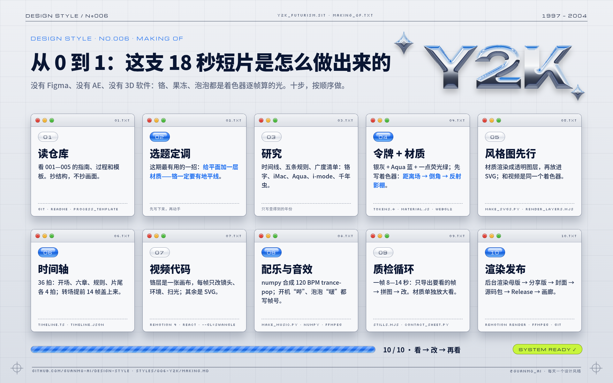

# 006 · 千禧未来主义 Y2K · 从 0 到 1：这支视频是怎么做出来的

> [`PROCESS.md`](PROCESS.md) 讲**设计上怎么想**：为什么这样选、哪里推翻重来。这份讲**动手怎么做**：用了哪些工具、按什么顺序、每一步敲什么命令、做到什么程度才算过关。
> 照着这份做，可以从一个空文件夹做出同样规格的一期：18 秒 · 1920×1080 · 60fps 短片，加上 4 张风格图、指南和过程文档。

🎬 [看成片（Releases · day-06）](https://github.com/guanmo-ai/design-style/releases/tag/day-06) · 📐 [风格指南](README.md) · 🛠 [制作过程](PROCESS.md) · 📦 源码包：Release 附件 `006-y2k-source.zip`



---

## 0 · 先说结论：这一期是怎么“做”的

- **全部是代码。** 没用 Figma、After Effects、Blender / C4D，也没用素材库、AI 生图或现成音乐。铬字、果冻、泡泡和玻璃不是贴图，而是一个 WebGL2 着色器**逐帧算出来的光**；其余每个窗口、按钮、像素、每一声“哔”都由仓库里的源码生成，改一个数字就能重出。
- **谁做的。** 这一期由 AI 智能体（Notion AI）在一台 Linux 沙盒里完成：读仓库、查资料、写代码、渲染、看图、改版、写文档。人负责定方向、审稿（本期第一版候选图被评价“比较普通”，于是推翻重做，先写材质渲染器；Aqua 窗口里的中文译文也按审稿意见删掉，只留英文原话）和最终确认发布。
- **为什么用代码做。** ① 可复现：别人 `git clone` 下来就能重出一模一样的成片；② 可精确：铬的色标、倒角 26、细条纹 2px、网格 80px、一拍 30 帧，全都是写死的数字；③ 一份代码两处用：视频里的铬和风格图里的铬是**同一个着色器**画的，不会“视频一个样、图片另一个样”。
- **顺序。** 文字 → 令牌 → **材质** → 静态图 → 时间轴 → 动画 → 声音 → 质检 → 发布。**先把光做对，再把静止的画面做对，最后让它动。**

## 1 · 工具箱

| 环节 | 工具 | 版本（本期） | 用来做什么 | 费用 |
|---|---|---|---|---|
| 视频 | [Remotion](https://www.remotion.dev) + React + TypeScript | 4.0.538（成片在 4.0.454 上渲染，升级后抽帧核对一致） | 用 React 组件写视频：每一帧都是 `frame → 画面` 的函数；SVG 画界面，`<canvas>` 画材质；`@remotion/fonts` 加载字体 | 个人与小团队免费（[许可](https://www.remotion.dev/license)） |
| 材质 | WebGL2 着色器（手写，`video/material.js`） | — | 距离场 → 倒角高度场 → 法线 → 铬 / 果冻 / 泡泡 / 玻璃；没有显卡时用 SwiftShader 在 CPU 上跑（`--gl=swangle`） | 免费 |
| 运行环境 | Node.js · Python | 24 · 3.13 | Node 跑 Remotion 与截图脚本；Python 写图片、配乐、过程图 | 免费 |
| 风格图 | Python 手写 SVG · Pillow | — | 按公式输出 SVG（窗口、果冻按钮、进度条、刻度、条形码）；用真实字体度量算字宽；材质部分写成图层参数 JSON | 免费 |
| 渲染图片 | Playwright + Chromium | — | 用视频的着色器把材质图层渲染成透明 WebP；把 SVG 渲染成 2x PNG；导出视频关键帧；把流程图 HTML 截成 PNG | 免费 |
| 配乐 | numpy | — | 从零合成 supersaw 铺底、侧链“呼吸”、四拍底鼓、FM 玻璃钟，以及开机“哔”、调制解调器、泡泡“啵”、8-bit 琶音……没有任何外部音源 | 免费 |
| 音视频处理 | [ffmpeg](https://ffmpeg.org) | 7.0 | 响度测量（loudnorm）、精确抽帧、封面、压分享版 | 免费 |
| 过程图 | Pillow · matplotlib | — | 联系表、时间轴图、拼图 | 免费 |
| 字体 | [Unbounded](https://fonts.google.com/specimen/Unbounded) · [Michroma](https://fonts.google.com/specimen/Michroma) · [Silkscreen](https://fonts.google.com/specimen/Silkscreen) · [Noto Sans SC](https://fonts.google.com/noto/specimen/Noto+Sans+SC) · [Inter](https://rsms.me/inter/) | — | 宽体标题；科技小字；像素读数；中文黑体；界面西文。都是 OFL，可商用 | 免费 |
| 版本管理 | git · GitHub | — | 一期一个分支；视频与源码包放 Releases；画廊由 GitHub Pages 自动发布 | 免费 |

全部开源或免费，一台没有显卡的 2 核机器就能跑完整个流程——只是这一期整片要渲染一个多小时。

## 2 · 准备环境（10 分钟）

```bash
git clone https://github.com/guanmo-ai/design-style.git && cd design-style
npm ci                          # 按 package-lock.json 安装 Remotion 等
npm run fonts                   # 字体下载到 public/fonts（不入库；本期新增 Unbounded、Michroma、Silkscreen）
pip install numpy fonttools pillow matplotlib
npx playwright install chromium # 或用系统 Chromium：export CHROMIUM_PATH=$(which chromium)
npm run studio                  # 浏览器里逐帧预览，确认环境可用（选 S006-Y2K；有显卡时材质是实时的）
```

## 3 · 十步，从 0 到 1

每一步都写了：**做什么 → 产出 → 过关标准**。过关了再进下一步，返工最少。

### 01 · 读仓库（抄结构，不抄画面）

- **做什么：** 通读 001—005 的 `README.md`、`PROCESS.md`、`MAKING.md`、`tokens.*`、`video/` 和 [`docs/PROCESS_TEMPLATE.md`](../../docs/PROCESS_TEMPLATE.md)、[`docs/GALLERY.md`](../../docs/GALLERY.md)。列出每期都有的东西：60fps / 一整首配乐 / 4 张 1080×1350 图 / 统一的页眉页脚 / 指南 10 节 / 过程文档。
- **产出：** 一份“这一期必须有什么”的清单。
- **过关：** 新的一期放进目录里，和前几期并排看像是一个系列。

### 02 · 选题与“最有用的一招”

- **做什么：** 写出一句话定义，再写出**这一期观众能带走的一招**。本期是：*给平面加一层材质——铬一定要有地平线。*
- **产出：** 写在 `PROCESS.md` §1 的三行字。
- **过关：** 后面每一个画面、每一张图，都能回答“它在演示哪一招”。答不上来的画面删掉。

### 03 · 研究：先列清单，再动手

- **做什么：** 时间线（只写查得到的日期；本期特别核对了 iMac G3 的**发布日 1998.5.6 和上市日 1998.8.15**、Aqua 的发布日 **2000.1.5**、乔布斯原话的出处《财富》2000.1.24、MoMA 收藏的是 **176 个原版**表情）→ 5 条可执行的规则（铬 / 果冻 / 技术感的底 / 像素字 + 宽体字 / 大面积银）→ **广度清单**：铬字、iMac、Aqua、i-mode 表情、千年虫、Liquid Glass → 常见误区（Y2K ≠ 赛博朋克 ≠ 蒸汽波 ≠ Frutiger Aero；铬不是灰色）。
- **产出：** `README.md` §1—§7 的草稿。广度清单直接变成视频的六章。
- **过关：** 每个人名、产品名、日期都能对上来源。

### 04 · 设计令牌 + 材质渲染器：先把“光”做对

- **做什么：** 银灰铝面 + Aqua 蓝 + 一点荧光绿（含面积比例）、字体、细条纹与网格、节拍，写进 `tokens.ts`（视频用）、`tokens.css`（网页用）、`tokens.json`（画廊与 AI 用）。然后写这一期最关键的一份代码：`video/material.js`。
- **关键代码 ①：形状 → 高度场。** 字画进掩码，用欧氏距离变换算出“离边缘多远”，再按圆角倒角的公式变成高度——边缘是一圈 1/4 圆，中间是平的：
  ```js
  // video/material.js：距离 d（像素）→ 高度 h；Rb = 倒角半径（默认 26）
  const dist = insideDist(alpha, W, H);                 // Felzenszwalb 精确 EDT，两遍一维
  for (let i = 0; i < W * H; i++) {
    const t = Math.min(Math.max(dist[i], 0) / Rb, 1);
    hgt[i] = Rb * Math.sqrt(1 - (1 - t) * (1 - t));     // 1/4 圆的倒角
  }
  ```
- **关键代码 ②：铬 = 反射一个“影棚”。** 每个像素按法线反射视线，查一个程序化环境：上半是天空，地平线发白（HDR，亮度 > 1），地平线下一点点就变暗：
  ```glsl
  vec3 envStudio(vec3 r){
    float el = r.y;                                     // 反射方向的仰角
    if (el > 0.0) {                                     // 天空：地平线白 → 天蓝 → 深蓝
      col = mix(skyHor, skyMid, smoothstep(0.0, 0.30, el));
      col = mix(col, skyTop, smoothstep(0.25, 0.9, el));
      col += softboxes(el, az);                         // 四块柔光箱 = 字面上那几条亮带
    } else {                                            // 地面：一过地平线就暗
      col = mix(floorHor, floorBot, pow(-el, 1.1));
    }
    col += vec3(1.8, 1.9, 2.1) * exp(-abs(el) * 70.0);  // 地平线那一条最亮的线
    return col;
  }
  ```
  果冻（折射 + 按厚度吸收 + 焦散 + 硬边高光）、泡泡（薄膜干涉彩虹）、玻璃（圆角透镜 + 色散 + 边缘高光）在同一个着色器里，用 uniform 传进位置和颜色。
- **过关：** 把铬字单独截出来，不需要说明也认得出是金属；果冻球后面的网格在球里是弯的；`tokens.css` 的平面版铬字（同一套色标的 `background-clip: text`）放在网页里也像样。

### 05 · 风格图先行（先把静止的画面做对）

- **做什么：** `images/make_svgs.py` 一次生成 4 张 SVG（海报 · 速查卡 · 半透明手机 app · 四步改造）。需要材质的地方写一份图层参数 `layers/<名字>.json`，SVG 里放 `<image href="layers/<名字>.webp">` → `images/render_layers.mjs` 打开 `layer.html`，用**视频的同一份** `material.js` 把图层渲染成 2 倍、透明背景的 WebP → `scripts/build_images.py`（本期给 `FACES` 加了 Unbounded / Michroma / Silkscreen，并让 .png / .webp 图层保留透明）子集化字体、把字体和图层内嵌进 `preview/*.svg` → Chromium 渲染 2x PNG。
  ```bash
  npm run images:006
  # = python3 styles/006-y2k/images/make_svgs.py          # SVG + layers/*.json
  #   node styles/006-y2k/images/render_layers.mjs        # layers/*.webp（一张 10—30 秒）
  #   python3 scripts/build_images.py styles/006-y2k/images
  ```
- **要点：** 同样的铬星星（不同大小）复用同一个图层文件；果冻按钮、进度条这些“平面版材质”用矢量渐变画（中线断开 + 上半截高光），和渲染出来的铬放在一起也不违和。
- **过关：** 缩小到 900px 看，铬一眼就是金属、主角只有一个；放大到 2x 看，图层边缘没有白边，没有溢出。

### 06 · 时间轴：先写节拍，再写动画

- **做什么：** 120 BPM、60fps → 1 拍 = 30 帧。1080 帧 = 36 拍：开场、六章、五条规则、片尾各 4 拍。这一期不放慢——每段 2 秒，信息足够看清。
- **转场提前盖：** 下一幕提前 `TR = 14` 帧开始盖上来，正好在拍点上盖满；所以每章的小标题提前 8 帧、大标题提前 4 帧开始出现，盖满时已经可以读。
  ```ts
  // video/timeline.ts
  export const AT = {open: 0, chrome: 120, jelly: 240, aqua: 360, emoji: 480, bug: 600, today: 720, rules: 840, end: 960};
  export const DURATION = 1080;
  export const TR = 14;
  ```
- **产出：** `video/timeline.ts`（代码用）+ `process/timeline.json`（画图、画廊用）。
- **过关：** 每次换幕都落在拍点上；每章只有一个主角、一种材质。

### 07 · 视频代码：SVG 画界面，画布画材质

- **文件结构：**

  | 文件 | 内容 |
  |---|---|
  | `video/Y2K.tsx` | 总装：按时间窗挂载各章，每章一层 `clip-path` 做转场；页眉页脚、颗粒、配乐 |
  | `video/material.js` | 材质着色器（视频、风格图、流程图共用） |
  | `video/ui.tsx` | 本期的“工具箱”：底（细条纹 + 网格 + 套准标记）、页眉页脚 `Hud`、铬画布 `Chrome`、铬精灵 `Sprite`、窗口、果冻按钮、进度条 `Loader`、药丸 `Pill`、像素表情 `Emoji`、打字 `typed`、转场 `wipeClip` / `WipeEdge` |
  | `video/opening.tsx` | 开场（开机 → 铬字 Y2K）+ 01 铬 |
  | `video/chapters.tsx` | 02 果冻 · 03 Aqua · 04 表情 · 05 千年虫 |
  | `video/finale.tsx` | 06 今天 · 五条规则 · 片尾 |
  | `src/Root.tsx` | 注册 `S006-Y2K` |

- **铬层是怎么接进 Remotion 的：** 一个 `<canvas>`，`useLayoutEffect` 里同步调用 `Y2K.draw()`；字的形状不变时高度场只算一次（缓存），之后每帧只改 uniform——镜头高度、环境旋转、扫光、果冻和泡泡的位置：
  ```tsx
  export const Chrome = ({cfg}) => {
    const ref = useRef<HTMLCanvasElement>(null);
    const key = JSON.stringify(cfg);
    useLayoutEffect(() => { if (ref.current) Y2KM.draw(ref.current, cfg); }, [key]);
    return <canvas ref={ref} style={{position: 'absolute', width: cfg.w, height: cfg.h}} />;
  };
  // 开场：镜头高度慢慢下移 → 地平线在字上滑；落地后扫光扫过
  const cfg = base({cam: [960, -hy, 1400], envRot: 0.1 + f * 0.0016,
                    sweep: [lerp(-1.4, 1.6, tween(f, land + 2, 34, 0, 1, E.inOut)), f > land ? 1 : 0], texts: [HERO]});
  ```
- **一个转场是怎么写出来的：** 下一幕整层盖上来，形状由 `clip-path` 决定；泡泡 / 果冻是一个从某点放大的圆，地平线是从上往下的 `inset`，玻璃从左往右，像素是 80px 网格的方块按随机顺序点亮，故障是 30px 的横条 + 横向抖动；`WipeEdge` 再沿边缘画一圈彩虹膜、蓝边、亮线或折射边。
- **三条让动效“顶尖”的做法：**
  1. **光是活的。** 静止的铬看起来像贴图；镜头一动、地平线在字上一滑，它才是金属。所以每个铬镜头都有一点慢慢的移动或旋转，落地时再加一道扫光。
  2. **转场用这个风格自己的东西。** 泡泡、地平线、果冻、像素、故障、玻璃——8 次换幕没有一次硬切，也没有一次重复同一个“方向”。
  3. **一个动作配一个“电脑声”。** 开机“哔”、进度条“滴”、泡泡“啵”、像素 8-bit 琶音、零点的钟——画面上发生的事，耳朵里也听得到。
- **过关：** `npm run studio` 里逐帧拖，任何一帧截下来都能当海报。

### 08 · 配乐与音效：和画面共用帧号

- **做什么：** `audio/make_music.py` 用 numpy 合成一整首 F 大调 120 BPM 的 trance-pop。音效直接写**帧号**，和画面用同一套数字：
  ```python
  def fr(frame):                    # 帧 → 秒
      return frame / 60.0

  sfx(blip(1000, 0.12, False) * 0.6, fr(2), 0.35)    # 开机“哔”
  sfx(bloop(220, 900, 0.18), fr(44), 0.28, 0.6)      # 大泡泡鼓起来
  for i in range(10):                                # 进度条：每一格一声小“滴”
      sfx(blip(1800 + i * 60, 0.02), fr(60 + i * 5), 0.05, 0.6)
  ```
- **响度：** 合成后用 ffmpeg loudnorm 测量、迭代到 **−14 LUFS**，真峰值 < −1 dBTP。
  ```bash
  npm run music:006   # → public/006-y2k/music.wav
  ```
- **过关：** 每一次落地、弹出、点亮都有声音；一整首，不是几段拼起来。**要有人戴耳机听一遍。**

### 09 · 质检循环：看 → 改 → 再看

这一期一帧要 8—14 秒（着色器在 CPU 上软件渲染），所以“只看要看的帧”更重要：

```bash
CHROMIUM_PATH=$(which chromium) node out/stills.mjs S006-Y2K 8,30,112,232,352,472,592,712,832 out/check   # 打包一次，只出这几帧
python3 scripts/contact_sheet.py out/sheet.jpg --cols 5 \
  "out/check/f030.png|f030 落地" "out/check/f112.png|f112 泡泡转场" ...      # 拼成一张图看
```

- 动作至少看起点、中间、终点三帧——**转场的中间帧、砸下来的那一帧、果冻弹到最高的那一帧最容易出事**。
- 材质单独放大到 200% 看：倒角边缘有没有台阶、地平线是不是一条锐利的线。
- 成片出来后：`contact_sheet.py --video` 精确抽帧做联系表，`timeline_chart.py` 叠上配乐波形检查剪辑点是否落在拍子上，`ffprobe` 核对规格（1920×1080 · 60fps · 1080 帧 · H.264 + AAC · yuv420p）。
- 改版记录写进 `PROCESS.md` §6：位置 · 问题 · 诊断 · 改了什么。

### 10 · 渲染与发布

```bash
npm run render:006    # 配乐 + 母版：out/006-y2k-master.mp4（crf16，--gl=swangle，放后台）
ffmpeg -i out/006-y2k-master.mp4 -vf "scale=in_range=full:out_range=tv,format=yuv420p" \
  -c:v libx264 -preset slow -crf 18 -profile:v high -c:a aac -b:a 192k -movflags +faststart \
  out/006-y2k.mp4                                    # 分享版（各平台都能播）
ffmpeg -i out/006-y2k.mp4 -vf "select=eq(n\,100)" -frames:v 1 -q:v 2 styles/006-y2k/video/cover.jpg   # 封面
```

1. 过程图：联系表、开场拆解、转场链、时间轴、流程图 → `process/`（流程图 `05-workflow.html` 右上角的铬字也是用 `material.js` 实时算的）。
2. 提交：一期一个分支，视频不进 git；做到一半就先推一个 WIP 分支。
3. 源码包：`git archive` 打出本期的源码（含共享脚本和工具清单）→ `006-y2k-source.zip`。
4. Release：tag `day-06`，上传 `006-y2k.mp4` 和源码包，正文附 SHA-256。
5. 画廊：向 `gallery/data/works.json` 添加条目（SHA-256 与 Release 一致），运行 `npm run gallery:readme`、`gallery:test`、`gallery:build`、`gallery:check`。

## 4 · 和 AI 一起做：开工提示词

这一期就是由 AI 智能体做的。想让 AI 帮你做下一期，可以从这段开始（把风格名换掉）：

```text
你在 design-style 仓库里做第 NNN 期：「风格名」。
1. 先读 styles/001—006 的 README.md、PROCESS.md、MAKING.md 和 docs/ 下的模板，列出每期必须有的产出。
2. 写一句话定义和「这一期观众能带走的一招」，之后所有画面都围着它。
3. 研究：时间线（只写能查证的，发布 / 上市 / 首展分开写）、3—5 条可执行规则、广度清单（≥6 个领域）、常见误区。
4. 先写 tokens（颜色+面积比、开源字体、线宽、BPM 换算成帧）。如果这个风格的核心是材质（金属、玻璃、塑料），
   先写一个能复用的渲染器把材质做对，视频和图片共用它；不要用渐变冒充材质。
5. 用 Python 生成 4 张 1080×1350 SVG；再写 timeline（每段几拍、换幕落在拍点），再写 Remotion 组件；
   转场用这个风格自己的元素接力，不硬切。
6. numpy 合成一整首配乐，音效写帧号，响度 −14 LUFS。
7. 每改一处只导出受影响的帧检查，转场必看中间帧；把改版记录写进 PROCESS.md。
8. 每完成一步就本地提交，并尽早推一个 WIP 分支到远端。
9. 交付：分享版 MP4、封面、process/ 过程图、README / PROCESS / MAKING 三份文档、源码包、gallery 条目。
```

**和 AI 协作的经验：**
- **说“普通”就推翻重来。** 本期第一版候选图被说“比较普通”，原因不在排版，而在材质是假的；与其一点点调渐变，不如退一步先把渲染器写出来。
- **让 AI 看图，而不是只看代码。** 每一轮都导出截图让它自己检查；本期开场前 16 帧是空的、章节标题比转场晚半拍、暂停符号被高光吃掉，都是“看图”发现的。
- **给数字，不给形容词。** “铬再亮一点”不如“地平线 HDR 1.4、49% → 51% 断开”；“标题早一点”不如“提前 8 帧”。
- **人来听声音、看语气。** AI 能测响度、对齐拍点，但“好不好听”“这句中文怪不怪”要人来判断。

## 5 · 投入与产出

| 项 | 数字 |
|---|---|
| 源码 | 视频约 1,390 行 TS + 材质着色器约 380 行 JS/GLSL · 配乐约 450 行 Python · 风格图约 770 行 Python |
| 外部素材 | 0（没有照片、没有 3D 模型、没有音源、没有 AI 生图） |
| 单帧预览 | 每帧 8—14 秒（CPU 软件渲染 WebGL） |
| 整片渲染 | 2 核、无显卡的机器约 1.5 小时（铬、果冻、泡泡逐帧算光） |
| 风格图图层 | 18 个透明 WebP，每个 10—30 秒 |

## 6 · 文件地图

```
styles/006-y2k/
├─ README.md        # 风格指南：历史 · 规则 · 色板 · 字体 · 版式 · 误区 · 提示词 · 分镜
├─ PROCESS.md       # 制作过程：怎么想、哪里推翻重来
├─ MAKING.md        # 本文：用什么工具、按什么顺序、敲什么命令
├─ tokens.{ts,css,json}
├─ video/           # Remotion 源码 + material.js（材质着色器）+ cover.jpg
├─ audio/make_music.py
├─ images/          # make_svgs.py → *.svg + layers/*.json → render_layers.mjs → layers/*.webp → preview/（内嵌）→ png/（2x）
└─ process/         # 01 联系表 · 02 开场拆解 · 03 转场链 · 04 时间轴 · 05 本文流程图（.html 源文件可改）
```
